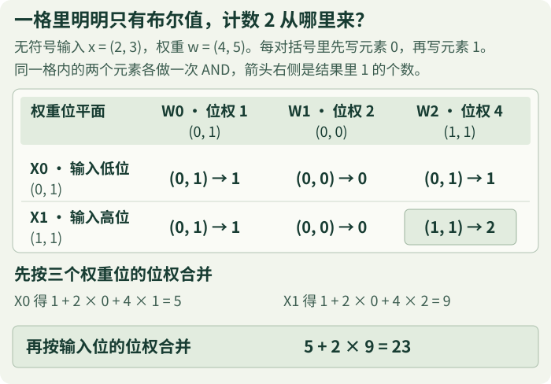

# 阵列每列只输出一位，怎样靠计数算出 2×4 + 3×5？

在[上一种算法](./analog-cim-fundamentals.md#two-input-planes)里，权重 4 和 5 可以留在两个多级电导中。送入两个输入的高位 `(1,1)`，列电流就代表 `4＋5＝9`。现在换一块只能逐位求与的 SRAM。它的一列一次只能回答「这两个比特都是 1 吗？」一个列输出只有 0 或 1，怎么可能得到 9，更不用说最后的 23？

先抓住无符号二进制乘法最小的一步。拿两个单独的比特相乘，`0×0`、`0×1`、`1×0` 都是 0，只有 `1×1` 是 1。这四种情况正好构成 AND（按位与）的真值表。于是硬件可以**先求出一对比特的乘积，后面再把这两个比特所在的位置算进去**。

## 输入和权重各拆几行，哪两格必须对齐？ {#and-and-count}

把点积写成两项：第 0 项是 `2×4`，第 1 项是 `3×5`。两项分别占第 0、1 列。输入用两位无符号数 `10₂`、`11₂`，权重用三位无符号数 `100₂`、`101₂`。取出所有输入的同一位组成一行，叫一个**输入位平面**；同样地，每个**权重位平面**也单占一行。下标从最低位 0 开始。

| 写进 SRAM 的哪一行 | 第 0 列：2 配 4 | 第 1 列：3 配 5 | 这一行的位权 |
| --- | --- | --- | --- |
| `X₀`，输入低位 | 0 | 1 | 1 |
| `X₁`，输入高位 | 1 | 1 | 2 |
| `W₀`，权重低位 | 0 | 1 | 1 |
| `W₁`，权重中位 | 0 | 0 | 2 |
| `W₂`，权重高位 | 1 | 1 | 4 |

例如 `W₀=(0,1)`，因为 4 的最低位是 0，5 的最低位是 1。列顺序要从写入一直保持到读出。若只把权重两列对调，阵列算的会变成 `2×5＋3×4＝22`；后面的计数器照常工作，也没法察觉配对被换了。

## 两个相与结果究竟从哪里出来？ {#two-independent-columns}

用一个已经有实物依据的读法。Jeloka 等的可配置 6T SRAM 为同一行分别设置左右两条字线。做 AND 时，只打开两个操作数所在行的**右字线**，其他行不参与。对某一列，两格只要有一格为 0，就会把该列的真值位线从预充高电平往下拉。列末的感测电路在规定时刻判决，只有两格都为 1 时，这一列才输出 1。每一列都有自己的位线与判决路径。普通单行差分读的过程和这个模式的感放接法，在介质篇中有电路图。[SRAM 两行 AND 的接线](../02-memory-technologies/sram-cim-foundation.md#two-row-and) · [Jeloka 等原论文，图 15 及表 I](https://blaauw.engin.umich.edu/wp-content/uploads/sites/342/2017/11/JelokaA28nmconfigurable2016.pdf#page=8)

先选 `X₁=(1,1)` 和 `W₀=(0,1)`。沿第 0 列看，`1 AND 0＝0`；沿第 1 列看，`1 AND 1＝1`。所以阵列已经给出了 **`(0,1)` 两个乘积位**。它们来自两条独立的列输出。每一列同时选中的两行只留下一个逻辑判决，从一条位线的一次判决取不回原来的两个操作数。

再给两列配一个数字计数器，数出输出中共有多少个 1。这一步称为 **popcount**。两列已经各给出一个 0 或 1，只需要把这两个一位数相加：`(0,0)` 数成 0，`(1,0)` 和 `(0,1)` 都数成 1，`(1,1)` 数成 2。这个计数结果要能表示三个值，至少用两个二进制位。计数器可以放在宏的数字外围。本例只数这两列；若实际字更宽，其他列须屏蔽或保证其乘积为零。论文图 15 支持阵列按列相与，跨列计数和后面的位权累加是我们给教学数据通路配的电路。

## 为什么同样数出一个 1，有时加 1，有时却要加 4？ {#restore-the-bit-weights}

先让 `X₀` 依次配 `W₀`、`W₁`、`W₂`，保持列里的两个元素一一对应。配 `W₀` 得 `(0,1)`，其中一个 1 表示「第 1 项的输入低位与权重低位都为 1」，值是 `1×1＝1`。配 `W₂` 也得 `(0,1)`，但这个 1 对应权重的**高位**，值变成 `1×4＝4`。光记计数，还得同时记住它由哪两个位平面产生。

一般地，输入的第 `i` 位值 `2^i`，权重的第 `j` 位值 `2^j`。这一组中每个为 1 的乘积位都值 `2^(i+j)`，所以可以先在两列之间数 1，再把所得计数按 `i+j` 左移。把六组补全：

| 选哪两个平面 | 两列的 AND 输出（第 0 项，第 1 项） | 数出几个 1 | 每个 1 值多少 | 加入总和 |
| --- | --- | ---: | ---: | ---: |
| `X₀` 与 `W₀` | (0,1) | 1 | 1 | 1 |
| `X₀` 与 `W₁` | (0,0) | 0 | 2 | 0 |
| `X₀` 与 `W₂` | (0,1) | 1 | 4 | 4 |
| `X₁` 与 `W₀` | (0,1) | 1 | 2 | 2 |
| `X₁` 与 `W₁` | (0,0) | 0 | 4 | 0 |
| `X₁` 与 `W₂` | (1,1) | 2 | 8 | 16 |

<figure class="micro-diagram" tabindex="0" aria-label="六个位平面对的与结果、计数和位权" markdown="1">

<figcaption>同一组两个列位属于点积的两项。先在组内数 1，再按输入位和权重位的位置恢复数值。六组是六份逻辑工作，图中没有给它们指定六个时钟周期。</figcaption>
</figure>

第一排计数 `(1,0,1)`，按权重位权 `1、2、4` 算得 `1＋0＋4＝5`。第二排计数 `(1,0,2)`，先只按权重位权算是 `1＋0＋8＝9`，它来自 `X₁`，还要乘以输入位权 2，得到 **18**。因此 `5＋18＝23`。表的最后一栏已经包含输入位权，直接把它相加也得 23，不能再乘一次 2。

留意最后一组：两列均为 1，真实计数是 2。如果把计数器换成只报告「至少有一列为 1」的一位信号，这组会误报 1。原本该加 `2×8＝16`，现在只加 8，结果会从 23 降到 15。前面几组恰好都没出现两个 1，因此只有走到最后这一组，才能发现少了一位计数信息。

## AND 在阵列内、计数在外围，还算数字 CIM 吗？ {#where-the-bits-are-produced}

看刚才的 `(0,1)` 穿过了哪道边界。若用普通 SRAM，每次读只能交付选中行的原位。读出 `X₁` 和 `W₀` 两行后，还得让阵列外的逻辑逐项求与、计数；换成在旁边放一个完整数字 MAC，仍由那个 MAC 做乘法。本例的列末已经给出了两项的 AND 结果，外围只接过这些结果去数 1。**第一次有了乘积位的位置**，让人能区分阵列参与求值和普通 SRAM 供数。这个口径也解释了为什么 bank 旁有一个数字处理单元的 DRAM/HBM/GDDR-PIM，要沿独立处理单元追踪它的指令和操作数。[普通 SRAM 的用途](../../../storage/02-sram/applications/README.md) · [存储缓冲、bank 旁处理单元和阵列内求值](../01-overview/cim-pim-nmc-taxonomy.md)

在 SRAM 上实现这种路径，可以利用 CMOS 的本地数字逻辑、时序验证和测试方法，但字线能否按此方式选择、读扰能否控制，仍要检查实际宏。其他器件也能贡献一个逻辑位，例如 MRAM 的感测通路可以针对多个磁态的组合判决。若仅从 MRAM、ReRAM 或 Flash 普通读出权重，再送往独立数字乘法器，运算就落在外部逻辑。ReRAM 或 Flash 若选择二值读出和位平面展开，则要把更多次访问与外围编码记入预算，同时仍须满足器件的写入校验、保持、耐久及读出裕量要求。[SRAM-CIM 基础](../02-memory-technologies/sram-cim-foundation.md) · [MRAM 的读出与判决](../02-memory-technologies/pcm-mram-for-cim.md)

## 把这套逻辑做成宏，实际换来了什么？ {#checking-the-macro}

数字结果有一个好处：只要每列判决正确，计数和累加位宽足够，输入相同就能逐项核对出相同的整数。本例若只保留 4 位无符号累加器，连 23 都装不下。推广到 INT4 或 INT8，要同时说明输入是无符号数还是二补码、符号位的位权、最大需要累加多少项，以及是否舍入或饱和。布局后能否在目标时钟前交付稳定的位、测试向量能否覆盖读路径及加法进位，决定了这种可复算性在芯片上能否兑现。

真实的数字宏也有不同的电路取舍。Kim 等的 **Colonnade** 在定制单元里使用 XNOR 和全加器，原型验证了可配的输入与权重精度；它把按位计算与加法移入单元的办法，与本文的两行 AND 后接外围计数器不同。比较这类实现，应在相同数值格式、结果精度和模型布局下，同时计入输入位平面的准备、写入、激活、读出、计数和最终累加。保存权重不动有机会少搬原操作数，但多开并行路径也要增加布线、面积和归约硬件。[Colonnade 的位串行计算单元与芯片测量](https://doi.org/10.1109/JSSC.2021.3061508)

表中六组现在都有了正确答案。若硬件一次只能接纳一组，和一次能做三组相比，23 分别要到什么时候才可用？[继续安排六组位平面的执行日程](./digital-cim-deep-dive.md#schedule-six-pairs) · [数字 CIM 深入](./digital-cim-deep-dive.md) · [阵列求值与信号转换导读](./README.md)
