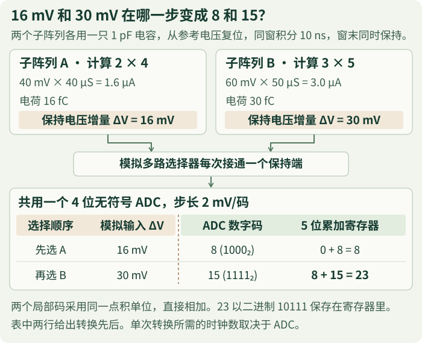

# 同一个点积分在两处算，模拟结果怎样交给数字累加器？

两个子阵列要合算 `2×4＋3×5`。A 接到第一个输入和权重，B 接到第二个。两个子阵列可以同时读，后面却只接了一只模数转换器（ADC），一次只能看一个输入。它读 A 的时候，B 算出的东西存在哪里？等两份结果都出来，数字加法器凭什么知道它们可以直接相加？

沿着这次读操作，在三个地方各看一次：先看单元所在列的**电流**，再看读窗末端被保持的**电压**，最后看进入累加器的**数字码**。下面使用能手算的理想参数，真实芯片另取 IBM HERMES 对照。

## 两边同步开窗，各自产生了什么？ {#signal-handoff}

沿用[ReRAM 点积](../02-memory-technologies/reram-as-compute-element.md#ideal-column-current)的刻度。数字输入每单位驱动 20 mV，单元电导每 10 µS 表示一个单位权重。与两行汇入同一列的例子相比，这次把**点积的两项分放到两个独立子阵列**，各有自己的列端；每个子阵列此例只启用一项。控制器让两边同时开始一个 10 ns 读窗。

- **A 要算 `2×4`。** 驱动器把输入码 2 换成 40 mV，权重 4 已经写成 40 µS。假设列端相对参考保持在 0 V，单元呈线性，得到 `40 mV × 40 µS＝1.6 µA`。
- **B 要算 `3×5`。** 相同输入刻度下，3 驱动 60 mV，权重 5 是 50 µS，得到 `60 mV × 50 µS＝3.0 µA`。

打开读窗前，两边各把积分器复位到已知参考，各有一只 **1 pF** 反馈电容。窗内，前端维持列端的读偏置，读电流使反馈电容的电荷发生变化。这里按**相对于复位点的电压变化量的正幅值**记数；若电路反相，读出端需采用相应极性。恒流时，`电荷变化＝电流×时间`，`电压变化量＝电荷变化量÷电容`。

| 子阵列 | 本列电流 | 10 ns 内的电荷变化 | 1 pF 上的电压变化量 |
| --- | ---: | ---: | ---: |
| A | 1.6 µA | 16 fC | 16 mV |
| B | 3.0 µA | 30 fC | 30 mV |

到 10 ns 时，两边同时结束积分并保持各自的样本。**此时存在的是两个电压，16 mV 和 30 mV。** ADC 先看谁都可以，前提是另一个样本在等候期间保持到规定精度。共用的是下一段转换电路，前面的两个样本各有自己的保存位置。

## 先读 A 再读 B，什么时候才有整数 23？ {#digitize-two-samples}

先约定一个理想的 4 位无符号 ADC。复位参考对应码 0，步长是 **2 mV/码**；把样本的电压变化量除以步长，舍入至最近整数，超出 0 至 15 时钳在端点。这个刻度怎样接回原来的算术？一单位输入乘一单位权重，产生 `20 mV×10 µS＝0.2 µA`；10 ns 内恰好积出 2 fC，在 1 pF 上变化 2 mV。所以这个例子里**一个 ADC 码的单位，恰好等于一个乘积单位**。

多路选择器先把 A 的样本送到 ADC。转换完成后，`16 mV ÷ 2 mV/码＝8`，初值为 0 的数字累加器收下 8。再切到 B；它保存的 30 mV 对应码 15。数字逻辑将两个无符号码扩展到足够位宽，再算 `8＋15＝23`。这两个部分和对应**同一输出的不同输入项**，刻度、零点和符号约定相同，直接相加才成立。若两个前端增益不同，必须先用各自的标定关系换成同一单位。想沿电路看这两个码怎样产生，可以跟着比较器逐次判断一个样本。[从 16 mV 和 30 mV 到整数码](../04-circuit-and-macro/adc-dac-sa-in-cim.md#sample-to-code)

<figure class="micro-diagram" tabindex="0" aria-label="两列独立积分、保持，再分时使用同一 ADC，最终数字相加" markdown="1">

<figcaption>一个共同读窗之后，有两次分时转换。第一次转换期间，B 的样本仍在保持。10 ns 只规定积分时间，整个过程还要计入两次转换和交付结果所需的时间。</figcaption>
</figure>

这也解释了为什么一只 4 位 ADC 可以参与算出 23：它单次只需表示 8 或 15，最后的累加器至少要有 5 位。若把它承诺的范围扩大为**任意两个 2 位无符号输入和两个 3 位无符号权重**，单项最大是 `3×7＝21`，合计最大是 42。保持同样刻度，要完整覆盖这个范围，分开读时每路至少需 5 位，最终无符号累加器至少需 6 位；为这组 4、5 权重能正确算题，不等于覆盖了那一整个规格。

## 能不能先在模拟域相加，只转换一次？ {#before-or-after-the-converter}

可以另外设计一条前端：把两条单元支路的**电流**路由到同一个保持在规定读偏置的求和节点，由一只 1 pF 反馈电容积分，输入驱动和 10 ns 读窗都不变。这时电流为 `1.6＋3.0＝4.6 µA`，电荷变化为 46 fC，单只电容上的电压变化量为 46 mV。换算后该得到码 23，但刚才那只 4 位 ADC 仍然最高只报 15。若保持 2 mV/码，至少需要 5 位才能读出本例的 23。也可改变模拟增益或转换步长来换量程，但须重算还能区分多小的输入变化。

这次加法发生在**积分之前**。若先像原例那样把两只 1 pF 电容分别充到相对同一参考、同极性的 16 mV 和 30 mV，再将它们隔离电源后理想并联，46 fC 会分到总共 2 pF 上，最终电压变化量是 **23 mV**。这是电荷共享后的平均值。把两个已经保持的样本接到一起，与两路电流在同一个前端相加，是两种电路。

回看原来的双样本方案，它将量程较小的两份结果分别数字化，代价是多一套积分保持路径、两次转换和一次数字累加。还有等待误差可查。假设 B 本来应为 30 mV，轮到它时只剩 28.8 mV，其他条件不变，`28.8/2＝14.4` 舍入为码 14，最终便是 `8＋14＝22`。即使数字加法器完全正确，丢掉的那部分电压也已经不在码 14 里了。应分别测积分结束时和保持结束时的信号，才能判断是阵列、保持电路、参考还是转换器出了偏差。[重复读数与固定偏差如何区分](./analog-cim-deep-dive.md#repeat-read) · [模拟 CIM 深入](./analog-cim-deep-dive.md)

## 换一种介质，这道交界还在同一处吗？ {#where-the-conversion-occurs}

「模拟求值」描述的是哪段电路用连续量保存中间结果；「混合信号」描述的是这些量在哪里进入或离开数字处理。一个用电流形成多级部分和的阵列，连同驱动、ADC 和数字累加器，可以同时符合这两种描述。数字 CIM 也要感测电压；如果每列只交付已经判定的逻辑位、后续用数字计数器和累加器计算，设计者需要验证的主要接口会不同。一次比较能给出一个布尔结果；要区分 8 和 15 这样的部分和，读出需要多个可辨等级。[数字逐位结果怎样安排计数与累加](./digital-cim-deep-dive.md)

| 换到哪条已有路径 | 哪个量值得一路追到判决点 |
| --- | --- |
| [SRAM 局部部分和](../02-memory-technologies/sram-cim-deep-dive.md) | 多个读支路的电流或共享电容的电压承载局部和，读出后再由数字逻辑归并。 |
| [Flash 三窗积分](../02-memory-technologies/flash-cim-niche.md#three-read-windows) | 权重由阈值标定的读电流表示，接通时长决定积分贡献；零点、读出刻度和后处理要接上数字控制。 |
| [PCM 与 MRAM](../02-memory-technologies/pcm-mram-for-cim.md) | PCM 用电导保存权重，写入校验和保持漂移会影响读数。MRAM 若用组合磁态的感测信号判决逻辑，需核对感放参考与失调；若只普通读出权重，之后的数字 MAC 在哪里就到哪里找算术。 |
| [DRAM bank 旁乘加](../02-memory-technologies/dram-pim-foundation.md) | 常规 DRAM 感放和 I/O 也有模拟电路，但权重原值读出后才交给 bank 旁独立 FPU 相乘。分类要看哪段电路参与求值。 |

**HERMES 的真正转换边界在哪里？** IBM 的 64 核 PCM 研究芯片把数字输入变成读电压脉冲的宽度，PCM 的电导产生阵列电流。论文按它的阵列方向将输出称为「行」，每个核的 256 个单元行各配一只基于电流控制振荡器的时域 ADC。阵列输出电流影响振荡，转换电路据此得到数字计数，本地数字处理单元（LDPU）再做按通道缩放等操作；需要时还会结合邻核经片上链路传来的部分结果。前面的 1 pF、共享一只电压 ADC、顺次读 A/B，都是为了用数字追清边界而作的教学选择。HERMES 使用实际芯片的并行电流读出与片上通信。[Le Gallo 等原论文，第 3 页的模拟核和本地数字处理](https://arxiv.org/pdf/2212.02872#page=3) · [HERMES 怎样在片上归并卷积部分和](../../../chip-architectures/ibm-hermes/README.md)

## 核算总时间和能耗时，该数到哪一步？ {#count-the-full-path}

从控制器收到两个输入，一直数到消费者拿到有效的 23。原例要产生两路驱动电平、复位并运行两次局部积分（同时进行）、保持两份样本、让共享 ADC 先后转换两次，再写寄存器和相加。改成每个子阵列各有一只 ADC，可以并行转换，但转换器和参考电路的规模、面积与负载会改变。移到更晚的转换边界可以少交付一份数字码，也可能需要更宽的模拟量程、更稳定的线路和新的求和设备。

若结果属于不同 tile，还要查部分和是否要经过片上网络、由哪个缓冲保存、谁负责最后一次累加。参考源、驱动、采样保持、ADC、校准常数和校准频率都有成本；只报阵列读窗消耗的能量，无法据此得出整个模型的能耗。对齐输入范围、允许误差、结果可用时刻和统计边界，才知道这次交接放在哪里合算。[外围开销都落在哪些模块](../04-circuit-and-macro/peripheral-overhead.md)

下一篇保持这个点积和精度要求一致，把模拟读出、数字计数与两者之间的交接放到同一张账上比较。[继续比较同一个点积的实现](./analog-vs-digital-tradeoff-map.md#same-dot-product) · [阵列求值与信号转换导读](./README.md)
