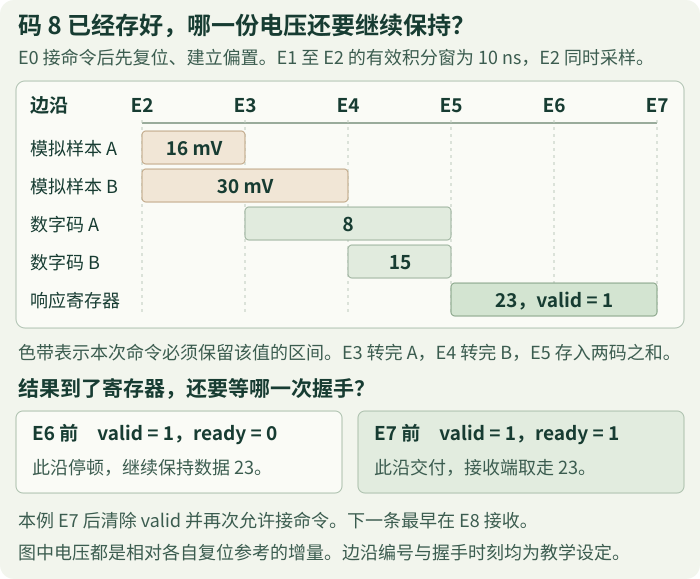

# 一条点积命令进了 CIM 宏，结果在哪一拍才算交付？

在存内计算宏（CIM macro）的输出线上看见了 23。下一拍再看，还是 23。下一级究竟收到了两个结果、一个结果，还是一个也没收到？只盯着数值，分不出这三种情况。把观测点向前移，还会遇到另一种等待：同一条点积命令产生了两个电压，模数转换器（ADC）正在读第一个，第二个由谁留着？

沿用[两个子阵列合算一个点积](../03-compute-paradigms/mixed-signal-cim.md#signal-handoff)的接线。A 算 `2×4`，B 算 `3×5`。这一次从接命令跟到交结果，每到一个时刻，都能指出哪一块电路还得替下一块保存数据。

## 接到一条命令，到底是哪一块电路开始工作？ {#follow-one-command}

设权重 4、5 已分别写在 A、B。上游发一条求点积命令，带上输入 2、3。这个教学宏一次只做一条命令，输入端没有等候队列。宏空闲时拉高 `cmd_ready`；上游给出有效的命令和输入时拉高 `cmd_valid`。在上升沿 **E0 到来之前**，两者都是 1，因此 E0 把命令和输入一起锁存。此后上游可以改自己的输入线。宏内部的输入寄存器仍然记得 2、3。

控制器接下来做的是定次序。先将两个积分器分别复位到已知参考，建立列端读偏置，再让行驱动器按输入值施加读电压。普通 SRAM 的读操作往往要先预充位线，这里的前端则要把积分器清到同一起点。若省去复位，上条命令留下的电荷也会算进这次结果。控制器负责发出复位、驱动、保持和写寄存器的信号。电流在单元和读出前端中流动，数字码在寄存器和加法器间传递。[普通 SRAM 的字线、位线与感放](../../../storage/02-sram/foundations/wordline-bitline-sense-amp.md)

A 用 40 mV 读 40 µS 的单元，列电流为 1.6 µA。B 用 60 mV 读 50 µS 的单元，列电流为 3.0 µA。假设单元线性，两边的列端均维持在参考电位。等驱动稳定，各自在 **10 ns** 的有效读窗里，用一只 **1 pF** 的反馈电容积分。A 增加的电荷量为 16 fC，B 为 30 fC。按相对复位参考的变化幅值计，两边分别得到 **16 mV、30 mV**。读窗可以同时关，两份电压必须分开保持，共用的 ADC 一次只能处理一份。算例假定等候期间的电压变化小到不改变量化结果。

下面的 E0、E1 等是相邻的数字时钟上升沿。假定一拍容得下相应电路的建立、有效积分或转换及接收端所需的余量。10 ns 只指电流参与积分的时段。ADC 使用 4 位无符号码，零电压变化对应码 0，每码 2 mV。本教学电路为每次转换留一拍，要求所选样本保持到该次转换完成。一拍在这里只规定宏何时拿到码；若用逐次逼近 ADC，它在这一拍里要完成多轮比较。实际电路需要更多时间，就得延长等待。输出用一个 5 位寄存器保存，`out_valid` 初始为 0。

| 时刻 | 这一步完成什么 | 现在谁还要保存什么 |
| --- | --- | --- |
| E0 | 宏接收命令，暂时撤下 `cmd_ready`。 | 输入寄存器保存 2、3。 |
| E0 到 E1 | 两个积分器复位，建立列端读偏置。 | 前端得到各自的起始参考。 |
| E1 到 E2 | 两行按输入驱动，稳定后同窗积分。E2 时两份样本已进入保持。 | A 保持 16 mV，B 保持 30 mV；两列可以结束驱动。 |
| E2 到 E3 | 选择器接 A。转换结果在 E3 锁存，`16÷2＝8`。 | 局部累加器从 0 变成 8。A 样本可以释放，B 仍要保持 30 mV。 |
| E3 到 E4 | 选择器接 B。E4 锁存第二份码，`30÷2＝15`。 | 码寄存器保存 15，累加器保存 8。B 样本也可以释放。 |
| E4 到 E5 | 加法器把两份同刻度的无符号码扩到 5 位后相加。E5 将 23 写入输出寄存器。 | E5 **之后**输出端给出 `out_valid=1` 和 23。E5 之前还没有待交付结果。 |
| E6 | 沿前 `out_valid=1`、`out_ready=0`，下一级没有接收。 | 输出寄存器继续保存 23，有效标志保持为 1。 |
| E7 | 沿前 `out_valid=1`、`out_ready=1`，下一级在这个沿收下 23。 | E7 之后输出槽腾空，有效标志清零，宏重新给出 `cmd_ready=1`。 |

<figure class="micro-diagram" tabindex="0" aria-label="跟踪一条点积命令的样本、数字码与输出握手" markdown="1">

<figcaption>沿前的 valid 和 ready 同时为 1，接收方才在该沿取走数据。图中只有 E6 错过一次交付机会；从 E5 写出 23 到 E7 被取走，一共交付一次。</figcaption>
</figure>

如果下一级在 E6 已经准备好，23 就能在 E6 交付。这一次只迟了一拍，**多占一拍的是输出寄存器**。B 的模拟样本早在 E4 就用完了，无须再保持，也无须重新积分。反过来，如果在 E3 就把 B 复位，后面转到的将是复位点附近的电压。最终结果会接近 8，无论下一级等多久，都补不回第二项。

A、B 能释放样本，意味相应的保持位置可以重新使用。这台一次只接一单的宏要等输出被取走，下一条命令最早在 E8 接收。若要提前开始下一次读，可以另设缓冲，但得先指出新结果放在哪里：只要 E6 的输出槽还占着，新命令就不能覆盖里面的 23。

## 计数器交出一个 2，累加器为什么要加 16？ {#count-to-accumulator}

同一个点积还可以走数字阵列的读路径。把输入分成两个位平面，把权重分成三个位平面，两两配对，共有六对。读最后一对时，输入的第 1 位为 `(1,1)`，权重的第 2 位也为 `(1,1)`，位号均从 0 起算。沿两个元素各自独立的逻辑通路做按位与，得到两个结果位 `(1,1)`。局部计数器数出两个 1，给出二进制 `10`，也就是整数 2。一根只报 0 或 1 的判决线单独装不下这个计数。[从按位与到局部计数](../03-compute-paradigms/digital-cim-fundamentals.md#and-and-count)

控制器还要告诉累加器，这是**哪一对位平面**。输入第 1 位的单位是 2，权重第 2 位的单位是 4，因此每个被数到的 1 代表 8。移位电路把计数 2 左移三位，得到 16。前五对已经合出 7，于是 `7＋16＝23`。这里送进加法器的是 **7 和 16**。上表里的两个 ADC 码 **8 和 15** 属于另一种实现。[六对位平面的排程及各次部分和](../03-compute-paradigms/digital-cim-deep-dive.md#schedule-six-pairs) · [数字阵列的位平面排程](../03-compute-paradigms/digital-cim-deep-dive.md)

把一次停顿移到这条路径的**累加入口**。如果最后一对到达时 `valid=1、ready=0`，发送方应当同时留住计数 2 和它的位置信息，累加器继续保存 7。等两者同时为 1 的上升沿到来，只接收一次，才从 7 更新为 23。输出端停顿时保的是完整结果，这里停顿时保的却是**还没入账的贡献**。

甚至同样两个 1，也可以要求累加器做减法。只将权重改按三位二补码解释，原先的权重位形 `100`、`101` 就分别代表 −4、−3。最高位的单位变成 −4，最后一对贡献 `2×2×(−4)＝−16`。前五对按这个约定已合出 −1，最终为 −17，正好等于 `2×(−4)＋3×(−3)`。计数器交出的 2 完全一样；改变的是解释这个计数的位权和累加器的有符号运算。

## 换掉阵列，哪一步还会留在存储读通路里？ {#locate-the-operation}

普通 SRAM 宏中的行驱动器选字，位线与感应放大器（SA，常称感放）读出原来保存的位。若把整字送到输出缓冲后，再由普通乘加阵列算点积，第一步乘法发生在存储宏之外。给读出口接一个累加器，仍需回头看它究竟接到了**权重原值、逐项逻辑位，还是已有数值意义的部分和**。[传统 SRAM 阵列怎样组织](../../../storage/02-sram/foundations/sram-array-organization.md)

- **模拟求值。** 输入驱动器可将数字码变成电压、电流或脉宽，单元电导和列线电流、或位线上的电荷形成局部数值。ReRAM 可在列线上合流，Flash 可以把较固定的权重写进阈值，但要考虑编程校验、保持和标定。PCM 的电导可以表示权重，其漂移和重写代价会限制适用负载。SRAM 也能把局部位线或耦合电容用于电荷域累加。[Flash 读窗](../02-memory-technologies/flash-cim-niche.md#three-read-windows) · [PCM 电导漂移](../02-memory-technologies/pcm-mram-for-cim.md#pcm-drift) · [SRAM 的电荷累加与读出](../02-memory-technologies/sram-cim-deep-dive.md)
- **数字求值。** 可协同设计 SRAM 的 6T、8T、10T 单元、字线、位线及 CMOS 外围，让选出的多项在读通路内形成 AND、XNOR 等逻辑结果，再计数、移位并累加。要查具体接线与选通信号，才能判定支持哪种操作。对于 MRAM、ReRAM 或 Flash，也要看感测端是否已经形成逻辑结果。若只是逐位读出存储内容，再交给独立数字单元运算，计算边界跟普通存储加外部运算单元相同。[MRAM 的两个磁态怎样参与判决](../02-memory-technologies/pcm-mram-for-cim.md#mram-two-rows)
- **混合信号宏。** 看模拟量在哪里交给数字逻辑。双样本例在列端保留模拟乘法，在 ADC 后合并两个数字码。换一个真实布局，边界也会变。IBM HERMES 的单核图中可以认出脉宽输入调制器、PCM 阵列、左右 ADC 阵列、码寄存器和本地数字处理单元。图中的电流 DAC 用于编程。两样本共用一个 ADC 与 E0 至 E7 的排程是上文为跟踪一次命令所设。[Le Gallo 等，HERMES 原论文图 1c](https://arxiv.org/pdf/2212.02872#page=13)

同样把运算移近存储，还可以把独立处理单元放在 DRAM、HBM 或 GDDR 的 bank 附近。此时 bank 先读出操作数，处理单元再完成乘加。若处理逻辑在 HBM 基底层、转接板或封装侧，还要把数据经过的接口算进去。两种位置都能少走一段远路，沿 bank 读出、局部乘法和归约的边界逐一追，才知道哪一段真的缩短了。[在 DRAM bank 旁跟一条乘加命令](../02-memory-technologies/dram-pim-foundation.md#find-the-multiplier)

## 宏已经交出 23，整片芯片也完成了吗？ {#beyond-the-macro}

看下一级拿这个 23 做什么。若更长的点积分布在多个宏里，每个宏交出的只是自己那一段。计算块（tile）要先缓冲各段结果，再在本地或片上网络（NoC）完成归约；不受支持的算子还可能交回主机。即使一块 128×128 或 256×256 的阵列利用率很高，系统耗时还要计入各宏等待共享资源、传输和末级合并的时间。HERMES 论文也分别测量了阵列矩阵向量乘，以及计入多核聚合和数字处理的工作负载。[片上归约网络怎样合并结果](../../../interconnect/NOC/06-ai-noc-specifics/reduction-and-collective-networks.md) · [HERMES 论文，功耗测量方法](https://arxiv.org/pdf/2212.02872#page=10)

回到一次命令，验证电路也有了可逐一检查的位置。随工艺、电压、温度（PVT）变化，采样前的位线能否及时建立，重复计算后原存储位是否仍正确？测试电路能分别观察 ADC 的码和累加器的值吗？软件所用的量化、饱和和完成条件与硬件是否一致？多行感测会改变读稳定性和时序裕量，增加保持、控制、移位和缓冲电路也要付出面积、功耗和测试代价。只给阵列一个吞吐或能效数字，无法回答这些问题。[工艺节点与功耗、性能、面积的权衡](../../../chip-development/FAB/wiki/02-front-end-fabrication/process-nodes-and-ppa-tradeoffs.md)

沿 E2 的两份电压继续往下看：行驱动器怎样把码变成激励，感放怎样作一次判决，ADC 又怎样把保持的电压变成码 8 或 15？[继续读驱动、感放和 ADC 的分工](./adc-dac-sa-in-cim.md#sample-to-code) · [返回电路、外围与计算宏](./README.md)
