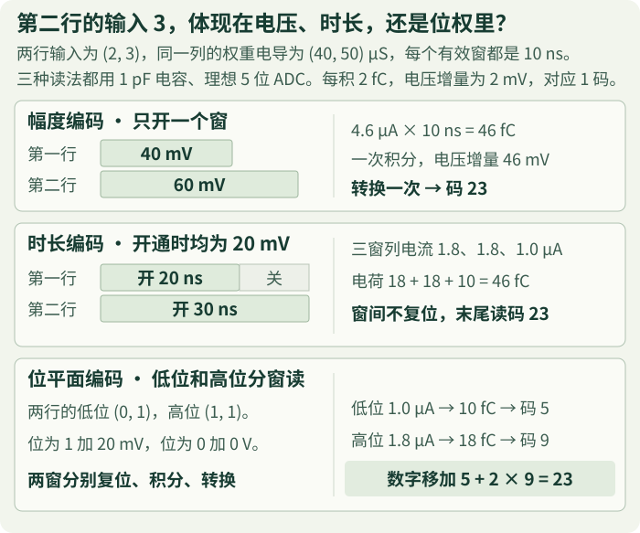

# 输入都是 3，行驱动器该加多高的电压、开多久？

在输入寄存器里写下无符号整数 3，用示波器看接收它的那一行。可能看见一个 60 mV 的短脉冲，也可能看见一个 20 mV 的长脉冲。还有一种实现，先给 20 mV，停一下，再给同样的 20 mV。最后一种明明只有两个脉冲，为什么仍能表示 3？

让这一行乘权重 5，另一行用输入 2 乘权重 4。每次都求 `2×4＋3×5`。保持两格的权重、列端电路和读出刻度不变，只改输入怎么送，以及读出以后怎么合并。这样可以逐项核对，代表「3」的三份贡献究竟藏在哪里。

## 把 3 变成 60 mV，一次读能算出多少？ {#encode-one-input}

两行接到同一列。第一格的电导为 40 µS，第二格为 50 µS，每 10 µS 代表一个权重单位。假定所用读压范围内单元近似线性，列端由读出电路维持在 0 V，忽略线阻、漏电与切换瞬态。积分器复位到已知参考，再用 **1 pF** 反馈电容收集列电流。以下取相对复位点的电压变化幅值。[两行怎样合成一股列电流](../02-memory-technologies/reram-as-compute-element.md#ideal-column-current)

先定一个三种读法共用的单位。给代表权重 1 的 10 µS 单元施加 **20 mV**，就有 `20 mV×10 µS＝0.2 µA`。让电流持续 **10 ns**，能收 `0.2 µA×10 ns＝2 fC` 的电荷，在 1 pF 上产生 **2 mV** 变化。本例理想 5 位无符号 ADC 的零点就是复位参考，步长为 2 mV/码，按最近整数转换并限于 0 至 31。这样，**每积到 2 fC，读出就多一个码**。选择 5 位是为了直接读下本题的 23。若承诺支持任意两个两位无符号输入与两个三位无符号权重，完整点积最大是 `3×7＋3×7＝42`，同刻度一次读全列需要至少 6 位。反过来，单独读一个输入位平面，最大只有 `1×7＋1×7＝14`，4 位就能覆盖该窗，最终数字累加器仍需容下 42。

先把所有输入都限制在同一个 10 ns 的有效读窗，用**幅度**区分大小。数模转换器（DAC）或等效行驱动器给第一行 40 mV、第二行 60 mV。第一行电流为 1.6 µA，第二行为 3.0 µA。两股电流汇入列端，`4.6 µA×10 ns＝46 fC`，电压变化为 46 mV，ADC 一次报出 **23**。第二行之所以贡献 15，是因为它的电压是单位读压的三倍。代价也落在这里：驱动器必须能给出多个可分辨的电压，单元与读出前端在最高读压时仍要近似线性。

## 如果行只能开到 20 mV，把输入 3 放到哪里？ {#equal-weight-windows}

保持第二行 20 mV，单元 50 µS，现在它打开时只给 **1.0 µA**。要收回原来的 30 fC，让它打开 30 ns 就行。第一行打开时给 0.8 µA，持续 20 ns 便收回 16 fC。两行同时开始，积分器直到最后才读出一次。沿时间看，列端经历三个等长的时段。

| 有效积分时段 | 输入 2 所在行 | 输入 3 所在行 | 列电流 | 本段增加的电荷 |
| --- | ---: | ---: | ---: | ---: |
| 头 10 ns | 20 mV | 20 mV | 1.8 µA | 18 fC |
| 中间 10 ns | 20 mV | 20 mV | 1.8 µA | 18 fC |
| 末 10 ns | 0 mV | 20 mV | 1.0 µA | 10 fC |

收满 `18＋18＋10＝46 fC`，还是码 23。**脉宽编码**把行连续打开所需的时长。也可以改成**等权脉冲计数**：在三个位置分别发 10 ns 的单位脉冲，第一行发两个，第二行发三个。即便脉冲之间留空，只要各脉冲有效面积相同、空档关闭积分门并保持此前的电荷（或让两行回到 0 mV，使理想净电流为零）、各单位之间不复位，总电荷仍为 46 fC。逐个脉冲的意义相等，这种用几个相同单位表示数值的方式叫一元编码（unary）。它降低了区分多档幅度的要求，但要求单位脉冲的面积可重复；两位无符号数最多需三个单位，八位则最多需 255 个。若用空间并排放这些单位，开销便转成更多器件和连线。

**三个等权时段，要转三次吗？** 前面一次复位，末尾只转换一次。如果硬件在每个 10 ns 末都先保持、转换，再复位，下一个时段重新计量，它会依次给出码 **9、9、5**。数字端直接相加也能得到 23，但这次需要三次转换。增加了几次驱动、几次积分和几次转换，是三个可分别核对的问题。真实的 IBM HERMES 使用脉宽调制读脉冲驱动 PCM 阵列，并用时间域电流 ADC 读出；这里的 20 mV、10 ns、1 pF 和三段排程是为同尺度比较所设。[HERMES 原论文的输入与转换电路](https://arxiv.org/pdf/2212.02872#page=3)

## 同样只发 20 mV，为什么两个脉冲就能表示 3？ {#two-binary-planes}

把输入 2 和 3 写成二进制 `10₂` 和 `11₂`，先送两行的低位，再送高位。每个读窗都单独复位、积分 10 ns、保持并转换。读第几位由控制器记录，权重 4、5 始终留在原来的两个单元。

| 送入的位平面 | 两行的开关（1 表示 20 mV） | 列电流 | 收到的电荷及码 | 进入数字和的贡献 |
| --- | --- | ---: | --- | ---: |
| 低位，位权 1 | (0, 1) | 1.0 µA | 10 fC → 5 | 5 |
| 高位，位权 2 | (1, 1) | 1.8 µA | 18 fC → 9 | 18 |

对输入 3 所在的第二行，**两个脉冲本身完全一样**。第一窗它贡献码 5，第二窗它还是贡献码 5，但后一窗是高位，数字端要给这份 5 乘 2。合起来便是 `5＋2×5＝15`。对整列也是同样的规则：`5＋2×9＝23`。要是像等权脉冲那样一路积分到末尾，只能读到 `(10＋18) fC÷2 fC＝14`；两个平面的身份已经丢了，末端也就无从只给高位乘 2。[逐位面跟踪模拟列读出](../03-compute-paradigms/analog-cim-fundamentals.md#two-input-planes)

<figure class="micro-diagram" tabindex="0" aria-label="同一列分别按电压幅度、等权时长与二进制位平面编码输入" markdown="1">

<figcaption>前两种在模拟端收齐 46 fC，末尾各读一次。第三种每个平面独立读，最终的 23 保存在数字累加器中。各窗只标有效积分时间，未计驱动建立、复位、保持和转换的时间。</figcaption>
</figure>

二进制规定**各位的权重**，位串行（bit-serial）规定**这些位何时送到**。同一二进制数也可把所有位并行送入不同的逻辑通路，由压缩树同时归约部分积。减小标称位宽，只有在控制器真的少发位平面，或门控电路使相应部件停止活动时，才会减少相应周期或能耗。就看低位窗的 `(0,1)`：第一行可以不驱动，第二行仍要产生 5，共享 ADC 也照常工作。[数字阵列怎样排位平面](../03-compute-paradigms/digital-cim-deep-dive.md)

## 线上同样传 0 和 1，数它们就能做乘法吗？ {#random-stream}

等权脉冲事先就能确定发几个。**随机编码**（stochastic encoding）则约定一个位置上出现 1 的概率代表数值，用一段流中 1 的比例估计它。取两个在 0 至 1 之间的数 `p、q`，每个位置的两个输入位若相互独立，AND 只有两者同时为 1 时才报 1，概率就是 `p×q`。例如两个数都是 0.5，输出为 1 的期望比例是 0.25。若把**同一条流**接到 AND 的两个端口，输出逐位复现输入，期望比例却是 0.5。

有限长度的随机流读出来会有波动，还要检查相关性。延长流或增加并行通路可以换取更多样本，同时要计入时延、随机源、面积和验证成本。不能把前面三个确定的脉冲当作对概率的三次采样，两种编码对「数 1」有不同的约定。[Alaghi 和 Hayes，图 1 的单极性 AND 乘法与相关输入](https://homes.cs.washington.edu/~armin/ICCD_2013.pdf#page=1) · [Gaines 的随机计算表示](https://gaines.library.uvic.ca/pdf/SJCC67.pdf)

## 输入解释清楚了，权重的符号和零点又放在哪里？ {#weight-and-zero-point}

刚才的 23 有两个前提：输入是**无符号**两位数，每格又能用一个可分辨的多级电导保存完整权重。只把输入改按**两位二补码**解释，`10₂` 就是 −2，`11₂` 就是 −1。位线读出的低位码 5、高位码 9 都不变；最高位的单位变成 −2，数字端要算 `5−2×9＝−13`。它恰好等于 `(−2)×4＋(−1)×5`。输出要有容纳负数的格式，5 位无符号 ADC 仍可读这里两个非负的局部码。

物理单元的最小电导也可能大于零。设一格的实际电导为 `10 µS＋权重×10 µS`。同样的权重 4、5 现在要写成 50、60 µS。沿第一种幅度读法，40、60 mV 合起来产生 **5.6 µA**，10 ns 后读到码 **28**。两个单元共有的那档基线也在导电：`(40 mV＋60 mV)×10 µS＝1.0 µA`，对应码 5。减去它才是 `28−5＝23`。若输入换了，两行电压之和也会变，不能永远减同一个常数。另一种是给一个权重配一正一负两条支路，用两者电导之差代表有符号权重。此时两边各自的电流、失配和读出量程都要检查，即便差值为零也可能两边都在耗电。[软件量化中的比例因子与零点](../06-software-stack/quantization-for-cim.md)

介质直接影响哪种编码划算。ReRAM、Flash 能用多级状态或差分支路，能否分清相邻权重要看编程校验、器件差异及保持。PCM 还要考虑电导漂移和温度。若每格只读一个二进制位再搬出去计算，多级状态和列电流求和的能力就没有被用上。普通 SRAM 一格保存一位，要让权重表示二值、三值或更高精度，可组合多个单元、分次读、或复制若干单位单元；也可在读通路执行 XNOR、计数和移位。对 SRAM 追求高分辨率模拟量，需要另查局部电荷或电流读出及外围精度。MRAM 常从二态感测出发，能否做局部比较或归约取决于读通路。用离散输入驱动模拟求和再做数字移加，便是这些编码在同一混合信号宏中配合的例子。[各存储介质的读出条件](../02-memory-technologies/memory-tech-comparison-matrix.md)

若论文写的是 DRAM、HBM 或 GDDR 的 bank 旁处理单元，要查看其指令支持什么操作数格式、一次对哪个 bank 或通道发出什么命令。主机可见的命令和内存映射接口还要花费传输与控制资源，这些问题可以沿接口继续查。[HBM 堆叠宽接口](../../../storage/03-dram/protocols/hbm-stacked-wide-io.md) · [DRAM 行列选择与感测](../../../storage/03-dram/foundations/row-column-decode-sense-amplify.md) · [系统互联的接口组件](../../../interconnect/BUS/04-microarchitecture-integration/interconnect-components.md)

## 论文写「支持 INT8」，还缺哪几项才能复算？ {#read-a-format-claim}

| 要追踪的对象 | 应能从设计里找出的答案 |
| --- | --- |
| 激活值和权重 | 输入的一单位改变幅度、脉宽、脉冲数还是位位置？权重是一格多级、二值或三值组合、差分对，还是复制的单位单元？ |
| 时间和部分和 | 哪些项同时驱动，何时保持、复位和转换？每次转换的码代表一个完整点积、一个位平面，还是一块阵列的局部结果？ |
| 位宽、符号与零点 | ADC、感放、宏内累加器及跨块归约各须容下多大范围？谁处理符号、基线和比例因子？ |
| 零值和实际成本 | 遇到零时，哪些行驱动、读窗、转换或数字加法真的取消？校准用什么参数，编译器能否按这套约定映射多个层？ |

接下来固定编码，只让一次读出的码差一格。落在低位窗和高位窗，对最终点积的影响会相同吗？[继续追踪一个最低有效位的误差](./precision-and-quantization-at-circuit.md#trace-one-lsb) · [精度与量化](./precision-and-quantization-at-circuit.md) · [返回电路、外围与计算宏](./README.md)
