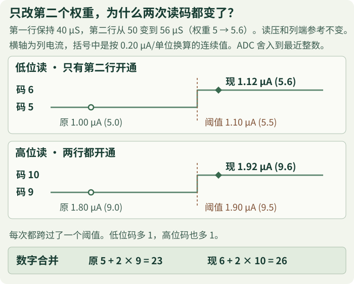
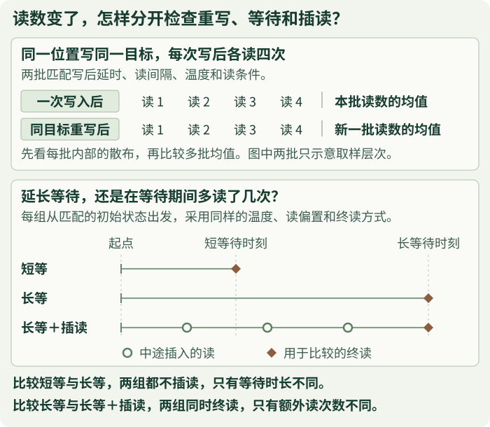

# 点积从 23 变成 26，怎样查出偏差发生在哪里？

把输入 2、3 送进阵列，权重已经按 4、5 写好。软件期望 `2×4＋3×5＝23`，芯片却连续报出 26。再送一百遍同样的输入，也许会再得到一百个 26。这一百次都在读**同一次写入**。要知道换一次写入还会不会出错，得换一种实验。

先保留三样东西：每次转换前的列信号、转换出来的两个局部码，以及按位权合成的最终结果。若芯片只引出了数字码，先记码，再用有已知输入的测试通路缩小范围。下面用一组教学读数说明实验怎样区分误差来源。

## 哪个码先走偏了？ {#trace-weight-error}

这条通路把输入拆成两个位平面。低位 `(0,1)` 只选第二行，高位 `(1,1)` 同时选两行。每条被选行都施加 20 mV，第一、第二行的目标电导分别为 40、50 µS。用相同读窗和增益，将读出折算到列电流，ADC 每码对应 0.2 µA，采用最近值舍入，本例没有饱和。理想低位为 `20 mV×50 µS＝1.00 µA`，读码 5。高位多了第一行的 0.80 µA，读码 9。数字端得到 `5＋2×9＝23`。[沿一个最低有效位追到最终输出](./precision-and-quantization-at-circuit.md#trace-one-lsb)

先人为指定一个原因：其余部分理想，只有第二行写后稳定在 **56 µS**。选中它时，列上多出 `20 mV×6 µS＝0.12 µA`。低位因此收到 **1.12 µA**，跨过 1.10 µA 的门槛，读码 **6**；高位收到 **1.92 µA**，跨过 1.90 µA 的门槛，读码 **10**。输出 `6＋2×10＝26`。一处偏差在两次采样里出现，不能把两处错码自动记作两个独立的噪声源。若采用两个等权部分和分别转码，还可能一高一低而在最终输出抵消。

<figure class="micro-diagram" tabindex="0" aria-label="第二行写偏时两个列电流越过判决门槛" markdown="1">

<figcaption>这次把原因预先设成写入偏差。面对未知的 26，没有足够证据先调整任何一个权重。</figcaption>
</figure>

**先绕过一段电路。** 若测试接口支持，在移加入口分别送入已知的码 5 和 9，同时附上正确的低位、高位标记。仍得不到 23，就先查位权、累加宽度、复位和数据交付。若得到 23，说明数字末段在这组输入下能算对，再查它平常收到的两个码从何而来。

**再绕过阵列。** 用独立标定的电流源，在读出前端入口注入电流，并保持后面的增益、参考、ADC 配置及采样窗口不变。例如依次注入 1.08、1.12 µA，理想码应分别为 5、6；在另一个门槛两边注入 1.88、1.92 µA，理想码应为 9、10。如果这里就错，先查注入点之后的读出增益、偏置、参考和判决。若都通过，只表示这几个点和这一工作条件通过，再从驱动器、阵列和未覆盖的范围查起。若实际宏没有这类测试入口，只靠最终码很难把前端增益和单元状态分开。[比较单行、空输入及公共增益三种结果](../03-compute-paradigms/analog-cim-deep-dive.md#repeat-read)

## 一次写完读四遍，与写两次再读，有什么区别？ {#repeat-or-rewrite}

现在只选第二行，用已校准、分辨率比宏内 ADC 更高的测试通路观测列电流。保持读偏置、温度、写完到首读的延时以及四次读的间隔相同。写一次后先不动权重，读四遍，再在**同一位置**重新写入同一个目标，照原样读四遍。假设得到下表。

| 第二行同样以 50 µS 为目标 | 第一次读 | 第二次读 | 第三次读 | 第四次读 | 这次写入后的平均 |
| --- | ---: | ---: | ---: | ---: | ---: |
| 第一次写入 | 1.11 µA | 1.12 µA | 1.13 µA | 1.12 µA | **1.12 µA** |
| 第二次写入 | 0.99 µA | 1.00 µA | 1.01 µA | 1.00 µA | **1.00 µA** |

看第一行，四个读数相差最多 0.02 µA，宏内 ADC 会把它们都报成码 6。反复得到同一个整数，并不证明模拟量毫无波动。看两行的均值，相差 0.12 µA；在这两次写入中，变化主要出现在重写前后。若把八个数混在一起算一次散布，就会把写入批次间的变化也算成每读一次都会发生的噪声。

这两批还不足以估计器件的分布。要分开**同一单元重写的变动**与**不同单元的失配**，应对多个位置各自重复上述两层操作，每次同时测一个稳定参考，记录编程脉冲、写后验证值及验证时刻。若参考也一起变，先排除测试仪器、温度或读出增益随实验顺序变化。最后一次写校验已有偏差，与校验达标、稍后第一次读才偏，是两种不同的观测。NeuRRAM 的实验就分别记录了写校验期间和写后不同延时的电导分布，发现其器件在刚写完时还会快速松弛。论文据此报告了推理测量距写入的时间。[Wan 等，NeuRRAM 原论文，扩展数据图 3c–e](https://pmc.ncbi.nlm.nih.gov/articles/PMC9385482/)

## 隔一段时间再读，怎样分清是等待，还是读操作本身？ {#wait-or-read}

假设第二行的终读电流又变了。在一天内多读一千遍，既增加了写后的经过时间，也增加了读脉冲数。用这份记录单独作图，两种影响会叠在一起。可以把写入状态和位置相匹配的一批单元分为三组，使用相同写法和初始校验。环境温度、供电、终读偏置及终读方法相同，只有表中两项有意改变。

| 组别 | 从写后初始校验到终读 | 中间做什么 | 应与哪一组比 |
| --- | --- | --- | --- |
| 短等 | 短时间 | 静置 | 和「长等」比两组各自相对初始值的变化。 |
| 长等 | 长时间 | 静置 | 与「短等」都没有插入读，差异支持进一步检查写后松弛、漂移或保持。 |
| 长等并插读 | 与「长等」同样长 | 插入规定次数、同一偏置的读脉冲 | 和「长等」比，额外差异与插入的读操作有关。 |

<figure class="micro-diagram" tabindex="0" aria-label="写后重复读、重新写，以及同温等待和插入读的对照" markdown="1">

<figcaption>重写次数、写后时间和读操作次数是三个不同变量。各组需要多个匹配样本；终读时的参考与温度也要记录。</figcaption>
</figure>

如果只在「长等并插读」组看到额外变化，先核实读脉冲带来的温升和读出前端工作点变化。再用普通存储读或独立的单元读回检查，同时留出足以消退读出瞬态的时间，再判断原来的存储状态是否受了**读扰动**。若两组长等待都变了，参考通路也跟着变，前端漂移仍是候选。想专门测温度效应，可以改变保存温度，并在同一温度、同一写后时间读回；研究读出随温度的变化时，则要控制保存历史。老化与经历的写擦次数有关时，还要匹配循环历史，不能用一次等待曲线代替耐久性试验。

PCM 的写后电阻漂移与读噪声也要分开测；短间隔的相邻读数可能相关，不能总指望把读数平均四次，噪声就恰好减半。Nandakumar 等依据一万多只 PCM 器件的表征，分别建立了电导更新、漂移与读噪声的模型。器件、状态和时间范围换了，模型参数也要重新验证。[IBM 原始研究，PCM 编程与时间演化的实测模型](https://research.ibm.com/publications/phase-change-memory-models-for-deep-learning-training-and-inference)

## 同一格单独读对了，多开一行为什么又错？ {#change-location-and-load}

把两行分别打开，先测 0.80 µA 和 1.00 µA，再同时打开，理想和为 1.80 µA。若单行均正确而双行偏低，优先检查随总负载变化的行驱动压降、共用线阻和读出范围。换相同权重到远近不同的位置，保持输入、总负载不变；再固定位置，仅改变同时开启的行和未选单元的状态。前者检验空间依赖，后者暴露共享驱动、位线耦合或旁路电流。缩短线长可减少相应的 I·R 压降，但切小阵列不会自动消除原来每格的器件失配，还会多用外围和归并资源。[ReRAM 的线阻、旁路电流与选择器](../02-memory-technologies/reram-cim-deep-dive.md)

具体的异常要落回具体电路。

| 观测对象 | 应保留的对照 |
| --- | --- |
| 模拟存储单元 | ReRAM 查成形条件、写入变动及保持；Flash 查编程阈值分布和保持；PCM 查写入、电阻漂移及温度。分别记录写后状态和读出，不把写入误差当成每次读都重新抽取的扰动。 |
| 感测与外围 | DAC 或行驱动失配会改变实际激励。参考噪声、热噪声、感放（SA）失调及 ADC 量化会改变判决。SRAM 电荷域读出还要测漏电、位线失配、工艺/电压/温度变化及感测裕量；MRAM 多行判决要检查读电流、隧穿磁阻（TMR）分布、参考及读写扰动。 |
| 数字存内计算 | 读出位本身可能因单元阈值失配、多行或半选扰动、软错误、坏位及时序违例而错。用普通读回、已知模式、内建自测试（BIST）定位，再检查计数和累加逻辑。纠错码（ECC）、冗余及工艺/电压/温度极端条件的时序验证各覆盖不同问题。 |
| 独立的 bank 旁处理单元 | DRAM、HBM 或 GDDR 的刷新、保持、时序及物理接口仍需验证。其数字 PIM 还要查命令、bank 冲突、热条件和主机卸载；要沿独立处理单元的实际数据格式跟踪结果。 |

## 找到偏差以后，要花什么代价才能修正？ {#after-calibration}

以 26 为例，若多个独立参考输入都显示同一读出偏置，才适合补偿公共偏置。若偏的是第二行单元，给所有读数减去同一个码会把单独读第一行的正确结果也改错。可以收紧该类状态的写入校验，也可选择重新编程或避开坏点。差分编码能抑制两支路共有的误差，代价可能是从一格变两格，或要多一次读；两条支路各自的偏差仍需度量。真实校准还要提供参考、测试向量、参数存储、软件映射和运行时更新。要报告每次耗时、能耗，以及校准在多宽的温度和写后时间内仍有效。

最后换一组没有参与校准的输入，按原位置、原位权回放：先比较局部码，再查 tile 归约、模型映射和软件参考。单个点积回到 23 后，还须按温度、位置和使用历史检查误差分布，用指定的数据集测模型准确率，必要时把已测扰动带入训练，再验证未参与训练的条件。量产测试还要比较多颗芯片、多个位置的硅后分布，据此设定筛查门槛和重新校准的条件。这才有依据决定应该改写入、补读出、增大时序裕量，还是在模型侧适配。[同一输入的重复读出](../03-compute-paradigms/analog-cim-deep-dive.md) · [工艺节点和功耗、性能、面积权衡](../../../chip-development/FAB/wiki/02-front-end-fabrication/process-nodes-and-ppa-tradeoffs.md)

增加一次参考测量、增加一只 ADC，或多存一组校准参数，都要占用宏的资源。把这些开销也算进去，再看一个结果交付时到底花了多少。[阵列已经算完，交付一个 23 还要付出多少？](./peripheral-overhead.md#cost-per-delivered-result) · [返回电路、外围与计算宏](./README.md)
