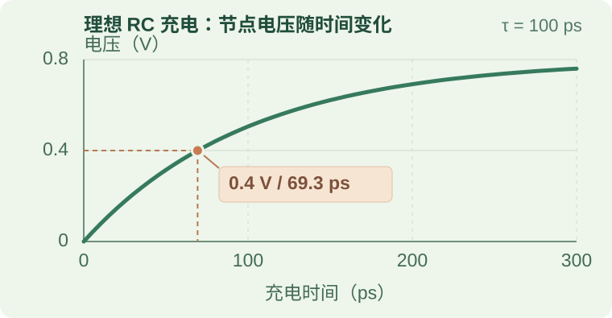

# 从电荷到芯片时序：一条可手算的路径

为什么芯片中的一次操作不能瞬间完成？因为电路要用有限的电流改变节点电压，信号还要经过后续电路。对于同步路径，数据必须在规定的时钟边沿附近满足采样要求。

时钟定义的是**什么时候采样**，它不会让电路中的信号传播得更快。本文从一个电容充电的例子出发，算出节点到达参考电压的时间，再把它放进一条寄存器到寄存器的路径，最后说明如何把这些时间用于周期模型。

  
01 / 电路<strong>节点充电</strong><small>电流改变电容上的电压</small>

  
02 / 路径<strong>信号传播</strong><small>后续电路产生有效结果</small>

  
03 / 时序<strong>时钟采样</strong><small>检查数据是否来得及</small>

  
04 / 模型<strong>离散事件</strong><small>在约定的边沿记录结果</small>

文中的数值都是**教学假设**，不是某个工艺库或芯片的参数。实际设计需要结合器件库、互连提取和时钟约束，在相关工艺、电压、温度（PVT）条件下分析。

## 1. 电压为什么需要时间才能变化？

可以把一个电路节点的负载先近似为电容。这个电容包括接收电路的输入电容、连线寄生电容等。要改变节点电压，驱动电路必须向它送入电荷或从中移走电荷。

对于电容值不随电压变化的理想电容，电荷、电压和电流满足：

  <var>Q</var> = <var>C</var> · <var>V</var>
  <var>I</var> = d<var>Q</var>/d<var>t</var> = <var>C</var> · d<var>V</var>/d<var>t</var>

这里的电压是电容两端的电压。直观地说：**负载电容越大，需要搬运的电荷越多；在相同电流下，电压变化就越慢。**这不是完整的门电路延迟模型，但能帮助我们理解延迟的一个来源。

### 先用恒流做一次估算

假设节点的总负载电容为 50 fF，要从 0 V 升到 0.8 V，且整个过程都由 0.2 mA 恒流充电：

  Δ<var>Q</var> = <var>C</var> · Δ<var>V</var> = 40 fC
  Δ<var>t</var> = Δ<var>Q</var> / <var>I</var> = 200 ps

这里 fF（飞法）是 10⁻¹⁵ F，fC（飞库）是 10⁻¹⁵ C，ps（皮秒）是 10⁻¹² 秒。

这个估算把电流看成恒定值。实际 CMOS 驱动电流通常随节点电压、输入波形和工作条件变化，所以 200 ps 只是这个假设下的结果。

## 2. 用 RC 模型观察电压怎样上升

换一个更具体的假设：一个 0.8 V 理想电压源，通过 2 kΩ 电阻给同一个 50 fF 电容充电。初始时电容电压为 0 V。电压源在时刻零阶跃到 0.8 V，之后保持不变。

开始充电时，电流为 0.8 V / 2 kΩ = 0.4 mA。随着节点电压升高，电阻两端的压差变小，电流也逐渐减小。这个理想一阶 RC 电路的时间常数和节点电压为：

  τ = <var>R</var><var>C</var> = 100 ps
  <var>V</var>node(<var>t</var>) = 0.8 V · (1 − e−t / 100 ps)

式中的 t 是开始充电后的时间，e 是自然常数，约为 2.718；计算指数时，t 和 100 ps 要使用相同的时间单位。

*图 1：虚线表示本例选择的 0.4 V 参考门限；圆点表示节点越过门限的时间。点击图可查看大图。*

| 观察点 | 节点电压 | 经过的时间 |
| --- | ---: | ---: |
| 开始充电 | 0 V | 0 ps |
| 到达最终电压的 50% | 0.4 V | 约 69.3 ps |
| 经过一个时间常数 τ | 约 0.506 V | 100 ps |
| 到达最终电压的 90% | 0.72 V | 约 230.3 ps |

例如，若我们选择 0.4 V 作为这个节点上升沿的参考门限，代入公式可得：

  <var>t</var>50% = τ ln 2 ≈ 69.3 ps

**69.3 ps 是到达这个参考门限的时间，不是完全充满的时间。**在理想 RC 模型中，电压只会逐渐接近 0.8 V；从 10% 上升到 90% 所需的时间约为 2.20τ，即 220 ps。它与上面的恒流模型使用不同的电流假设，不能把两者的结果直接当作同一电路的两次测量。RC 阶跃响应可参见 [MIT 的一阶系统课程资料](https://ocw.mit.edu/courses/2-004-systems-modeling-and-control-ii-fall-2007/92b7076d416d5ae7f9a26c100b52b724_lecture05.pdf)。

同一个例子也能说明能量去了哪里。在这个理想模型的最终状态（t → ∞）下，电容储存的能量为 ½CV² = 16 fJ；电源提供 CV² = 32 fJ，其中另一半在串联电阻中耗散。随后如果电容经电阻完全放电，储存的 16 fJ 也会耗散。实际模块还有短路电流、漏电、时钟和其他负载，不能把这个单节点数字直接当作模块能耗。

## 3. 到达门限，为什么还不等于完成采样？

节点电压越过参考门限，只说明信号到达了路径上的一个**测量点**。接收门电路还需要时间改变自己的输出；后面的组合逻辑也可能继续传播。门电路的切换点、时序测量门限和保证逻辑值有效的电压范围并不一定相同，具体定义要看模型或器件库。

线路较短时，集中 RC 可以作为粗略近似。如果线路传播时间与信号上升时间可比，分布参数、终端和反射可能重要；这时单一 RC 不能替代传输线分析。可继续阅读 [FAB 封装信号完整性](../../chip-development/FAB/wiki/06-cross-cutting-engineering/signal-integrity-in-package.md)。

对于同步路径，接收寄存器在指定的有效时钟边沿采样。为了可靠捕获数据，通常要分别检查：

- **建立时间（setup）**：数据必须在采样边沿之前足够早地变为有效，并保持到采样边沿。
- **保持时间（hold）**：数据在采样边沿之后还要保持规定的时间。

因此，数据不仅要“最终到达”，还要在**正确的时间窗口**内保持有效。违反约束可能导致错误或亚稳态，不能简单地假设它只是多花了固定时间。[MIT 的时序课程](https://ocw.mit.edu/courses/6-004-computation-structures-spring-2017/pages/c5/c5s1/)分别推导了 setup 和 hold 约束。

## 4. 算一条路径需要多长的时钟周期

现在把上面的节点放进一条假设路径：发射寄存器启动驱动，节点电压上升，后续组合逻辑产生结果，接收寄存器在下一时钟边沿捕获它。

这个例子使用同一个理想周期时钟，假设各段延迟的起止测量点相容，并把对 setup 不利的时钟偏斜和抖动合并成一个 25 ps 预算。后续逻辑延迟针对上面的 RC 输入波形假设，输出稳定后保持到接收边沿。表中数值是本例的指定值；这里不额外添加连线延迟。

| 路径或约束 | 本例数值 | 起点与终点 |
| --- | ---: | --- |
| 发射延迟 tlaunch | 35 ps | 发射边沿到 RC 电路开始驱动 |
| 节点充电 tRC | 69.3 ps | 开始驱动到节点越过 0.4 V 参考门限 |
| 组合逻辑延迟 tlogic | 180 ps | 节点越过参考门限到接收寄存器 D 端有效稳定 |
| 建立时间 tsetup | 40 ps | D 端在接收边沿之前需要保持有效的时间 |
| 不利时钟预算 Usetup | 25 ps | 本例合并考虑的偏斜和抖动预算 |

这些项需要放进同一个周期。因此，本例的 setup 约束是：

  <var>T</var> ≥ <var>t</var>launch + <var>t</var>RC +
  <var>t</var>logic + <var>t</var>setup + <var>U</var>setup

代入数值，得到最短周期 35 + 69.3 + 180 + 40 + 25 = **349.3 ps**，对应频率约 **2.86 GHz**。这个数字只描述上述假设下的这一条 setup 路径，不是整颗芯片已经验证的最高频率。

如果采用 400 ps 周期，可以按下面的顺序检查。本图只表示事件顺序，**不按时间比例绘制**：

  
0 ps<strong>发射边沿</strong><small>开始计算本周期</small>

  
35 ps<strong>开始驱动</strong><small>电容节点开始上升</small>

  
104.3 ps<strong>越过参考门限</strong><small>35 + 69.3 ps</small>

  
284.3 ps<strong>数据有效稳定</strong><small>再经过 180 ps 逻辑延迟</small>

  
335 ps<strong>最晚稳定时刻</strong><small>400 − 25 − 40 ps</small>

  
400 ps<strong>名义接收边沿</strong><small>还需单独满足 hold</small>

数据在 284.3 ps 稳定，早于 335 ps 的最晚稳定时刻，故本例的 setup 余量为 **50.7 ps**。这个结果的含义是：在上述假设和预算下，这一条路径通过了 setup 检查；它本身不证明 hold 或其他路径也通过。

注意每一段延迟的边界。本例将 35 ps 定义为从发射边沿到**开始驱动**，因此后面另加了 RC 过门限时间。如果使用的器件库 clock-to-Q 延迟已经包含输出到达指定门限及相应负载响应，就不能再把同一段延迟重复相加。

### 参数变化会怎样影响余量？

仅为了看参数如何传播，假设其他项都不变，电阻在标称值的 ±10% 内、电容在标称值的 ±20% 内分别取极端值。则 RC 时间常数为 72–132 ps，50% 过门限时间约为 49.9–91.5 ps。采用 400 ps 周期时，setup 余量约从 70.1 ps 降到 28.5 ps。

这只是敏感性示例，不是完整的 PVT 签核。实际条件变化时，驱动、负载、门限、其他逻辑延迟和 setup 也可能一起变化，并可能相互关联。实际静态时序分析应使用对应的器件库、输入 slew、提取互连和时钟约束，检查所需的多个工作条件。

## 5. 为什么 setup 通过了，还要检查 hold？

Setup 关心数据能否**足够早地到达下一个采样边沿**。Hold 关心新数据会不会**过早到达当前采样边沿**，破坏接收寄存器对旧数据的采样。

看一个独立的简化例子：两个寄存器的当前有效边沿同时到达，忽略时钟偏斜和不确定度。假设发射寄存器的新数据最早在边沿后 5 ps 出现，最短组合路径再经过 10 ps 到达接收端；接收寄存器要求边沿后保持旧数据 30 ps。

新数据最早在 15 ps 到达，却要求旧数据保持到 30 ps，因此 hold 余量为 **−15 ps**，发生 hold 违例。这里用的是**最短路径延迟**；上一节的 setup 例子关注的是数据不能太晚到达。这两个例子使用各自独立的假设。

对于这种同一对边沿的 hold 检查，单纯拉长时钟周期通常不能解决问题，因为当前边沿后的保持窗口没有随周期变长。设计可能需要增加最小路径延迟、调整时钟关系或采取其他针对性措施。复位、时钟树和跨时钟域也需要各自的检查；异步跨域还需要同步结构与失效概率分析。

## 6. 怎样把物理时间变成模型中的事件？

周期模型不必逐个计算晶体管电压，但必须说明：**什么时间接收数据，以及为什么可以在这个时间接收。**

以前面的 400 ps 周期为例，模型的输入包括发射时刻、路径延迟、目标时钟边沿和采样规则。执行时，模型先算数据何时有效，再与目标边沿对应的 setup 要求比较。如果 setup 和独立的 hold 等要求都满足，模型可以在设计规定的边沿记录捕获事件。

反过来看：如果这条普通同步路径要求在 400 ps 边沿捕获，而数据直到 360 ps 才稳定，扣除 25 ps 时钟预算后，只剩 15 ps，小于要求的 40 ps。这是 setup 违例。模型不能仅因为数据来晚了，就自行改成 800 ps 捕获并宣称结果正确。

只有设计本身通过采样使能、有效握手或其他明确机制允许后续捕获时，模型才能按相应规则安排它。**多周期时序约束本身不会改变硬件行为**；设计必须保证数据和采样控制满足相应的多周期要求，相关 hold 约束也要正确设置。

建模时，最好分别记录架构参数（如队列和仲裁规则）、物理抽象参数（如延迟与频率）和工作条件（如电压、温度与负载）。用目标实现的库、时序报告或测量结果校准可用参数；没有数据时明确标为假设。仅在模型中写下“固定一周期”，并不能证明真实电路满足 setup、hold 或 PVT 要求。

## 接下来怎么读？

- [COMPUTE：时钟与流水线](../COMPUTE/wiki/04-clocking-and-pipeline/README.md)：从单条路径继续看流水线与吞吐。
- [RAM：字线、位线与读出放大器](../../storage/RAM/wiki/02-sram-foundations/wordline-bitline-sense-amp.md)：看存储阵列中的电容、信号变化与感测。
- [FAB：供电完整性](../../chip-development/FAB/wiki/06-cross-cutting-engineering/power-delivery-pi-pdn-decap.md)：了解电源网络对电路工作条件的影响。
- [CPO：光链路基础](../../interconnect/CPO/wiki/04-optical-engine/optical-link-basics.md)：从电信号延伸到另一类数据传输路径。
- [SerDes：全局链路](../../interconnect/SERDES/wiki/01-overview/README.md)：继续看发送、通道与接收端怎样处理高速信号。
