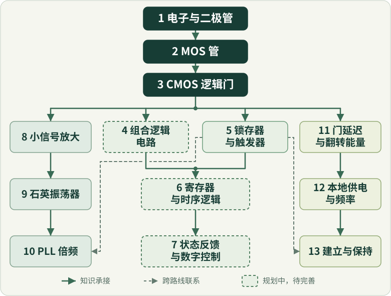

# 半导体与电路基础

在电路图上，一个反相器只占一个符号。输入电压从低变高时，它怎样把输出电压拉低？如果下一级是寄存器，又该等到什么时候采样？这两个问题把硅里的电荷、晶体管里的电流和电路里的时钟连在了一起。

先跟着电子看清二极管为什么会整流。让两个结共用一片很薄的基区，就可以追问[发射区注入的电子怎样抵达集电极](electrons-to-diode/README.md#bjt)。沿 MOS 管这条路走，则能在[硅片剖面上找回反相器的输入、输出和电源线](cmos-logic-gates/README.md#physical-inverter)。把两个反相器接成反馈环后，就可以追问一个比特怎样保存、怎样被下一拍的新值改写。想追问时钟从哪里来，可以从晶体管放大读到 PLL。想知道一拍要留多久，可以先读[电容充到半高要多久](fanout-and-wire-delay/README.md#rc-half)，再顺着门延迟、本地供电和寄存器的采样窗口往下读。

## 文章知识关系

本系列规划十三篇文章，从电子与材料出发，逐步解释器件、数字电路、时钟，以及真实芯片中的功耗和时序约束。已有十一篇正文，第 6、7 篇为新增提纲，后续逐篇完善。

下表列出每篇文章的核心问题及前置知识，按推荐阅读顺序排列。也可以根据下方的学习目标选择，不必始终从第一篇读起。

<figure class="foundation-article-map" markdown="1">

<figcaption>实线表示知识主线的承接关系，虚线箭头表示不同路线之间的联系，虚线边框表示待完善文章。箭头不是强制阅读顺序。点击图可查看大图。</figcaption>
</figure>

| 文章 | 核心问题 | 建议先掌握 |
| --- | --- | --- |
| 1. [从电子到二极管](electrons-to-diode/README.md) | 硅如何导电，PN 结如何形成势垒并实现单向导通？ | 本系列起点 |
| 2. [MOS 管与沟道电流](bands-to-channel/README.md) | 栅极如何控制沟道，源漏电压如何驱动电流？ | 第 1 篇：能带、掺杂与载流子 |
| 3. [从 MOS 管到逻辑门](cmos-logic-gates/README.md) | NMOS 和 PMOS 如何通过充放电产生逻辑 0 和 1？ | 第 2 篇：MOS 管的导通与关断 |
| 4. [组合逻辑电路](combinational-logic/README.md) | 怎样用逻辑门构造具有特定功能的电路？ | 第 3 篇：逻辑电平与基本逻辑门 |
| 5. [从反相器到锁存器与触发器](latch-and-divider/README.md) | 电路如何保存一个比特、按时钟边沿采样并实现分频？ | 第 3 篇：反相器与逻辑电平 |
| 6. [寄存器与时序逻辑](registers-and-sequential-logic/README.md) | 多个触发器怎样保存、选择性更新和逐拍传递数据？（待完善） | 第 4、5 篇：组合逻辑与边沿采样 |
| 7. [状态反馈与数字控制](digital-control/README.md) | 电路怎样按状态更新并控制数据通路？（待完善） | 第 4、6 篇：组合逻辑与寄存器 |
| 8. [晶体管的小信号放大](transistor-amplifier/README.md) | 晶体管如何把输入电压的微小变化放大？ | 第 1–3 篇：器件电流与反相器 |
| 9. [石英振荡器的起振与稳幅](quartz-oscillator/README.md) | 石英的谐振如何与放大电路结合，产生稳定的时钟？ | 第 8 篇：信号放大 |
| 10. [PLL 怎样实现二倍频](integer-pll/README.md) | 锁相环如何通过相位比较和反馈控制改变时钟频率？ | 第 5、9 篇：分频与时钟来源 |
| 11. [门延迟、翻转能量与芯片功耗](fanout-and-wire-delay/README.md) | 负载与连线为何影响翻转速度，一次翻转为何消耗能量？ | 第 3 篇：逻辑门与电容充放电 |
| 12. [本地供电、翻转能量与时钟频率](supply-voltage-and-frequency/README.md) | 供电压降、去耦和工作电压如何影响能量与延迟？ | 第 11 篇：门延迟与翻转能量 |
| 13. [建立与保持：数据为何太晚或太早](pvt-and-path-delay/README.md) | 数据为什么可能错过采样窗口，工艺、电压与温度如何改变时序？ | 第 5、11、12 篇：边沿采样与路径延迟 |

## 按学习目标选择

- **从零理解数字电路（1 → 2 → 3 → 4 → 5 → 6 → 7）**：从电子运动开始，理解晶体管、逻辑门、比特存储和数字控制。第 6、7 篇目前为提纲；完成后，这条路线将为后续学习计算微架构和存储系统提供基础。
- **理解时钟从哪里来（8 → 9 → 10）**：沿小信号放大、石英振荡到锁相环阅读；如果还不熟悉反相器或分频，先补第 3、5 篇。
- **理解芯片的频率与功耗（11 → 12 → 13）**：如果已经了解逻辑门与触发器，可以直接进入这条路线，理解电路中的充放电、供电和采样约束。

## 接着往哪读

想知道芯片怎样做乘法，可以从几个输入位画起，看逻辑门怎样生成部分积，部分积又怎样相加。见[从部分积到 MAC](../microarchitecture/01-datapath/multiply-accumulate-from-gates.md)。

想知道一个比特怎样在片上存储器里保存，可以从两个交叉耦合的反相器出发，进一步看存储单元怎样连接位线、怎样完成读写。见[6T SRAM 存储单元](../storage/02-sram/foundations/6t-cell-bistable-storage.md)。

想知道时钟能跑多快，可以跟着数据走过两个寄存器之间的一段逻辑，算一算它能否赶上下一个采样边沿。见[电路与时序基础](../microarchitecture/02-pipeline/electrical-timing-foundations.md#4-算一条路径需要多长的时钟周期)。

想从硅片继续追到封装，可以顺着[板卡到裸片的供电路径](supply-voltage-and-frequency/README.md#board-to-die)往里走。再换一根信号线，看[GPU 与 HBM 之间的横向连线，以及 HBM 堆栈里的垂直连接](../chip-development/FAB/wiki/04-back-end-packaging/hbm-as-case-study/ai-gpu-hbm-package-architecture.md#hbm-section)。
