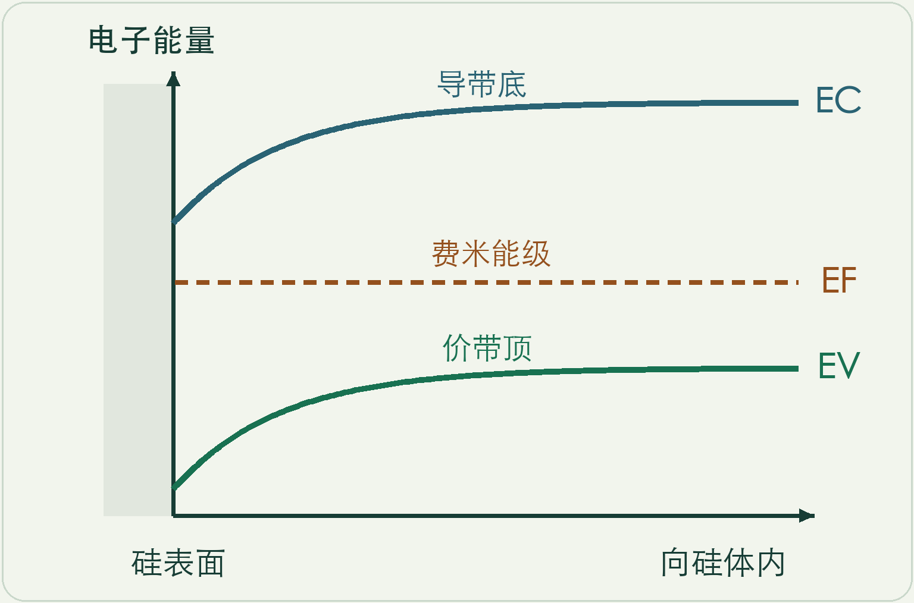

# 从能带到沟道，栅极怎样控制硅中的电荷

把一只增强型 NMOS 的源极、漏极和衬底接到 0 V，慢慢提高栅压。栅极与硅之间隔着绝缘层，硅表面却能出现一层可移动的电子。这些电子从哪里来？为什么同一块 p 型硅，靠近栅极的薄层可以由电子主导导电？

## 先看能量，再数载流子

在硅晶体里，电子可占据的能量组成能带。价带接近填满时，一个空位可以表现为可移动的空穴。电子获得足够能量后，可以进入导带并参与导电。导带底与价带顶之间的能量差称为**带隙**。热平衡下，**费米能级**与温度一起决定各能态被电子占据的概率。

以室温、非简并掺杂的硅为例。在相同温度下，费米能级离导带底越近，导带里的电子浓度越高。n 型硅的费米能级靠近导带，p 型硅的费米能级靠近价带。把 p 区和 n 区做成一个结并达到热平衡后，费米能级在两侧对齐。耗尽区里的电势随位置变化，画出来的带边也随位置变化，这就是**能带弯曲**。[胡正明《现代半导体器件》](https://www.chu.berkeley.edu/modern-semiconductor-devices-for-integrated-circuits-chenming-calvin-hu-2010/) · [PN 结中的固定电荷和势垒](../silicon-to-logic/README.md)

## 隔着绝缘层加电压

先把结构简化为栅极、绝缘层和 p 型硅组成的 **MOS 电容**。取硅体内一处作电势参考。先找到能带在表面附近不弯曲时的栅压，称为**平带电压**。栅材料、硅和绝缘层电荷等因素会使它偏离 0 V。下表描述表面达到准静态平衡后的变化。

| 栅压如何变化 | 硅表面发生什么 | 表面附近的净电荷主要来自哪里 |
| --- | --- | --- |
| 从平带向负方向调 | 空穴受到吸引，聚集到界面 | 可以移动的空穴，形成积累层 |
| 从平带向正方向调 | 空穴被排开，表面一带缺少多数载流子 | 留在晶格里的带负电受主离子，形成耗尽层 |
| 继续调正，进入强反型 | 界面附近的电子浓度大幅增加 | 耗尽区外加一层可移动的反型电子 |

图中某处的静电势升高时，带负电的电子势能降低，因此该处带边向下弯。在表面，导带底更接近费米能级，电子浓度增大。图中曲线表示变化方向。绝对能量和耗尽深度要由掺杂、栅压和结构确定。[胡正明，第 5 章《MOS 电容》](https://www.chu.berkeley.edu/wp-content/uploads/2020/01/Chenming-Hu_ch5.pdf)

## 加上源极和漏极

在栅极两侧各做一个 n⁺ 区，作为源极和漏极。提高栅压时，电源经外部导线改变栅极电荷。电场穿过绝缘层改变硅表面电势。与反型层相连的源漏区可以提供电子。再给漏极施加一个小正电压，沟道中就有横向电场，电子从源端向漏端移动。**栅压控制沟道中的电荷，源漏压差驱动沿沟道的净电流。**

这也解释了一个边界情况。在均匀、无横向电场的沟道中，源漏同电势时，即使已有反型层，稳态源漏净电流仍为零。单独的 MOS 电容缺少源漏这两个电子库，快速扫压时少数载流子的补充可能跟不上。阈值电压描述进入强反型的条件。实际 MOSFET 在阈值以下也有亚阈值电流。[胡正明《MOS 电容》](https://www.chu.berkeley.edu/wp-content/uploads/2020/01/Chenming-Hu_ch5.pdf)

给 MOSFET 选定一个工作点，再把栅压轻轻提高几毫伏，漏电流会变多少？接着看[晶体管为什么能放大微弱信号](../transistor-amplifier/README.md)。
