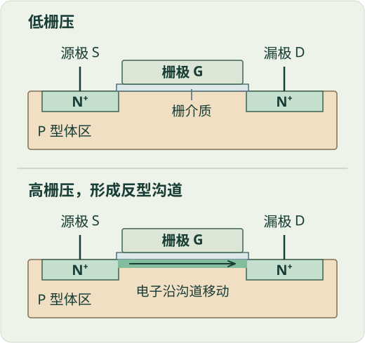
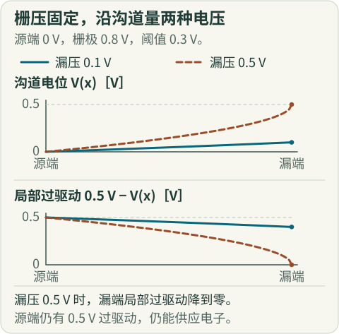
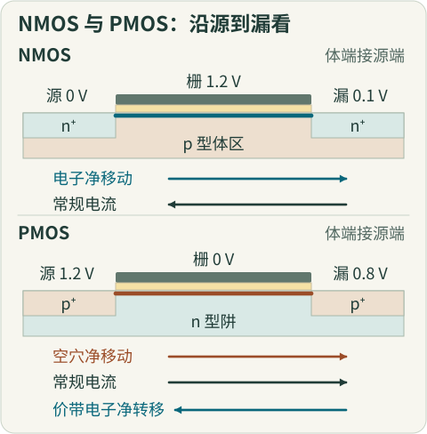

# MOS 管怎样隔着绝缘层控制电流？

把一只 NMOS 的源极、漏极和体端都接到 0 V，在漏极串入电流表。慢慢提高栅压，直到硅表面出现一条从源到漏的电子沟道。等电压稳定，电流表仍然读零。保持栅压，只把漏极从 0 V 抬高一点，电流表就有了读数。

这里有两个可以分开观察的过程。**第一步，栅极隔着绝缘层，怎样使硅中出现可以移动的电子？第二步，这些电子已经在沟道里，是什么让它们开始向同一侧净输运？** 两次实验都用下面这只平面增强型 NMOS，先从器件剖面认出四个端子。

从左往右依次是源区 S、栅下硅表面和漏区 D。向下看，栅极 G、栅介质和硅体构成一个电容。体区通过图中省略的第四个接触 B 接地。后面沿**深度**观察栅下电荷，沿**水平方向**观察源漏输运。用源极作电压参考，栅源电压 VGS = VG − VS，漏源电压 VDS = VD − VS。

## 源漏都是 n⁺，中间的 p 型硅为什么挡住电子？ {#先看能量再数载流子}

先让四端均为 0 V。左右两块 n⁺ 硅里都有大量导带电子。中间的 p 型硅含有固定在晶格中的负受主，体区里的多数空穴补偿这些负电荷。注意符号，p 型硅的整体仍近似电中性。

从源区挑一个导带电子，试着沿栅下表面走向漏区。它首先遇到 n⁺ 源与 p 型体区之间的 PN 结。沿这条路线，未形成沟道时，中间的导带底比源区更高。室温下能越过这道势垒的电子只占很小一部分。即使在漏端加一点正电压，漏区与 p 型体区的结也只是反偏，难以从体区得到大量电子。要让两个 n⁺ 区之间能持续输运，得先改变**靠近表面的这一条路径**。这里用到了上一章区分的两件事：到达势垒的载流子有多少，以及它们沿途遇到的带边有多高。[回看 PN 结的电子势垒](../electrons-to-diode/README.md#field)

## 实验一：保持源漏等电势，只调栅压 {#隔着绝缘层加电压}

先取栅极正下方的一小片硅。逐个比较稳定后的状态。为清楚分辨表面电荷，先找**平带电压** VFB，即这片硅的能带从表面到体内保持平坦时的栅压。它受栅材料和绝缘层电荷等影响，可以偏离 0 V。在这个参考点向负方向调栅，空穴聚到界面，叫积累。现在回到平带，向正方向调栅。

**先看栅极导线。** 电源从栅极抽走一些电子，栅上净正电荷增加。隔着介质，电场指向硅内，表面的正空穴受到向体内的力。用价带电子的语言说，相邻电子填补靠近表面的空位，空位向深处传递。空穴浓度下降后，原来由它们补偿的负受主逐渐显露。受主仍在原来的晶格位置。这层多数载流子变少的硅就是耗尽区。测栅极导线，可以在调电压时测到充电电流。理想栅介质中没有持续穿行的导电电子，电荷重排完成后，栅极仍能保持电场。

**再看硅表面的能量。** 表面相对体内的静电势升高，电荷为 −q 的电子在表面的静电势能便降低。同一种硅的导带底和价带顶随之一起下移。读图时手指从右侧体内移到左侧界面，两条带边之间仍隔着带隙。源、漏、体等电势并等到稳定时，图中硅内的费米能级是水平的。表面的导带底离这条线更近，导带态被电子占据的概率就更高。

**最后追问，这些电子从哪里来？** 正栅压一边降低表面导带底，一边降低源漏电子进入这片表面要越过的势垒。两侧有接触的 n⁺ 区都能沿着硅提供导带电子。电子在界面下方占据能量较低的导带态，邻近的一薄层逐渐变为电子占多数。这里的受主掺杂依旧是 p 型，改变的是表面载流子的占据，这叫**反型**。若中间的反型层连续连接源、漏，它就成了沟道。栅上新增的正电荷，此时既由耗尽层的负受主补偿，也由界面附近的可移动负电子补偿。[胡正明《现代半导体器件》第 5 章，图 5–7 至 5–10](https://www.chu.berkeley.edu/wp-content/uploads/2020/01/Chenming-Hu_ch5.pdf#page=6)

可以从[上一篇的室温算例](../electrons-to-diode/README.md#fermi)看出变化有多大。取均匀 p 型硅，受主浓度约 10¹⁶ cm⁻³，本征浓度取 10¹⁰ cm⁻³。体内导带电子浓度约为 10⁴ cm⁻³。在非简并平衡近似下，表面相对体内每升高约 60 mV 的**静电势**，表面电子浓度就约增十倍。升高约 0.36 V 时，表面电子和空穴都约为 10¹⁰ cm⁻³；再升高约 0.36 V，表面电子浓度才接近体内原有的多数空穴浓度 10¹⁶ cm⁻³。后一个条件常用于定义强反型阈值。这里改变的是**硅表面电势**。外加栅压还要承担栅介质的压降，并以平带电压为参考，所以这些数值不能直接当作栅极门限。实际的亚阈值电流也随着栅压连续变化。

回到电流表。调栅的过程中，电子从源漏进入界面，仪表可能记录到瞬态电流。等变化结束，从左向右、从右向左通过沟道截面的电子通量在平均意义上相抵。**反型层已经有电子，稳态源漏净电流仍为零。** 如果只做一个没有 n⁺ 源漏的 MOS 电容，反型电子要依靠硅内热产生等路径补充。快速扫栅压时，电子可能来不及补上，耗尽层会暂时继续加深。两种结构的静态能带图可以很相似，得到那批电子所需的时间却可能相差很大。[胡正明，第 5 章的反型电子来源与深耗尽](https://www.chu.berkeley.edu/wp-content/uploads/2020/01/Chenming-Hu_ch5.pdf#page=9)

## 实验二：保持栅压，只调漏压 {#加上源极和漏极}

让源、体继续接 0 V，把栅压固定在 0.8 V，漏极从 0 V 提到 0.1 V。此处换用一组**独立的长沟道教学模型参数**，取阈值 VT = 0.3 V，忽略接触压降和体效应。上面的掺杂算例没有给出栅材料、栅介质等完整参数，不能单靠它算出这个阈值。

在漏极的欧姆接触处，外电路从 n⁺ 漏区取走电子并维持较高的漏电位；源端的接触则不断补充电子。沿沟道建立的横向电场主要从漏端指向源端。电子带负电，在原有热运动上叠加了从源向漏的净运动。电流表通常按**常规漏极电流**记正号，方向从漏到源。这里有两个电源回路：栅极电源负责建立和调整控制电荷，漏源回路给持续的输运提供能量。

### 同一根栅极，为什么对沟道不同位置的控制强弱不同？ {#channel-voltage}

理想金属栅各处都近似 0.8 V。现在想象把另一支表笔从源端移到漏端。源端被外电路固定在 0 V，漏端被固定在 0.1 V。硅沟道有有限电导，承载稳态电流需要沿途存在电压降。把它分成许多小段，流过每一段的电流一样大。在线性区，可以把各段看作小电阻，段上的压降为 IΔR，全部相加正好是端子间的 0.1 V。若电势处处相等，既接不上两个不同的端电压，也维持不了这里的漂移电流。

设 V(x) 是沿沟道位置 x 相对于源的**局部沟道电压**。强反型渐变沟道模型里，可用它描述电子的局部电化学势变化。刚才沿深度看能带时用的**表面静电势**，还包含栅引起的垂直带弯，两者不能直接互换。

先取图中的 0.1 V 曲线。在源端，栅极比沟道高 0.8 V，扣掉阈值，还有 0.5 V 用于维持反型电荷。在漏端，栅极只比沟道高 0.7 V，扣掉相同阈值，只余 0.4 V。在夹断前的强反型沟道里，像算一个小电容那样，**单位面积的反型电子电荷量大小约为 Cox[VGS − VT − V(x)]**，其中 Cox 是单位面积栅介质电容。漏端的反型电荷于是约为源端的 0.4/0.5 = 80%。沟道“变薄”，在这个模型里就是局部每单位面积的导电电子变少。电荷较少的那段局部电阻较大，承担的单位长度压降也较大。不同位置间的电压通常不会严格按长度均分。[胡正明，第 6 章图 6–15，沟道电压与反型电荷](https://www.chu.berkeley.edu/wp-content/uploads/2020/01/Chenming-Hu_ch6-1.pdf#page=16)

### 把沟道等分成四段，哪一段分到的压降最大？ {#five-points}

换一组便于沿路读数的端电压。取 VG = 1.2 V、VT = 0.4 V，源和体仍接 0 V，漏接 0.4 V。把源、漏之间的距离等分成四段，在端点标 A 到 E。如果沟道真是均匀电阻，各点会依次读到 0、0.1、0.2、0.3、0.4 V。现在用上面随位置改变的反型电荷计算，结果怎样？

| 位置 | 沟道电压 V(x) | 栅极比此处高多少 |
| --- | ---: | ---: |
| A · 源端 | 0 V | 1.200 V |
| B · L/4 | 0.079 V | 1.121 V |
| C · L/2 | 0.168 V | 1.032 V |
| D · 3L/4 | 0.271 V | 0.929 V |
| E · 漏端 | 0.400 V | 0.800 V |

从第二列取相邻两行做减法，四段承担的压降约为 **0.079、0.089、0.103、0.129 V**。越靠近漏端，栅极比当地沟道高出的电压越少，反型电子越少。同样长的一段要传递同样大的电流，就要有更陡的电压变化。如果一组数读起来越往漏端每段压降越小，就与这只长沟道 NMOS 的近似条件相冲突。[调节漏压，读 A 至 E 五处的沟道电势](experiments.html#channel)

这组数可以独立复算。写 Vov = VGS − VT。把下文的局部电流式分别从源端积到 x、从源端积到 L，再取比值，得到 **x/L = [2VovV(x) − V(x)²] / [2VovVDS − VDS²]**。譬如取 x/L = 1/2，代入 Vov = 0.8 V、VDS = 0.4 V，解出介于 0 和 0.4 V 之间的根约为 0.168 V。此处的斜率描述模型中的沟道电压，强反型近似在漏端即将夹断时会逐渐失效。

### 漏端已经夹断，后面的电子怎样到达漏极？ {#pinch-off}

回到前一只阈值为 0.3 V、栅压为 0.8 V 的管子。把漏极提高到 0.5 V，漏端局部的栅对沟道电压只剩 0.8 − 0.5 = 0.3 V，刚好等于这个模型的阈值。沿途的强反型电子面电荷向漏端逐渐减小，理想模型在末端把它算到零。这就是**夹断**的起点。源端仍有 0.5 V 的过驱动量，仍能把大量电子送进沟道。对 A 至 E 的那只管子，同样的判据给出 1.2 − 0.4 = 0.8 V，漏端到 0.8 V 才进入夹断。

再把漏压升到 0.8 V。一个电子先穿过从源端延伸过来的反型沟道，走到靠近漏端的夹断区域。这里移动载流子密度较低，却有很强的横向电场，能把到达的电子扫进漏极。这一点与反偏 PN 结收集少数载流子相似。眼前的 MOSFET 在源端接着一条能够持续送来电子的沟道。新增的漏压主要落在漏侧高场区，理想长沟道模型下，源端供应与沟道输运共同决定的电流趋于饱和。[胡正明，第 6 章图 6–17，夹断后的电子输运](https://www.chu.berkeley.edu/wp-content/uploads/2020/01/Chenming-Hu_ch6-1.pdf#page=18)

| 漏源电压 | 沿沟道看到的变化 | 理想漏极电流 |
| --- | --- | ---: |
| 0 V | 沟道已有反型电荷，左右通量相抵 | 0 µA |
| 0.1 V | 电子净向漏端移动，漏端仍有强反型电荷 | 9 µA |
| 0.5 V | 漏端恰到夹断起点 | 25 µA |
| 0.8 V | 电子经过漏端高场区后被收集 | 25 µA |

从沟道上每一小段的电荷，算出 9 µA 和 25 µA

取沟道宽 W、长 L，电子迁移率 μn 近似恒定。设过驱动电压 Vov = VGS − VT。靠近源端的一小段，栅下的反型电荷多。往漏端走，反型电荷随 V(x) 增加而减少。对尚未夹断的沟道，局部电流大小等于沟道宽度乘以电子面电荷量大小，再乘以平均漂移速率。在渐变沟道、强反型的漂移近似下，得到

**ID ≈ W μnCox[Vov − V(x)] dV/dx。**

稳态时各截面流过相同的 ID。把等式两边乘以 dx，从源到漏累加，左边是 IDL。右边从 V = 0 积分到 V = VDS，于是 **ID = k(VovVDS − VDS²/2)**，其中 k = μnCoxW/L。取 k = 200 µA/V²、Vov = 0.5 V、VDS = 0.1 V，就得到 200 × (0.05 − 0.005) µA = **9 µA**。

夹断刚出现时，代 VDS = Vov，得到饱和电流 kVov²/2 = **25 µA**。漏压继续升高时，前面的积分只适用于仍然有强反型沟道的部分。此模型忽略了有效沟道变短、速度饱和和其他短沟道效应。实际器件的饱和区曲线仍可能向上倾斜。[MIT 6.012 的长沟道大信号模型](https://ocw.mit.edu/courses/6-012-microelectronic-devices-and-circuits-fall-2009/resources/mit6_012f09_lec11/)

## 换成 PMOS，哪一路电荷反过来了？ {#pmos}

在 n 型阱里做两个重掺杂 p⁺ 区，栅极仍与硅绝缘。现在把源和体接到 1.2 V，栅也从 1.2 V 起步。这样 VSG = VS − VG = 0。保持源、漏、体同为 1.2 V，把栅压从 1.2 V 降到 0 V，栅上增加负电荷，阱表面的多数导带电子被排开，留下未补偿的固定正施主。表面电势相对体内降低，带边上弯，价带顶更靠近硅侧的费米能级，价带中出现更多可移动的空位。p⁺ 源漏可以为反型层提供空穴。当 VSG 足够大，界面下方形成一条空穴沟道。和刚才一样，若源漏同为 1.2 V，稳态没有净源漏电流。

看图中下面那只 PMOS。保持栅极 0 V、源极和体端 1.2 V，把漏极降到 0.8 V。于是栅驱动 VSG 是 1.2 V，推动空穴输运的 VSD 是 0.4 V。沿沟道的空穴从高电位的源端净移向低电位的漏端，常规电流同向。只看价带电子也能读出这个方向：漏侧的价带电子依次向源侧填补空位，空位就向漏侧传播。再看上面的 NMOS。栅极 1.2 V、源和体 0 V、漏极 0.1 V，电子从低电位源端向高电位漏端净移动，常规电流与电子运动反向。这就是两种导电通路接电路时要核对的两个方向。[胡正明《现代半导体器件》第 6 章，NMOS 与 PMOS](https://www.chu.berkeley.edu/wp-content/uploads/2020/01/Chenming-Hu_ch6-1.pdf)

拿一份器件手册核对，“超过阈值”能驱动多大的负载？

以 Nexperia 的分立 NMOS 2N7002 为例。在结温 25 °C、VDS = VGS 时，厂家以 ID = 0.25 mA 定义栅源阈值，规格范围为 1.0–2.5 V。若要在同一温度下传输 75 mA，手册在 VGS = 4.5 V 处给出的导通电阻最大值为 5.3 Ω。阈值测试告诉你何时达到那个小电流；所需负载能否在给定的压降下工作，要查相应栅驱动下的导通电阻或输出特性。这是另一只真实器件，与上面的理想模型参数各有自己的条件。[Nexperia 2N7002 数据手册，表 7](https://assets.nexperia.com/documents/data-sheet/2N7002.pdf#page=5)

## 只用一只 NMOS，能把一个输出节点控制成什么电压？ {#output-node}

让 NMOS 的源和体接地，漏极接一个输出节点。节点上的负载电容此前充到 0.8 V，现在移开充电电源。提高栅压，导电沟道出现。常规电流从输出流向地，电子从地端经沟道到达电容靠输出的一侧，逐步补偿那里的正电荷，输出电压下降。这就是**下拉**。

等输出已接近 0 V，再把栅压降到 0 V。沟道变弱，然后呢？关掉下拉通路只能使放电电流变小。理想情况下若忽略漏电、切换耦合，节点会保留刚才的电荷。真实节点会受漏电或干扰，单靠这只关断的 NMOS 难以建立可靠的高电平。要把输出重新充到 0.8 V，电荷得从电源获得一条新的通路。把一只 PMOS 接在电源与同一个输出之间，并让两个栅极共用输入，会发生什么？[下一篇：两只 MOS 管怎样组成一个逻辑门？](../cmos-logic-gates/README.md)
