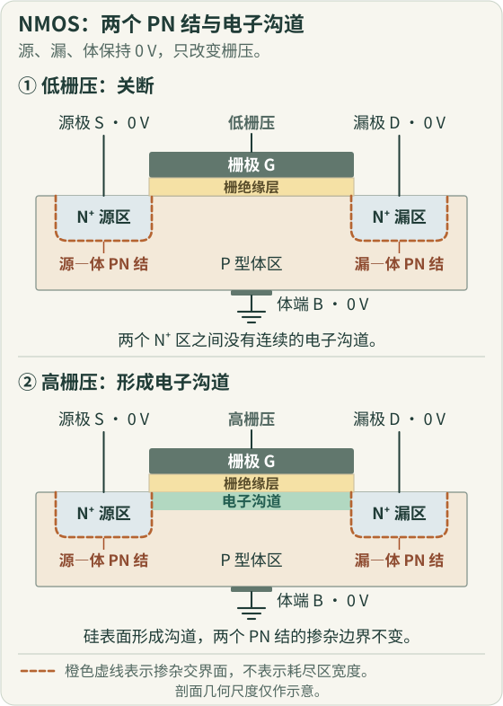
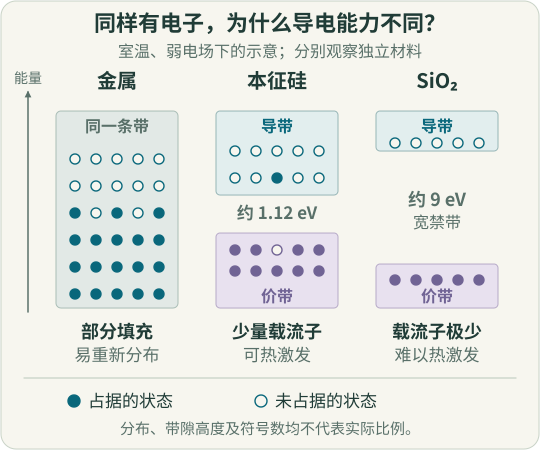
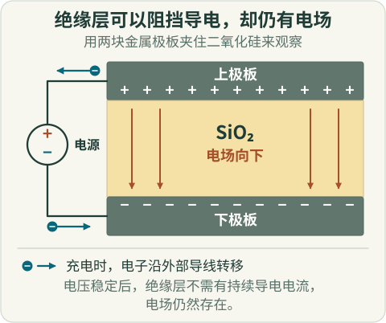
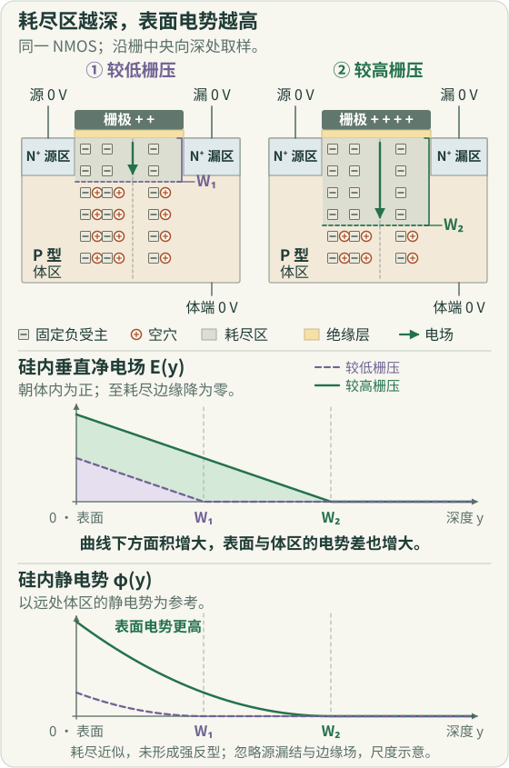
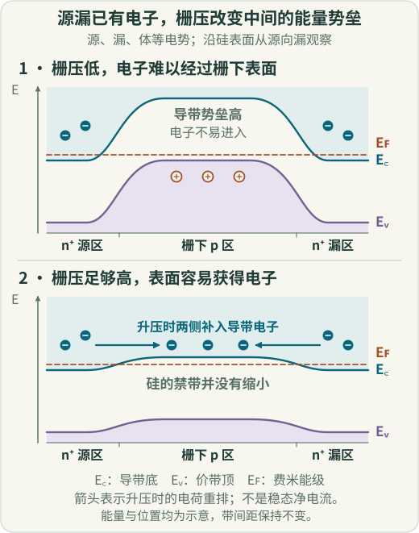
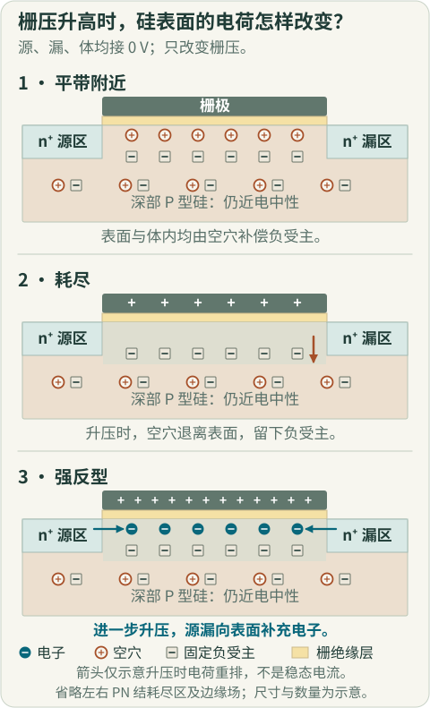
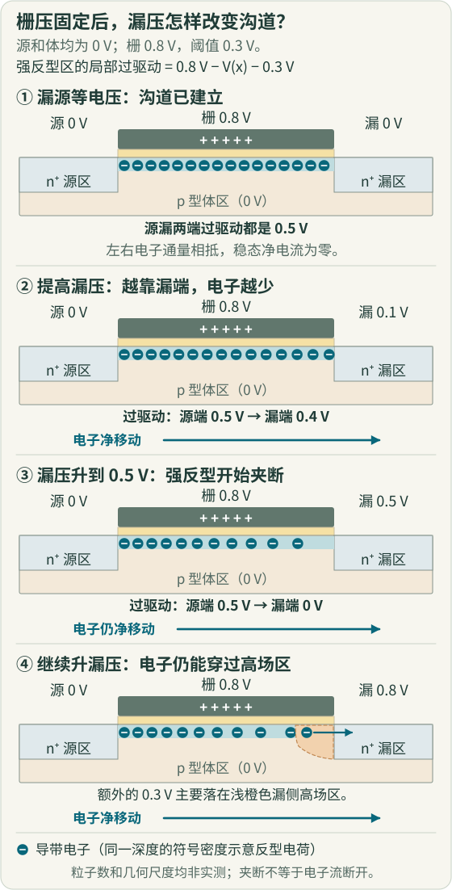
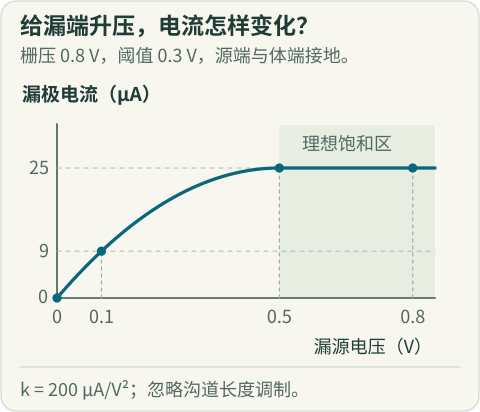
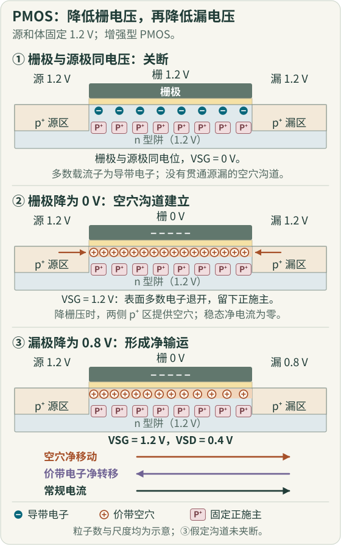
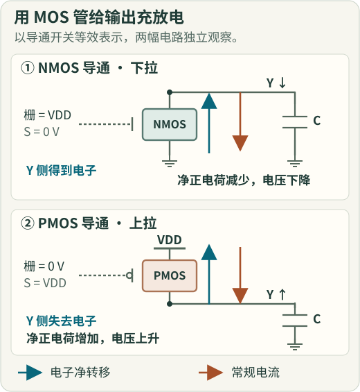

# MOS 管怎样隔着绝缘层控制电流？

手机、电脑等电子设备中，并不是所有电路都需要一直工作。为了减少功耗，可以通过电信号接通或断开某些电路的供电。[TI：负载开关的基本工作原理](https://www.ti.com/lit/an/slva652a/slva652a.pdf)

这就需要一种能够由电信号控制的开关。上一篇介绍的二极管，能否导通主要取决于自身两端的电压。如果希望用一个独立的信号控制另一条电流路径，就需要增加一个控制端。

**MOS 管（MOSFET，金属–氧化物–半导体场效应晶体管）**就是这样一种器件。控制端称为栅极（Gate，G），被控制的电流路径位于源极（Source，S）和漏极（Drain，D）之间。

以常见的增强型 NMOS 为例。两侧的 N⁺ 区是重掺杂的 N 型硅，里面有大量导带电子。它们与中间的 P 型体区分别形成 PN 结。

<figure markdown="1">

</figure>

图中的栅极与硅之间隔着一层绝缘材料。除了源极、漏极、栅极，MOS 管还有一个连接半导体体区的**体端（Body，B）**。本文讨论的 NMOS 将体端和源极接地。

原本被 P 型硅隔开的两个 N⁺ 区，为什么只需提高栅压，就能形成一条导电沟道？要理解这个过程，先来看绝缘层在其中起什么作用。

## 为什么栅极与硅之间要有绝缘层？ {#gate-insulator}

我们希望控制端能够影响源漏之间的导电路径，却不需要持续向这条路径注入电流。将控制端与硅隔开，仍然能够借助电场改变硅中的电子分布。为此，先来看什么样的材料能充当绝缘层。

### 有些材料为什么不导电？

回顾[上一篇的能带模型](../electrons-to-diode/README.md#bands)：只有当能带中既有电子，又有可以改变占据的空态时，电子才可能通过带内响应形成净电流。完全填满的能带不能用这种方式导电。

金属有部分填充的能带。施加电场后，电子的占据分布可以改变，因此金属容易导电。硅的价带与导带则隔着一段禁带，室温下的带隙约为 1.12 eV。

如果换成带隙约为 9 eV 的二氧化硅（SiO₂），在通常温度下，价带电子很难获得足够的能量进入导带。材料中可供输运的电子和空穴就极少。

<figure markdown="1">

</figure>

绝缘体并不是没有电子，而是在正常工作条件下，缺少能够参与净电荷输运的载流子。

### 为什么选用氧化物作为绝缘层？

硅与氧结合后，形成以 Si–O 键连接的 SiO₂ 网络。原来硅中的电子状态随原子之间的相互作用重新组织，形成了新的能带结构。这不是在原有的硅能带上简单地加一些氧原子。

SiO₂ 中低能量的已占据状态与高能量的导电状态相隔很大，热激发十分困难。硅片表面还可以直接生长出质量较好的 SiO₂ 薄膜，因此它长期被用作 MOS 管的栅绝缘层。

电子若试图从硅进入这层材料，也会遇到界面势垒。例如在常用的 Si/SiO₂ 能带模型中，SiO₂ 的导带底比硅高约 3.1 eV。这进一步限制了电子从沟道进入绝缘层。[Stanford EE311 栅介质讲义](https://web.stanford.edu/class/ee311/NOTES/GateDielectric.pdf) · [胡正明《现代半导体器件》第 5.1 节](https://www.chu.berkeley.edu/wp-content/uploads/2020/01/Chenming-Hu_ch5.pdf#page=3)

不过，**氧化物不是绝缘体的同义词**。例如氧化铟锡（ITO）可以作为透明导电电极。选择栅介质要看材料形成的电子状态、界面势垒以及漏电等性质，而不能仅凭它是不是氧化物判断。[美国能源部：透明导电氧化物](https://www.energy.gov/sites/default/files/2022-02/2022-ssl-manufacturing-status-opportunities_0.pdf)

硅属于类金属元素，传统的 SiO₂ 栅氧并非通常所说的金属氧化物。现代 MOS 管也常用 HfO₂（氧化铪）等金属氧化物作为栅介质。

金属铪可以导电，但铪与氧成键后形成了不同的电子状态。HfO₂ 具有约 5.7 eV 的宽带隙，也很难通过热激发产生大量载流子。[HfO₂ 的材料特性综述](https://www.engr.colostate.edu/ECE574/Papers/Papersforstudents/1-s2.0-S0370157315004986-main.pdf)

深化阅读：为什么现代 MOS 管会改用高介电常数材料？

绝缘层越薄，栅极对硅表面电荷的控制通常越强，但电子穿过势垒的隧穿概率也会增大。介电常数较高的材料（High-k）可以在保持相近栅电容的同时使用更厚的薄膜，从而降低隧穿漏电。

现代工艺还需要处理栅介质与硅之间的界面缺陷等问题。实际栅介质可以由多层材料组成。[胡正明《现代半导体器件》第 7.4 节](https://www.chu.berkeley.edu/wp-content/uploads/2020/01/Chenming-Hu_ch7.pdf)

### 电子过不去，电场为什么还能影响另一侧？

绝缘层限制的是电荷穿过材料的净输运，并不是电场本身。即使没有电子能从一侧穿到另一侧，两侧的带电粒子也可以通过电场相互作用。

可以先看最简单的结构：两块导体中间隔着 SiO₂，将它们接到电源上。电源从上方导体取走电子、向下方导体补充电子，两侧因而分别带有净正电荷和净负电荷。

<figure markdown="1">

</figure>

在电场作用下，绝缘材料内部的正负电荷也可以发生微小的相对位移（极化），但这不同于电子穿过整个材料形成导电电流。电压稳定以后，理想绝缘层两侧仍然存在电场，却没有持续的导电电流。

这就是**电容**的基本工作方式。将下方的金属极板换成硅，上方的金属极板作为栅极，就得到了 MOS 结构。

改变栅极电压时，外部电路通过导线重新分配两侧的电荷，产生的电场会改变硅表面电子和空穴的分布。

真实栅介质过薄、场强过高或存在缺陷时，可能有漏电，甚至击穿。以下先讨论正常工作中近似绝缘的栅介质。

## 不加栅压，为什么两个 N⁺ 区之间没有导电通路？ {#先看能量再数载流子}

回到开头的 NMOS。先将源极、漏极、体端和栅极都接到 0 V。两个 N⁺ 区各自与 P 型体区形成 PN 结，结附近有耗尽区和内建电场。

注意，外部导线接相同的电压，不代表 N⁺ 区与 P 型体区内部的静电势相同。[上一篇](../electrons-to-diode/README.md#contacts)已经解释过，硅内部的内建电势差在热平衡时不会直接表现为外部端口的电压差。

从 N⁺ 源区挑一个导带电子，试着沿硅表面走向漏区。按照[PN 结中的势垒](../electrons-to-diode/README.md#field)，它先遇到导带底升高所形成的能量障碍。因此，低栅压下的源区与漏区之间没有连续的电子沟道。

如果仅把漏极电压抬高，漏区与接地的 P 型体区之间的 PN 结还会反偏。在正常关断条件下，只加漏压并不能建立大量电子连续通过的路径。

因此，想让电子顺利从源到漏，需要降低栅下硅表面的势垒，而不必改变整块硅的掺杂类型。

## 栅极怎样让 P 型硅的表面出现电子沟道？ {#隔着绝缘层加电压}

让源极、漏极和体端始终接 0 V，逐步提高栅压。这样可以先观察沟道怎样形成，而不受漏源电压驱动的横向净电流干扰。

### 第一步：把原有的空穴排开

在 P 型硅中，受主（例如硼）接收电子后成为固定的负离子。多数空穴补偿了这些负电荷，使均匀的 P 型硅整体近似电中性。

提高栅压时，电源通过栅极导线取走电子，栅上的净正电荷增加。电场使价带电子向硅表面重新分布，填补空态。从空穴的视角看，就是空穴向远离栅极的方向移动。

空穴离开表面附近后，原本由空穴补偿的负受主显露出来，形成**耗尽区**。但在均匀掺杂的硅中，固定受主仍均匀分布在原来的晶格位置，不会被栅极吸引到硅表面。

当表面附近原有的空穴已经很少时，在这片区域内继续填补空态所能增加的净负电荷已经很有限。此时还未出现大量导带电子，继续提高栅压，会使更深处的空穴被排开，耗尽区向体内扩大。

### 第二步：为什么栅下硅表面的电势会升高？

P 型硅中的净负电荷增加，是否会像上一篇 PN 结中的负离子那样，更强烈地阻碍 N⁺ 区的导带电子进入？不能只看到硅中的负电荷，还必须考虑栅极上的正电荷和它们各自所处的位置。

先在同一只 NMOS 的栅极中央，沿垂直方向观察电场。暂时忽略两侧 PN 结的边缘电场。以硅表面与深部体区电势相同的状态（平带）为起点，此时的栅压不一定为 0 V。

像前面理想电容一样，忽略界面电荷和边缘效应时，栅极和硅中增加的净电荷等量异号。不同之处在于，硅中的负电荷分布在耗尽区内部，而非全部集中在表面。

把耗尽区的负离子想成许多水平薄层。在任意两层之间，正栅电荷与下方负离子都产生向下的电场，上方负离子则产生向上的电场，只抵消其中一部分。

在这个平面耗尽近似下，根据高斯定律，净电场的大小取决于该处下方尚未被空穴补偿的负电荷量。越往深处，下方剩余的负电荷越少，指向体内的净电场越弱；到耗尽区边缘，电场近似为零。

<figure markdown="1">

</figure>

沿电场方向，电势逐渐降低。所以硅表面的电势高于深部体区。将沿途每一小段的场强乘以长度，再相加，就是两处的电势差，即图中场强曲线下方的面积。

耗尽区从 W₁ 扩大到 W₂ 后，硅内电场延伸得更深，同一深度的电场也更强，曲线下方的面积增大。因此，表面相对深部体区的电势差也随之增大。

增加栅极电压，并不等于硅表面的电势增加同样多。外加栅压的增量，一部分用于增大绝缘层两侧的电压差，另一部分用于增大硅内的电势差。

耗尽区越深，未补偿的负电荷越多，需要的栅极正电荷也越多，绝缘层上的压降随之增加；硅内的电势差同时增大。因此，在耗尽近似下，提高栅压会使平衡时的耗尽区更深、表面电势更高。[胡正明《现代半导体器件》第 5.3 节](https://www.chu.berkeley.edu/wp-content/uploads/2020/01/Chenming-Hu_ch5.pdf#page=6)

### 第三步：降低势垒，让两侧的导带电子进入表面 {#第二步降低导带电子进入表面的势垒}

刚才我们沿垂直方向解释了栅下硅表面的电势变化。现在换回沿硅表面从源区走向漏区的视角，看看这个变化对 N⁺ 区的导带电子意味着什么。

调节栅压时，整个器件的电荷都在重新分布，原有 PN 结的电场也会变化。垂直电场增强，不代表横向阻碍电子的电场也增强。要判断势垒，应比较沿硅表面的总静电势分布。

以 N⁺ 源区内部的静电势为 0 V 参考，假设低栅压时中间硅表面的静电势是 −0.7 V。提高栅压后，表面电势升高 0.6 V，达到 −0.1 V，而远离结面的源区内部电势近似不变。

电子带负电，其静电势能 U = −qφ（q 为元电荷的正值）。电势升高，电子的静电势能反而降低。

| 沿硅表面观察 | 低栅压 | 高栅压 |
| --- | ---: | ---: |
| N⁺ 源区内部静电势 | 0 V | 0 V |
| 栅下硅表面静电势 | −0.7 V | −0.1 V |
| 进入栅下表面的导带势垒 | 0.7 eV | 0.1 eV |

这个例子忽略重掺杂引起的带边变化，并假设沿硅表面的最高导带底位于栅下区域。数值仅为教学示意，不代表实际器件。

表面电势升高的 0.6 V 不是外部栅压的全部增量，也不代表外部源、漏、体的导线电压发生了改变。

回顾第一篇：能带表示电子可以占据的状态所对应的能量范围。同一个位置的导带状态和价带状态都属于带负电的电子，因此电势升高会使两条带边的能量一起降低，**并不是带隙缩小或价带电子跃迁到了导带。**

<figure markdown="1">

</figure>

图中的棕色虚线 EF 是费米能级。源、漏、体接相同电压且硅内达到平衡后，费米能级水平。由[上一篇](../electrons-to-diode/README.md#fermi)可知，导带底相对于费米能级降低时，平衡时的导带电子浓度升高。

两幅图是各自栅压下稳定的能带示意，箭头表示升压时曾经发生的电子重排。

N⁺ 源区和漏区本来就有大量导带电子。表面势垒降低后，更多导带电子能够沿硅进入栅下区域，占据那里的导带空态；源漏连接的外部导线还可以继续补充电子。

这些电子没有从栅极穿过绝缘层，也不需要从 P 型体区的价带大量跃迁。**栅极主要负责降低势垒，N⁺ 源漏负责补充导带电子。**[Stanford EE214：MOS 管的反型电子来源](https://web.stanford.edu/class/archive/ee/ee214/ee214.1042/Handouts/HO2mosphysics.pdf#page=4)

当硅表面的导带电子浓度超过空穴浓度时，表面呈现与 P 型体区相反的载流子类型，这称为**反型（Inversion）**。反型层连接两侧 N⁺ 区后，便形成了电子沟道。硅的掺杂类型并未发生改变。

<figure markdown="1">

</figure>

这里的三个阶段用于理解主要变化，而非三个截然分开的过程。强反型形成后，表面增加的导带电子会屏蔽新增栅电荷对深部体区的电场影响。再提高栅压，主要是增加沟道电子，耗尽区深度与表面电势的增长趋缓。[胡正明，第 5.5 节](https://www.chu.berkeley.edu/wp-content/uploads/2020/01/Chenming-Hu_ch5.pdf#page=9)

深化阅读：能带下降以后，怎样知道表面有多少电子？

刚才沿横向看的是电子从源区进入栅下表面的势垒。现在改为沿硅的深度观察。栅极主要改变界面附近的电势，远离界面的体区带边变化很小。

<figure markdown="1">

</figure>

在源、漏、体端口电压相同且硅内电荷重排完成后，硅内的费米能级近似保持水平。表面导带底向费米能级靠近，相应导带态的电子占据概率提高，价带空态的占据情况也随之变化。

取室温 P 型硅，受主浓度约 10¹⁶ cm⁻³，本征浓度约 10¹⁰ cm⁻³。根据[上一篇的平衡载流子关系](../electrons-to-diode/README.md#fermi)，体内导带电子浓度约为 10⁴ cm⁻³。

非简并平衡近似下，表面相对体内的静电势每升高约 60 mV，表面电子浓度约增十倍。表面静电势升高约 0.72 V 时，表面电子浓度约达到体内原有的多数空穴浓度 10¹⁶ cm⁻³。

此时称为强反型的常用参考条件。这里说的 0.72 V 是硅表面相对于体内的静电势变化，并不是外部栅压，还不能直接当作 MOS 管的阈值。外加栅压也要承担绝缘层中的压降等。[胡正明，第 5.3–5.5 节](https://www.chu.berkeley.edu/wp-content/uploads/2020/01/Chenming-Hu_ch5.pdf)

### 如果没有两侧的 N⁺ 区呢？电子需要跃迁吗？

如果去掉两侧的 N⁺ 源漏，只保留栅极、绝缘层和 P 型硅，就是一个单独的 MOS 电容。P 型体区通过导线交换电荷时，主要依靠多数载流子（空穴）输运，并不能像 N⁺ 区一样迅速补充大量导带电子。

栅下原有的少量导带电子仍可聚集到表面，后续则可依靠热产生等机制补充导带电子。即使温度不变，也一直存在电子–空穴对的产生和复合，但补足反型电荷可能很慢。

正常工作的 NMOS 有 N⁺ 源漏作为电子来源，不必等待这些产生机制。[胡正明，第 5.5–5.6 节](https://www.chu.berkeley.edu/wp-content/uploads/2020/01/Chenming-Hu_ch5.pdf#page=14)

### 沟道形成了，为什么源漏之间还没有净电流？

取源极为电压参考，栅源电压 VGS = VG − VS。通常用一个**阈值电压 VT** 来表征明显形成反型沟道所需的栅源电压。超过阈值较多时，沟道中的可移动电子更多，导电能力通常更强。

阈值不是一个突变的开关边界。即使低于阈值，仍可能存在少量亚阈值电流。后文的理想开关和长沟道模型会忽略这些小电流。

到这里栅压已经足够高，源、漏却仍然都接 0 V。栅压变化时，电子补入沟道会产生瞬态电流；等电荷分布稳定后，沟道中的电子仍在运动，但从源到漏与从漏到源的电子通量平均相抵。

**有通路，不等于一定有净电流。** 栅压让沟道形成，接下来还要在沟道两端施加电压，才能让电子持续定向净移动。

降低栅压时，栅上的正电荷减少，硅表面的能带恢复，电子可以经源漏离开，也可以复合；空穴重新分布，沟道逐渐消失。这就是关断的过程。

深化阅读：为什么器件手册中的阈值不代表充分导通？

厂家通常在规定的偏置条件和小电流下测量栅源阈值。实际使用时，若希望晶体管以很小的压降输运较大的电流，应检查目标栅源电压下的导通电阻或输出特性，而不能只看是否超过阈值。

例如 [Nexperia 2N7002 数据手册，表 7](https://assets.nexperia.com/documents/data-sheet/2N7002.pdf#page=5) 列出了阈值及不同栅驱动条件下的导通电阻。它是分立器件，不是下文的集成长沟道教学模型。

## 形成了沟道，怎样让电流持续流动？ {#加上源极和漏极}

下面用一组简化的长沟道教学参数观察源漏输运：源和体均为 0 V，栅压为 0.8 V，假设阈值为 0.3 V。忽略局部体效应、迁移率等因素的变化。阈值是此例的假设，不由前面的材料数值直接推出。

### 保持栅压，把漏压从 0 V 提高到 0.1 V

漏极通过外部电路不断取走电子，源极通过外部电路不断补充电子，沟道中建立从漏端指向源端的横向电场。

导带电子带负电，净运动方向从源朝向漏。因此常规电流方向从漏到源。电荷可以持续经源漏交换，而栅极在充电结束后近似不需要持续的导电电流。

### 为什么越靠近漏端，可移动的电子越少？ {#channel-voltage}

整块栅电极保持在 0.8 V。但是源、漏两个端子已经处在不同的电压，导电的沟道有有限电阻，沿途必须存在电压变化。

在这个模型里，把沿途相对于源端的局部沟道电压记为 V(x)。在源端 V(x) = 0 V，在漏端 V(x) 约为 0.1 V。于是栅极对不同位置的驱动不一样：

| 位置 | 栅极比当地沟道高多少 | 扣掉 0.3 V 阈值后 |
| --- | ---: | ---: |
| 源端 | 0.8 V | 0.5 V |
| 漏端 | 0.7 V | 0.4 V |

扣掉阈值后剩余的电压称为**局部过驱动电压**。它越大，这一小段沟道能维持的反型电子面密度通常就越高。在此近似下，漏端单位面积的反型电子电荷量约为源端的 80%。

因此，虽然同一根栅极的电压不变，靠近漏端的栅对沟道的控制却比较弱，反型层的电子逐渐变少。很多教材将这个现象画成越来越薄的沟道；它主要表示反型面电荷的减少，而不是晶体切掉了一部分。

此时整条沟道仍能导电。漏源电压 VDS = VD − VS 增大，通常会使漏极电流增大。这属于 MOS 管的**线性区**（也称三极管区）。

这里的 V(x) 是长沟道输运模型中的局部沟道电压，不应与前面描述垂直能带弯曲的硅表面静电势直接等同。[胡正明《现代半导体器件》第 6.6 节](https://www.chu.berkeley.edu/wp-content/uploads/2020/01/Chenming-Hu_ch6-1.pdf#page=16)

### 为什么沟道会夹断？夹断后为什么还有电流？ {#pinch-off}

继续保持栅极 0.8 V，把漏压升到 0.5 V。此时漏端的栅对沟道电压为 0.8 − 0.5 = 0.3 V，恰好等于此例的阈值。

随着漏端电压升高，栅极能在漏端维持的反型电子越来越少，理想模型在这一时刻将漏端的强反型面电荷算到零。这就是**夹断（Pinch-off）**的起点。源端的过驱动仍有 0.5 V，那里依然可以形成电子沟道。

如果再将漏端升到 0.8 V，漏侧 PN 结的反偏增强，靠近漏端的一段区域不再维持强反型沟道。夹断位置向源端移动，使剩余的连续强反型沟道变短。

在这个模型中，夹断位置的沟道电压仍近似为 0.5 V，漏极却已升至 0.8 V。额外的 0.3 V 压降主要集中在两者之间的狭小区域，因而这里存在较强的横向电场。

<figure markdown="1">

</figure>

这里的夹断不是关断。虽然漏端附近的移动载流子浓度低，但那里存在很强的横向电场。沿沟道抵达夹断附近的电子会继续被电场扫入漏极，而不需要在那一段维持高浓度反型电子。

这一过程和上一篇[反偏 PN 结收集少数载流子](../electrons-to-diode/README.md#reverse)相似。不同的是，MOS 管的源端有一条能够持续供给电子的沟道，所以不必等待少量热产生的电子来维持这股电流。

在忽略沟道长度变化的理想长沟道模型中，夹断以后继续提高漏压，剩余沟道两端的电压差近似不变。因此电流不再随漏压明显增加，这叫**饱和区**。这里的“饱和”不表示管子关断。[胡正明，第 6.6 节图 6–17](https://www.chu.berkeley.edu/wp-content/uploads/2020/01/Chenming-Hu_ch6-1.pdf#page=18) · [MIT 6.012 第 9 讲](https://ocw.mit.edu/courses/6-012-microelectronic-devices-and-circuits-spring-2009/4dd0f37dcb3a9617b66b82a33894ef73_MIT6_012S09_lec09.pdf)

<figure markdown="1">

</figure>

图中使用理想模型算出电流，目的是观察变化趋势，不代表真实器件规格。真实管子的夹断并非没有电子的空白区，饱和电流也可能随漏压继续增加。在短沟道器件中，速度饱和等效应还会改变电流的增长规律。

到这里可以把 MOS 管的控制作用分成两部分：栅压主要改变沟道中可参与输运的载流子数量，漏源电压建立横向输运所需的电场。二者共同决定电流。

深化阅读：怎样由局部反型电荷计算漏极电流？

取单位面积的栅介质电容 Cox，沟道宽 W、长 L，电子迁移率 μn 近似恒定。在长沟道、强反型渐变沟道模型中，忽略局部体效应，单位面积的反型电子电荷量大小约为：

**|Qinv(x)| ≈ Cox[VGS − VT − V(x)]**。

设源端过驱动电压 Vov = VGS − VT。尚未夹断时，局部电流大小约等于沟道宽度乘以电子面电荷量大小，再乘以平均漂移速率：

**ID ≈ W μnCox[Vov − V(x)] dV/dx。**

稳态时各截面流过相同的电流。把等式两边乘以 dx，从源端积分至漏端，得到线性区的近似关系：

**ID = k(VovVDS − VDS²/2)**，其中 k = μnCoxW/L。

若取 k = 200 µA/V²、Vov = 0.5 V，漏压为 0.1 V 时所得电流是 9 µA。夹断起点 VDS ≈ Vov 时，漏电流约为 kVov²/2 = 25 µA。后一个数值也是忽略沟道长度调制时的理想饱和电流。

<figure markdown="1">

</figure>

有了上面的关系，还可以求出各处的局部沟道电压。将电流式从源端积到 x，再与积到 L 的式子取比值：

**x/L = [2VovV(x) − V(x)²] / [2VovVDS − VDS²]**。

换一组参数，栅压 1.2 V、阈值 0.4 V、源体 0 V、漏压 0.4 V。将沟道等分四段，求得下面五个位置的电压。

| 位置 | 沟道电压 V(x) | 栅极比此处高多少 |
| --- | ---: | ---: |
| A · 源端 | 0 V | 1.200 V |
| B · L/4 | 0.079 V | 1.121 V |
| C · L/2 | 0.168 V | 1.032 V |
| D · 3L/4 | 0.271 V | 0.929 V |
| E · 漏端 | 0.400 V | 0.800 V |

相邻两点的压降依次为约 0.079、0.089、0.103、0.129 V。靠近漏端的电子面密度较小，等长的一段沟道要输运同样的电流，需要更高的电场，所以端点电压不是均匀分布的。

[可选交互：调节漏压，观察 A 至 E 的局部沟道电压](experiments.html#channel) · [MIT 6.012 长沟道大信号模型](https://ocw.mit.edu/courses/6-012-microelectronic-devices-and-circuits-fall-2009/resources/mit6_012f09_lec11/)

## PMOS 管为什么反过来用低栅压导通？ {#pmos}

NMOS 通过在 P 型硅表面建立导带电子沟道来控制电流。能不能换一个角度，在 N 型硅的表面建立空穴沟道，也达到控制电流的目的？这就是 PMOS。

把 NMOS 的 P 型体区换成 N 型体区，在两侧形成重掺杂的 P⁺ 区，栅极仍隔着绝缘层。现在将源和体接到 1.2 V，漏极也先保持在 1.2 V。为说明行为，仍用简化模型，假设 PMOS 阈值的大小为 0.3 V。

之所以将体端接高电位，是为了让 P⁺ 源漏与 N 型体区形成的 PN 结，在正常工作时处于零偏或反偏，而不是正向导通。

### 先降低栅压，建立空穴沟道

初始时栅极为 1.2 V，栅源压差为零。把栅极降到 0 V，外部电路向栅极补入电子，栅上的电荷向负方向变化。栅下表面的多数导带电子受到排斥，逐渐离开表面，留下固定的正施主。

与 NMOS 相反，栅极负电荷和硅中未被补偿的正施主建立向上的垂直电场，使表面电势低于体内。电子的静电势能升高，导带底与价带顶一起上移。

因此，空穴进入表面的势垒降低，价带态被电子占据的概率下降，空穴浓度升高。

P⁺ 源漏本来就含有许多价带空穴，可以为表面的反型层补充空穴。如果只跟踪电子，相当于表面的一些价带电子向 P⁺ 区转移，原来的空位逐渐向栅下传播。它不要求大量电子从价带跃迁到导带。

于是，在 N 型体区中形成一薄层以空穴为主要载流子的反型层。连续连接两个 P⁺ 区后，PMOS 的空穴沟道形成。与 NMOS 一样，源漏端口电压相同时仍然没有持续的净源漏电流。

### 再降低漏压，让空穴沿沟道净移动

保持源和体为 1.2 V、栅为 0 V，把漏极降至 0.8 V。此时栅极比漏端低 0.8 V，仍有足够的驱动维持漏端的反型电荷。沟道中的横向电场从高电位的源端指向低电位的漏端，正空穴也沿这个方向净移动，常规电流与空穴运动同向。

<figure markdown="1">

</figure>

用价带电子解释这个电流也可以：从漏侧到源侧，价带电子依次填补空态，等效为空穴从源侧传向漏侧。这与上一篇解释 P 型硅导电的方式完全相同。

把栅压重新提高到 1.2 V，原有的空穴沟道便逐渐消失。这里不是因为栅极达到了某一个绝对电压，而是栅极与源极之间的压差不足以维持反型层。

[胡正明《现代半导体器件》第 6.1 节，NMOS 与 PMOS 的结构和电压极性](https://www.chu.berkeley.edu/wp-content/uploads/2020/01/Chenming-Hu_ch6-1.pdf#page=4)

### NMOS 和 PMOS 究竟有哪些不同？

| | NMOS | PMOS |
| --- | --- | --- |
| 体区与源漏 | P 型体区、N⁺ 源漏 | N 型体区、P⁺ 源漏 |
| 沟道的主要载流子 | 导带电子 | 价带空穴 |
| 怎样增强沟道 | 栅极电压高于源极 | 栅极电压低于源极 |
| 常用导通条件 | VGS > VTn | VSG > \|VTp\| |
| 通常接线中常规电流 | 漏极 → 源极 | 源极 → 漏极 |

其中 VSG = VS − VG，VTp 为负的栅源阈值。导通条件使用 PMOS 阈值的大小。这里讨论的都是常见的增强型 MOS 管。

**判断源端能否形成沟道，要看栅极相对源极的电压，而不是栅极相对地的绝对电压。** 这个判断以相同的体端偏置等条件为前提。 例如 PMOS 源极为 1.2 V、栅为 0 V 时，已经得到负的栅源电压，无需负电源。

## 为什么数字电路同时使用 NMOS 和 PMOS？ {#output-node}

MOS 管用于数字电路时，我们并不总是关心某一时刻具体有多少微安的电流，更关心一条电荷输运路径能否打开，以及这条路径能把输出节点的电压改变到什么程度。

假设输出节点 Y 上有一个对地的电容，Y 原先是高电压。改变 Y 侧的净电荷就能改变电容两端的电压。若将 NMOS 的源极接地、漏极接 Y，并提高栅压，源极经沟道向 Y 补入电子。Y 一侧的净正电荷减少，电压下降，直到接近地电位。

但是关断 NMOS，只是切断了这条放电路径。如果 Y 原先已经被拉低，并不会因为 NMOS 关断而自动变回高电压。我们还需要一条把 Y 接向电源的路径。

在相同供电条件下，将 PMOS 的源极接到电源 VDD、漏极接 Y。栅压降低后，空穴沟道接通。等效的价带电子净转移方向从 Y 向电源，Y 一侧电子减少，净正电荷增加，电压上升，直到接近 VDD。

在这里讨论的数字电路中，我们通常用接近 0 V 的电压表示低电平（逻辑 0），用接近电源电压 VDD 的电压表示高电平（逻辑 1）。按照图中的接线，**NMOS 由高电平控制导通，PMOS 由低电平控制导通**。

<figure markdown="1">

</figure>

这两种作用分别称为**下拉**和**上拉**。假设输入信号的电压范围为 0 到 VDD。当 Y 被 NMOS 拉到接近 0 V 时，NMOS 的栅源驱动仍可保持足够大；当 Y 被 PMOS 拉到接近 VDD 时，PMOS 的源栅驱动也仍可保持足够大。

反过来，如果仅用 NMOS 把 Y 拉高，而栅压最高也只有 VDD，那么 Y 越接近 VDD，靠近 Y 的沟道驱动就越弱，难以保持强导通至电源电压。PMOS 可以很好地解决这个问题。PMOS 单独传输低电平也存在相应的限制。

下一步，让两个栅极连接同一个输入、两个漏极连接同一个输出。假设电源电压足以使两只管子充分导通。输入为高电平时让 NMOS 导通、PMOS 关断；输入为低电平时让 PMOS 导通、NMOS 关断，就有了由输入控制的互补上拉与下拉。

这正是 **CMOS（互补 MOS）** 逻辑门的基础。[下一篇：两只 MOS 管怎样组成一个逻辑门？](../cmos-logic-gates/README.md)
