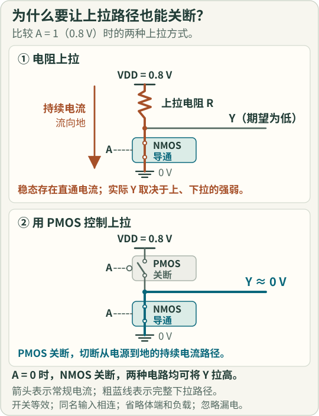
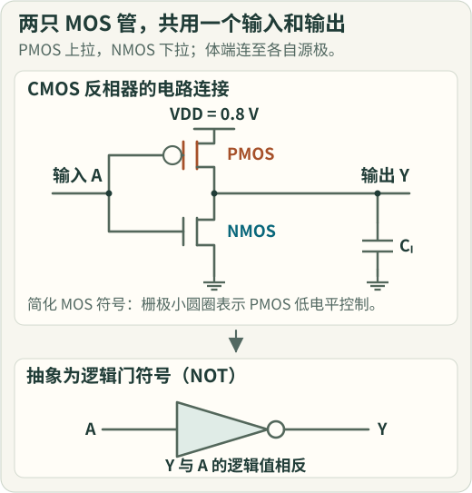
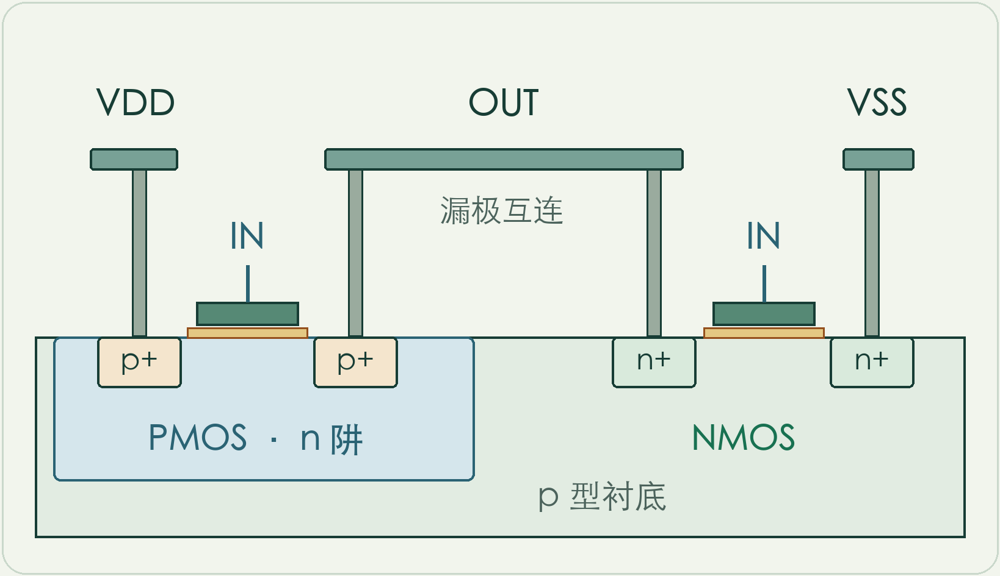
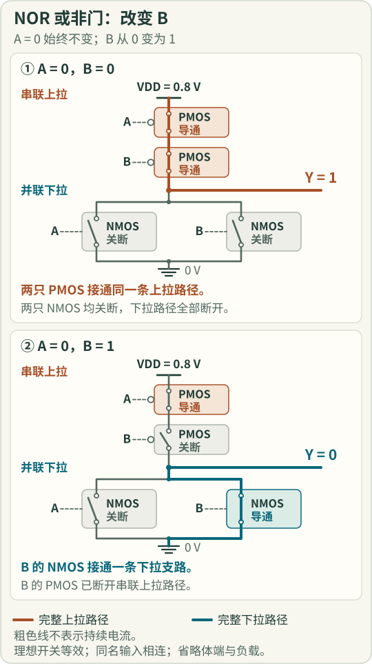
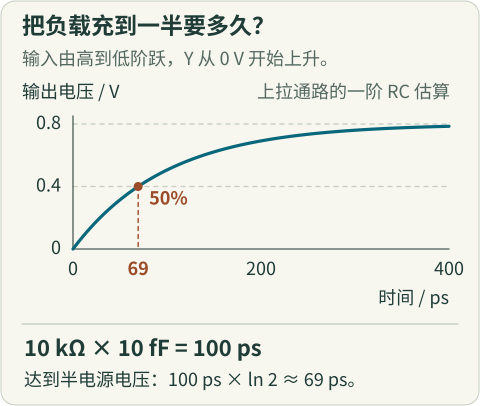
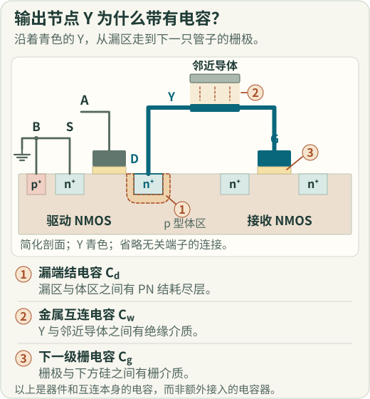

# MOS 管怎样构成逻辑门？

电路有时需要将一个信号的含义反过来。例如，假设故障检测电路在发生故障时输出 1，正常时输出 0，而后面的控制电路用 1 表示允许设备运行，0 表示禁止运行。怎样把前一个信号转换为后一个信号？

我们需要一种电路：输入为 0 时输出 1，输入为 1 时输出 0。这种电路称为**反相器（Inverter，也称 NOT 门）**。它属于**逻辑门（Logic Gate）**，即根据输入信号的逻辑值实现基本逻辑运算的电路。

计算机中的运算、数据选择和控制电路，都可以由逻辑门组合而成。本文从一只 MOS 管开始，看看怎样实现反相，再增加输入，构造其他逻辑门，最后解释它们为什么能一级一级地工作。

在[上一篇](../bands-to-channel/README.md#output-node)中，我们已经知道：通过 NMOS 可以将输出节点接向地，通过 PMOS 可以将输出节点接向高电源。下面继续沿着电子的运动理解节点电压的变化，再用 0 和 1 描述电路的功能。

本文采用 0.8 V 电源的教学电路。用接近 0 V 的低电平表示 0，用接近 0.8 V 的高电平表示 1。为便于推导，先假设输入恰好为这两个电压，且供电足以使增强型 MOS 管在需要导通时充分形成沟道。

## 为什么只用一只 NMOS 下拉还不够？ {#floating-output}

我们希望输入 A 为 1 时输出 Y 为 0，A 为 0 时 Y 为 1。先把 NMOS 的栅极接 A、漏极接 Y、源极和体端接地。根据上一篇的沟道知识，可以把它近似看成一个由 A 控制的开关。

<figure markdown="1">

</figure>

A 为 1 时，NMOS 的电子沟道形成，地端可以向 Y 补入电子，将 Y 的电压拉低。现在把 A 改成 0，NMOS 关断。我们希望 Y 回到 0.8 V，但断开下拉路径能够做到这一点吗？

### 断开开关，并不等于输出 1

沿用[上一篇的输出节点模型](../bands-to-channel/README.md#output-node)，在下图中把 Y 与地之间画成一只电容（CL）。它只是为了描述改变 Y 的电压需要改变电荷，并不是额外接入的元件。

在其他条件不变时，要让 Y 从 0 V 升到 0.8 V，就要从 Y 取走电子。仅仅断开 NMOS 并不能做到这一点。

下面做两次实验。每次都先将 Y 充到 0.8 V，再移开充电导线。第一次始终让 NMOS 关断；第二次先让它导通，待 Y 被拉低后再关断。

<figure markdown="1">

</figure>

两次实验最终的输入都是 0，但 Y 的电压取决于之前是否被拉低。此时 Y 没有通向电源或地的低阻通路，称为**悬空状态**。忽略漏电和其他节点的电压耦合时，原来的电压可以暂时保持。

这与我们希望实现的反相功能不同：当 A 为 0 时，不论 Y 原来是什么电压，都应该得到高电平。因此，我们还需要一条能主动将 Y 拉高的路径。

## 怎样构造一个 CMOS 反相器？ {#inverter}

### 为什么不直接用一个电阻上拉？

最直接的办法是把 Y 接向 0.8 V 电源。但如果直接用导线相连，NMOS 导通时就会将电源与地短接。可以先在电源与 Y 之间接一个电阻，限制流过这条路径的电流。

当 A 为 0 时，NMOS 关断，电阻可以给负载电容充电。A 为 1 时，NMOS 导通；如果 NMOS 的导通电阻比上拉电阻小得多，Y 就可以被拉到较低的电压。这种连接也能够实现反相功能。

但当 A 为 1 时，即使 Y 已经稳定，电源仍会经过电阻和 NMOS 向地输送电流。而且，电流流过 NMOS 的导通电阻，使得 Y 不会恰好等于 0 V。能否让上拉路径在下拉时自动断开？

我们希望 A 为 1 时，上拉关闭、下拉打开；A 为 0 时，上拉打开、下拉关闭。回顾上一篇的[两种 MOS 管](../bands-to-channel/README.md#pmos)，在这里的接线方式下，NMOS 由高电平控制导通，PMOS 由低电平控制导通。因此，可以用 PMOS 替换上拉电阻。

<figure markdown="1">

</figure>

### 怎样用同一个输入控制两条路径？

将 PMOS 的源极和体端接高电源轨 VDD，将 NMOS 的源极和体端接低电源轨 VSS。本文取 VDD = 0.8 V、VSS = 0 V（地）。两只管子的栅极一起接输入 A，漏极一起接输出 Y。

<figure markdown="1">

</figure>

为什么同一个输入能控制两条相反的路径？两只管子的源极接在不同电压上。NMOS 的栅源电压为 VGS = VA，PMOS 的源栅电压为 VSG = 0.8 V − VA。

因此，当 A 从 0 V 升到 0.8 V 时，NMOS 的栅源驱动从 0 增加到 0.8 V，PMOS 的源栅驱动则从 0.8 V 降为 0。两只管子分别从关断变为导通、从导通变为关断。

### 输入从高变低，输出为什么升高？

A 原先为高电平，Y 被 NMOS 拉低。现在把 A 降为 0 V。PMOS 导通，NMOS 关断，电源与 Y 之间形成上拉通路。

常规电流从 VDD 经 PMOS 流向 Y。从电子净转移的角度看，Y 侧电子减少，净正电荷增加，所以电压升高。随着 Y 接近 VDD，PMOS 源漏电压差越来越小，充电电流也越来越小；即使电流趋近于零，PMOS 仍保持导通。

### 输入从低变高，输出为什么下降？

反过来，当 A 变为 0.8 V 时，PMOS 关断，NMOS 导通。常规电流从 Y 流向地；NMOS 源端的导带电子通过沟道净移向 Y，Y 的净正电荷减少，电压下降。

当 Y 接近 0 V 时，NMOS 漏源电压差也趋近于零，因此放电电流逐渐减小。这同样不意味着 NMOS 已经关断。

<figure markdown="1">

</figure>

A 上的电子并没有穿过栅绝缘层进入 Y。输入只改变栅极的电压，控制两只管子的沟道。真正改变 Y 电荷的是连接电源或地的输运路径。

等输入保持稳定、输出充放电完成后，把电压对应为 0 和 1，就能用一张表描述这个电路的功能。

| 输入 A | PMOS | NMOS | 输出 Y |
| --- | --- | --- | --- |
| 0 | 导通 | 关断 | 1 |
| 1 | 关断 | 导通 | 0 |

这就是开头需要的反相器。上面的表称为**真值表（Truth Table）**，记录每一种有效输入组合及其对应的稳定输出。电路图中可以用输出端带有小圆圈的反相器符号表示这种取反功能。

这种使用 NMOS 和 PMOS 互补控制的结构称为 **CMOS（Complementary MOS，互补 MOS）**。在这里的理想静态 CMOS 电路中，无论输入保持在 0 还是 1，输出都有对应的驱动路径，而不需要依靠之前的电荷来决定逻辑值。[MIT 6.004：CMOS 开关与组合门](https://ocw.mit.edu/courses/6-004-computation-structures-spring-2017/pages/c3/c3s1/)

### 在硅片上，怎样找到电路图里的输入和输出？ {#physical-inverter}

下面是平面 CMOS 反相器的简化剖面。左边 PMOS 位于 N 型阱，右边 NMOS 位于 P 型衬底。电路图上的公共输出 Y（图中 OUT）实际上是一根金属线，经接触分别连到两只管子的漏区；两处 IN 在剖面之外接到同一根输入线。

<figure markdown="1">

</figure>

这样，物理上分开的器件，通过导体组成了电路图中的公共节点。图中省略了部分体端连接及上层布线。[康奈尔大学 CMOS 器件讲义](https://web.csl.cornell.edu/courses/ece6745/handouts/ece6745-T01-basic-devices.pdf) · [器件与金属互连的制造流程](../../chip-development/FAB/wiki/02-front-end-fabrication/process-flow-overview.md)

## 再加一个输入，怎样构造新的逻辑门？ {#nand-nor}

回到开头的控制场景。如果设备有两个允许信号 A、B，要求两个信号同时为 1 才允许运行，我们怎样用刚才掌握的 MOS 管连接方式实现这个条件？

下面继续使用理想开关模型，只判断是否存在完整的导通路径，不计算串联管之间的实际节点电压和电流。

### 只有两个输入都为 1 时，才让输出为 0

沿用刚才的思路：高电平打开 NMOS，将输出拉低。因此，先尝试让两个允许信号同时为 1 时才将 Y 拉低。每个输入控制一只 NMOS，要让下拉通路必须等两只管子都导通才接通，就把它们**串联**。

如果任一输入为 0，下拉路径就会断开。此时必须有一条上拉路径，才能确定输出。由于 PMOS 由低电平控制导通，只要让两只 PMOS **并联**，任一输入为 0 时就有一条完整的上拉通路。

<figure markdown="1">

</figure>

固定 A 为 1，只改变 B。B 为 0 时，B 控制的 PMOS 导通、NMOS 关断，Y 被拉高。B 变为 1 时，两只 PMOS 都关断、两只 NMOS 都导通，下拉路径完整，Y 便被拉低。

这个电路称为**与非门（NAND）**，即先检查两个输入是否同时为 1，再将这个逻辑结果取反。

### 只要有一个输入为 1，就让输出为 0

如果希望任意一个输入为 1 就把 Y 拉低，下拉路径该怎样连接？这次不需要等待两只 NMOS 都导通，只需要其中一只导通即可，因此应当把它们并联。

为了保证下拉断开时 Y 被拉高，需要在两个输入都为 0 时接通上拉。于是，把两只 PMOS 串联，让上拉路径必须等两只都导通才接通。

<figure markdown="1">

</figure>

固定 A 为 0。B 为 0 时，两只 PMOS 都导通，Y 被拉高。B 变为 1 时，B 控制的 PMOS 切断上拉，而 NMOS B 独立接通下拉，Y 被拉低。

这个电路称为**或非门（NOR）**，即检查是否至少有一个输入为 1，再将这个逻辑结果取反。

把四种输入组合放在一起，可以沿两个电路的导通路径核对真值表：

| A | B | NAND 的稳态输出 | NOR 的稳态输出 |
| --- | --- | --- | --- |
| 0 | 0 | 1 | 1 |
| 0 | 1 | 1 | 0 |
| 1 | 0 | 1 | 0 |
| 1 | 1 | 0 | 0 |

这里不再逐一追踪每只管子中的电子。因为已经知道完整的下拉或上拉路径分别怎样改变输出电荷，只需判断哪条路径接通，就能推导稳定输出代表的逻辑值。[MIT 6.004：串并联 CMOS 网络](https://ocw.mit.edu/courses/6-004-computation-structures-spring-2017/pages/c3/c3s1/)

### 怎样得到与门和或门？

最开始的控制需求是两个输入都为 1 时输出 1。但 NAND 的输出恰好相反。只要在 NAND 的输出端再接一个反相器，就能满足这个要求。这是**与门（AND）**。同理，在 NOR 后接一个反相器，就是**或门（OR）**：至少有一个输入为 1 时输出 1。

<figure markdown="1">

</figure>

例如 A = 1、B = 0 时，NAND 的输出为 1，它作为后一级反相器的输入，使反相器输出 0。这样，我们不必重新画一整套晶体管，也能根据前一级的输出推导出后一级的输出。

[可选交互：切换 A、B，核对 NAND 和 NOR 的导通通路](../bands-to-channel/experiments.html#gates)

## 为什么逻辑门可以一级一级地连接？ {#levels}

刚才通过连接 NAND 和反相器构造了与门。实际上，NAND 输出的金属线接到反相器的两个栅极。改变这根线的电压，就是给反相器的输入栅电容充放电，从而改变它的沟道。后一级反相器再通过自己的上拉或下拉路径改变自己的输出。

不过，刚才假设 NAND 的输出要么是 0 V，要么是 0.8 V。如果输出是 0.70 V，信号到达后一级时又因噪声降到 0.62 V，反相器是否还能按照逻辑 1 处理它？

### 输入电压缓慢变化，输出会发生什么？

回到原来的 CMOS 反相器。先看输入和输出只有两种理想电压的情况，再逐步改变输入电压。为了区分输入、输出，把反相器的输入记为 A，输出仍记为 Y。

输入很低时，PMOS 上拉，Y 接近 VDD；输入很高时，NMOS 下拉，Y 接近地。在通常的 CMOS 反相器中，中间存在一段输入电压，两只管子可能同时导电。

此时要判断 Y 的电压会升高还是降低，就比较两条通路中的常规电流：从 PMOS 流入 Y 的电流记为 IP，经 NMOS 流出 Y 的电流记为 IN。忽略其他电流时，流入的电流更大，Y 的净电荷就增加，电压升高；流出的电流更大则相反。

当两者相等时，Y 不再继续充放电，电压稳定。但如果在这时略微提高 A，上拉减弱、下拉增强，原来的电流平衡就会被打破，Y 的电压开始下降。

继续沿用上一篇的[源漏电压与沟道电流关系](../bands-to-channel/README.md#加上源极和漏极)。在固定的新输入下，Y 下降使 NMOS 漏源压差减小、PMOS 源漏压差增大。通常下拉电流趋于减小，上拉电流趋于增大，直到两条通路在新的输出电压重新平衡。

在转换区，两只管子的电流对栅压变化较敏感，而栅压升高会增强下拉、同时减弱上拉，因此输出可能随输入的小幅变化而发生很大的变化。靠近电源轨时，则由其中一条通路主导，输出接近对应的电源电压。

把 A 从 0 V 缓慢提高到 0.8 V，每改变一点都等待 Y 稳定。将这些稳态电压画出来，就是**直流传输特性曲线（Voltage Transfer Characteristic，VTC）**。

<figure markdown="1">

</figure>

输入和输出相等的位置称为直流翻转点。它取决于两只管子的特性，不一定正好在电源电压的一半。上图只表示典型趋势，并不是具体工艺的测量曲线，也不表示输出随时间的变化。[胡正明《现代半导体器件》第 6.7 节](https://www.chu.berkeley.edu/wp-content/uploads/2020/01/Chenming-Hu_ch6-1.pdf)

### 为什么发送端与接收端要规定不同的电压范围？

由传输曲线可以看到，设计合适的反相器即使接收到偏离理想值的高、低电压，也能产生更接近另一条电源轨的输出。为了让不同逻辑门可靠连接，可以分别规定发送端必须提供的电压范围、接收端必须能处理的输入范围。

仍以 0.8 V 供电的 NAND 和反相器为例。假设它们在规定的供电、负载等工作条件下满足如下接口规格。这些是教学假设，不是所有 0.8 V 电路的通用门限，也不是从上面的定性曲线读取的实测数据。

<figure markdown="1">

</figure>

| 逻辑值 | 发送端保证的输出 | 接收端保证识别的输入 |
| --- | --- | --- |
| 0 | 不高于 0.10 V（VOL,max） | 不高于 0.25 V（VIL,max） |
| 1 | 不低于 0.70 V（VOH,min） | 不低于 0.55 V（VIH,min） |

现在可以回答刚才的问题：A = 1、B = 0 时，NAND 本应输出高电平。即使它从 0.70 V 受到干扰降到 0.62 V，仍然高于反相器能识别为 1 的最低电压 0.55 V。反相器在稳定后会给出不高于 0.10 V 的低电平，与门的逻辑结果仍然正确。

这种接受偏离理想值的有效输入、再主动生成满足输出规格的电平的能力，称为**电平恢复**。只要输入偏差仍在保证范围内，后一级就能重新产生满足规格的输出，而不会把原来的电压偏差直接传到输出。

发送端与接收端预留的电压差称为**噪声容限（Noise Margin）**。本例低电平容限为 0.25 − 0.10 = 0.15 V，高电平容限为 0.70 − 0.55 = 0.15 V。这里讨论的是静态电压扰动的余量。[MIT 6.004：数字抽象与噪声容限](https://ocw.mit.edu/courses/6-004-computation-structures-spring-2017/pages/c2/c2s1/)

如果反相器的输入为 0.4 V，电路依然会作出电气响应，但它不属于任何一个保证有效的输入范围，不能保证输出逻辑正确。这不是第三种逻辑值。

注意区分三个概念：MOS 管的阈值描述形成明显沟道所需的栅源驱动；反相器的直流翻转点描述输入、输出电压相等的点；输入高低电平的门限则是接口保证条件。它们不是同一个电压。

## 输入已经翻转，输出为什么还要等？ {#edge}

继续看由 NAND 和反相器组成的与门。固定 A 为 1，将 B 从 0 变为 1，NAND 的输出就需要从高电平变成低电平，后一级反相器的输出则需要从低电平变成高电平。

但连接下一只逻辑门时，输出不只是一个逻辑值。前一级需要实际搬运电荷，改变后一级栅极的电压。为什么搬运电荷需要时间？

前面用 CL 表示与输出节点相连的等效负载电容。假设电容近似恒定，另一侧的参考电压不变，改变输出电压 ΔVY 所需的净电荷变化为：

**ΔQ = CLΔVY**。若以 Y = 0 V 时的电荷为参考，也可以写成 Q = CLVY。

相同的电压变化下，CL 越大，需要搬运的电荷就越多。电流是单位时间内的净电荷输运量。结合前面定义的上拉和下拉电流，忽略其他电流时有：

**CL dVY/dt = IP − IN**。

晶体管的电流有限，所以输出电压不能在瞬间改变。在相同净电流下，电容越大，输出电压变化就越慢。

<figure markdown="1">

</figure>

图中用 10 kΩ 电阻近似上拉路径，给 10 fF 电容充电，电源电压为 0.8 V。这只是理想 RC 模型，图中的 0.4 V 为半摆幅的计时点，并不代表接收端已经能可靠识别为 1。具体的延迟计算留到[门延迟、翻转能量与芯片功耗](../fanout-and-wire-delay/README.md#load)展开。

因此，真值表描述的是输入有效并保持稳定、等待足够时间后的输出，而不是输入刚改变那一刻的输出。

选读：实际电路并没有专门接一只电容，为什么还需要电容模型？

前面只用一只电容来表示 Y 改变电压时需要搬运多少电荷。现在看一根真实的连线：上一级 NMOS 的漏区通过金属线 Y 接到下一级 MOS 管的栅极。

在[上一篇](../bands-to-channel/README.md#gate-insulator)中，我们已经知道，栅极和下方的硅隔着绝缘层，形成了电容结构。因此，即使电子不穿过栅介质，要改变栅极电压，前一级也必须改变连接到 Y 的栅电极上的电荷。

<figure markdown="1">

</figure>

同样，图中金属线与邻近导体之间有绝缘介质；漏区与体区的 PN 结中，耗尽区的电荷分布也会随电压改变，形成[结电容](../electrons-to-diode/README.md#storage)。这些不是额外安装的电容元件。

它们连接 Y 的一侧都要随 Y 的电压变化重新分布电荷。忽略连线电阻，假设各电容另一侧电压固定、各电容近似不变，就可把这些电荷变化加在一起，用一个对地的等效电容表示。

<figure markdown="1">

</figure>

这不代表所有实际电容都直接接地。更具体的负载分析见[门延迟、翻转能量与芯片功耗](../fanout-and-wire-delay/README.md#charge)。

### 为什么 CMOS 不需要持续给输出电容充电？ {#energy}

在前面的电阻上拉电路中，NMOS 导通时，即使 Y 已稳定，电源到地也有持续电流。对于刚才的理想静态 CMOS 电路，当输入和输出稳定在电源轨电平、忽略漏电时，上拉和下拉网络只有一条导通。不再有持续的充放电电流，也没有电源到地的直接导通电流。

但在发生翻转时，电源需要为输出节点充电，之后存储在电容中的能量也会在放电路径上耗散。输入经过转换区时，两条网络还可能短时同时导通。真实器件也存在漏电，所以停止翻转不代表功耗一定为零。

一次充放电的能量怎样计算、这些能量最终去了哪里，以及如何累计为整个芯片的功耗，见[第十一篇的能量分析](../fanout-and-wire-delay/README.md#energy)。

## 从逻辑门到更复杂的电路 {#next}

回顾开头的需求，我们不仅能够利用互补 MOS 管把一个信号取反，还能够通过串联和并联控制通路，实现不同的逻辑关系。由于每一级都有自己的驱动路径，并能在规定的条件下恢复逻辑电平，这些逻辑门可以继续组合成更大的电路。

接下来可以改变观察方式：不再从每只 MOS 管的电子运动出发，而是在有效稳定的电平和传播时间这些条件下，直接追踪信号线上的 0 和 1。

如何用逻辑门判断两组数据是否相同，或者在多路数据中选择一路？这是[下一篇：组合逻辑电路](../combinational-logic/README.md)的主题。

如果还需要让电路保存之前的值，则可以继续阅读[从反相器到锁存器与触发器](../latch-and-divider/README.md)，理解反馈怎样维持一个稳定的状态。
