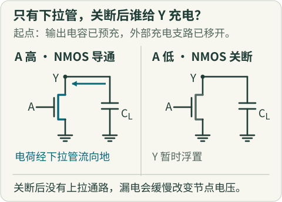
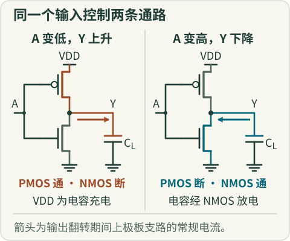
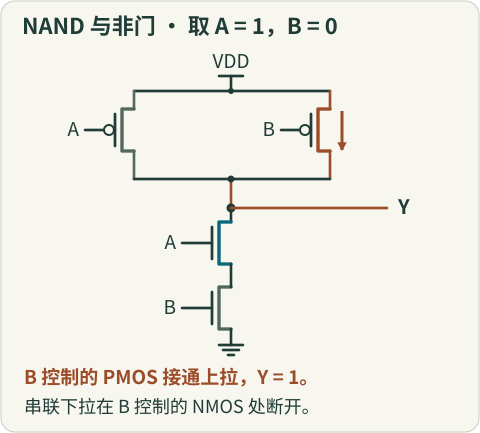
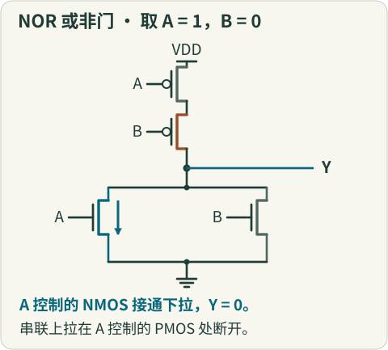

# 两只 MOS 管怎样组成一个逻辑门？

把一只 NMOS 的源极接地，漏极接到输出，栅极接到输入。假设输出原来是高电压，提高栅压，沟道接通，输出就被拉低。现在把栅压降回零。NMOS 关了，谁负责把输出重新拉高？

在这个缺了半边的电路里，答案是：目前没有这样的通路。补上一只 PMOS 之前，我们先看输出节点上究竟存着什么。

## 单只 NMOS 关断以后，输出会是多少？ {#floating-output}

在电路图上给输出的金属线起名 **Y**。接在这条线上的漏端、金属互连，以及下一级门的栅极都会形成电容。先把它们合并成一个理想负载电容 CL，一端接 Y，另一端接地。Y 相对于地的电压是 VY，Y 一侧极板相对零电压时多出的净电荷为 **Q = CLVY**。要改变 Y 的电压，得先有一条能给这一侧搬运电荷的路径。

做两次实验，每次都先让 NMOS 关断。用临时引线给 Y 预充到 0.8 V，然后移走引线。第一遍让输入一直保持 0 V。忽略漏电和耦合，Y 保留原有电荷，仍为 0.8 V。第二遍把输入升至 0.8 V，让管子充分导通，等 Y 降到接近 0 V 后，再把输入拉回 0 V。此时 Y 保留下来的恰好是低电压。

两次实验结束时输入都是 0，输出却可以一高一低。因为此时 Y 与两条电源轨之间都缺少低阻通路，它处于**高阻、悬空**的状态，节点电压取决于先前存下的电荷。真实电路中，漏电会缓慢改变电荷，相邻导线跳变也可能通过电容耦合扰动 Y。要做一个能长期给出确定输出的组合门，输入为低时也要有器件主动驱动 Y。[MIT 6.004：CMOS 开关与组合门](https://ocw.mit.edu/courses/6-004-computation-structures-spring-2017/pages/c3/c3s1/)

## 给输出添一条由输入控制的上拉路径 {#inverter}

把一只 PMOS 的源极接 0.8 V 电源，漏极也接 Y。让它和下面那只 NMOS 共用输入 A。在常见的体硅 CMOS 里，上方 PMOS 的体端接电源，下方 NMOS 的体端接地。沿电路图检查两个节点：**输入 A 接两只管子的栅，输出 Y 接两只管子的漏。** 栅介质把输入端的栅电极与硅隔开。改变输入电压，会改变沟道里的电荷。先假设输入总能到达 0 V 或 0.8 V，器件的阈值也使它们在这两个端点有明确的开关状态。

同一个 A，为什么能把一只管打开、又把另一只关上？把两只管子的**栅压都与各自的源极比较**。下管源极为 0 V，A 升高时，它的 VGS 增大。上管源极为 0.8 V，A 降低时，它的 VSG = 0.8 V − VA 增大。前者增强电子沟道，后者增强空穴沟道。[MOS 管怎样隔着绝缘层控制电流？](../bands-to-channel/README.md)

- **把 A 从高拉低。** 此前 Y 很低。现在上管的 VSG 达到 0.8 V，下管的 VGS 降到零。在上管的沟道里，空穴从接电源的源端流向接 Y 的漏端，常规电流也朝这个方向。只跟踪价带电子，其净转移方向恰好反过来，从漏端到源端。经两侧的接触和金属线，输出节点 Y 一侧少了一些电子，净正电荷增加，电容开始充电。Y 升到接近电源电压后，PMOS 两端的压差很小，充电电流随之衰减。
- **把 A 从低推高。** 此前 Y 很高。现在下管的 VGS 达到 0.8 V，上管的 VSG 降到零。Y 经 NMOS 向地放电，常规电流从 Y 流向地。沟道中的电子由接地的源端进入输出端，补回 Y 一侧所缺的电子，Y 随之降到接近零。

让 A 停留在任一端点足够久，Y 都会被接通的那一侧拉到与 A 相反的逻辑电平。即使 Y 曾被短暂扰动，只要 A 固定、扰动解除，导通的管子仍能把 Y 拉回来。这是**反相器**能够驱动下一级的原因。输入端的驱动器负责改变栅电荷，给输出电容充电的能量则来自上方的电源。

## 输入已经翻转，输出为什么还要等？ {#edge}

沿用这只反相器，让 A 快速从高变低。在输入边沿的起点，Y 仍接近 0 V。电容两端的电压若要瞬间跳变，就要求在零时间内交付有限电荷；真实晶体管只有有限的电流。把流入 Y 的上拉电流记作 IP，从 Y 流向地的下拉电流记作 IN。在这个集中负载模型里，**CL dVY/dt = IP − IN**。这个差为正，Y 上升；差越大，波形在这一刻越陡。

先做一组能手算的假设。取 CL = 10 fF，把导通的 PMOS 近似成 10 kΩ 的恒定电阻，输入作理想阶跃，下拉管完全关断。输出从 0 V 升到 0.8 V，需要搬运 **10 fF × 0.8 V = 8 fC** 的净电荷，约等于五万个电子的电荷量。刚开始，电阻两端有 0.8 V，充电电流为 80 µA；Y 达到 0.4 V 时，剩余压差减半，电流也减为 40 µA。越靠近电源电压，曲线越平。

把电阻电流 (0.8 V − VY)/R 代入上面的电荷方程，可得 **VY(t) = 0.8 V × [1 − exp(−t/τ)]**，其中 τ = RCL = 100 ps。若要让 Y 达到半摆幅，剩余压差也要变成起初的一半，所需时间为 τ ln 2 ≈ **69.3 ps**。若下拉路径也取 10 kΩ，反向翻转时 Y 从 0.8 V 按 0.8 V × exp(−t/τ) 下降，穿过 0.4 V 的时刻相同。实际两只管子的驱动强度会不同，而且每只管子的电流都随端电压改变。这里的 R 只用于解释这组曲线。[MIT 6.002：电容与一阶电路](https://ocw.mit.edu/courses/6-002-circuits-and-electronics-spring-2007/resources/6002_l12/)

如果输入也需要时间翻转呢？在中间的一段输入电压上，两只管子可能同时导电。此时有一部分电流直接从电源流到地，只有上下管的**电流差**改变负载电荷。做实际时序测量时，传播延迟从输入跨过规定参考电平的时刻量到输出跨过规定参考电平的时刻。下一级能否把此刻的 Y 当成逻辑 1，还要另外看它的输入规格。[扇出、布线与门延迟](../fanout-and-wire-delay/README.md)

## 下一级从多少伏开始承认这是 1？ {#levels}

将 Y 接到第二只反相器的输入。缓慢提高第一只门的输入 A，每一步都等到 Y 稳定，便能画出一条输入电压对输出电压的**直流传输曲线**。中段两只管子可以同时导通，稳定下来意味着上、下拉电流达到平衡。曲线上 Vin = Vout 的点称为这只门的直流翻转点。改变上、下管相对的驱动强度，这个点也会移动。[MIT 6.012：CMOS 反相器的传输曲线与噪声容限](https://ocw.mit.edu/courses/6-012-microelectronic-devices-and-circuits-fall-2005/6bec6dd1b07b02a1a84098b78f068cc3_lec14.pdf)

真正把两级接起来，要同时看发出端和接收端。设一组供教学计算的接口规格，均适用于前述 0.8 V 电源，在规定的负载和温度下：

| 状态 | 第一级保证送出的电压 | 第二级保证识别的输入 | 可容忍的最坏方向直流扰动 |
| --- | --- | --- | --- |
| 低 | 不高于 0.10 V（VOL,max） | 不高于 0.25 V（VIL,max） | 0.25 − 0.10 = 0.15 V |
| 高 | 不低于 0.70 V（VOH,min） | 不低于 0.55 V（VIH,min） | 0.70 − 0.55 = 0.15 V |

如果第一级的高电平受干扰后只剩 0.62 V，第二级仍保证读高。若 Y 正在上升、刚好经过 0.4 V，第二级的逻辑结果暂时没有保证。按前面同一个 RC 模型，输出要升到 0.55 V，剩余压差要从 0.8 V 减至 0.25 V，总共约需 **100 ps × ln(0.8/0.25) = 116 ps**。可见，同一次翻转在约 69 ps 时已经经过测延迟的半摆幅点，到约 116 ps 才进入这个例子规定的可靠高电平范围。单只管子的阈值电压描述沟道形成；这张表则用来检查两个门之间能否可靠传递逻辑值。[MIT 6.004：数字接口与噪声容限](https://ocw.mit.edu/courses/6-004-computation-structures-spring-2017/pages/c2/c2s1/)

## 再加一个输入，怎样从导通路径读出 NAND 和 NOR？ {#nand-nor}

先规定要什么行为：**只有 A 和 B 都为高时，Y 才应该接到地。** 把两只 NMOS 串联在 Y 与地之间，由 A、B 各控制一只。两只沟道必须一起导通才有完整下拉路径，任一只关断便切断它。其余输入组合还需要把 Y 拉高。把两只 PMOS 并联在电源与 Y 之间，只要 A 或 B 有一个低，对应的 PMOS 就能独立把 Y 接到电源。这构成两输入**与非门（NAND）**。

再换一个条件：**A 或 B 只要有一个高，就把 Y 接到地。** 两只 NMOS 应当并联，任一条支路都能放电。只有 A、B 同时为低时才需要上拉，所以两只 PMOS 串联。这样得到两输入**或非门（NOR）**。每个输入都连着一只上管和一只下管，两种网络的接法互补，使每组稳定有效的输入都恰有一种拉动方向。[MIT 6.004：串并联 CMOS 网络](https://ocw.mit.edu/courses/6-004-computation-structures-spring-2017/pages/c3/c3s1/)

用手指沿图验算 A = 1、B = 0。NAND 上，A 的下管虽然打开，B 的下管隔断了通往地的串联路径；沿 B 的上管却能从 Y 一直走到电源，所以 Y 为 1。把手指放到 NOR 的 Y 上，A 的下管本身就是一条完整的接地路径，A 的上管又切断了串联上拉，所以 Y 为 0。同一组输入得出相反结果，差别就落在两条线上。

| A | B | NAND 的完整路径与稳态输出 | NOR 的完整路径与稳态输出 |
| --- | --- | --- | --- |
| 0 | 0 | 两条并联上拉都通，1 | 两只串联上拉都通，1 |
| 0 | 1 | A 上拉，1 | B 下拉，0 |
| 1 | 0 | B 上拉，1 | A 下拉，0 |
| 1 | 1 | 两只串联下拉都通，0 | 两条并联下拉都通，0 |

可以先挑表中一行，用手指出从 Y 到哪条电源轨有完整通路，再[切换 A、B，跟着高亮的支路检查判断](../bands-to-channel/experiments.html#gates)。真值表列出的是输入稳定并给输出留下充放电时间之后的结果。想把 NAND 变成 AND，在它后面接一级反相器即可。多出的一级也有自己的负载和传播延迟。

## 一次充放电，能量去了哪里？ {#energy}

回到那只 10 fF 的输出。由 0 V 充到 0.8 V，电源每送出 1 C 电荷就做 0.8 J 的功，总共送出 8 fC，因此电源交付 **0.8 V × 8 fC = 6.4 fJ**。当电容刚开始充电时极板间电压很小，到充满时才有 0.8 V；按送入的电荷量平均，充电过程中的电容电压是 0.4 V。电容最终储存 **0.4 V × 8 fC = 3.2 fJ**，另有 3.2 fJ 在上拉路径中耗散。随后把 Y 放回零，电容原先储存的 3.2 fJ 又在下拉路径中耗散。

在理想恒压供电、恒定电容、全摆幅切换模型中，电源为这个节点的一次完整充放电提供 CLVDD²。在真实门里还会有两管短时同时导通的能耗、内部节点的切换，以及稳态漏电。后续要从单个节点算到一组门的平均功率，还得数单位时间内实际发生了多少次上升。[MIT 6.012：CMOS 门延迟和功耗](https://ocw.mit.edu/courses/6-012-microelectronic-devices-and-circuits-fall-2009/resources/mit6_012f09_lec16_scaling/) · [翻转能量与芯片功耗](../switching-energy-and-power/README.md)

## 把这个输出接回另一个输入 {#next}

拿开开头的预充引线后，单管电路只能让浮着的节点暂时记住先前的电荷。如果把两只完整反相器交叉连接，情况就变了：第一只的高输出让第二只输出低，第二只的低输出又让第一只继续主动拉高。电源接通时，这对互相驱动的节点可以维持一个比特。6T SRAM 在这四只晶体管之外再加两只访问管，才有了由字线控制的读写通路。[6T SRAM 怎样维持一个比特](../../storage/02-sram/foundations/6t-cell-bistable-storage.md)

1T1C DRAM 走的是开头那条存电荷的路。字线关断后，访问管使存储电容与位线隔离，漏电会逐渐改变节点电压。下次读出时要考虑与位线的电荷共享和读后恢复。两种单元用到的器件相似，维持数据的办法已经不同。[1T1C DRAM 的读出与恢复](../../storage/03-dram/foundations/1t1c-cell-destructive-read.md)
