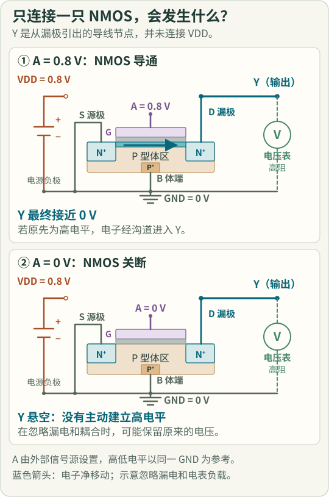
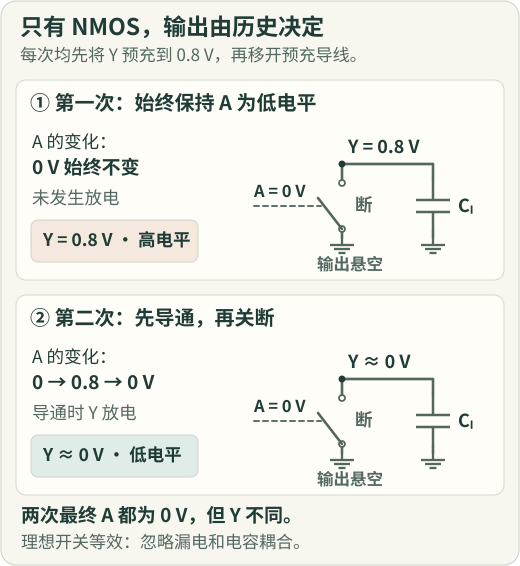
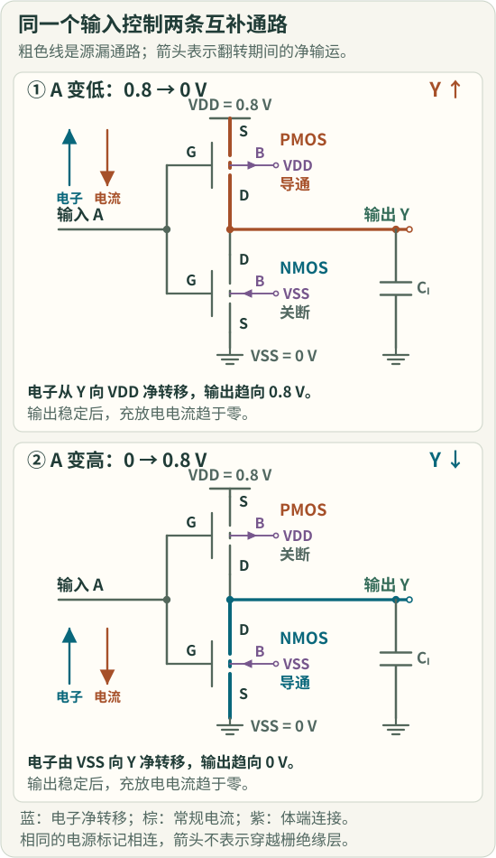
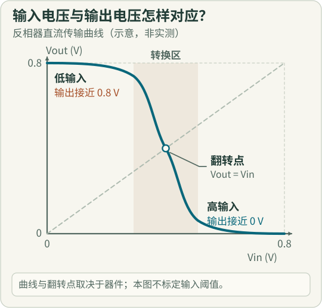
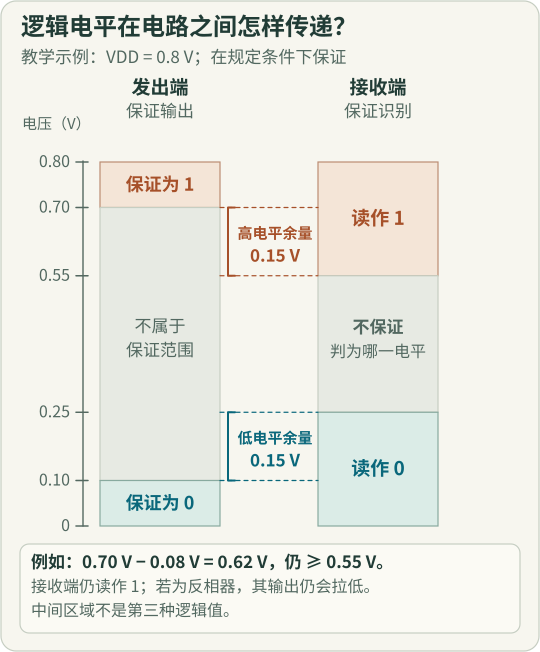
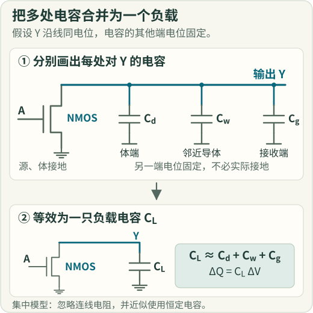
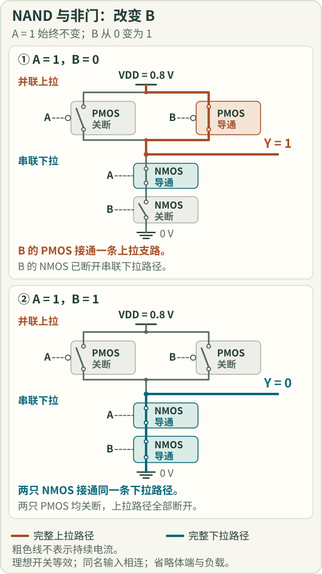
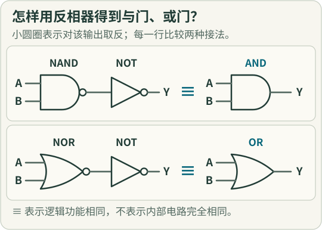

# 两只 MOS 管怎样组成一个逻辑门？

**逻辑门（Logic Gate）** 是数字电路中实现基本逻辑运算的单元。它接收代表 0 或 1 的电信号，根据规定的逻辑关系产生另一个电信号。

例如，反相器的功能是将输入取反：输入为 0 时输出 1，输入为 1 时输出 0。计算机里的复杂运算电路，就可以由许多具有这些基本功能的逻辑门构成。

在[上一篇](../bands-to-channel/README.md#output-node)中，我们已经知道 NMOS 可以通过导电沟道降低输出电压，PMOS 则可以提高输出电压。本文要解决的问题是：怎样连接这些晶体管，让电路根据输入电压产生确定的输出，并使输出能够继续驱动下一道逻辑门？

先取一个采用 0.8 V 电源的教学电路。将接近 0 V 的电压称为低电平，将接近 0.8 V 的电压称为高电平，分别用 0 和 1 表示。为了先理解门电路的工作原理，我们暂时只观察输入恰好为这两个电压时的行为。

## 为什么一只 NMOS 不够？ {#floating-output}

我们希望得到一个反相器：输入 A 为 1 时输出 Y 为 0，输入 A 为 0 时输出 Y 为 1。先只接一只 NMOS，看看能否满足这两个要求。

将 NMOS 的栅极接 A、漏极接 Y、源极和体端接地。用开关等效图观察两种输入状态。

<figure markdown="1">

</figure>

A 为 1 时，Y 可以被拉低。但 A 变成 0 时，仅仅断开了 Y 与地之间的通路，并没有把 Y 接到高电源。**这只 NMOS 只能主动把 Y 拉低。**

### 断开开关，并不等于输出 1

输出节点能够存储电荷，可以暂时把它看成带有一个小电容的节点，用 CL 表示。稍后再解释这个电容来自哪里。

下面两次实验都先将 Y 充到 0.8 V，再移走临时的充电导线。区别只在于之后有没有打开过 NMOS。

<figure markdown="1">

</figure>

两次实验的最终输入都是 0，输出却可能一高一低。Y 此时没有通向电源或地的低阻通路，称为**高阻、悬空**状态。若忽略漏电和电容耦合，节点就保留原来的电荷和电压。

所以，要让输出确定地由当前输入决定，还需要一条能把 Y 主动拉高的通路，而不能依靠 Y 原本储存的电荷。

## 用两只互补的 MOS 管构成反相器 {#inverter}

### 怎样用同一个输入控制两条路径？

我们希望：A 为高电平时将 Y 接向地，A 为低电平时将 Y 接向电源。根据上一篇的知识，NMOS 适合下拉，PMOS 适合上拉，恰好可以实现这两个条件。

将 PMOS 的源极和体端接高电源轨 VDD，将 NMOS 的源极和体端接低电源轨 VSS。本文取 VDD = 0.8 V、VSS = 0 V（地）。两只管子的栅极一起接输入 A，漏极一起接输出 Y。

<figure markdown="1">

</figure>

为什么同一个输入可以同时打开一只管子，又关掉另一只？还是比较各自的栅源电压：NMOS 的 VGS = VA，而 PMOS 的 VSG = 0.8 V − VA。当 A 升高时，NMOS 的电子沟道增强，PMOS 的空穴沟道减弱。

假设供电电压足以使两只增强型 MOS 管在应当导通时充分形成沟道，来看两种输入状态下输出怎样变化。

### 输入从高变低，输出为什么升高？

此时 PMOS 导通，NMOS 关断，电源与 Y 之间形成上拉路径。沿常规电流方向看，电流从 VDD 经过 PMOS 流向 Y。沿电子净转移方向看，Y 侧的电子被取走，净正电荷增加，输出电压升高。

当 Y 接近 VDD 时，PMOS 源漏之间的电压差越来越小，给负载电容充电的电流也逐渐减小。即使最后充电电流接近零，PMOS 仍处于导通状态。

### 输入从低变高，输出为什么下降？

现在 NMOS 导通，PMOS 关断。常规电流从 Y 流向地；NMOS 源端的导带电子则经沟道净移向 Y。Y 侧净正电荷减少，输出放电到接近 0 V。

<figure markdown="1">

</figure>

A 并没有通过栅极把自己的电子直接搬运到 Y。栅极隔着绝缘层控制沟道，实际改变 Y 的电荷的是由电源或地通向 Y 的路径。输出与下一级栅极相连时，每一级都由供电网络而不是前一级的信号线提供驱动输出所需的能量。

等电压稳定下来，将输入和输出的高低电平对应为 0 和 1，可以用这样一张表记录电路的功能：

| 输入 A | PMOS | NMOS | 输出 Y |
| --- | --- | --- | --- |
| 0 | 导通 | 关断 | 1 |
| 1 | 关断 | 导通 | 0 |

这就是**反相器（Inverter，也称 NOT 门）**。前面反相器的逻辑符号用输出端的小圆圈表示取反。上面的表称为**真值表（Truth Table）**，列出各种输入组合下的逻辑输出。

当 A 保持为有效的低电平或高电平时，Y 始终有对应的驱动路径。因此输出不再依赖之前存了多少电荷，而可以主动恢复为确定的电平。这是逻辑门区别于前面悬空节点的重要地方。[MIT 6.004：CMOS 开关与组合门](https://ocw.mit.edu/courses/6-004-computation-structures-spring-2017/pages/c3/c3s1/)

这种使用 NMOS 与 PMOS 互补控制的结构称为 **CMOS（Complementary MOS，互补 MOS）**。

## 在硅片上，怎样找到电路图里的输入和输出？ {#physical-inverter}

刚才的电路图用一个节点表示两个漏极相连，实际的两只 MOS 管却不在同一个位置。下面是一个平面 CMOS 反相器的简化剖面。左边是 N 型阱里的 PMOS，右边是 P 型衬底里的 NMOS。

<figure markdown="1">

</figure>

沿图中 OUT 金属线向左，可以经竖直的**接触**到达 PMOS 的漏区；向右则到达 NMOS 的漏区。两处 IN 在剖面之外接到同一根输入线。VDD 和 VSS 则分别接到两只管子的源区。

这样，两个物理上分开的位置，就可以通过导体成为同一个电路节点。若要继续连接更远处的逻辑门，还可以通过**过孔**连接不同的金属层。图中省略了部分体端连接和上层布线。[康奈尔大学 CMOS 器件讲义](https://web.csl.cornell.edu/courses/ece6745/handouts/ece6745-T01-basic-devices.pdf) · [从器件到金属互连的制造流程](../../chip-development/FAB/wiki/02-front-end-fabrication/process-flow-overview.md)

## 实际电压落在什么范围，才代表 0 或 1？ {#levels}

我们刚才只取了两个理想电压：0 V 和 0.8 V。真实的电路里，电压可能因电阻上的压降、噪声或供电变化而偏离这两个值。

如果前一级输出 0.62 V，下一级还应该认为它是 1 吗？如果电压只有 0.4 V 呢？不能只根据单个 MOS 管的阈值来回答，因为这里要判断的是**整只逻辑门的输入和输出关系**。

### 输入电压缓慢变化，输出会发生什么？

现在不只取两个端点，而是把反相器的输入 A 从 0 V 缓慢提高到 0.8 V，每改变一点都等待 Y 稳定。这样可以画出一条输入电压与输出电压之间的关系曲线，称为**直流传输特性曲线（VTC）**。

<figure markdown="1">

</figure>

输入很低时，PMOS 将 Y 拉高；输入很高时，NMOS 将 Y 拉低。但在中间的一段电压范围内，两只管子可能同时导电。

稳定时，流入 Y 的上拉电流和流出 Y 的下拉电流大小相等。若此刻再略微提高 A，NMOS 下拉变强，PMOS 上拉变弱，Y 就会放电，直到在新的、较低的输出电压上重新平衡。

输入和输出相等的位置称为反相器的直流翻转点。它取决于两只管子的特性，不一定正好在电源电压的一半。图中的曲线只表示典型趋势，并非某个具体工艺的测量曲线。

### 为什么发送端与接收端要规定不同的电压范围？

如果只规定一个电压作为高低电平的分界，前一级输出刚好达到分界时，一点点干扰就可能让后一级误判。为此，我们希望门能够接受偏离理想值的输入，却产生更接近理想值的输出。

以两级使用 0.8 V 电源的门为例，假设它们满足下列人为设定的接口规格。实际数值取决于电路设计、供电、负载等条件，不能把它当作所有芯片的通用标准。

<figure markdown="1">

</figure>

| 逻辑值 | 发送端保证的输出 | 接收端保证识别的输入 |
| --- | --- | --- |
| 0 | 不高于 0.10 V（VOL,max） | 不高于 0.25 V（VIL,max） |
| 1 | 不低于 0.70 V（VOH,min） | 不低于 0.55 V（VIH,min） |

例如，第一级本来输出 0.70 V 的高电平，受到干扰后变为 0.62 V，接收端仍会把它视为 1。如果第二级是反相器，它就会从自己的电源轨主动驱动输出，让输出恢复到规定的低电平范围，而不是简单地复制前一级的电压。

发送端和接收端之间留出的电压差，称为**噪声容限（Noise Margin）**。在本例中，低电平容限为 0.25 − 0.10 = 0.15 V，高电平容限为 0.70 − 0.55 = 0.15 V。这里比较的是静态电压扰动的余量。[MIT 6.004：数字抽象与噪声容限](https://ocw.mit.edu/courses/6-004-computation-structures-spring-2017/pages/c2/c2s1/)

如果输入为 0.4 V，虽然它依然是一个真实的电压，且门电路也会作出电气响应，但规格没有保证它对应 0 还是 1。这不是第三种逻辑值，而是不能保证正确识别的输入范围。

注意区分三个概念：MOS 管的阈值描述沟道形成的条件；反相器的直流翻转点描述其输入输出曲线的交点；输入高低电平的门限则是接口识别的保证条件。它们不应混为一谈。

有了明确的输入输出范围和恢复电平的能力，多个逻辑门就能够一级接着一级地工作，不必要求每一根线都恰好保持在 0 V 或 0.8 V。[胡正明《现代半导体器件》第 6.7 节](https://www.chu.berkeley.edu/wp-content/uploads/2020/01/Chenming-Hu_ch6-1.pdf)

## 输出节点上的电容从哪里来？ {#output-capacitance}

前面用 CL 表示输出节点 Y 的电容。但芯片里通常不需要在每只逻辑门旁边专门放一只电容。为什么改变 Y 的电压，仍然需要搬运电荷？

观察一根从 NMOS 漏极连接到下一只 MOS 管栅极的金属线 Y。下图将这个节点涉及的三类典型电容标出来。

<figure markdown="1">

</figure>

- **漏端电容**：漏区与体区形成 PN 结。Y 高于接地体区时，PN 结反偏。电压改变会改变耗尽区的电荷分布，形成[结电容](../electrons-to-diode/README.md#storage)。
- **连线电容**：金属线 Y 与邻近导体之间隔着绝缘介质，如同两块电容极板。
- **接收端电容**：下一只 MOS 管的栅极与下方的硅隔着栅介质，这正是[上一篇的 MOS 电容结构](../bands-to-channel/README.md#gate-insulator)。

这些电容不是额外接上的元件，而是器件与连线结构本身的电气特性。改变 Y 的电压时，多个位置的电荷都需要重新分布。

### 怎样将多个电容合并为一个负载？

为方便分析，先忽略金属线的电阻，把整根 Y 视为同一个电压节点。假设各电容另一端的电位固定，并将电容近似为常数。

<figure markdown="1">

</figure>

当 Y 的电压改变 ΔV 时，每个电容连接 Y 的一侧都需要改变相应的电荷。三份电荷变化相加，就可以用一只等效电容 CL 来描述。这不意味着真实电路中的每个电容都直接接地。实际电容也可能随电压而变化。

在这个简化模型中，以 Y = 0 V 为参考，Y 侧净电荷的增加量与输出电压 VY 的关系是：

**Q = CLVY**。

电容表示改变单位电压所需要的电荷量，单位为法拉（F）。想实现相同的电压变化，电容越大，需要搬运的电荷就越多。[胡正明《现代半导体器件》第 6.7 节](https://www.chu.berkeley.edu/wp-content/uploads/2020/01/Chenming-Hu_ch6-1.pdf)

## 输入已经翻转，输出为什么还要等？ {#edge}

前面讨论的真值表，表示输入稳定后期望得到的输出。但从实际充放电过程看，输出需要经过一段时间才能进入新的有效电平范围。

如果想把 Y 从 0 V 提高到 0.8 V，需要改变的电荷量为 ΔQ = CLΔV。电流表示单位时间内的净电荷输运量，晶体管的电流有限，因此不能在零时间内完成这次电压变化。

用 IP 表示上拉流入 Y 的常规电流，IN 表示下拉流出 Y 的常规电流。在集中负载模型中，净电流决定了电容电压的变化速率：

**CL dVY/dt = IP − IN**。

上拉电流大于下拉电流时，电压就会上升；反之则下降。负载电容越大，在相同电流下电压变化越慢。

下图用 10 kΩ 的电阻近似上拉通路，给 10 fF 的负载充电。Y 越接近电源电压，通路两端压差越小，充电电流随之减小，所以上升的曲线越来越平缓。

<figure markdown="1">

</figure>

图中 0.4 V 是输出摆幅的一半，并不代表下一级一定能识别为新的高电平。

深化阅读：估算输出到达半高和有效高电平的时间

沿用 0.8 V 电源，取负载电容为 10 fF，将导通的 PMOS 简化成 10 kΩ 电阻，下拉 NMOS 完全关断，输入作理想阶跃。输出从 0 V 充至 0.8 V 需要的净电荷为 8 fC。

初始时电阻两端有 0.8 V 压差，电流为 80 µA。Y 升到 0.4 V 时，压差减半，电流也减半。Y 越接近电源电压，充电就越缓慢。

由 I = (0.8 V − VY)/R 与 I = CL dVY/dt 得到 **VY(t) = 0.8 V × [1 − exp(−t/RCL)]**。本例时间常数 RCL = 100 ps。

到达半摆幅 0.4 V 需约 69.3 ps。如果继续充到前面假设的有效高电平门限 0.55 V，则约需 116 ps。可见，常用的半摆幅计时点不一定代表已经能被下一级可靠识别。

这里用恒定 R 近似 MOS 管的导通通路。实际管子的电流还会随端电压变化。[MIT 6.002：电容与一阶电路](https://ocw.mit.edu/courses/6-002-circuits-and-electronics-spring-2007/resources/6002_l12/)

实际门电路也需要规定输入改变后，输出在什么时间内可以稳定为有效逻辑值。后面讨论[门延迟、扇出和连线](../fanout-and-wire-delay/README.md#timing)时，再进一步分析这个时间由什么决定。

## 为什么 CMOS 不需要持续给输出电容充电？ {#energy}

对于前面这种静态 CMOS 门，输入稳定在理想低电平或高电平后，一只管子关断，另一只将输出拉到相应的电源轨。理想情况下，稳态不再有负载充放电电流，也不存在从 VDD 经上下两管持续流到地的通路。

但翻转时必须搬运电荷，因此需要能量。如果输入经过转换区，两只管子还可能短时同时导通，形成从电源流向地的电流。真实器件也有漏电，所以电路不翻转并不意味着功耗一定为零。

深化阅读：给一次充放电记一笔能量账

用前面的 10 fF 电容与 0.8 V 电源。充电时，电源送出 8 fC 电荷，提供 0.8 V × 8 fC = 6.4 fJ 能量。由于电容电压从 0 V 逐渐升高，电容最终存下的能量为 ½CV² = 3.2 fJ，其余 3.2 fJ 在上拉路径中耗散。

下次放电时，先前存入的 3.2 fJ 又在下拉路径中耗散。在恒压供电、恒定电容、全摆幅且忽略漏电和上下管同时导通的模型中，一次完整的充放电从电源取得的能量为 **CLVDD²**。[MIT 6.004：CMOS 电路功耗](https://ocw.mit.edu/courses/6-004-computation-structures-spring-2017/pages/c8/c8s1/)

单个节点的能量怎样累计为整个芯片的功耗，留到[门延迟、翻转能量与芯片功耗](../fanout-and-wire-delay/README.md#energy)再展开。

## 再加一个输入，怎样构造新的逻辑门？ {#nand-nor}

反相器只有一个输入，根据输入决定哪条通路接通。如果有两个输入 A 和 B，想让输出取决于两者的组合，只需要改变控制上拉与下拉通路的方式。

### 只有两个输入都为 1 时，才让输出为 0

假设我们希望 A、B 同时为 1 才输出 0，其他情况都输出 1。先想下拉路径怎么接。只有两只 NMOS 都打开才能接通地，因此应当把它们**串联**。

下拉路径断开时，怎么保证 Y 不会悬空？只要 A、B 中任意一个为 0，就必须建立上拉通路。PMOS 由低电平控制导通，因此用两只**并联**的 PMOS 即可满足要求。

<figure markdown="1">

</figure>

这样得到的门称为**与非门（NAND）**：“A 和 B 都为 1”的结果取反。如果 A 为 1，B 为 0，A 的 NMOS 导通，但 B 的 NMOS 关断，无法形成完整下拉路径；B 的 PMOS 则独立接通上拉，因此 Y 为 1。

### 只要有一个输入为 1，就让输出为 0

换一个要求：A 或 B 中有一个为 1，就输出 0；只有两者都为 0 才输出 1。这次两只 NMOS 应当并联，让任一支路都能下拉。而两只 PMOS 则串联，要求两者都打开才能上拉。

<figure markdown="1">

</figure>

这样得到的是**或非门（NOR）**：“A 和 B 至少有一个为 1”的结果取反。同样令 A 为 1、B 为 0，A 的 NMOS 可以独立将 Y 拉向地，A 的 PMOS 又切断了串联上拉，所以 Y 为 0。

把四种输入组合全部列出来，可以直接沿两个电路的导通路径核对下面的真值表。

| A | B | NAND 的稳态输出 | NOR 的稳态输出 |
| --- | --- | --- | --- |
| 0 | 0 | 1 | 1 |
| 0 | 1 | 1 | 0 |
| 1 | 0 | 1 | 0 |
| 1 | 1 | 0 | 0 |

这里串联与并联的作用，本质上就是让导电路径满足不同的条件。每一组稳定有效的输入，都有对应的上拉或下拉路径，而不需要依靠输出节点之前的电荷来决定结果。[MIT 6.004：串并联 CMOS 网络](https://ocw.mit.edu/courses/6-004-computation-structures-spring-2017/pages/c3/c3s1/)

如果在 NAND 的输出端再接一个反相器，就得到与门（AND）：只有 A、B 同时为 1 时才输出 1。同理，在 NOR 后接反相器就得到或门（OR）。

<figure markdown="1">

</figure>

[可选交互：切换 A、B，核对 NAND 和 NOR 的导通通路](../bands-to-channel/experiments.html#gates)

## 从逻辑门到更复杂的电路 {#next}

回顾整篇文章：我们从 MOS 管控制沟道的能力出发，用互补的上拉与下拉通路改变输出电压，得到可靠的 0 和 1，再用门的符号和真值表抽象电路的功能。

接下来不必每次从晶体管画起，而可以把已经理解的逻辑门当作基本单元。如果需要在两路数据中选择一路，或者判断几根输入线组成的值，怎样用这些基本单元构造所需的电路？这是[下一篇：组合逻辑电路](../combinational-logic/README.md)的主题。

如果电路还需要保存之前的值，而不仅仅根据当前输入产生输出，可以进一步阅读[从反相器到锁存器与触发器](../latch-and-divider/README.md)，理解反馈怎样维持一个稳定的状态。
