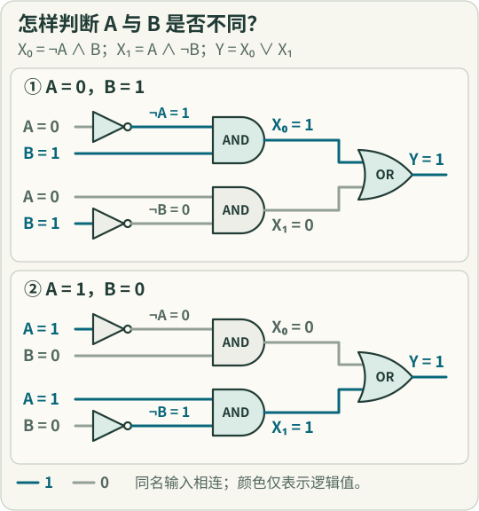
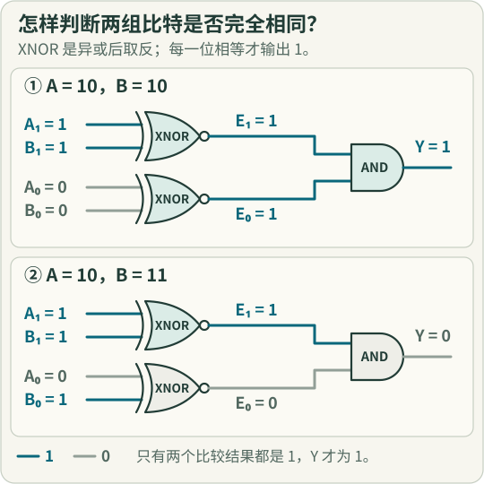
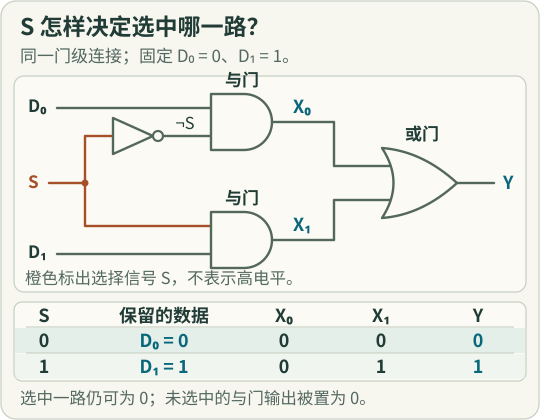
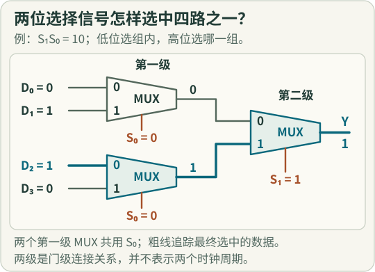
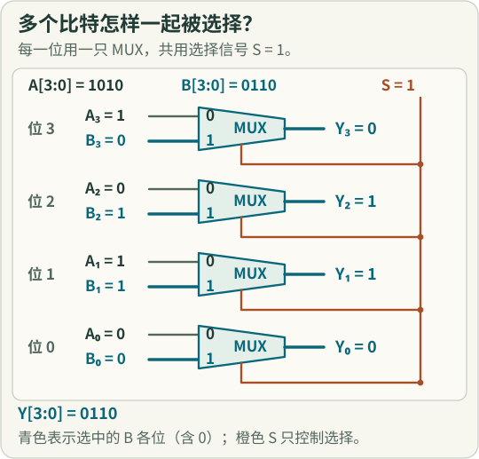
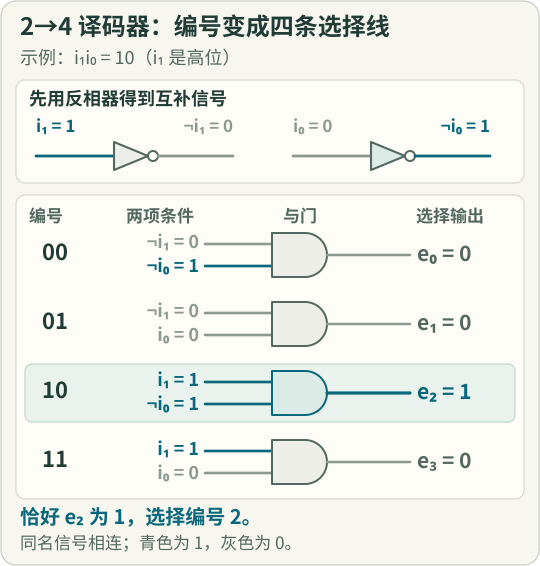
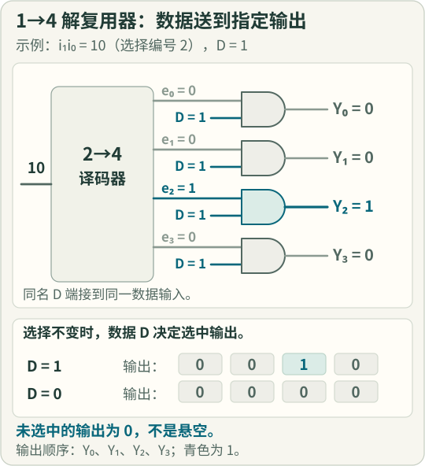
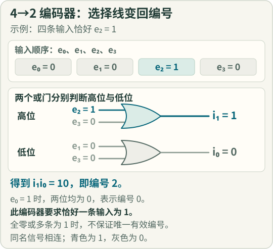
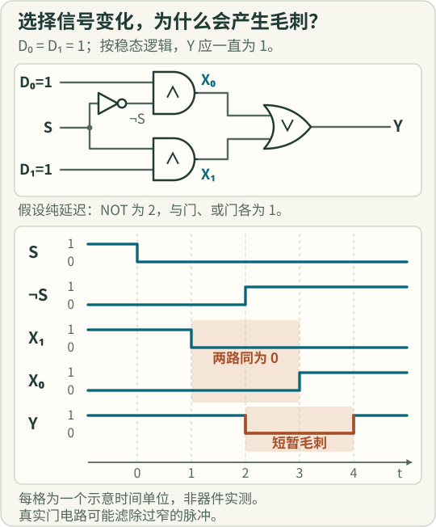

# 怎样用逻辑门构造具有特定功能的电路？

[上一篇](../cmos-logic-gates/README.md)已经解释了一个逻辑门怎样用晶体管产生稳定的高、低电平，并将它们表示为 1 和 0。接下来不再追踪每只 MOS 管中的电子，而是观察一根根信号线上的逻辑值怎样改变。

假设我们需要一个电路，它有两个输入，只有两者不同时才输出 1。单独使用一个与门、或门或反相器都不能直接满足这个要求。但是，可以把多个逻辑门连接起来实现它。

这类电路统称为**组合逻辑电路（Combinational Logic）**：在输入有效且稳定、等待充分的传播时间后，输出由当前输入决定，不需要保存过去的值。

数字电路不仅要判断条件，还要在多路数据中选择一路，或者用一个编号指定某个输出端。先看怎样从一个简单的功能要求出发，再把这种方法用于数据的选择和分配。

## 怎样判断两个输入是否不同？ {#logic-function}

### 先写出我们希望电路具有的行为

给两根输入线命名为 A、B，输出线命名为 Y。每根输入线只有 0 和 1 两种有效逻辑值，两个输入一共有四种组合。

我们把要求写成一张**真值表**。这一次不是根据已有电路推算输出，而是先规定每种输入应得到什么输出，再设计电路。

| A | B | Y（两者不同为 1） |
| --- | --- | --- |
| 0 | 0 | 0 |
| 0 | 1 | 1 |
| 1 | 0 | 1 |
| 1 | 1 | 0 |

现在需要找出能够识别中间两行的逻辑门。回忆上一篇的三种基本逻辑运算，可以用下面的符号简洁表示它们。

| 基本运算 | 符号 | 输出为 1 的条件 |
| --- | --- | --- |
| 非（NOT） | ¬A | A 为 0 |
| 与（AND） | A ∧ B | A、B 都为 1 |
| 或（OR） | A ∨ B | A、B 至少有一个为 1 |

由输入和这些逻辑运算组成的式子称为**布尔表达式（Boolean Expression）**。取反先于与，与先于或。括号用来明确子条件怎样组合，并不表示电路像软件一样逐条执行语句。

### 让每一条支路识别一种成立的条件

先只看真值表中的第二行：A 为 0、B 为 1 时，Y 应该为 1。

要判断 A 是不是 0，可以把 A 取反。这样，只有 A = 0 且 B = 1 时，¬A 和 B 才同时为 1。用一个与门把它们连起来，得到内部信号 X₀ = ¬A ∧ B。

再看第三行，需要 A = 1 且 B = 0。用同样的方法得到 X₁ = A ∧ ¬B。

只要这两个条件中有一个成立，Y 就应该为 1。因此，把 X₀ 与 X₁ 送进一个或门，就得到整个电路的表达式：

**Y = (¬A ∧ B) ∨ (A ∧ ¬B)**。

<figure markdown="1">

</figure>

这就是**异或（Exclusive OR，XOR）** 运算，常用 A ⊕ B 表示。它与普通的或运算不同：A 和 B 都是 1 时，异或的结果仍为 0。

将所有输入组合逐一代入门电路，可以检查它是否满足之前规定的真值表。这里并不需要 CPU 查表或执行判断，判断关系已经由门和导线的连接实现了。[MIT 6.004：从真值表构造组合逻辑](https://ocw.mit.edu/courses/6-004-computation-structures-spring-2017/pages/c4/c4s1/)

这个方法也可以用于其他布尔函数：为真值表中每一种输出为 1 的输入组合构造一个与条件，再用或门合并这些条件。这是一种直接的实现方法，不一定是门数最少或速度最快的实现。

深化阅读：为什么同一种功能可以有不同的电路？

例如，要求“只要 A 为 1 就输出 1”，直接将 A 传给输出即可。如果按照上面的真值表方法，也可以构造 (A ∧ ¬B) ∨ (A ∧ B)。两种表达式在稳定的 0/1 输入下等价。

若实际采用后一种门级连接，信号要经过更多逻辑门，可能产生额外延迟、面积和功耗。因此，得到正确的逻辑功能与选择最合适的实现，是两个不同的问题。复杂的布尔化简和逻辑综合不在本篇展开。[MIT 6.004：组合逻辑的化简与实现](https://ocw.mit.edu/courses/6-004-computation-structures-spring-2017/pages/c4/c4s1/)

### 如果要判断两组比特是否完全相同呢？

异或能判断一对比特是否不同，将它的结果取反，就能判断两比特是否相同。这称为**同或（XNOR）**。

现在比较两组二位信号 A₁A₀ 与 B₁B₀。只有对应的两对比特都相同，两组信号才完全相同。因此，可以让两只同或门分别判断两对比特，再用一个与门检查两个结果是否都为 1。

<figure markdown="1">

</figure>

同样的方法可以扩展到更多比特。这已经不只是一个基本逻辑运算，而是一块能够完成指定判断任务的电路。我们也可以把整块电路作为一个具有输入和输出的功能单元，不必每次都从里面的门开始分析。

## 怎样从两路数据中选择一路？ {#mux}

### 用一个信号决定哪路数据能影响输出

假设两根数据输入线 D₀ 和 D₁ 上分别有一个逻辑值。我们需要一根额外的控制线 S，让它决定输出 Y 应该等于哪路数据。

| 选择信号 S | 希望得到的输出 |
| --- | --- |
| 0 | Y = D₀ |
| 1 | Y = D₁ |

与门恰好具有一种可以利用的特性：一个输入为 1 时，输出就等于另一个输入；一个输入为 0 时，输出就是 0，与另一个输入的值无关。

要让 D₀ 在 S = 0 时影响输出，可将 D₀ 与 ¬S 送入与门。要让 D₁ 在 S = 1 时影响输出，则将 D₁ 与 S 送入与门。

这样，两条支路分别得到 X₀ = ¬S ∧ D₀、X₁ = S ∧ D₁。输入 S 确定以后，始终只有一条支路保留原数据，另一条支路被置为 0。用或门合并两条支路，就得到选中的数据：

**Y = (¬S ∧ D₀) ∨ (S ∧ D₁)**。

<figure markdown="1">

</figure>

这样构造的功能单元称为**多路选择器（Multiplexer，MUX）**。S 是选择信号，D₀ 和 D₁ 是数据信号。被选中的数据可能是 0，也可能是 1；被选中并不等于那条线上一定有高电平。

在这种门级实现中，数据输入并没有与输出导线直接短接。各个逻辑门根据输入值驱动后续节点，完成的是逻辑上的选择。[MIT 6.004：多路选择器](https://ocw.mit.edu/courses/6-004-computation-structures-spring-2017/pages/c4/c4s1/)

### 如果有四路数据呢？

一个选择位只有两个取值，只能区分两路输入。增加一个选择位，就能用二进制 00、01、10、11 分别表示编号 0、1、2、3。这里从左到右书写高位 S₁ 和低位 S₀，编号为 2 × S₁ + S₀。

不必重新从基本门画起。用两只二选一 MUX 分别处理 D₀/D₁ 和 D₂/D₃，再用第三只 MUX 选择前两只的结果。选择编号的低位 S₀ 控制第一级，高位 S₁ 控制第二级。

<figure markdown="1">

</figure>

当 S₁S₀ = 10 时，S₀ = 0 使第一级分别选出 D₀ 和 D₂，S₁ = 1 使第二级选择后一组的结果。沿这条关系就可以推导最终输出 Y = D₂。

这是把功能单元再组成更大功能单元的一种方式。类似地，更多选择位可以控制更多数据来源。[MIT 6.004：MUX 的树形组织](https://ocw.mit.edu/courses/6-004-computation-structures-spring-2017/pages/c4/c4s1/)

### 每路数据不只有一个比特，该怎么办？

刚才的 MUX 每次只选择一个比特。如果我们有两组各四位的数据 A = 1010、B = 0110，希望 S 决定输出整组 A 或 B，该怎样接线？

图中 A[3:0] 表示从高位 A₃ 到低位 A₀ 的四根信号线。例如 A = 1010 意味着 A₃、A₂、A₁、A₀ 分别为 1、0、1、0。

把各组数据的对应比特接入四只二选一 MUX，让它们共用同一根选择线 S。每只 MUX 选择一个比特，四只 MUX 一起完成整组数据的选择。

<figure markdown="1">

</figure>

注意区分两个问题：有多少路数据可以选择，以及每路数据中有多少个比特。四选一 MUX 可以每次选择一个比特；两路四位数据的选择也可以用四只一位的二选一 MUX 完成。

这里已经出现了**数据与控制信号**的区别：数据是电路要处理的内容，控制信号决定电路对数据采取什么操作。

## 怎样用两根选择线指定四条输出线中的一条？ {#decoder}

### 把一个编号变成四个独立的选择信号

MUX 解决了从多个来源中选一路的问题。现在换一个需求：有四个目的端，需要根据一个二位编号，让其中一个目的端收到有效信号。

令编号的高位、低位分别为 i₁、i₀。约定 1 表示被选中，0 表示未被选中。例如编号为 10 时，希望只有编号为 2 的输出线 e₂ 为 1。

| 编号 i₁i₀ | e₀ | e₁ | e₂ | e₃ |
| --- | ---: | ---: | ---: | ---: |
| 00 | 1 | 0 | 0 | 0 |
| 01 | 0 | 1 | 0 | 0 |
| 10 | 0 | 0 | 1 | 0 |
| 11 | 0 | 0 | 0 | 1 |

每根输出线实际上都在判断一种输入条件。e₂ 要识别编号 10，只需要判断 i₁ 为 1 且 i₀ 为 0，所以 e₂ = i₁ ∧ ¬i₀。对另外三根线也分别构造对应的与条件。

<figure markdown="1">

</figure>

这就是**译码器（Decoder）**。在这个没有额外使能、高电平表示有效的二到四译码器中，任一稳定有效的输入组合都会使恰好一根输出线为 1。这种表示方法称为独热（One-hot）。[MIT 6.004：译码器与输入条件](https://ocw.mit.edu/courses/6-004-computation-structures-spring-2017/pages/c4/c4s1/)

因此，使用两个比特就能区分四个目的端，而不必让外部电路直接提供四个独立的选择信号。例如，在存储器中，可以利用地址的一部分产生各行的选择信号。[存储系统：字线、位线与感测放大器](../../storage/02-sram/foundations/wordline-bitline-sense-amp.md)

### 怎样把一路数据送到指定的输出？

译码器只告诉我们哪个目的端被选中。如果还希望把一位输入数据 D 分配到该目的端，就可以将 D 接到四只与门，每只与门的另一个输入分别接译码器的选择信号 e₀ 到 e₃。

这样第 j 路输出就是 Yⱼ = eⱼ ∧ D。被选中的一路保留 D 的值，未选中的各路被置为 0。

<figure markdown="1">

</figure>

这就是**解复用器（Demultiplexer，DEMUX）**。它与 MUX 的数据方向相反：MUX 在多路来源中选择一路，DEMUX 将一路数据分配给多个目的端中的一路。

当 D = 0 时，被选中的输出也是 0，因此不能只根据数据输出是否为 1 来判断选择了哪个目的端。未选中也不表示悬空，图中的逻辑门会主动输出 0。[UCLA《Introduction to Digital Systems》第 9 章](https://web.cs.ucla.edu/Logic_Design/SLPDF/ch9.pdf)

真实器件还可能使用低电平作为有效信号，并增加使能端。这里使用高电平有效的模型，以便看清逻辑关系。[TI CD74HC139：译码器/解复用器数据手册](https://www.ti.com/lit/ds/symlink/cd74hc139.pdf)

### 怎样反过来得到被选中的编号？

如果电路已经给出四条独热信号，现在只想知道哪条线有效，而不希望继续用四根线传递这个信息，可以把它重新变成二位编号。

先观察编号的高位 i₁。只有编号为 2 或 3 的线有效时，高位应该为 1，所以 i₁ = e₂ ∨ e₃。同样，编号为 1 或 3 的线有效时，低位为 1，所以 i₀ = e₁ ∨ e₃。

<figure markdown="1">

</figure>

这种将独热信号转换成编号的电路称为**编码器（Encoder）**。这里的编码器要求输入中恰好有一条有效。如果没有任何一条有效，或者有多条同时有效，就不存在唯一的被选中编号。

例如，e₁ 和 e₂ 同时为 1 时，上面的两个或门会输出 11，但这并不意味着编号为 3 的线真正被选中了。

四根线都为 0 时，编码器输出 00，又与只有 e₀ 有效时无法区分。若系统允许这些输入情况，就需要额外的有效性判断，或为多个有效输入定义选择优先级，这里不展开。[UCLA《Introduction to Digital Systems》第 9 章：二进制编码器](https://web.cs.ucla.edu/Logic_Design/SLPDF/ch9.pdf)

## 为什么输入已经改变，组合逻辑的输出还没有稳定？ {#propagation}

### 两条支路不一定同时完成变化

我们再回到二选一 MUX。把 D₀ 和 D₁ 都固定为 1：无论 S 是 0 还是 1，按功能要求，Y 都应该是 1。

如果现在把 S 从 1 改为 0，那么原本输出 1 的 X₁ 要变为 0，原本输出 0 的 X₀ 要变为 1。假如两个变化不能同时到达或门，会发生什么？

[上一篇](../cmos-logic-gates/README.md#edge)已经说明，每只逻辑门都需要时间改变输出电容上的电荷。S 在电路中分成两路，一路直接进入与门，另一路要先经过反相器再进入与门，所以两条支路的传播时间可能不同。

下面使用一个纯延迟模型：逻辑值的变化只是向后推迟，不考虑短脉冲被滤除。假设反相器的传播延迟为 2 个时间单位，与门和或门各为 1 个时间单位。这些延迟值仅用于演示。

<figure markdown="1">

</figure>

直接支路先变为 0，而反相支路还没有来得及变为 1，于是两个与门的输出短时间都为 0。在图中的简化延迟模型下，或门也会短暂输出 0，随后恢复为 1。

这种短暂的、与稳定逻辑行为不一致的变化称为**毛刺（Glitch）**。实际是否产生可观察的毛刺和它能否传到后一级，还取决于具体实现、传播延迟、脉冲宽度与负载等因素。[MIT 6.004：组合逻辑中的毛刺](https://ocw.mit.edu/courses/6-004-computation-structures-spring-2017/pages/c4/c4s1/) · [同类 MUX 示例](https://ocw.mit.edu/courses/6-004-computation-structures-spring-2017/fab2a7e9e7c19e93ea73d7c7241ade7f_combinational_answers.pdf)

### 组合逻辑不保存历史，为什么还需要等待？

毛刺说明，组合逻辑的真值表描述的是输入有效并稳定足够长时间后的结果，而不是输入变化后每一瞬间的物理电压。

对这里的组合逻辑，不需要提供时钟来触发一次运算。信号一旦改变，各级门就会通过自身的电路连接随之响应。但经过多个门，输出需要时间才能形成新的稳定值。

假设后来 S、D₀、D₁ 都稳定在相同的取值，不管先前选择了哪一路，等传播完成后，MUX 的输出都会相同。**过去的输入可能影响短暂的过渡过程，却不决定最终稳定的计算结果。**

这也意味着，在后面的时序电路中，如果要把组合逻辑的结果保存下来，必须在合适的时刻采样。详细的门延迟和路径时序约束将在[门延迟、翻转能量与芯片功耗](../fanout-and-wire-delay/README.md)与[建立与保持](../pvt-and-path-delay/README.md)中讨论。

## 接下来的问题 {#next}

现在已经能够根据一个判断、选择或分配需求，用基本逻辑门构造相应的电路。理解了某块组合逻辑的功能以后，还可以继续把它作为更大电路的组成部分。

但假设输入信号已经改变，我们希望输出仍然保存上一次的值，组合逻辑就不够了。因为经过充分传播时间后，它会按照新输入产生新的输出。

怎样构造一个能够维持先前状态、且可以在需要的时候被新数据改写的电路？[下一篇：从反相器到锁存器与触发器](../latch-and-divider/README.md)。
