# 从电子到二极管：为什么 PN 结能整流？

家里的插座提供的是交流电，电源两端的电压极性会周期性地改变。但是，手机、电脑等设备内部的电子电路需要直流电供电。

**整流电路（Rectifier Circuit）**的作用就是将交流电转换为直流电。要实现整流，可以在电源极性反转时改变电流所经过的路径，让电流始终从用电电路的同一端流入。

怎样让电流容易沿一个方向通过，而难以沿相反方向通过呢？这就需要用到**二极管**。它是一种两端半导体器件，具有**单向导通**的特性：正向电压足够时容易导通，正常反向电压下则几乎不导通。

先看一个由二极管和用电器串联构成的简化电路。保持二极管方向不变，只对调电源的正、负极，观察两种情况下的电流。

<figure markdown="1">

[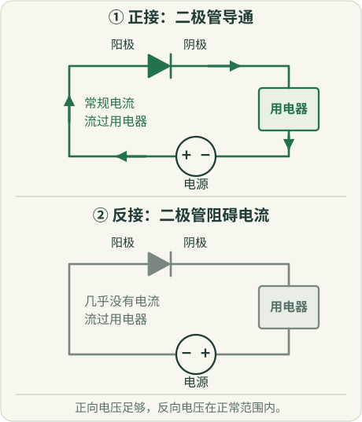](img/diode-one-way.svg)

</figure>

利用这种特性，可以用四只二极管构成一个桥式整流电路。下面两张图使用同一个电路，区别只有电源此刻的正负极性。绿色表示导通的电流路径，灰色表示截止的支路。

[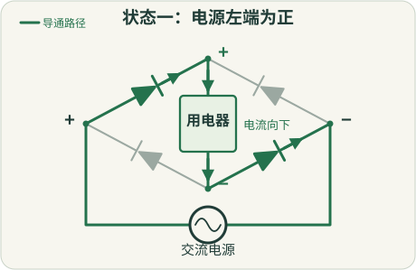](img/bridge-rectifier-positive.svg)

**电源的极性变了，但流过用电器的电流方向没有改变。** 这就是整流电路利用二极管实现的效果。手机充电器、电脑电源等设备中都可以找到整流电路。[加州大学伯克利分校：桥式整流及其应用](https://rfic.eecs.berkeley.edu/courses/ee42_100/pdf/lect20_ann2.pdf)

一种常见的硅二极管是在一块硅中形成相邻的 P 型区和 N 型区，两种区域的交界处称为 **PN 结**。P 端接阳极 A，N 端接阴极 K。

<figure markdown="1">

</figure>

**为什么二极管具有单向导通的能力？** 教材一般从什么是 PN 结开始讲，再解释二极管正接和反接时的行为。但我在学习 PN 结时还有很多疑问：硅为什么能导电？电子为什么会在硅中运动？P 型和 N 型硅接触后，电子又会发生什么变化？

因此，我想先从更基础的电荷、电子在硅中所处的状态以及电流形成的原因开始建立认知，一步步理解 PN 结，最后回到二极管的单向导通特性。

## 从电子的运动到能带 {#states}

### 电子的运动怎样形成电流？ {#electron-current}

电子带负电荷。电荷的定向净运动形成电流。按照约定，常规电流方向与正电荷的净运动方向相同，所以电子的净运动方向与其对应的电流方向相反。

但是，电子在运动，并不意味着一定有净电流。假设我们在一块材料中选取一个截面，统计同一段时间内向左和向右穿过它的电子数。

<figure markdown="1">

[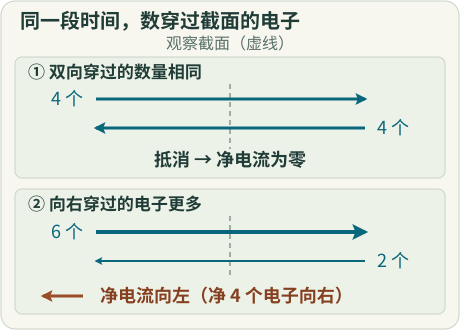](img/electron-net-current.svg)

</figure>

第二种情况相当于四个电子净向右通过截面，因此电流向左。

硅中有大量电子，为什么施加电场后，并不是所有电子都能参与净电荷输运？这就需要了解电子能够处于哪些状态。

### 什么是电子状态、能级和能带？ {#energy-states}

电子可以处于不同的物理状态。在本文采用的单电子能带模型中，我们可以通过能量、空间分布和运动特征等物理属性来认识电子的状态。电子的状态并不等于某一个空间位置。

状态所对应的能量值称为**能级（Energy Level）**。同一能级可以对应多个不同的状态。例如，某些状态具有相同的能量，却对应方向相反的电子速度。

孤立原子的电子能量是离散的。大量硅原子靠近形成晶体后，原子之间的相互作用使原有的能级发生分裂。许多允许状态的能量排列得非常紧密，形成一组组能量范围，这就是**能带（Energy Band）**。

<figure markdown="1">

[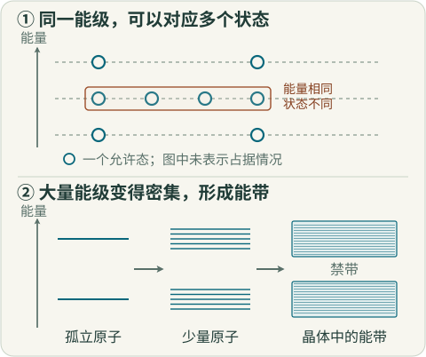](img/energy-states-and-bands.svg)

</figure>

在理想晶体中，相邻能带之间可能存在一段没有允许体电子态的能量范围，这称为**禁带（Band Gap）**。

根据泡利不相容原理，每个完整的单电子状态（包括自旋）最多只能被一个电子占据。因此，能带中的允许状态有些可能已经被占据，有些可能还空着。[胡正明《现代半导体器件》第 1 章，能带与态密度](https://www.chu.berkeley.edu/wp-content/uploads/2020/01/Chenming-Hu_ch1-3.pdf)

## 硅里有这么多电子，为什么只有一小部分参与导电？ {#bands}

### 1000 个硅原子的价电子，为什么恰好填满价带？ {#counting-states}

一个硅原子有 14 个电子，其中最外层的 4 个电子称为**价电子**。在硅晶体中，每个硅原子与周围四个相邻原子形成共价键，每条键共享一对价电子。

<figure markdown="1">

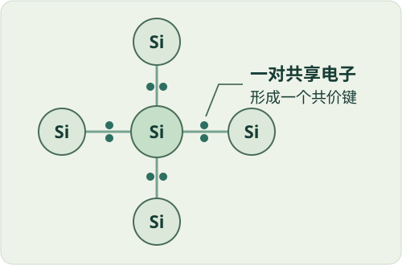

</figure>

硅晶体中，与价电子成键有关的一组低能允许状态形成了**价带（Valence Band）**。隔着基本禁带、能量更高的一组相邻能带称为**导带（Conduction Band）**。价带顶与导带底的能量差称为带隙，室温下约为 1.12 eV。[伊利诺伊大学：硅的能带形成和态数](https://courses.physics.illinois.edu/phys525/sp2024/units/Semiconductors.pdf)

现在假设有 1000 个硅原子组成理想晶体，忽略表面的影响。数一数电子数和可用状态数：

1. 每个硅原子提供 4 个价电子，共有 **4000 个价电子**。
2. 每个原子与四个相邻原子成键。每条键由两个原子共享，因此共有 1000 × 4 ÷ 2 = **2000 条共价键**。
3. 在简化的成键模型中，每条共价键对应一个低能成键轨道，可容纳两个自旋不同的电子。因此这组低能状态可以容纳 2000 × 2 = **4000 个电子**。

未掺杂的纯硅称为本征硅。在绝对零度（0 K）下，理想本征硅的电子占据最低能量的状态。这些价电子恰好填满价带中的允许状态，而导带没有电子。

这是特定温度下的占据情况，不是价带和导带的定义。电子可以获得能量并进入导带，价带中的状态也可以不再全部被占据。

### 填满以后，电子的运动为什么加不出净电流？

对于硅晶体，可以找到速度大小相同、方向相反的一对电子状态。当整条能带被填满时，每一对状态的电子电流贡献相互抵消。

<figure markdown="1">

</figure>

电场会对带电粒子施加力。但是，在较弱的电场下，如果电子仍处于同一条已经填满的能带中，所有允许状态都被占据，电子无法通过重新分布使某个方向上的占据多于另一个方向。

因此，即使电子并非静止不动，完全填满的能带也不能通过带内响应形成净导电电流。[塔斯马尼亚大学：满带、电子与空穴](https://ssp.utasphys.cloud.edu.au/6-semiconductors/6-1-semiconductors/)

### 当价带中出现空态，电子怎样参与导电？ {#carriers}

当温度升高时，少量价带电子能够获得足够的能量，跃迁到导带，并在价带中留下未被占据的状态。

两条能带都有了电子和空态，电子便有机会改变占据状态。

用简化的成键模型理解价带电子的运动时，我们可以把缺失的电子表示为一个空位。假设电场向右，导带电子向左净移动，价带中相邻的电子也可以依次向左填补空位。

<figure markdown="1">

</figure>

图中蓝色表示占据导带的电子，紫色表示占据价带的电子。两种颜色区分的是电子所处的状态，而不是两种不同的电子。

如果不逐个跟踪价带电子，而是跟踪空位，就会发现空位向右移动。电子向左净运动产生向右的电流，从电流的角度看，等效于一个带正电的载流子向右运动。这种等效载流子称为**空穴（Hole）**。

由此可见，硅中可以参与导电的载流子有两种：导带电子和价带空穴。仅仅产生载流子并不意味着产生了净电流；外加电场可以使它们发生定向净运动。

导带电子还可以释放能量，填上价带中的一个空态，这称为**复合**。一次这样的过程会使导带电子和空穴各减少一个。热平衡时，热产生与复合的平均速率相等。

金属有部分填充的能带，弱电场就可以改变电子占据的分布。硅则需要热激发等机制产生载流子。较大的带隙使热激发更困难，这也是许多材料表现为绝缘体的原因。[胡正明《现代半导体器件》第 1 章：电子、空穴与能带模型](https://www.chu.berkeley.edu/wp-content/uploads/2020/01/Chenming-Hu_ch1-3.pdf#page=12)

深化阅读：电子的空间运动与两种能带图

电子在空间中运动，不一定要跨越能带；即使空间分布几乎不变，也可能发生能带间跃迁。[交互：改变波包的位置和传播方向](interactive.html#state)

<figure markdown="1">

</figure>

电子的空间运动可以用波包描述：由许多晶体态叠加成一团集中的波。包络中心移动时，更可能找到电子的位置也随之移动。

后文的 PN 结能带图以空间位置 x 为横轴，画出各处导带底 EC(x) 和价带顶 EV(x) 的能量。另一类能带图 E(k) 以波矢 k 为横轴，用于描述电子状态的波动特征。

[交互：依次观察满带、激发、带内重新分布与复合](interactive.html#bands)

纯硅在室温下只有少量导带电子和价带空穴。有没有办法主动增加其中一种载流子的数量？这就引出了掺杂。

## 掺杂怎样增加载流子，又怎样保持电中性？ {#doping}

一种办法是在硅晶体中有意引入少量其他原子，改变电子可以占据的状态以及载流子浓度，这叫**掺杂（Doping）**。先看两种常用的杂质：磷和硼。它们的原子本身都是电中性的。

**用磷取代硅原子。** 磷比硅多一个质子，也多一个价电子。四个价电子参与成键，剩下一个与磷原子结合得较弱。该电子处于主要分布在杂质附近的局域状态，对应的能量称为施主能级，距硅的导带底约 0.045 eV。

在室温、普通轻掺杂条件下，大部分磷原子会失去这个电子。电子进入导带，成为可移动的载流子，磷则成为留在晶格位置上的正离子。能向导带提供电子的杂质叫**施主（Donor）**。

**用硼取代硅原子。** 硼只有三个价电子，比硅少一个参与成键的电子。它在价带顶附近引入受主能级。一个价带电子只需获得很少的能量，就可以进入这个局域状态。

硼接收电子后成为留在晶格位置上的负离子，价带则留下一个可移动的空穴。能接收价带电子、产生空穴的杂质叫**受主（Acceptor）**。

<figure markdown="1">

</figure>

每次电离后，导带电子与固定正离子的电荷相互抵消，空穴与固定负离子也一样。掺杂改变了两种载流子各自的数量，使其中一种成为多数载流子，但均匀掺杂的硅仍可保持近似电中性。

在热平衡时，掺入施主且以导带电子为多数载流子的硅称为 **N 型硅**；掺入受主且以空穴为多数载流子的硅称为 **P 型硅**。数量较少的另一类称为少数载流子。

[MIT 6.012 的掺杂与载流子讲义](https://ocw.mit.edu/courses/6-012-microelectronic-devices-and-circuits-fall-2009/a37c73e7fcff4bcb5c5f1177e12d0891_MIT6_012F09_lec01.pdf) · [比较本征激发、施主电离与受主电离](interactive.html#doping)

掺杂不仅会增加一种载流子的平衡浓度，也会使另一种载流子的平衡浓度降低。以室温（300 K）、掺杂浓度为 10¹⁶ cm⁻³ 的硅为例：

| 硅的类型 | 导带电子浓度 n（cm⁻³） | 空穴浓度 p（cm⁻³） |
| --- | ---: | ---: |
| 本征硅 | 10¹⁰ | 10¹⁰ |
| N 型硅 | 10¹⁶ | 10⁴ |
| P 型硅 | 10⁴ | 10¹⁶ |

上表为均匀掺杂、杂质近似完全电离、硅处于热平衡时的近似值。可以看到，P 型和 N 型硅中同一种载流子的浓度能够相差一万亿倍。即使空穴是多数载流子，P 型硅价带中的绝大多数状态仍被电子占据。

深化阅读：为什么另一种载流子减少？怎样计算它的浓度？

掺入磷后，施主向导带提供电子，却没有同时在价带中产生空穴。电子增多，原有空穴与电子复合的机会也增加，直至产生和复合重新达到平衡，空穴浓度下降。P 型硅中的情况与之对应。

仅凭杂质原子的数量，可以近似数出新增的多数载流子，但无法直接数出平衡时还有多少少数载流子。为此，需要知道不同能量的允许状态被电子占据的概率。

**费米能级（Fermi Level）** 是描述占据概率的能量参数，记为 EF。在热平衡、温度高于零时，能量为 E 的一个允许状态被电子占据的概率为：

**f(E) = 1 / [1 + exp((E − EF)/kT)]**

其中 T 是绝对温度，k 是玻尔兹曼常数。若某个允许状态的能量等于 EF，它的占据概率为 50%。如果 EF 位于禁带中，则这个能量不一定有允许状态。这里讨论的是材料内部的占据情况，不是外来电子进入某条能带的概率。

<figure markdown="1">

</figure>

以 300 K 为例，一个允许状态的能量比费米能级高 0.2 eV 时，占据概率只有约 0.04%；低 0.2 eV 时，占据概率约为 99.96%。

所以，费米能级靠近某条带边，并不代表占据概率接近 50%。而且，带边处的占据概率也不代表整条能带的占据比例。

能带结构给出了每小段能量中有多少允许状态（态密度）。把导带中每段的态数乘以占据概率后累加，可以求出导带电子的浓度；对价带则乘以空态概率，求出空穴浓度。

对于普通非简并硅，在温度和能带结构不变时，记导带底、价带顶的能量为 EC、EV，有效态密度为 NC、NV。两类载流子的浓度近似为：

- n = NC exp[(EF − EC)/kT]
- p = NV exp[(EV − EF)/kT]

将两式相乘，费米能级 EF 消掉。对于同种硅、相同温度的热平衡状态，**np = ni²**，这称为质量作用定律。ni 是本征硅中导带电子或空穴的平衡浓度。

假设只掺入 10¹⁶ cm⁻³ 的磷，近似完全电离。电中性的 N 型体区中 n ≈ 10¹⁶ cm⁻³，取室温 ni ≈ 10¹⁰ cm⁻³，由上式得到 p ≈ 10⁴ cm⁻³。P 型硅采用相同受主浓度时恰好反过来。

[胡正明《现代半导体器件》第 1 章，态密度、占据概率与载流子浓度](https://www.chu.berkeley.edu/wp-content/uploads/2020/01/Chenming-Hu_ch1-3.pdf) · [调节费米能级，比较导带占据与价带空态](interactive.html#fermi)

## 同一批电子，为什么既会漂移，又会扩散？ {#transport}

前面通过掺杂增加了载流子的数量，但要形成电流，还需要载流子有定向的净运动。这里先看两个能产生净运动的原因：电场和浓度差。

### 电场怎样使载流子发生净运动？

电场能够对电荷施加力。假设硅中存在向左的电场，导带电子带负电，受力向右；空穴带正电，受力方向向左。这里用的是电场力的方向，不是每个载流子此时的运动方向。

电子本来就在做热运动，也会与晶格振动、杂质等发生散射。电场使电子的平均运动方向产生偏好，表现为向右的净运动。这种由电场引起的净输运称为**漂移（Drift）**。

空穴的漂移方向与电场相同。因此两类载流子虽然漂移方向相反，却都产生向左的常规电流。[MIT 6.012：载流子的漂移](https://ocw.mit.edu/courses/6-012-microelectronic-devices-and-circuits-fall-2009/a37c73e7fcff4bcb5c5f1177e12d0891_MIT6_012F09_lec01.pdf#page=18)

深化阅读：从截面的电子数算出硅棒电阻

设元电荷的大小为 q，导带电子浓度为 n，硅棒截面积为 A，电子平均漂移速率为 v。在时间 Δt 内，通过截面的净电荷量大小为 qnAvΔt，因此电子漂移电流的大小为 I = qnAv。

在低场条件下，v 与电场强度的大小成正比，比例系数 μn 称为电子迁移率。对于长度 L、两端电压差大小为 V 的均匀硅棒，有 v = μnV/L。[比较不同间距下的电场](interactive.html#transport)

空穴也能参与导电。假设空穴浓度为 p、迁移率为 μp，把两种载流子的漂移电流贡献相加，可以得到电导率和电阻：

**σ = q(nμn + pμp)，R = L/(σA)。**

同样的电压加在较长的硅棒上，电场变弱，平均漂移速度下降。增大横截面积则让更多载流子参与输运。这里假设材料均匀、处于低场条件，且接触压降可忽略。

### 去掉电场，电子为什么还会向一边净传输？

在同种硅中取两个相邻且大小相同的区域，温度相同，先忽略电场的影响。假设右边有 100 个导带电子，左边只有 10 个，两侧的电子都在做随机热运动。

假设在一小段观察时间内，两侧每个电子越过交界的概率都是 ½。按此估算，右边有 50 个电子向左越界，左边有 5 个电子向右越界，结果相当于 **45 个电子净向左运动**。

<figure markdown="1">

[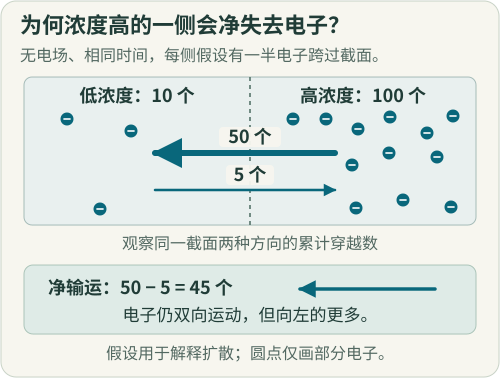](img/diffusion-count.svg)

</figure>

电子仍然可以向两边运动，不需要知道哪里浓度更低。只要高浓度一侧向低浓度一侧通过交界的电子更多，就会产生从高浓度处向低浓度处的净输运，这叫作**扩散（Diffusion）**。同样的道理也适用于空穴。

漂移与扩散并不是两群不同的电子在运动，而是同一群载流子净输运的两种贡献。如果这两种贡献方向相反，就可能相互抵消。[MIT 6.012 的漂移、扩散与非均匀掺杂讲义](https://ocw.mit.edu/courses/6-012-microelectronic-devices-and-circuits-fall-2009/pages/lecture-notes/)

现在回想掺杂后的硅：P 型硅的空穴多，N 型硅的导带电子多。如果这两个区域相邻，两种载流子都会因浓度差而产生扩散。接下来看看它们怎样改变交界附近的电荷分布。

## 两侧原本都电中性，结里的电场从哪里来？ {#equilibrium}

现在回到二极管内部的 PN 结。N 型区的导带电子远多于 P 型区，P 型区的空穴远多于 N 型区。两种区域相邻时，载流子的浓度差就会引起扩散。

### 载流子跨过结面，会发生怎样的电荷变化？

把左侧设为 P 区，右侧设为 N 区。我们先想象在某一刻才允许两侧交换载流子，以便观察电场怎样形成。实际器件可以在同一块硅晶体中直接形成相邻的掺杂区。

起初两侧都近似电中性：P 区的空穴补偿带负电的硼受主离子；N 区的导带电子补偿带正电的磷施主离子。

下面的图只抽取少量状态与晶格位置来做电荷记账，刻意放大了价带中的空态和导带中的电子数量，不代表它们的实际占据比例。

<figure markdown="1">

</figure>

**先看导带。** 一个导带电子从 N 区扩散到 P 区，仍然占据导带中的状态。N 侧少了一份负电荷，P 侧多了一份负电荷。

**再看价带。** 一个 N 侧价带电子填入 P 侧的空态，N 侧则留下一个价带空态。这等效于一个空穴从 P 侧扩散到 N 侧。又有一份负电荷从右向左传输。

这两个过程都完成后，按图中的示意数量记账，P 侧净电荷为 −2q，N 侧净电荷为 +2q。其中 q 是元电荷的正值。注意，硼和磷的离子一直留在原处。

跨结后，P 区的导带电子可以与空穴复合；N 区的空穴也可以与导带电子复合。复合使一正一负两个载流子同时减少，不改变任一区域的净电荷。[改变两侧计数，观察双向扩散](interactive.html#junction)

随着净扩散和复合，交界附近的多数载流子显著减少，固定离子不再得到充分补偿。这样的区域称为**耗尽区（Depletion Region）**，也称空间电荷区。

两侧分离的正负电荷建立了从 N 区指向 P 区的电场。即使没有外部电源，PN 结内部也能形成这个电场，所以叫作**内建电场**。

### 为什么扩散没有一直持续下去？

内建电场向左，但电子带负电，受到的力向右。因此，电场使导带电子向右漂移，与向左的净扩散相反。

再看价带。空穴的扩散方向向右，漂移方向向左；如果追踪价带电子，则这两种净输运贡献的方向分别向左、向右。

<figure markdown="1">

[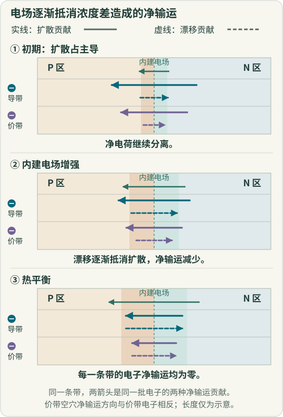](img/junction-equilibrium.svg)

</figure>

只要扩散贡献大于反方向的漂移贡献，净扩散就会继续分离电荷，从而增强电场。电场的增强使漂移抵消越来越多的扩散贡献。

最终，电子和空穴各自的漂移与扩散贡献相抵，不再有净电流。整个 PN 结处于等温、无外加电压、无光照等激励的**热平衡**状态。

平衡并不是电子停止运动，也不是两边的浓度变得相同，而是在同一位置，两种机制引起的净输运相互抵消。[MIT 6.012 的 PN 结热平衡](https://ocw.mit.edu/courses/6-012-microelectronic-devices-and-circuits-fall-2009/c053714447998e522f02db0776987091_MIT6_012F09_lec04.pdf#page=8)

深化阅读：怎样用式子表达漂移与扩散的抵消？

取 x 向右为正。电子漂移、扩散的常规电流密度分别为 qnμnE 和 qDndn/dx。Dn 为电子扩散系数，E 为带方向的电场。

在恒温、非简并硅的热平衡下，两个贡献之和为零。利用 Dn/μn = kT/q 的关系，可得 **E = −(kT/q) d(ln n)/dx**。

因此，当导带电子浓度沿 x 增长时，平衡所需的电场指向左。浓度相对变化得越快，需要的电场就越强。

[比较载流子浓度与两种输运贡献](img/drift-diffusion.svg) · [平衡 PN 结的局部剖面](../silicon-to-logic/img/pn-depletion.svg)

## 内建电场为什么会形成势垒？ {#field}

内建电场从 N 区指向 P 区，电子带负电，受到的电场力则指向 N 区。因此，电子从 N 区向 P 区运动时，需要克服电场力，静电势能随之升高。

下图中，从 N 区到 P 区的整个耗尽区都是电子势能升高的区域。结面处电场最强，电子势能变化最快，但越过结面后还需要继续克服电场力。

<figure markdown="1">

[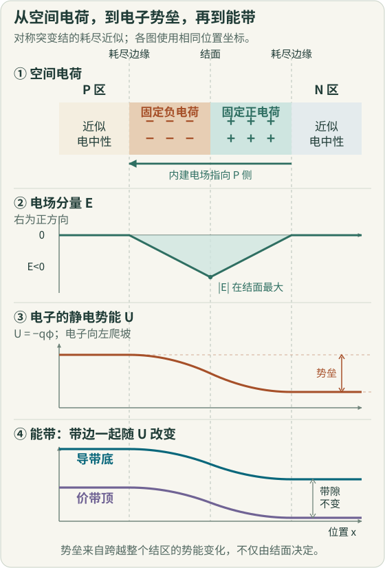](img/junction-field-barrier.svg)

</figure>

电子从 N 型体区运动到 P 型体区，需要克服的静电势能差称为**势垒（Barrier）**。能量不足的电子难以越过势垒，但能量足够的电子仍有机会通过。

电势是单位正电荷的静电势能，电压是电势差。电子带负电，因而 P 侧虽然电势较低，电子势能反而较高。正、反接电源正是通过改变这个电势差来改变势垒。

图中最下方展示了能带随位置的变化：同一种硅中的导带底和价带顶随电子静电势能一起升降。因此，P 侧的带边高于 N 侧，而带隙保持基本不变。这就是能带弯曲。[比较接触前后的能带图](interactive.html#align)

达到热平衡时，两类载流子的漂移和扩散贡献各自相抵，耗尽区的宽度也趋于稳定。两侧远离结面的区域仍有足够的载流子补偿固定掺杂离子，近似保持电中性，称为**准中性区**。

深化阅读：电场与势垒有什么区别？

用 φ 表示电势。电子带负电，静电势能 U = −qφ，其中 q 是元电荷的正值。

假设两根均匀硅棒的右端电势都比左端高 1 V，电势沿长度均匀变化。

| 硅棒长度 | 两端电压 | 电场强度 |
| --- | --- | --- |
| 1 μm | 1 V | 1 V/μm |
| 10 μm | 1 V | 0.1 V/μm |

两根硅棒的电场都向左，电子受力向右。较短硅棒中的电子受到的电场力是较长硅棒中的十倍，但从左到右走完全程时，电场做的功相同。

电子跨越 1 V 电势差时，静电势能变化的大小就是 1 电子伏特（eV）。两根硅棒中，电子从左到右的势能都降低 1 eV，从右到左的势能都升高 1 eV。

电场决定电子在当前位置受到的力；跨越整段距离的电势差决定其静电势能的变化。电场做的功也可能经散射传给晶格，并不一定全部变成电子的动能。[比较不同间距下的电场](interactive.html#transport)

在足够宽大的平面突变结中，可以把耗尽区的固定电荷近似看成许多薄片。每片的电场在两侧方向相反。结外两侧的总正负电荷产生的电场近似抵消。

从右往左进入耗尽区后，电子右侧留下越来越多的正离子薄片，吸引电子向右。左侧负离子也排斥电子向右。结面处的电场力最大，再往左则减弱。

[逐层观察电荷产生的力](interactive.html#depletion) · [对照电荷与电子势能参考图](../silicon-to-logic/img/pn-depletion-electron-energy.svg)

深化阅读：势垒高度和耗尽区宽度如何计算？

**先计算势垒。** 沿用掺杂一节的算例：温度为 300 K，P、N 侧掺杂浓度均为 10¹⁶ cm⁻³，杂质近似完全电离，本征载流子浓度取 10¹⁰ cm⁻³。

这种两侧分别均匀掺杂、在结面处浓度突变，且受主与施主浓度相等的结构称为对称突变结。远离结面的 P、N 侧体区，导带电子浓度分别约为 10⁴、10¹⁶ cm⁻³。

在[掺杂的深化阅读](#fermi)中，我们用费米能级描述某个允许状态被电子占据的概率。现在用它来计算热平衡时两个体区之间的能量差。

相互连通的材料达到等温热平衡时，以同一个能量参考表示，在所有位置费米能级都相同。这是热平衡的计算条件，并不是内建电场形成的原因。

非简并硅的导带电子浓度近似满足 n = NC exp[(EF − EC)/kT]，其中 NC 是导带有效态密度，EC 是导带底能量。

相同温度下，两侧是同一种硅，NC 取相同值。EF 相等，因此两侧的导带电子浓度之比取决于导带底的能量差。

令 nN/nP = 10¹²，kT ≈ 0.02585 eV，得到势垒 **qVbi = kT ln(nN/nP) ≈ 0.714 eV**。对应的内建电势差 Vbi ≈ 0.714 V。

在耗尽近似下，此对称突变结的结面处，电子静电势能比 N 型体区高约 0.357 eV。根据同样的热平衡关系，结面附近的导带电子浓度约为 N 型体区的百万分之一，即 10¹⁰ cm⁻³。耗尽区并非没有移动载流子，只是多数载流子显著减少。

**再计算耗尽区宽度。** 耗尽近似忽略结区内移动载流子对空间电荷的贡献；在结外取近似电中性。实际载流子浓度和电场并非在边界处突变。这里只讨论足够厚、均匀掺杂的平面突变结。

在对称突变结的[场强图](img/field-area.svg)中，纵轴为场强大小，横轴为位置。两侧三角形的面积之和是内建电势差。

设 P、N 侧的电离掺杂浓度为 NA、ND，耗尽宽度为 WP、WN。两侧分离的电荷量按单位结面积计相等，因此 **NAWP = NDWN**。

两侧掺杂浓度相差十倍，对应的耗尽宽度在耗尽近似下相差十倍。较高掺杂的一侧只需较窄的区域来提供等量异号的电荷。

在均匀掺杂区域，固定电荷密度恒定，电场随位置线性变化。由高斯定律，结面场强大小 **E峰 = qNDWN/ε**，其中 ε 是硅的介电常数。

设 W = WP + WN。对于对称结，两侧掺杂浓度均为 N，各自宽度是 W/2。图中场强三角形的面积给出 **Vbi = E峰W/2 = qNW²/(4ε)**。

代入 ε ≈ 1.04 × 10⁻¹² F/cm、N = 10¹⁶ cm⁻³、q ≈ 1.60 × 10⁻¹⁹ C、Vbi ≈ 0.714 V：

**W = √(4εVbi/(qN)) ≈ 4.3 × 10⁻⁵ cm = 0.43 μm。**

这个理想模型中，不到半微米的耗尽区就能建立约 0.714 eV 的势垒。

峰值场强为 2Vbi/W ≈ 3.3 × 10⁴ V/cm。若两侧掺杂不同，可由电荷平衡关系及三角形面积得到 W = √[(2εVbi/q)(1/NA + 1/ND)]。

改变某一侧掺杂浓度时，内建电势和总耗尽宽度也要重新计算。仅增加结面积或体区长度，在忽略边缘影响且体区足够厚的条件下，不改变耗尽宽度。

[改变两侧掺杂，检查宽度和峰值场强](interactive.html#depletion) · [胡正明《现代半导体器件》4.1–4.2 节，内建电势与耗尽宽度](https://www.chu.berkeley.edu/wp-content/uploads/2020/01/Chenming-Hu_ch4-1.pdf)

## 外部电路怎样向半导体补充或取走电子？ {#contacts}

不接电源时，PN 结的漂移与扩散相抵。接下来要通过电源改变这份平衡。电源并不直接接触硅，而是通过二极管两端的金属引线补充或取走电子。

先假设金属与硅之间的接触电阻很小，两个方向的电流都容易通过。这种接触称为**欧姆接触（Ohmic Contact）**。

<figure markdown="1">

[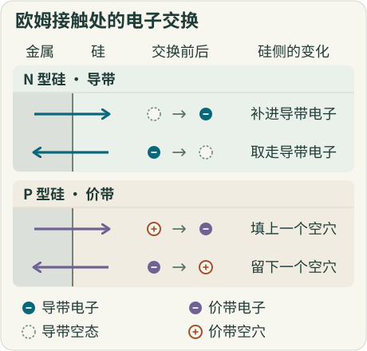](img/contact-exchange.svg)

</figure>

对于 N 型硅，接触附近的净电流主要由导带电子承担。金属送来电子，导带中的一个空态便可能被占据；金属取走电子，导带则空出一个原本被占据的状态。

对于 P 型硅，接触附近的净电流主要由价带空穴承担。金属送来的电子填补价带空态，相当于空穴被取走；金属取走一个价带电子，相当于给硅提供一个空穴。

要持续向 P 端送入电子，硅内必须不断向接触处输运空穴。反过来，取走价带电子，就能不断向 P 区提供空穴。

以上是接触附近由多数载流子主导的净交换。这不意味着金属中的某个电子进入硅后必定占据某条能带。如果少数载流子到达接触处，金属也可以收集它们。

深化阅读：金属与半导体怎样形成欧姆接触

同温的金属与掺杂硅接触时，若两侧的电子电化学势（热平衡时的[费米能级](#fermi)）不同，就会有电子发生净转移。界面附近的电荷重新分布，使硅的带边发生弯曲。

达到热平衡后，两侧费米能级相等，跨过界面的双向电子通量相抵，不再发生净电荷交换。

接上电源后，要使电子发生持续的净交换，出发处需要有已占据的允许态，接收处需要有能够接收电子的空态，电子还需要越过或穿过界面势垒。

实际器件常把紧邻金属的一小层硅做成重掺杂区，使势垒变薄，电子便容易隧穿。接触电阻可以因此降低。若金属与硅的接触本身具有明显整流特性，则属于另一类称为肖特基接触的界面。

[华盛顿大学的金属–半导体接触讲义](https://dunham.ece.uw.edu/ee482/Notes/MS.pdf#page=10) · [胡正明《现代半导体器件》4.21 节，欧姆接触](https://www.chu.berkeley.edu/wp-content/uploads/2020/01/Chenming-Hu_ch4-1.pdf)

### 内部已经形成电势差，为什么端口仍是 0 V？

PN 结在热平衡时内部已经形成电势差。可是把电压表接到未通电的二极管两端，读数却是 0 V。这是为什么？

表笔接触的不是 P 区和 N 区的硅内部，而是两端金属电极。在等温、无光照的热平衡下，金属与硅等接触处也存在内建电势差，它们在测量回路中抵消了 PN 结的内建电势。

深化阅读：热平衡与端口电压

在同温热平衡下，采用统一能量参考，两端金属电极的电子电化学势相同。电压表响应的是电极之间的电化学势差所对应的电压，而不是硅内部任意两点的静电势差。

[胡正明《现代半导体器件》4.1–4.2 节，内建电势、端口测量及耗尽宽度](https://www.chu.berkeley.edu/wp-content/uploads/2020/01/Chenming-Hu_ch4-1.pdf)

接下来给两个金属端子接上电源，外部电压便可以改变结区的电势差和势垒。分别看看正接和反接时会发生什么变化。

## 正接电源，为什么能一直有电流？ {#forward}

把 P 端接电源正极，N 端接负极，这称为**正向偏置**。先看电源接通的过程，再看电压稳定以后，电流为什么还能持续。

P 端接触处的价带电子被电源取走，留下空穴；N 端接触处的导带得到电子补充。外加电压改变两侧的电势和电场分布，使两侧的多数载流子可以向原有耗尽区靠近。

当空穴和导带电子到达原有耗尽区的边缘，一部分固定负受主和固定正施主的电荷便重新得到补偿。掺杂离子没有移动，但产生净空间电荷的区域缩小了。

原先 N 型体区的电势高于 P 型体区。忽略接触及体区的压降时，正向电压抵消了一部分原有的电势差，耗尽区变窄，结区电场减弱。电子从 N 区进入 P 区时要克服的势垒也降低了。

<figure markdown="1">

[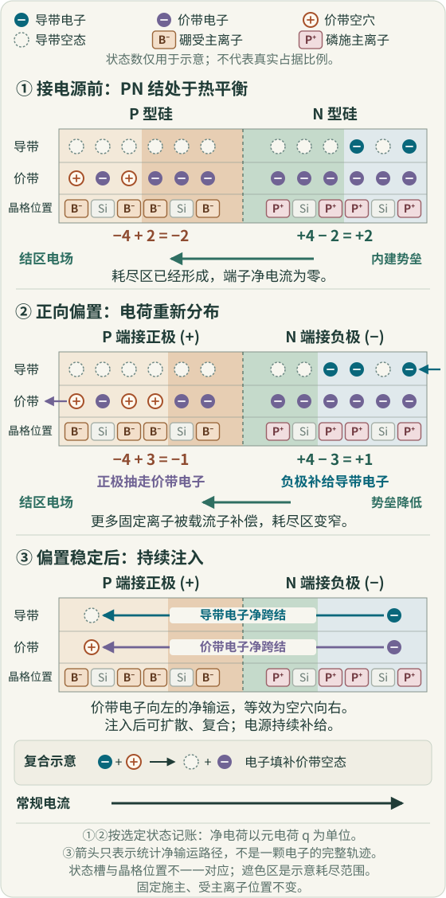](img/pn-forward-stages.svg)

</figure>

势垒降低之后，N 区的导带电子更容易进入 P 区；P 区的空穴也更容易进入 N 区。进入对侧后，它们成了当地的少数载流子。这个过程称为**少数载流子注入**。

### 正接时，电子怎样从 N 端送到 P 端？

正极从 P 端取走价带电子，负极向 N 端补充导带电子；那么，电子在两区之间怎样传递？我们分别跟踪两条跨结输运路径。

<figure markdown="1">

[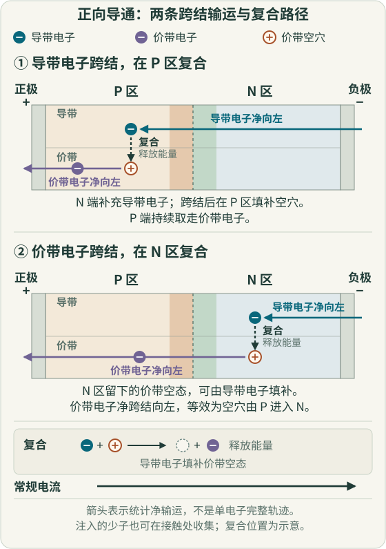](img/forward-recombination-paths.svg)

</figure>

**路径一：导带电子跨结，在 P 区复合。**

负极向 N 区补充导带电子。N 区的导带电子跨结进入 P 区后，仍处于导带。结区附近的电子浓度较高，它们可以继续向 P 区深处扩散，然后与空穴复合。

与此同时，正极不断取走 P 区的价带电子。价带电子依次填补这些空态，等效于空穴不断从 P 端净向结区移动。一次复合填上一个价带空态，使两种输运衔接起来。

**路径二：价带电子跨结，在 N 区复合。**

N 区的价带电子净向 P 区移动，并在 N 区留下空态。这等效于 P 区的空穴跨结进入 N 区。该空态可以被负极补充的导带电子填上，发生复合。

在 P 区，价带电子可以继续向正极净移动，并被电源取走。这样，经过 N 区的复合，导带与价带的输运也衔接起来了。

两条路径的电子净输运方向都是从 N 端指向 P 端，常规电流方向都是从 P 端指向 N 端，但它们承担的电流不一定相等。

P 区和 N 区都可以持续发生复合。复合时，导带电子释放能量，普通硅二极管中主要由晶格吸收这部分能量。电子不是一跨过结面就立即复合；有些注入的少数载流子还会抵达金属接触处，由电极收集。

只要保持正向导通，电源就持续补充和取走电子，注入、扩散与复合也会持续发生。平均载流子浓度稳定下来，这叫作**稳态**，并不是没有净电流的热平衡。

**电流持续，并不要求同一颗电子穿过整个二极管。** 在一维稳态且无侧向电流流出的条件下，任意横截面的总电流相等。导带电子和空穴分别承担的电流则可以随位置变化。

[斯坦福 EE116：二极管中的少数载流子分布和电流](https://poplab.stanford.edu/files/ee116/L22toL25_PNcurrent.pdf)

### 加大正向电压，电流会怎样变化？

对同一只二极管，加大正向电压就会降低势垒，让更多载流子跨过结区。于是结区边缘与远处的少数载流子浓度差进一步增大，电流也随之增大。

这一变化通常很快。在室温下的理想模型中，当电流随结电压呈指数增长时，结电压每提高约 60 mV，电流就约增大 10 倍。具体推导见下方深化阅读。

工程上常说硅二极管约 0.7 V 导通，但这不是固定的开关门限。0.7 V 只是常见工作条件下的压降量级，实际压降取决于电流、器件结构与温度。

深化阅读：势垒只降了一点，注入为什么多了那么多？

把外加偏压中落在 PN 结上的部分记为 Vj，P 端为正时 Vj 为正。如果接触及准中性区的压降很小，它就近似等于外部端电压。

沿用[势垒的深化阅读](#depletion-width)中的 0.714 eV 算例。正向结电压为 60 mV 时，导带电子跨结需要克服的势垒 q(Vbi − Vj) 从 0.714 eV 降到 0.654 eV。

能量较高的状态通常只有很低的占据概率。在普通非简并硅的热平衡近似下，假设费米能级与温度固定，相隔 ΔE 的两个高能状态，其占据概率之比约为 exp(−ΔE/kT)。

300 K 时 kT 约为 0.0259 eV。势垒降低 0.060 eV，相当于降低约 2.32 个 kT，对应跨结注入的浓度变化因子 exp(2.32) ≈ **10.2 倍**。

记 P 区热平衡时的导带电子浓度为 np0。在普通非简并硅、低注入（注入的少数载流子远少于原有的多数载流子）的模型中，取结区近似处于局部准平衡，忽略结内复合。

P 侧耗尽区边缘的导带电子浓度近似为 **np0 exp(qVj/kT)**。N 侧少数空穴的结边浓度也按相同的因子变化。

延续前文的掺杂算例，np0 约为 10⁴ cm⁻³。加上 60 mV 的结电压，P 侧结边的浓度变为约 10⁵ cm⁻³。对于足够长的 P 区，远离结区的浓度仍接近平衡值 10⁴ cm⁻³。

比较这两个位置，正偏时出现了约 9 × 10⁴ cm⁻³ 的浓度差；零偏时该浓度差为零。[胡正明《现代半导体器件》4.6 节，结边的少数载流子浓度](https://www.chu.berkeley.edu/wp-content/uploads/2020/01/Chenming-Hu_ch4-1.pdf#page=17)

下面画出 P 侧准中性区导带电子浓度的分布。正向偏置使靠近结区的位置积累过剩电子，也就是超过热平衡浓度的那部分电子。

<figure markdown="1">

</figure>

正偏注入时二极管不再处于热平衡。局部准平衡可以用电子和空穴各自的准费米能级描述，不能再把热平衡关系 np = nᵢ² 直接套用到结边。

从 P 侧结边向深处量距离 s。对于均匀、足够长的 P 区，假设电子扩散系数 D、过剩电子的复合寿命 τ 为常数。定义**扩散长度** L = √(Dτ)，它表示过剩电子发生扩散的典型距离。

令结边的过剩电子浓度为 Δn。稳态时，随着扩散和复合，过剩浓度按 Δn · exp(−s/L) 衰减，每经过一个扩散长度就减小到原来的 1/e。

结边浓度斜率的大小为 Δn/L，净离开结边的电子数（每单位面积、每单位时间）为 DΔn/L。计算扩散时应使用实际浓度的斜率，而不是图中对数曲线的斜率。

代入 Δn = np0[exp(qVj/kT) − 1]，便得到电子扩散电流与结电压的关系。N 区结边也有同样形式的空穴扩散电流。

将两类电流相加，得到理想二极管的电流方程：

**I = IS[exp(qVj/kT) − 1]**

IS 称为反向饱和电流，取决于结面积、掺杂、扩散及复合等条件。式中的 1 对应扣掉热平衡浓度，因此零偏时端子电流为零。

只有当指数项远大于 1 时，室温下多加约 60 mV 的结电压才对应电流近似增加 10 倍。实际器件在小电流下还可能有耗尽区复合电流，大电流下可能出现串联电阻和高注入的影响。

[胡正明教材 4.7–4.9 节的稳态少数载流子分布](https://www.chu.berkeley.edu/wp-content/uploads/2020/01/Chenming-Hu_ch4-1.pdf#page=19) · [MIT 6.012：PN 结的势垒、注入与电流](https://ocw.mit.edu/courses/6-012-microelectronic-devices-and-circuits-fall-2009/a342ce0afb84bfa8e5b7dc819ff3e9bc_MIT6_012F09_lec06.pdf) · [调节电压，对照势垒、耗尽宽度与电流](interactive.html#forward)

## 反接后，电场更强，为什么电流反而很小？ {#reverse}

把电源反过来：P 端接负极，N 端接正极，这称为**反向偏置**。

与正向偏置不同，电源在 P 端补充电子，填补一些价带空态；在 N 端取走导带电子。靠近耗尽区的多数载流子向远离结区的方向移动，原先被补偿的固定离子逐渐露出。

此时 N 型体区相对于 P 型体区的电势差增大，耗尽区变宽，电场增强。N 侧多数导带电子和 P 侧多数空穴要跨过结区，需要克服更高的势垒。

建立这一电荷分布时，外部回路中会有一股短暂的充电电流。但结区宽度和反向电压稳定以后，不需要再不断抽走多数载流子来扩大耗尽区，这股电流便消退。

<figure markdown="1">

[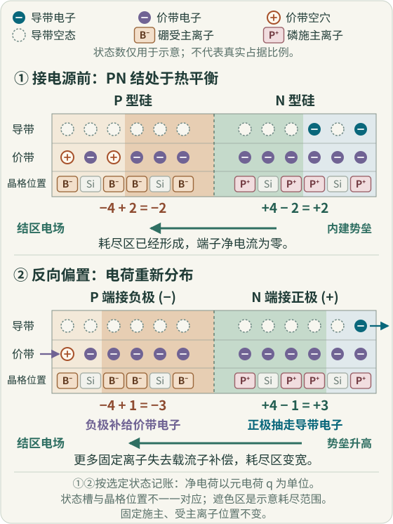](img/pn-reverse-stages.svg)

</figure>

### 电场能把电子扫过耗尽区，但下一颗电子从哪里来？

既然负极可以向 P 区送来电子，为什么反接时不能让这些电子源源不断地进入 N 区，形成很大的电流？

在普通欧姆接触下，P 区从负极得到电子，主要表现为填补价带空态，而不是补充导带电子。N 端连接的正极主要取走导带电子，也不是直接在价带中制造空穴。

要让价带电子变成导带电子，还需获得跨越带隙所需的能量。普通反向偏置虽使电场增强，却不意味着它能直接产生大量载流子。

不过，热激发可以使电子从价带进入导带，留下空穴。在反向电压作用下，这样产生的电子和空穴，有一部分会被结区的电场分离。

<figure markdown="1">

[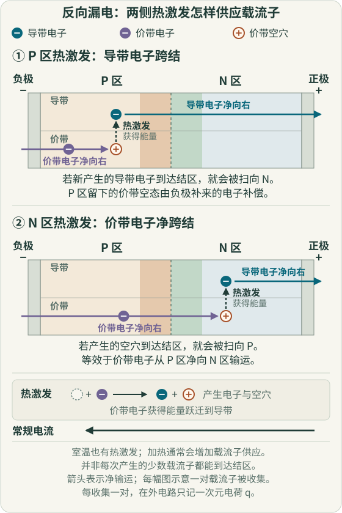](img/reverse-generation-paths.svg)

</figure>

**路径一：P 区产生电子，导带电子跨结。**

P 区有少量价带电子经热激发进入导带。如果新产生的导带电子没有在途中复合，而是扩散到结区边缘，就会受到向 N 区的电场力，被扫入 N 区。

它进入 N 区后可以向正极输运。P 区留下的价带空态则可由负极补入的电子填补。这样形成了一条从 P 端到 N 端的净电子输运路径。

**路径二：N 区产生空穴，价带电子跨结。**

N 区也有少量价带电子经热激发进入导带。导带电子可由正极取走。如果留下的空穴抵达结区边缘，电场就会将它扫向 P 区。

从电子的角度看，这等效于价带电子由 P 区向 N 区净输运，P 端由负极补入电子。这又形成了一条从 P 端到 N 端的净电子输运路径。

两条路径的常规电流均从 N 端指向 P 端。它们依靠两侧准中性区中少数载流子的扩散供应，构成反向扩散电流。

此外，电子和空穴也可能直接在耗尽区内产生，被电场分向两侧。这是另一种反向电流来源。完整收集一对载流子时，每根外引线只有一份元电荷通过，不能将电子和空穴分别再算一次。

### 加大反向电压，为什么电流不一定继续明显增大？

以 P 区的导带电子为例：反偏时结边的电子不断被电场带走，浓度比深处更低。于是更多电子从深处向结边净扩散。

可结边的电子浓度最低只能接近零，而深处能提供的少数载流子本来就不多。因此，即使反向电压继续升高，由这种扩散供应形成的电流也会逐渐趋于饱和。

这不意味着实际的反向电流一定恒定。除反向扩散电流外，耗尽区中的热产生电流、表面漏电等也可能对反向电流产生影响。

深化阅读：比较反向载流子路径和饱和电流

<figure markdown="1">

</figure>

上图两条路径的主要区别是载流子的来源。完整收集一个热产生的电子–空穴对时，每根外引线传递一份元电荷，不能把它们算成两份独立的外电路输运电荷。

仍假设 300 K、P 区深处的平衡导带电子浓度为 10⁴ cm⁻³，并沿用[正向偏置中的结边浓度关系与浓度曲线](#forward)。

| 结电压 Vj | P 侧结边浓度 | 结边浓度 / 深处浓度 |
| --- | --- | --- |
| 0 V | 10⁴ cm⁻³ | 1 |
| −10 mV | 约 6.79 × 10³ cm⁻³ | 0.679 |
| −100 mV | 约 2.1 × 10² cm⁻³ | 0.021 |

代入理想二极管方程，−10 mV 和 −100 mV 分别对应 −0.321 IS 和 −0.979 IS。在反向结电压绝对值远大于 kT/q、且未击穿时，理想扩散电流接近 −IS。

[沿电子路径比较正接与反接](interactive.html#reverse) · [在图上比较两种小反压](interactive.html#forward)

也可以参看[原来的正反偏载流子与导线净电子流向对照图](../silicon-to-logic/img/pn-diode-bias-flow.svg)。

### 如果主动增加反向载流子的供应呢？

室温下，电子与空穴已经不断产生和复合，因此反向漏电不需要额外加热也会存在。在相同的反向电压下，升高温度通常会提高少数载流子浓度，增加反向漏电。这不是正向导通，而是有了更多可供收集的载流子。

[胡正明教材 4.9 节](https://www.chu.berkeley.edu/wp-content/uploads/2020/01/Chenming-Hu_ch4-1.pdf#page=24) · [东芝：温度对硅二极管反向漏电的影响](https://toshiba.semicon-storage.com/eu/semiconductor/knowledge/faq/diode/are-there-any-special-considerations-for-temperature.html)

还可以用光照射二极管，让价带电子获得光能，进入导带并留下空穴。产生的载流子若被结区电场分离和收集，也会增大反向电流。这就是反偏光电二极管测光的原理。

[胡正明《现代半导体器件》4.15 节，光电二极管](https://www.chu.berkeley.edu/wp-content/uploads/2020/01/Chenming-Hu_ch4-1.pdf#page=45)

## 为什么桥式整流能使电流方向保持不变？ {#real-rectification}

现在可以从电子状态变化的角度对比正常正向导通与未击穿的反向漏电：

| | 正向导通 | 反向漏电 |
| --- | --- | --- |
| 结区势垒 | 降低 | 升高 |
| 跨结的电子净输运 | N → P | P → N |
| 载流子供应 | 多数载流子持续注入 | 少数载流子及热产生 |
| 典型的能带间变化 | 导带电子填补价带空态（复合） | 价带电子进入导带（产生） |
| 电流大小 | 较大 | 通常很小 |

这两种能带间变化表示典型净输运过程，不是说正偏时没有热产生、反偏时没有复合。

回到开头的[桥式整流电路](#rectification)。当电源提供足够大的输入电压时：

- 电源左端为正，左上和右下的二极管导通，电流从用电器的上端流向下端。
- 电源右端为正，右上和左下的二极管导通，电流仍从用电器的上端流向下端。

四只二极管利用正、反偏时巨大的电流差异，将输入的两种极性转换为用电器上相同的电流方向。

实际的导通路径有两只二极管的正向压降，反向阻断的二极管也会有少量漏电。反压过高可能发生击穿，快速换向也可能让反向电流暂时变大。

到这里，我们已经解释了普通二极管为什么能够单向导通。如果你想继续理解计算机里的晶体管，可以直接进入[下一篇 · MOS 管怎样隔着绝缘层控制电流？](../bands-to-channel/README.md)。

自测：能否用刚才的机制预测这两种现象？

- 不接电源、暗处且处于等温热平衡时，电压表能否直接测到内建电势？回看[内建电势与表笔](#内部已经形成电势差为什么端口仍是-0-v)。
- 维持反偏，遮住原来照射结区的光，反向电流的绝对值会怎样变化？回看[反偏下的载流子供应](#reverse)。

以下为选读内容。它们解释更大的反向电压、较快的换向，以及怎样利用正偏结注入载流子、反偏结收集载流子来控制电流，并不是理解 MOS 管的必读前置知识。

## 拓展：强场怎样改变载流子的供应？ {#breakdown}

反向截止有一个适用边界：反向电压达到一定程度后，强电场可以产生大量载流子，使反向电流急剧增大。这称为**反向击穿**。

选读：雪崩击穿与齐纳击穿的微观机制

### 雪崩倍增：一个电子怎样产生更多载流子？

先跟踪一颗热产生的导带电子。它进入耗尽区，在强电场中加速。若在两次散射之间获得足够能量，它就可能在碰撞中将一个价带电子激发到导带。

<figure markdown="1">

[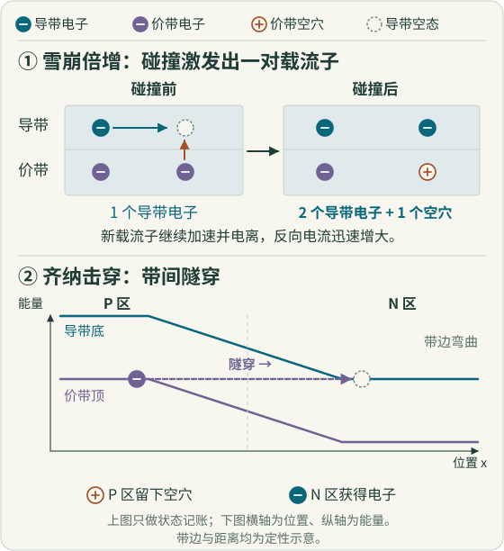](img/diode-breakdown-mechanisms.svg)

</figure>

碰撞后，导带里有两个电子，价带里留下一个空穴。这称为**碰撞电离**。新产生的载流子也可能获得能量、继续碰撞电离，于是出现连锁倍增。[斯坦福 EE116 的反向击穿图](https://poplab.stanford.edu/files/ee116/L22toL25_PNcurrent.pdf#page=9)

### 齐纳击穿：电子怎样从一条能带进入另一条能带？

看图中下半部分。重掺杂的 PN 结耗尽层较窄，反偏时可以形成很强的电场。P 侧价带中的一个已占据状态，可能与空间上靠近它的 N 侧导带空态具有相近的能量。

当两处相距足够短，电子可以通过**带间隧穿**进入 N 侧导带，在 P 侧留下空穴。这个过程不需要电子先加速到能够引发碰撞电离的程度。

这里的隧穿距离 L，是图中两处能量相近的允许态之间的空间距离，并非总耗尽区宽度 W。如果局部电场强度 F 近似均匀，L ≈ Eg/(qF)。

增加反压时，耗尽区变宽，但局部电场增强，隧穿距离反而可能缩短。雪崩与隧穿也可以在同一器件内同时发生。[胡正明教材图 4–12](https://www.chu.berkeley.edu/wp-content/uploads/2020/01/Chenming-Hu_ch4-1.pdf#page=14)

**电子为何能够穿过去？** 电子的波函数在经典禁阻区内衰减；两处允许态距离足够短时，另一侧仍存在非零振幅，就有跃迁的可能。弹性隧穿时电子能量保持不变。

硅的价带顶和导带底对应不同的晶体动量，晶格振动的量子（声子）也可以参与跃迁，与电子交换能量和动量。[硅中的声子辅助隧穿](https://saraswatgroup.stanford.edu/Thesis/Donghyun%20Kim%20Thesis.pdf)

[改变势垒宽度，观察隧穿概率](interactive.html#breakdown)

## 拓展：同样的反接，为什么刚才正向导通过的二极管会多出一股电流？ {#storage}

上述正反偏分析描述的是稳定后的状态。若把正在正向导通的二极管迅速接入反向电源，它可能不会立即停止导通。这会影响开关电源的换向速度。

选读：储存载流子、反向恢复与关断时间

对比两只相同的 PN 二极管，通过相同的限流电路接受反向驱动，反压远低于击穿电压。第一只原先处于零偏平衡，第二只原先有稳定的正向电流。

两只管子都要重新建立结区的电荷分布。耗尽区加宽，两侧固定离子失去载流子的补偿，因此都有电荷重新分布所产生的瞬态电流。

第二只管子则还有一批正向导通时注入的载流子：P 侧的过剩导带电子和 N 侧的过剩空穴。它们主要分布在耗尽区外，多数载流子也作出相应调整，使这些区域仍近似电中性。

<figure markdown="1">

[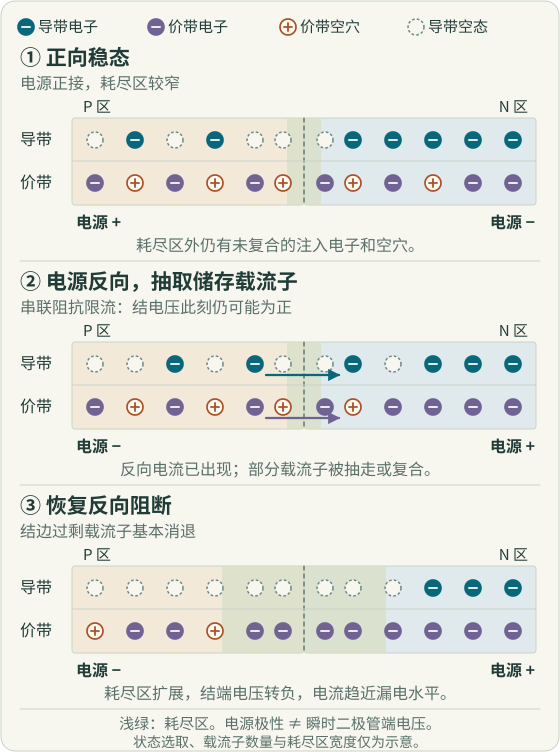](img/diode-recovery-stages.svg)

</figure>

反向驱动刚建立时，原来注入的少数载流子尚未消失。其中一部分在原处复合，另一部分会被结区收集，经外电路产生额外的反向电流。

<figure markdown="1">

[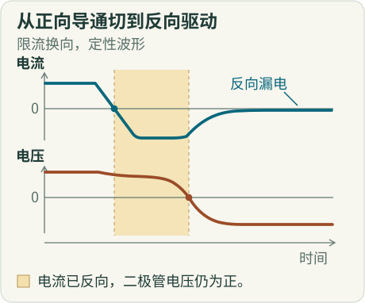](img/reverse-recovery.svg)

</figure>

**电源的极性反了，不代表此刻二极管两端的电压也已经反了。** 限流条件下，电流可以先过零，而端电压仍为正。结边的过剩载流子基本消退后，耗尽区才扩展到足以承担反向电压。

电流随后逐渐回到漏电水平。这一由正向导通恢复为反向阻断的过程称为**反向恢复**。它与击穿不同：恢复依赖此前储存的载流子，击穿依赖强场产生或倍增载流子。[东芝的关断电流与电压波形](https://toshiba.semicon-storage.com/eu/semiconductor/knowledge/faq/diode/what-is-trr.html) · [逐步观察关断](interactive.html#transient)

切换后的外部电路不同，储存载流子消失的路径也会不同。

| 从同一正向稳态切换 | 在端子上观察什么？ |
| --- | --- |
| 断开引线 | 没有端子电流。内部载流子扩散、复合；暗处充分弛豫后端电压回到零。 |
| 断开电源后将两端短接 | 端电压被拉到接近零。部分过剩载流子仍可到达结区并被收集，形成瞬态短路电流。 |
| 接入限流的反向电源 | 电流由电源和串联阻抗限制，载流子被抽取或复合后恢复反向阻断。 |

结区一侧分离电荷量随结电压的变化率（取绝对值）称为**结电容**。平面、均匀突变结的耗尽近似给出 Cj = εA/W，ε 是介电常数，A 是结面积，W 是耗尽宽度。

耗尽宽度 W 加倍，结电容减半。对同样一小步反向电压，只需再搬运原来一半的电荷。正向注入的过剩载流子储存量随电压的变化率则对应**扩散电容**。[MIT 6.012 的结电容和扩散电容](https://ocw.mit.edu/courses/6-012-microelectronic-devices-and-circuits-fall-2005/4b2ed0f760def0cae0d70cc9fbf934df_lec16.pdf)

**恢复时间** trr 从电流过零算到手册规定的终点。**恢复电荷** Qrr 是规定区间内反向恢复电流绝对值的积分。

若反向恢复电流近似为底宽 20 ns、峰值 1 mA 的三角形，Qrr = ½ × 20 ns × 1 mA = 10 pC。底宽不变、峰值翻倍时，恢复时间可以相同，抽出的电荷却翻倍。

比较器件时还要对照原先的正向电流、换流速率、温度和指定的测量条件。[东芝对恢复时间与测试条件的说明](https://toshiba.semicon-storage.com/eu/semiconductor/knowledge/faq/diode/definitions-of-the-terms-in-the-electrical-characteristics-table.html)

## 延伸：旁边再放一个反偏结，它能收到刚注入的电子吗？ {#bjt}

如果想用一个端子的电压控制另一条电流路径，可以让一个正偏结向附近的反偏结供应载流子。这是双极型晶体管的基本思路，后面学习放大电路时会用到它；理解 MOS 管并不要求先掌握这一节。

选读：NPN 三极管怎样借助两个 PN 结控制电流？

一只 **NPN 型双极型晶体管**（Bipolar Junction Transistor，简称 BJT）有三个相连的区域：重掺杂的 N 型发射区、很薄的 P 型基区，以及 N 型集电区。

在下图的偏置示例中，三个端子分别是发射极 E（0 V）、基极 B（+0.70 V）和集电极 C（+2.30 V）。靠近发射区的结正偏，靠近集电区的结反偏。

<figure markdown="1">

[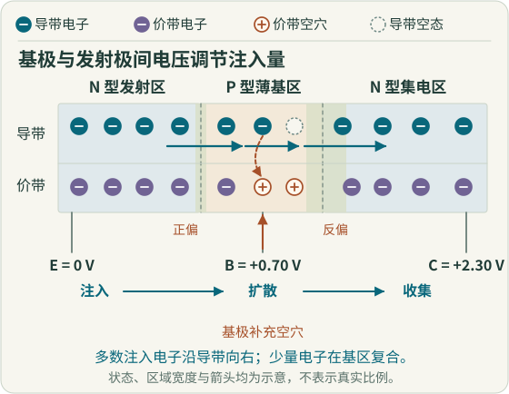](img/bjt-transport.svg)

</figure>

先跟踪一个导带电子。它跨过左侧正偏结进入 P 型基区，成为少数载流子，但并没有立即转变成价带电子。

靠近发射结的位置不断有电子注入，靠近集电结的位置又有电子被电场扫走，基区内因此形成浓度差，使导带电子净向右扩散。

如果准中性基区远薄于电子的扩散长度（电子在复合前扩散的特征距离），多数注入电子便能在复合前抵达右侧的耗尽区。集电结电场从 N 区指向 P 区，电子受力向右，被扫入集电区。

因此，从集电极到发射极有一条持续的常规电流路径。提高基极相对于发射极的电压，可以增加注入，从而控制集电极电流。这组偏置属于 BJT 的正向放大区。[MIT 的 NPN 注入与收集示意，第 4–6 页](https://ocw.mit.edu/courses/6-012-microelectronic-devices-and-circuits-fall-2005/f6e04646e02de2f0ebabbc7e3e5adee9_lec17.pdf#page=4)

只有一小部分注入电子会在基区与空穴复合，需要由基极补充空穴。基区向发射区注入的空穴也贡献基极电流。因此，合适的掺杂和基区厚度可让集电极电流远大于基极电流。

普通分立二极管的 P 端即使通过导线相连，也没有共同的薄硅基区。载流子到达各自的金属接触后，不能按上述方式从一个结连续扩散到另一个结。[MIT 的薄基区条件与端子电流](https://ocw.mit.edu/courses/6-012-microelectronic-devices-and-circuits-fall-2005/fba725b75109fd1dec7c316fc3f74b47_lecture17annotat.pdf) · [另一张 NPN 结构示意](../silicon-to-logic/img/npn-injection.svg)

**PNP 型** BJT 则交换 P、N 区的类型，并将各端电压反号。发射区注入空穴，空穴穿过基区，被反偏集电结收集。常规电流沿空穴的净运动方向，从 E 进入、主要从 C 流出。

[小信号放大篇的负载算例](../transistor-amplifier/README.md#bjt-load)会进一步解释三极管控制的电流怎样使输出电压发生变化。

## 下一只三端器件，怎样用绝缘栅控制电流？ {#next}

PN 结给我们展示了怎样通过电压改变硅中的电荷分布和电子跨结的势垒。如果不直接向硅补充或取走电子，而是隔着绝缘层施加电压，还能不能控制其中的电流？

下一篇从 MOS 管的结构出发，看看栅压怎样让硅表面形成一条可导电的路径。[MOS 管怎样隔着绝缘层控制电流？](../bands-to-channel/README.md)
