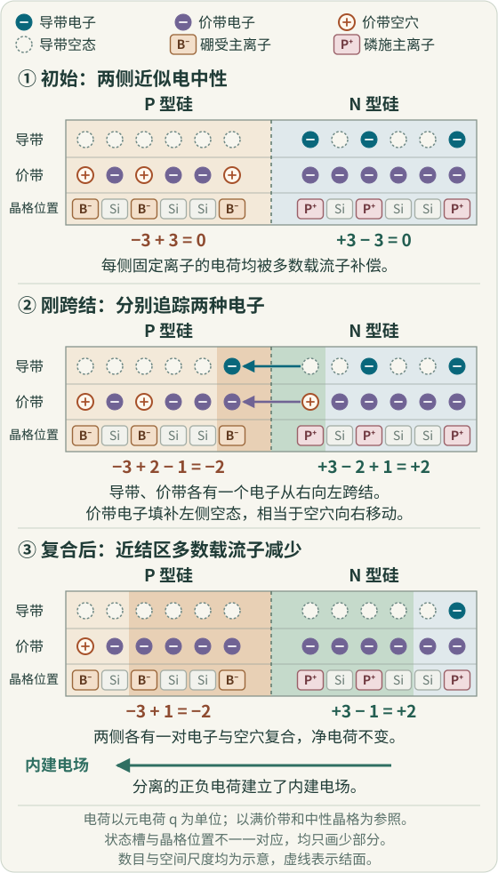
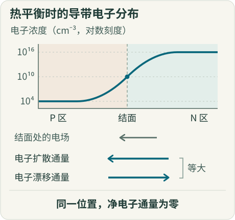
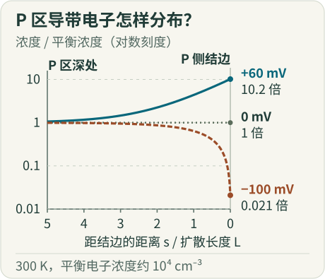
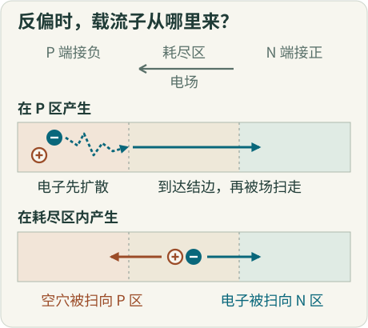
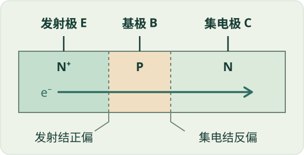

# 从电子到二极管：为什么 PN 结能整流？

**二极管**是一种两端半导体器件，重要的特性是**单向导通**：在正常工作条件下，正向接入时容易让电流通过，反向接入时则阻碍电流通过。

利用这种特性，我们可以用四只二极管构成一个桥式整流电路。下面两张图使用同一个电路，区别只有电源此刻的正负极性。绿色表示导通的电流路径，灰色表示截止的支路。

**电源的极性变了，但流过用电器的电流方向没有改变。** 这就是整流。家里的插座提供交流电，许多电器内部的电路却需要直流电，例如手机充电器、电脑电源。这些设备通常使用整流电路将交流电转换成直流电。[桥式整流的工作原理](https://rfic.eecs.berkeley.edu/courses/ee42_100/pdf/lect20_ann2.pdf)

一种常见的硅二极管是在一块硅中形成相邻的 P 型区和 N 型区，两种区域的交界处称为 **PN 结**。P 端接阳极 A，N 端接阴极 K。

<figure markdown="1">

</figure>

**为什么二极管具有单向导通的能力？** 教材一般从什么是 PN 结开始讲，再解释二极管正接和反接时的行为。但我在学习 PN 结时还有很多疑问：硅为什么能导电？电子为什么会在硅中运动？P 型和 N 型硅接触后，电子又会发生什么变化？因此，我想先从更基础的电荷、电子在硅中所处的状态以及电流形成的原因开始建立认知，一步步理解 PN 结，最后回到二极管的单向导通特性。

## 从电子的运动到能带 {#states}

### 电子的运动怎样形成电流？ {#electron-current}

电子带负电荷。电荷的定向净运动形成电流。按照约定，常规电流方向与正电荷的净运动方向相同，所以电子的净运动方向与其对应的电流方向相反。

但是，电子在运动，并不意味着一定有净电流。假设我们在一块材料中选取一个截面，统计同一段时间内向左和向右穿过它的电子数。

<figure markdown="1">

</figure>

第二种情况相当于四个电子净向右通过截面，因此电流向左。

硅中有大量电子，为什么施加电场后，并不是所有电子都能参与净电荷输运？这就需要了解电子能够处于哪些状态。

### 什么是电子状态、能级和能带？ {#energy-states}

电子可以处于不同的物理状态。在本文采用的单电子能带模型中，我们可以通过能量、空间分布和运动特征等物理属性来认识电子的状态。电子的状态并不等于某一个空间位置。

状态所对应的能量值称为**能级（Energy Level）**。同一能级可以对应多个不同的状态。例如，某些状态具有相同的能量，却对应方向相反的电子速度。

孤立原子的电子能量是离散的。大量硅原子靠近形成晶体后，原子之间的相互作用使原有的能级发生分裂。许多允许状态的能量排列得非常紧密，形成一组组能量范围，这就是**能带（Energy Band）**。

<figure markdown="1">

</figure>

在理想晶体中，相邻能带之间可能存在一段没有允许体电子态的能量范围，这称为**禁带（Band Gap）**。

根据泡利不相容原理，每个完整的单电子状态（包括自旋）最多只能被一个电子占据。因此，能带中的允许状态有些可能已经被占据，有些可能还空着。[胡正明《现代半导体器件》第 1 章，能带与态密度](https://www.chu.berkeley.edu/wp-content/uploads/2020/01/Chenming-Hu_ch1-3.pdf)

## 硅里有这么多电子，为什么只有一小部分参与导电？ {#bands}

### 1000 个硅原子的价电子，为什么恰好填满价带？ {#counting-states}

一个硅原子有 14 个电子，其中最外层的 4 个电子称为**价电子**。在硅晶体中，每个硅原子与周围四个相邻原子形成共价键，每条键共享一对价电子。

<figure markdown="1">

</figure>

硅晶体中，与价电子成键有关的一组低能允许状态形成了**价带（Valence Band）**。隔着基本禁带、能量更高的一组相邻能带称为**导带（Conduction Band）**。价带顶与导带底的能量差称为带隙，室温下约为 1.12 eV。[伊利诺伊大学：硅的能带形成和态数](https://courses.physics.illinois.edu/phys525/sp2024/units/Semiconductors.pdf)

现在假设有 1000 个硅原子组成理想晶体，忽略表面的影响。数一数电子数和可用状态数：

1. 每个硅原子提供 4 个价电子，共有 **4000 个价电子**。
2. 每个原子与四个相邻原子成键。每条键由两个原子共享，因此共有 1000 × 4 ÷ 2 = **2000 条共价键**。
3. 在简化的成键模型中，每条共价键对应一个低能成键轨道，可容纳两个自旋不同的电子。因此这组低能状态可以容纳 2000 × 2 = **4000 个电子**。

未掺杂的纯硅称为本征硅。在绝对零度（0 K）下，理想本征硅的电子占据最低能量的状态。这些价电子恰好填满价带中的允许状态，而导带没有电子。

这是特定温度下的占据情况，不是价带和导带的定义。电子可以获得能量并进入导带，价带中的状态也可以不再全部被占据。

### 填满以后，电子的运动为什么加不出净电流？

对于硅晶体，可以找到速度大小相同、方向相反的一对电子状态。当整条能带被填满时，每一对状态的电子电流贡献相互抵消。

<figure markdown="1">

</figure>

电场会对带电粒子施加力。但是，在较弱的电场下，如果电子仍处于同一条已经填满的能带中，所有允许状态都被占据，电子无法通过重新分布使某个方向上的占据多于另一个方向。

因此，即使电子并非静止不动，完全填满的能带也不能通过带内响应形成净导电电流。[塔斯马尼亚大学：满带、电子与空穴](https://ssp.utasphys.cloud.edu.au/6-semiconductors/6-1-semiconductors/)

### 当价带中出现空态，电子怎样参与导电？ {#carriers}

当温度升高时，少量价带电子能够获得足够的能量，跃迁到导带，并在价带中留下未被占据的状态。

两条能带都有了电子和空态，电子便有机会改变占据状态。

用简化的成键模型理解价带电子的运动时，我们可以把缺失的电子表示为一个空位。假设电场向右，导带电子向左净移动，价带中相邻的电子也可以依次向左填补空位。

<figure markdown="1">

</figure>

如果不逐个跟踪价带电子，而是跟踪空位，就会发现空位向右移动。电子向左净运动产生向右的电流，从电流的角度看，等效于一个带正电的载流子向右运动。这种等效载流子称为**空穴（Hole）**。

由此可见，硅中可以参与导电的载流子有两种：导带电子和价带空穴。仅仅产生载流子并不意味着产生了净电流；外加电场可以使它们发生定向净运动。

导带电子还可以释放能量，填上价带中的一个空态，这称为**复合**。一次这样的过程会使导带电子和空穴各减少一个。热平衡时，热产生与复合的平均速率相等。

金属有部分填充的能带，弱电场就可以改变电子占据的分布。硅则需要热激发等机制产生载流子。较大的带隙使热激发更困难，这也是许多材料表现为绝缘体的原因。[胡正明《现代半导体器件》第 1 章：电子、空穴与能带模型](https://www.chu.berkeley.edu/wp-content/uploads/2020/01/Chenming-Hu_ch1-3.pdf#page=12)

深化阅读：电子的空间运动与两种能带图

电子在空间中运动，不一定要跨越能带；即使空间分布几乎不变，也可能发生能带间跃迁。[交互：改变波包的位置和传播方向](interactive.html#state)

<figure markdown="1">

</figure>

电子的空间运动可以用波包描述：由许多晶体态叠加成一团集中的波。包络中心移动时，更可能找到电子的位置也随之移动。

后文的 PN 结能带图以空间位置 x 为横轴，画出各处导带底 EC(x) 和价带顶 EV(x) 的能量。另一类能带图 E(k) 以波矢 k 为横轴，用于描述电子状态的波动特征。

[交互：依次观察满带、激发、带内重新分布与复合](interactive.html#bands)

纯硅在室温下只有少量导带电子和价带空穴。有没有办法主动增加其中一种载流子的数量？这就引出了掺杂。

## 掺杂怎样增加载流子，又怎样保持电中性？ {#doping}

一种办法是在硅晶体中有意引入少量其他原子，改变电子可以占据的状态以及载流子浓度，这叫**掺杂（Doping）**。先看两种常用的杂质：磷和硼。它们的原子本身都是电中性的。

**用磷取代硅原子。** 磷比硅多一个质子，也多一个价电子。四个价电子参与成键，剩下一个与磷原子结合得较弱。该电子处于主要分布在杂质附近的局域状态，对应的能量称为施主能级，距硅的导带底约 0.045 eV。

在室温、普通轻掺杂条件下，大部分磷原子会失去这个电子。电子进入导带，成为可移动的载流子，磷则成为留在晶格位置上的正离子。能向导带提供电子的杂质叫**施主（Donor）**。

**用硼取代硅原子。** 硼只有三个价电子，比硅少一个参与成键的电子。它在价带顶附近引入受主能级。一个价带电子只需获得很少的能量，就可以进入这个局域状态。

硼接收电子后成为留在晶格位置上的负离子，价带则留下一个可移动的空穴。能接收价带电子、产生空穴的杂质叫**受主（Acceptor）**。

<figure markdown="1">

</figure>

每次电离后，导带电子与固定正离子的电荷相互抵消，空穴与固定负离子也一样。掺杂改变了两种载流子各自的数量，使其中一种成为多数载流子，但均匀掺杂的硅仍可保持近似电中性。

在热平衡时，掺入施主且以导带电子为多数载流子的硅称为 **N 型硅**；掺入受主且以空穴为多数载流子的硅称为 **P 型硅**。数量较少的另一类称为少数载流子。

[MIT 6.012 的掺杂与载流子讲义](https://ocw.mit.edu/courses/6-012-microelectronic-devices-and-circuits-fall-2009/a37c73e7fcff4bcb5c5f1177e12d0891_MIT6_012F09_lec01.pdf) · [比较本征激发、施主电离与受主电离](interactive.html#doping)

### 同样两条能带，怎样知道哪条带里有多少载流子？ {#fermi}

掺杂增加了一种载流子，另一种载流子的浓度又会怎样变化？要回答这个问题，需要知道不同能量的允许状态有多大概率被电子占据。

热平衡时，可以用一个能量参数描述这种占据概率，这就是**费米能级（Fermi Level）**。它在能量图上标记为 EF。它由材料的能带结构、温度和电子总数等因素决定。

对于温度相同、能带结构相同的硅，费米能级越高，导带中的状态被电子占据的概率越大，价带中的状态为空的概率越小。反之，费米能级降低，导带电子减少、价带空穴增加。

以常见的非简并掺杂硅为例：费米能级处于禁带中，且不太靠近任何一条带边。与本征硅相比，N 型硅的费米能级向导带底靠近，P 型硅则向价带顶靠近。

<figure markdown="1">

</figure>

费米能级还有一个重要特点：当两块材料接触并达到同温热平衡后，两边的费米能级相同。后面理解 PN 结时，还会用这个条件判断两侧能带和载流子浓度的关系。

深化阅读：从费米分布和态密度理解载流子浓度

热平衡、温度高于零时，能量为 E 的允许态被占据的概率为 **f(E) = 1 / [1 + exp((E − EF)/kT)]**。这里的 T 是绝对温度，k 是玻尔兹曼常数。

如果能量 E 恰好等于 EF，相应状态的占据概率就是 1/2。如果 EF 位于没有允许状态的能量范围中，它仍是一个有用的统计参数，不代表有电子占据了这里。

当 E 比 EF 高很多时，占据概率 f(E) ≈ exp[−(E − EF)/kT]；当 E 比 EF 低很多时，空态概率 1 − f(E) ≈ exp[−(EF − E)/kT]。这两种近似适用于普通非简并半导体。

能带结构给出了每小段能量范围内有多少允许状态，这称为**态密度（Density of States）**。对于导带，每段允许态的数量乘以占据概率，累加起来即可求出电子数量。对于价带，应乘以空态概率，求出空穴数量。

记导带底、价带顶的能量分别为 EC、EV，能带结构和温度不变。在非简并近似下，电子浓度正比于 exp[−(EC − EF)/kT]，空穴浓度正比于 exp[−(EF − EV)/kT]。

把两式相乘，EF 恰好消掉。在同种材料、温度相同的热平衡条件下，电子与空穴浓度的乘积保持不变。

[胡正明《现代半导体器件》第 1 章，态密度、占据概率与载流子浓度](https://www.chu.berkeley.edu/wp-content/uploads/2020/01/Chenming-Hu_ch1-3.pdf) · [调节费米能级，比较导带占据与价带空态](interactive.html#fermi)

**掺杂能够使两种载流子的浓度相差多大？** 取 300 K，用 n 表示导带电子浓度，p 表示空穴浓度。硅的本征载流子浓度 ni 约为 10¹⁰ cm⁻³，本征硅中 n = p = ni。

对于普通非简并硅，在热平衡时，电子与空穴的浓度满足 **np = ni²**，这称为质量作用定律。它意味着增加一种载流子的平衡浓度时，另一种载流子的平衡浓度会下降。

现在取一块均匀硅，只掺入浓度为 10¹⁶ cm⁻³ 的施主。假设杂质近似完全电离。因为这个掺杂浓度远大于本征载流子浓度，在电中性的体区，电子浓度约为施主离子浓度，即 10¹⁶ cm⁻³。

根据上面的关系，空穴浓度 p ≈ 10²⁰ / 10¹⁶ = 10⁴ cm⁻³。若换成相同浓度的受主，结果恰好反过来。

| 300 K 下的硅 | 导带电子浓度 n（cm⁻³） | 空穴浓度 p（cm⁻³） |
| --- | ---: | ---: |
| 本征硅 | 10¹⁰ | 10¹⁰ |
| N 型硅 | 10¹⁶ | 10⁴ |
| P 型硅 | 10⁴ | 10¹⁶ |

这里的数值是指定掺杂条件下的近似算例。对于后一块 P 型硅，空穴虽是多数载流子，价带中绝大多数允许状态仍被电子占据。

### 外部电路怎样向半导体补充或取走电子？ {#contacts}

硅里的电子和空穴能够参与导电。但二极管还要通过金属引线接入电路。外部电路怎样向硅补充或取走电子？先假设金属与硅之间的接触电阻很小，电流能够容易地双向通过。这种接触称为**欧姆接触（Ohmic Contact）**。

<figure markdown="1">

</figure>

对于 N 型硅，接触附近的净电流主要由导带电子承担。金属送来电子，导带中的一个空态便可能被占据；金属取走电子，导带则空出一个原本被占据的状态。

对于 P 型硅，接触附近的净电流主要由价带空穴承担。金属送来的电子填补价带空态，相当于空穴被取走；金属取走一个价带电子，相当于给硅提供一个空穴。

要持续向 P 端送入电子，硅内必须不断向接触处输运空穴。不同电子可以接续搬运电荷，不需要同一个电子穿过整个器件。

以上是接触附近由多数载流子主导的净交换。如果少数载流子到达接触处，金属也可以收集它们。

深化阅读：金属与半导体怎样形成欧姆接触

同温的金属与掺杂硅接触时，若两侧的电子电化学势（热平衡时的费米能级）不同，就会有电子发生净转移。界面附近的电荷重新分布，使硅的带边发生弯曲。

达到热平衡后，两侧费米能级相等，跨过界面的双向电子通量相抵，不再发生净电荷交换。

接上电源后，要使电子发生持续的净交换，出发处需要有已占据的允许态，接收处需要有能够接收电子的空态，电子还需要越过或穿过界面势垒。

实际器件常把紧邻金属的一小层硅做成重掺杂区，使势垒变薄，电子便容易隧穿。接触电阻可以因此降低。若金属与硅的接触本身具有明显整流特性，则属于另一类称为肖特基接触的界面。

[华盛顿大学的金属–半导体接触讲义](https://dunham.ece.uw.edu/ee482/Notes/MS.pdf#page=10) · [胡正明《现代半导体器件》4.21 节，欧姆接触](https://www.chu.berkeley.edu/wp-content/uploads/2020/01/Chenming-Hu_ch4-1.pdf)

## 同一批电子，为什么既会漂移，又会扩散？ {#transport}

载流子在硅中不断进行热运动。什么会使这些运动产生方向上的偏好，从而形成净电流？先看电场，再看载流子浓度差。

### 同样加 1 V，电子在每处受到的力一样大吗？

电势就是单位正电荷在某处的静电势能，电压是两点的电势差。电场指向电势下降的方向，电势沿空间变化得越快，电场就越强。

取两根掺杂相同、长度不同的均匀硅棒，让右端电势都比左端高 1 V，假设棒内电势均匀变化。

| 硅棒长度 | 两端电压 | 电场强度 |
| --- | --- | --- |
| 1 μm | 1 V | 1 V/μm |
| 10 μm | 1 V | 0.1 V/μm |

两根棒中的电场都向左，带负电的电子受力向右。但在较短的棒中，电子受到的电场力是另一根的十倍。

设电子电荷为 −q，q 是元电荷的正值。电子的静电势能为 −qφ，φ 是电势。电子从左端走到右端，两根棒里势能都降低了 1 eV（一个电子跨越 1 V 电势差对应的能量）。[比较不同间距下的电场](interactive.html#transport)

**局部电场决定电子在这一处受多大的力，两端的电势差决定整个过程中电场做多少功。** 在 PN 结中，我们也需要分清这两件事。

电子受力后会加速，但在晶体中还会与晶格振动、杂质等发生散射。电场使电子群原本近似随机的热运动增加了方向偏好，这种电场引起的净运动称为**漂移（Drift）**。

在恒定电场下，电子群会建立有限的平均漂移速度。电场对电子做的功也可能经散射传给晶格，不能把 1 eV 的势能降低直接理解为电子到达右端时的动能增加。

从截面的电子数算出硅棒电阻

设导带电子浓度为 n，硅棒截面积为 A，电子平均漂移速率为 v。在时间 Δt 内，通过截面的净电荷量大小为 qnAvΔt，因此电子漂移电流的大小为 I = qnAv。

在低场条件下，v 与电场强度成正比，比例系数 μn 称为电子迁移率。对于长度 L、两端电压 V 的均匀硅棒，有 v = μnV/L。

空穴也能参与导电。假设空穴浓度为 p、迁移率为 μp，把两种载流子的漂移电流贡献相加，可以得到电导率和电阻：

**σ = q(nμn + pμp)，R = L/(σA)。**

同样的电压加在较长的硅棒上，电场变弱，平均漂移速度下降。增大横截面积则让更多载流子参与输运。这里假设材料均匀、处于低场条件，且接触压降可忽略。

### 去掉电场，电子为什么还会向一边净传输？

设硅棒右边的导带电子浓度高，左边的浓度低。先忽略电场，在两边取相同大小的区域。假设右边有 100 个电子，左边只有 10 个。

只考虑最初一瞬，并假设两边电子穿过交界的概率都是 ½。右边有 50 个电子向左越界，左边有 5 个电子向右越界，相当于 **45 个电子净向左运动**。

这个数字是帮助理解的假设。当电场建立后，两边的越界情况会改变。电子不需要知道哪边的浓度低，只要从高浓度一侧出发的电子更多，就会产生净输运。

这种由浓度差引起的净输运称为**扩散（Diffusion）**。在均匀、非简并的硅中，导带电子从高浓度处向低浓度处净扩散，空穴也是如此。

真实的电子可以同时受电场作用并发生热运动。漂移与扩散是对**同一群载流子净输运**的两种贡献，而不是两群电子。即使这两个贡献相抵，电子仍然可能不断穿过同一个截面。[MIT 6.012 的漂移、扩散与非均匀掺杂讲义](https://ocw.mit.edu/courses/6-012-microelectronic-devices-and-circuits-fall-2009/pages/lecture-notes/)

## 两侧原本都电中性，结里的电场从哪里来？ {#equilibrium}

现在回到二极管内部的 PN 结。N 型区的导带电子浓度远高于 P 型区，P 型区的空穴浓度则远高于 N 型区。这样的两种区域相邻时，载流子就有了扩散的条件。

### 载流子跨过结面，会发生怎样的电荷变化？

把左侧设为 P 区，右侧设为 N 区。我们先想象在某一刻才允许两侧交换载流子，以便观察电场怎样形成。实际器件可以在同一块硅晶体中直接形成相邻的掺杂区。

起初两侧都近似电中性：P 区的空穴补偿带负电的受主离子；N 区的导带电子补偿带正电的施主离子。

跟着最先从 N 区扩散到 P 区的一个导带电子。它刚跨过交界，N 区少了一份负电荷，P 区多了一份负电荷。

如果这个电子随后在 P 区与空穴复合，电子转入价带并填补空态。一份导带电子的负电荷减少，同时一份空穴的正电荷也减少。所以复合没有改变 P 区此刻的净电荷。

再看空穴：空穴从 P 区向 N 区扩散，等效于价带电子从 N 区向 P 区净传输。若用空穴记账，就不必再把同一次价带电子输运重复计算。

[改变两侧计数，观察双向扩散](interactive.html#junction)

两种扩散都使 P 侧交界附近出现净负电荷、N 侧交界附近出现净正电荷。不能随载流子移动的掺杂离子留在晶格上，却逐渐失去了原先移动电荷的充分补偿。

交界两侧的多数载流子浓度显著降低，留下的固定电荷形成了空间电荷区，也称为**耗尽区（Depletion Region）**。

两层电荷在结区建立了从 N 区指向 P 区的电场。即使没有外部电源，PN 结内部也能产生这个电场，所以叫作**内建电场**。

<figure markdown="1">

</figure>

### 为什么扩散没有一直持续下去？

这个电场对电子施加向右的力，阻碍电子从右侧 N 区向左净扩散，却有利于电子向右漂移。对于空穴，漂移方向也与它的扩散方向相反。

随着载流子净扩散，两侧分离的电荷增加，内建电场逐渐增强。此时电场造成的漂移贡献也随之增加，抵消越来越多的扩散贡献。

<figure markdown="1">

</figure>

最终达到**热平衡**：没有外加电压、温度均匀且不受光照等外部激励，各处平均载流子浓度不再随时间变化。电子和空穴各自的漂移与扩散贡献相抵，净电流为零。

这里的平衡是净输运为零，不是所有电子停止了运动，也不是两边的电子浓度变得相同。可对照[平衡 PN 结的局部剖面](../silicon-to-logic/img/pn-depletion.svg)。[MIT 6.012 的 PN 结热平衡](https://ocw.mit.edu/courses/6-012-microelectronic-devices-and-circuits-fall-2009/c053714447998e522f02db0776987091_MIT6_012F09_lec04.pdf#page=8)

深化阅读：怎样用式子表达漂移与扩散的抵消？

取 x 向右为正。电子漂移、扩散的常规电流密度分别为 qnμnE 和 qDndn/dx。Dn 为电子扩散系数，E 为带方向的电场。

在恒温、非简并硅的热平衡下，两个贡献之和为零。利用 Dn/μn = kT/q 的关系，可得 **E = −(kT/q) d(ln n)/dx**。

因此，当导带电子浓度沿 x 增长时，平衡所需的电场指向左。浓度相对变化得越快，需要的电场就越强。

## 电子能够进入，为什么耗尽区只占一小段？ {#field}

耗尽区的右侧仍有很多导带电子。为什么这些电子没有把右侧固定正离子的电荷全部重新补偿？

从右侧体区移一个电子向左，确实能在某一处增加负电荷。但它原先所在的位置也少了一份负电荷。仅靠 N 区内部运动，不能消除 N 区已经因跨结输运形成的净正电荷。

电子仍然可以从两侧进出耗尽区。要理解平衡时结区内的载流子为什么少，以及电场为什么只集中在结附近，就需要看看电子从一侧走到另一侧要付出多少静电势能。

### 结面处的场最强，电子到那里就爬完了坡吗？

在下面的图中，从右侧 N 型体区开始，沿横轴向左移动一个测试电子。先用耗尽近似，认为结区内的电荷主要来自固定掺杂离子。

在宽大平面结的一维模型中，把固定电荷分成许多薄片。每片的电场在两侧方向相反。离结很远时，两侧的总正负电荷产生的电场近似抵消。

从右向左进入耗尽区，越来越多的正离子薄片落在电子右边，吸引电子向右；左侧负离子也推着电子向右。两类固定电荷贡献的合力逐渐增大。

到达结面附近时，力的大小达到最大。电子继续向左移动，受到的力仍向右，只是逐渐减小。这意味着即使越过结面，电子仍要克服电场继续向左运动。[逐层观察电荷产生的力](interactive.html#depletion)

<figure markdown="1">

</figure>

图的下半部分纵轴是能量，横轴仍是位置。从 N 区向 P 区走时，电子的静电势能逐渐升高，直到 P 型体区。这段能量差称为电子跨结的**势垒（Barrier）**。

它对应的不是一处不能穿越的实物，而是内建电场所形成的能量差。热运动中能量较高的电子仍有机会跨过它，能量较低的电子则难以通过。

在同一种硅中，导带底与价带顶随当地电子的静电势能 −qφ 升降。画在能量随位置变化的图中，两条带边一起弯曲，带隙基本不变。[比较接触前后的能带图](interactive.html#align)

### 平衡时两边的电子浓度为什么仍然不同？

前面介绍的费米能级描述了能态的占据情况。在热平衡下，采用同一个能量参考，整个 PN 结的费米能级具有相同的数值。它反映的是电子的电化学势，并不是各处的静电势相等。

因此即使费米能级相同，N 区的导带底仍更接近费米能级，导带电子多；P 区的导带底则离费米能级更远，导带电子少。能带的弯曲使浓度差和静电势差可以同时存在。

下面使用一个简单算例。两侧均匀掺杂，浓度在结面突变，称为突变结。两侧的掺杂浓度取相同数值，即对称突变结。

沿用前面的掺杂算例：300 K，两侧掺杂浓度均为 10¹⁶ cm⁻³，假定完全电离，本征载流子浓度取 10¹⁰ cm⁻³。

| 位置 | 导带电子浓度 |
| --- | ---: |
| N 型体区 | 约 10¹⁶ cm⁻³ |
| P 型体区 | 约 10⁴ cm⁻³ |

在这个理想对称结模型中，N 侧的电子浓度是 P 侧的一万亿倍。按照热平衡时的能态占据关系，两侧的电子势垒约为 **0.714 eV**，对应内建电势差 Vbi ≈ 0.714 V。

深化阅读：从费米能级与能带求势垒

非简并硅的导带电子浓度近似满足 n = NC exp[(EF − EC)/kT]，其中 NC 是导带有效态密度，EC 是导带底能量。

相同温度下，两侧是同一种硅，NC 取相同值。EF 相等，因此导带电子浓度之比只取决于导带底的能量差。

令 nN/nP = 10¹²，kT ≈ 0.02585 eV，则势垒 qVbi = kT ln(nN/nP) ≈ 0.714 eV。

对于这个对称突变结，从 N 型体区走到结面附近，电子已经克服约 0.357 eV 的势垒。根据同样的热平衡关系，结面处的导带电子浓度约为 N 型体区的百万分之一，即 10¹⁰ cm⁻³。

从 P 型体区看则相反：越靠近结面，导带电子浓度上升，而原先大量存在的空穴浓度显著下降。这就是为什么图中的耗尽区并非空无一物，而是多数载流子显著减少的区域。

### 建立这个势垒，究竟要露出多宽的一层离子？ {#depletion-width}

建立上述势垒不需要让整块硅失去移动电荷。结附近分离的固定电荷就能产生足够的电场，使漂移与扩散取得平衡。剩下的区域仍然近似电中性，称为**准中性区**。

沿用前面的对称突变结，在耗尽近似下，两侧的总耗尽宽度约为 **0.43 μm**，每侧约 0.215 μm。下面从固定电荷与电场分布复算这个数。

<figure markdown="1">

</figure>

图的纵轴是场强的大小，横轴是位置，两侧三角形的面积之和是内建电势差。结面处场强最大，两边的场强逐渐减小，并在体区近似为零。

在耗尽近似下，掺杂浓度越高，每单位体积所含的未补偿固定电荷越多。在同一个结中，掺杂较浓的一侧只需较窄的区域就能提供与另一侧相等的电荷量。例如，两侧掺杂浓度相差十倍，对应的耗尽宽度在耗尽近似下相差十倍。

深化阅读：从固定电荷到耗尽宽度的计算

耗尽近似忽略结区内移动载流子对空间电荷的贡献；在结外取近似电中性。实际的载流子浓度和电场并非在边界处突变。这里只讨论足够厚、均匀掺杂的平面突变结。

设 P、N 侧的电离掺杂浓度为 NA、ND，耗尽宽度为 WP、WN。两侧分离的电荷量按单位结面积计相等，因此 **NAWP = NDWN**。

在均匀掺杂区域，固定电荷密度恒定，电场随位置线性变化。由高斯定律，结面场强大小 **E峰 = qNDWN/ε**，其中 ε 是硅的介电常数。

设 W = WP + WN。对于对称结，两侧掺杂浓度均为 N，各自宽度是 W/2。图中场强三角形的面积给出 **Vbi = E峰W/2 = qNW²/(4ε)**。

代入 ε ≈ 1.04 × 10⁻¹² F/cm、N = 10¹⁶ cm⁻³、q ≈ 1.60 × 10⁻¹⁹ C、Vbi ≈ 0.714 V：

**W = √(4εVbi/(qN)) ≈ 4.3 × 10⁻⁵ cm = 0.43 μm。**

峰值场强为 2Vbi/W ≈ 3.3 × 10⁴ V/cm。若两侧掺杂不同，可由电荷平衡关系及三角形面积得到 W = √[(2εVbi/q)(1/NA + 1/ND)]。

改变某一侧的掺杂浓度时，内建电势和总耗尽宽度也要重新计算。仅增加结面积或体区长度，在忽略边缘影响且体区足够厚的条件下，不改变耗尽区宽度。[改变两侧掺杂，检查宽度和峰值场强](interactive.html#depletion)

### 内部已经形成电势差，为什么端口仍是 0 V？

把电压表接到未通电的二极管两端，并不会测得上述 0.714 V 的内建电势差。在等温、无光照的热平衡下，两端金属电极的电子电化学势相同。

电压表的测量回路还包括金属与硅等接触处的电势差，它们与 PN 结的内建电势差相抵，因而表读 **0 V**。外部电源改变的是端口电压，再通过它改变结内部的势垒。[胡正明《现代半导体器件》4.1–4.2 节，内建电势、端口测量及耗尽宽度](https://www.chu.berkeley.edu/wp-content/uploads/2020/01/Chenming-Hu_ch4-1.pdf)

## 正接电源，为什么能一直有电流？ {#forward}

现在把 P 端接正、N 端接负，这称为**正向偏置**。负极通过 N 端接触补充导带电子，正极从 P 端取走价带电子，留下空穴。两侧的多数载流子都有了持续供应。

原本 N 区的电势高于 P 区。现在电源试图提高 P 端相对于 N 端的电势，抵消一部分内建电势差。

两侧的多数载流子向结区靠近，使耗尽区边缘的一部分固定离子重新得到补偿，耗尽区变窄。

N 区导带电子进入 P 区所需克服的势垒变低。原本不容易跨结的电子，现在有更大的机会进入 P 区。P 区的空穴也更容易进入 N 区。

电子由 N 区进入 P 区后，成了 P 区的少数载流子；空穴由 P 区进入 N 区后也是如此。这种过程称为**少数载流子注入**。

### 势垒只降了一点，注入为什么多了那么多？

把外加偏压中落在 PN 结区上的部分记为 Vj，P 端为正时 Vj 为正。若接触及准中性区的压降很小，它就近似等于外部端电压。

沿用前面 0.714 eV 的势垒算例。正向结电压为 60 mV 时，导带电子跨结需要克服的势垒 q(Vbi − Vj) 由 0.714 eV 降到 0.654 eV。

为什么只降低 0.060 eV，却能让更多电子跨过结区？普通非简并硅在热平衡时，高能态的电子占据概率近似按 exp(−E/kT) 衰减，其中 E 是相对于固定参考能量的电子能量。

300 K 时 kT 约为 0.0259 eV。势垒降低 0.060 eV，相当于降低约 2.32 个 kT，对应的占据概率比值约为 exp(2.32) ≈ **10 倍**。

看耗尽区刚刚结束、进入 P 型准中性区的位置。记 P 区热平衡时的导带电子浓度为 np0。

下面采用理想模型：非简并条件下，注入的少数载流子远少于原有的多数载流子（低注入），结区载流子分布近似服从平衡时的占据关系，并忽略结内复合。

P 侧结边的导带电子浓度变为 **np0 exp(qVj/kT)**。N 侧的少数空穴浓度也按相同的因子变化。

若延续前文的掺杂算例，np0 约为 10⁴ cm⁻³。加上 60 mV，P 侧结边的浓度便约为 10⁵ cm⁻³。对于足够长的 P 区，远离结区的浓度仍接近平衡值 10⁴ cm⁻³。

这两个位置出现了约 9 × 10⁴ cm⁻³ 的浓度差。在零偏时，这个浓度差为零。[胡正明《现代半导体器件》4.6 节，结边的少数载流子浓度](https://www.chu.berkeley.edu/wp-content/uploads/2020/01/Chenming-Hu_ch4-1.pdf#page=17)

<figure markdown="1">

</figure>

沿图中正偏曲线从右往左看。由于结边的导带电子浓度高于 P 区深处，电子会向 P 区深处净扩散。

电源持续补充载流子，复合与金属接触则为注入的电子提供去路；结边高于深处的浓度分布因此得以维持。电子的扩散电流也能持续。[斯坦福 EE116：二极管中的少数载流子分布和电流](https://poplab.stanford.edu/files/ee116/L22toL25_PNcurrent.pdf)

正偏注入后，二极管不再处于热平衡，即使浓度已不随时间变化，也不能把热平衡关系 np = nᵢ² 直接用于结边。

### 跨到 P 区的那个电子，会立刻掉进价带吗？

一个 N 区导带电子越过势垒后，仍然占据 **P 区的导带态**。P 区有较多空穴，但电子与空穴复合需要一个将多余能量传递给周围的过程，并不是每个电子刚跨过结面就立即复合。

注入后超过平衡浓度的部分称为过剩载流子。用**扩散长度** L = √(Dτ) 表示它们扩散的典型距离。D 是扩散系数，τ 是过剩载流子的复合寿命。如果 P 区远长于 L，多数注入电子会在内部复合。

假设一个导带电子已在 P 区复合，为什么电流表还有读数？从左端往回看。正极从接触处取走价带电子；硅内其他电子填补空位，使空位向结区传递，等效于空穴向结区净运动。

于是导带电子从 N 区向左扩散，空穴从 P 端向右输运。两者在 P 区内部相遇并复合。一个导带电子和一个价带空穴消失，但总电荷没有丢失。

从结边向 P 端观察，导带电子承担的电流逐渐减少，空穴承担的电流相应增加。在一维稳态下，若没有侧向电流流出，任意两个横截面的总电流都相等，否则它们之间就会持续积累净电荷。

再看另一条跨结路径。P 区的空穴进入 N 区，等效于 N 侧的价带电子净向 P 侧输运。注入 N 区的空穴可以与负极补给的导带电子复合，也可能在接触处被收集。

这两条跨结路径的常规电流都从 P 指向 N。不必要求同一个电子穿过整个回路，**需要连续的是净电荷输运**。

### 加大正向电压，电流会怎样变化？

对同一只二极管，结电压增大时，少数载流子的结边浓度会更高。只要材料与复合条件不变，结边浓度梯度就会更大，扩散电流也会增加。

将两类少数载流子注入对应的电流相加，理想扩散模型给出：

**I = IS[exp(qVj/kT) − 1]**

这里 IS 称为反向饱和电流。它是由结面积、掺杂、扩散和复合等因素决定的参数。下一节会看到它与反接时的电流有什么关系。

只有当 qVj/kT 足够大、指数项远大于 1 时，室温下多加约 60 mV 的结电压才对应端子电流近似增加 10 倍。60 mV 对结边总浓度的影响不能直接等同于电流变化。

工程上常说硅二极管约 0.7 V 导通。这只是常见工作条件下的压降量级，而不是一个固定的开关门限。实际压降还取决于电流、器件结构与温度。

深化阅读：由少数载流子的浓度分布推导二极管电流

在局部准平衡模型中，可用电子、空穴各自的准费米能级描述非平衡占据情况；理想结区边界条件得到上述浓度关系。

取均匀、足够长的 P 区，假设低注入下 D 和 τ 均为常数。从 P 侧结边向 P 区深处量距离 s。

令结边的过剩电子浓度为 Δn，即结边浓度减去热平衡浓度。稳态下，电子持续扩散、复合，过剩电子浓度随 s 按 Δn · exp(−s/L) 衰减，其中 L = √(Dτ)。

过剩浓度每经过一个扩散长度就减小到原来的 1/e。结边的浓度斜率大小为 Δn/L，按扩散定律，单位面积、单位时间净离开结边的电子数为 DΔn/L。

在前面的图中，纵轴采用对数坐标，用来同时显示正偏和反偏的浓度。这里计算扩散通量时，使用的是实际浓度对距离的斜率，而不是图中对数曲线的斜率。[胡正明教材 4.7–4.9 节的稳态少数载流子分布](https://www.chu.berkeley.edu/wp-content/uploads/2020/01/Chenming-Hu_ch4-1.pdf#page=19)

代入 Δn = np0[exp(qVj/kT) − 1]，便得到电子扩散电流与结电压的关系。N 区结边也有同样形式的空穴扩散电流。

两项电流合成前面的二极管方程。式中的 1 来自扣掉热平衡浓度；零偏时，端子净电流为零。

实际器件在小电流下可能显现耗尽区复合电流，大电流下可能显现串联电阻和高注入的影响。[MIT 6.012：PN 结的势垒、注入与电流](https://ocw.mit.edu/courses/6-012-microelectronic-devices-and-circuits-fall-2009/a342ce0afb84bfa8e5b7dc819ff3e9bc_MIT6_012F09_lec06.pdf) · [调节电压，对照势垒、耗尽宽度与电流](interactive.html#forward)

## 反接后，电场更强，为什么电流反而很小？ {#reverse}

现在把电源反过来：P 端接负，N 端接正，这称为**反向偏置**。

与正偏时相反，电源提高 N 端相对于 P 端的电势，使跨结的电势差增大。电源从 N 端取走导带电子，并向 P 端补充价带电子，填补空穴。

靠近结区的多数载流子退开，更多固定离子失去移动电荷的补偿，耗尽区变宽。

结区的电场变强，N 区多数导带电子向左跨结、P 区多数空穴向右跨结时，要克服的势垒都更高。电压建立的过程中会有充电电流；反压及耗尽宽度稳定后，这部分电流便消退。

### 电场能把电子扫过耗尽区，但下一颗电子从哪里来？

先看 P 区的一个导带电子。它若到达耗尽区边缘，电场对它的力向右，很容易被扫入 N 区。但 P 区的多数载流子是空穴，能来到结边的少数导带电子数量很少。

<figure markdown="1">

</figure>

沿图中上面这条路看。暗处，P 型准中性区可以热产生导带电子和空穴。新产生的导带电子可能先复合，也可能扩散到耗尽区边缘，被扫入 N 区，再由正极收走。

P 端送来的电子可以填补留下的价带空位。整个路径可以持续传输电荷，但受 P 区少数导带电子的供应限制。

N 区的少数空穴也可以到达结边，被电场扫入 P 区，等效为价带电子向右净输运。正极从 N 端取走导带电子，并不会直接在价带中产生大量空穴。

两类少数载流子的跨结运动所产生的常规电流均从 N 指向 P。这就是反向扩散电流。[沿电子路径比较正接与反接](interactive.html#reverse)

再看图中下面这条路。反偏增强时，能带弯曲得更陡，但同一位置的带隙仍约为 1.12 eV；强电场本身不保证产生大量导带电子。

若电子和空穴在耗尽区内部热产生，例如经过缺陷能级产生，它们会被电场直接分向两侧，不必先扩散到结边。完整收集一对载流子时，每根外引线传递一份元电荷。

这是耗尽区产生电流，与前面由准中性区供应的反向扩散电流不同。

### 加大反向电压，为什么电流不一定继续明显增大？

用前面得到的结边浓度关系做一个比较。仍假设 300 K、P 区深处的平衡导带电子浓度为 10⁴ cm⁻³，结区符合前面的理想近似。

| 结电压 Vj | P 侧结边浓度 | 结边浓度 / 深处浓度 |
| --- | --- | --- |
| 0 V | 10⁴ cm⁻³ | 1 |
| −10 mV | 约 6.79 × 10³ cm⁻³ | 0.679 |
| −100 mV | 约 2.1 × 10² cm⁻³ | 0.021 |

反偏时，P 区的结边浓度低于深处，导带电子便由深处向结边净扩散。回看[上一节的浓度曲线](#forward)，此时浓度梯度的方向与正偏时相反。

继续降低结边浓度，最低只能接近零，因此深处与结边能够形成的浓度差最多接近原平衡浓度。材料和几何条件不变时，理想反向扩散电流便趋于饱和。

代入二极管理想方程可得，−10 mV 和 −100 mV 分别对应 −0.321 IS 和 −0.979 IS。反偏电压绝对值远大于热电压 kT/q、且未击穿时，理想扩散电流接近 −IS。

实际暗电流还可能包含耗尽区产生电流和表面漏电等，未击穿时的反向电流也并非必然恒定。[在图上比较两种小反压](interactive.html#forward)

### 如果主动增加反向载流子的供应呢？

保持反偏电压不变，用能在硅中产生电子–空穴对的光照射结区。新产生的载流子可能被结区电场分离，结区附近准中性区产生的载流子也可能扩散到结边后被收集。

载流子供应增加，电流表上的反向电流绝对值也随之增大。这正是反偏光电二极管可以测光的原因。[胡正明《现代半导体器件》4.15 节，光电二极管](https://www.chu.berkeley.edu/wp-content/uploads/2020/01/Chenming-Hu_ch4-1.pdf#page=45)

<figure markdown="1">

</figure>

对比图中的两种偏置：正接时耗尽区变窄，反接时变宽。

## 为什么桥式整流能使电流方向保持不变？ {#real-rectification}

现在回到开头的[桥式整流电路](#rectification)。先假设电源提供足够大的电压，观察两种接法：

- 电源左端为正，左上和右下的二极管正偏。电流经过这两只管子，从用电器的上端流向下端。
- 电源右端为正，导通路径换成右上和左下的二极管。电流仍然从用电器的上端流向下端。

为什么每次只有其中两只二极管容易导通？正偏降低势垒，使 N 区的电子和 P 区的空穴能够持续注入对侧。反偏升高势垒，能够被电场扫过结区的少数载流子却很少。

正、反偏时的电流因此可以相差许多个数量级。利用这种单向导通特性，四只二极管就能让交流电源的两种极性对应到负载上同一个电流方向。

实际电路中，导通路径上有两只二极管的正向压降，反向阻断的二极管也仍有少量漏电。

到这里，我们已经解释了二极管单向导通的基本原理。试着用这些知识判断两个现象：

- 不接电源、暗处且处于等温热平衡时，能不能用电压表直接测到内建电势？回看[内建电势与表笔](#depletion-width)。
- 维持反偏，遮住原来照射结区的光，反向电流的绝对值会怎样改变？回看[反偏下的载流子供应](#reverse)。

如果只想了解普通二极管的整流机制，可以先进入[下一篇 · MOS 管怎样隔着绝缘层控制电流？](../bands-to-channel/README.md)。以下拓展解释更强的反压、较快的换向，以及正偏结和反偏结怎样协同工作。

## 拓展：强场怎样改变载流子的供应？ {#breakdown}

前面讨论反接时，电流之所以很小，是因为原有的少数载流子很少。如果继续增大反向电压，强电场能不能产生更多载流子？

当反压达到一定程度，反向电流会急剧增大，这个现象称为**反向击穿**。这里观察两种不同的载流子产生机制。

### 雪崩倍增：一个电子怎样产生更多载流子？

跟着一颗热产生的导带电子进入耗尽区。电子在强电场中加速。如果在两次散射之间获得足够的动能，它就可能在碰撞中把一个价带电子激发到导带。

碰撞前只有一个导带电子。碰撞后有两个导带电子，价带里还留下一个空穴。这个过程称为**碰撞电离**。

新产生的载流子也可以在电场中加速，再产生更多电子与空穴。这样，一次初始注入就可能引起连锁倍增，反向电流迅速增大。[斯坦福 EE116 的反向击穿图](https://poplab.stanford.edu/files/ee116/L22toL25_PNcurrent.pdf#page=9)

### 齐纳击穿：电子怎样从一条能带进入另一条能带？

在重掺杂的 PN 结中，耗尽层很窄，反向偏置能产生很强的电场。沿着弯曲的能带观察：P 侧某个已占据的价带态，与 N 侧某个空着的导带态，可能具有相近的能量。

如果两处的空间距离足够短，电子就有一定概率隧穿中间的势垒，进入 N 侧导带，并在 P 侧留下空穴。这称为**带间隧穿**，可以引起齐纳击穿。

此时，不必等待电子先获得足够动能再撞出另一个电子。强场使两侧能量相近的允许态在空间中靠得更近，增大了隧穿概率。

深化阅读：隧穿距离与耗尽区宽度

电子的波函数在经典禁阻区内衰减。如果两端状态之间距离足够短，另一侧仍存在非零振幅，因此电子有概率跃迁。在弹性隧穿中，电子的能量保持不变。

硅的价带顶与导带底对应不同的晶体动量。晶格振动的量子称为声子；它可以参与这类跃迁，与电子交换动量和能量。[硅中的声子辅助隧穿](https://saraswatgroup.stanford.edu/Thesis/Donghyun%20Kim%20Thesis.pdf)

**总耗尽区变宽，隧穿距离为何反而变短？** 沿能带图的横轴量两次：两条耗尽区边缘之间是总宽度 W；从一个价带态量到能量相近的导带态，得到的则是隧穿距离 L。

如果局部场强 F 近似均匀，长度 L 上的能量变化约为 qFL。要跨过一个带隙 Eg，所需的距离约为 **L ≈ Eg / (qF)**。

增加反压，耗尽区加宽，但结面附近的场强 F 同时增大，隧穿距离 L 因而有可能缩短。雪崩倍增和带间隧穿在实际器件中可以共存。[胡正明教材图 4–12](https://www.chu.berkeley.edu/wp-content/uploads/2020/01/Chenming-Hu_ch4-1.pdf#page=14)

[改变势垒宽度，观察隧穿概率](interactive.html#breakdown)

## 拓展：同样的反接，为什么刚才正向导通过的二极管会多出一股电流？ {#storage}

前面的正、反接分析，主要观察偏置稳定后的电流。如果把刚才正向导通的二极管突然反接，原先注入的载流子能立即消失吗？

让两只相同的 PN 二极管通过相同的限流电路接受反向驱动，反压都远低于击穿电压。第一只原先处于零偏平衡，第二只原先有稳定的正向电流。

**两只管子都需要重新建立结区电荷分布。** 加上反压后，耗尽区加宽，两侧各有更多固定离子失去可移动载流子的补偿。电荷重新分离的过程会在端子上产生瞬态电流，直到新的偏置稳定下来。

**第二只管子还储存着正向导通时注入的载流子。** P 侧有来不及复合的导带电子，N 侧有过剩空穴。它们主要分布在耗尽区外，而且多数载流子的调整使这些区域仍近似电中性。

换成反向电压时，这批过剩载流子还在硅中。一部分在原处或扩散途中复合，另一部分向结区扩散，被电场收集并经外电路抽走。它们就能贡献额外的反向电流。

<figure markdown="1">

</figure>

沿图从左往右看。刚切换电源时，外电路已经开始抽取载流子，结电压却可能还为正。等结边缘的过剩载流子基本消退后，耗尽区才重新扩展到足以承担反向电压。

剩余的过剩载流子继续被抽走或复合，电流最终回到正常反向漏电的水平。这个由正向导通转为反向阻断的过程称为**反向恢复**。

反向恢复和击穿都会产生反向电流，但原因不同：前者利用先前储存的载流子，后者依靠眼下的强电场产生或倍增载流子。[东芝的关断电流与电压波形](https://toshiba.semicon-storage.com/eu/semiconductor/knowledge/faq/diode/what-is-trr.html) · [逐步观察关断](interactive.html#transient)

如果改变外部电路，储存的载流子仍需要消失，但消失的路径可以不同。

| 从同一正向稳态切换 | 在端子上观察什么？ |
| --- | --- |
| 断开引线 | 端子电流为零。内部载流子继续扩散、复合；暗处充分弛豫后，端电压回到零，结内仍有内建电势。 |
| 断开电源后将两端短接 | 端电压被拉到接近零。部分过剩载流子仍能到达结区并被收集，短路线上出现瞬态电流。 |
| 接入限流的反向电源 | 电源和串联阻抗限制反向电流。载流子被抽取或复合后，二极管恢复反向阻断。 |

深化阅读：怎样描述储存电荷与关断时间？

结区一侧分离电荷量的微小变化与结电压变化（取绝对值）之比称为**结电容**。在平面、均匀突变结的耗尽近似下，Cj = εA/W，其中 ε 是介电常数，A 是结面积，W 是耗尽宽度。

如果耗尽宽度 W 加倍，两侧已分离的电荷更多，但结电容减半。同样一小步反向电压，只需要再搬运原来一半的电荷。

正向电压稍升高时，注入的过剩少数载流子储存量也随之增加。储存电荷的微小变化量与结电压变化量之比对应于**扩散电容**。[MIT 6.012 的结电容和扩散电容](https://ocw.mit.edu/courses/6-012-microelectronic-devices-and-circuits-fall-2005/4b2ed0f760def0cae0d70cc9fbf934df_lec16.pdf)

**恢复时间** trr 是从电流过零到手册规定终点的时间。**恢复电荷** Qrr 是规定区间内反向恢复电流绝对值的积分。

如果把反向恢复电流近似为底宽 20 ns、峰值 1 mA 的三角形，面积就是 ½ × 20 ns × 1 mA = 10 pC。底宽不变、峰值翻倍时，恢复时间可以相同，抽出的电荷却翻倍。

比较实际器件手册时，还要对照先前的正向电流、换流速率、温度以及指定的测量条件。[东芝对恢复时间与测试条件的说明](https://toshiba.semicon-storage.com/eu/semiconductor/knowledge/faq/diode/definitions-of-the-terms-in-the-electrical-characteristics-table.html)

## 延伸：旁边再放一个反偏结，它能收到刚注入的电子吗？ {#bjt}

我们已经知道，单独一个反偏结的电流小，是因为附近少数载流子的供应少。如果在它旁边放一个正偏结，持续注入少数载流子，会发生什么？

下图是一只 **NPN 型双极型晶体管**（Bipolar Junction Transistor，BJT，常称三极管）。它在一块连续的硅中形成三个区域：重掺杂的 N 型发射区、很薄的 P 型基区，以及 N 型集电区。区与区的交界分别形成发射结和集电结。

<figure markdown="1">

</figure>

以一组正向放大区的端电压为例，发射极 E 为 0 V，基极 B 为 +0.70 V，集电极 C 为 +2.30 V。

- 左边的 P 区比 N 区高 0.70 V，发射结正偏。
- 右边的 P 区比 N 区低 1.60 V，集电结反偏。

先跟踪一颗由发射区跨过正偏结的导带电子。它进入 P 型基区后变成少数载流子，但仍处于导带。

基区靠近发射结的位置有很多被注入的电子，靠近集电结的位置却有电子被电场持续扫走。这样就在基区建立了浓度差，使导带电子净向右扩散。

如果中间的准中性基区远薄于电子的扩散长度，多数注入电子就能在复合前抵达右边的耗尽区。电场从 N 型集电区指向 P 型基区，电子受力向右，被扫入集电区。

因此，发射区送出了电子，集电区接收了它们。外电路中的常规集电极电流方向与这些电子的运动方向相反，即从外电路流入 C。[MIT 的 NPN 注入与收集示意，第 4–6 页](https://ocw.mit.edu/courses/6-012-microelectronic-devices-and-circuits-fall-2005/f6e04646e02de2f0ebabbc7e3e5adee9_lec17.pdf#page=4)

这就是三极管与普通二极管的区别：反偏结不再只依靠原有的少数载流子，它可以收集附近正偏结注入的载流子。提高基极相对于发射极的电压，就能增加注入量，从而影响集电极电流。

只有一小部分注入电子在基区与空穴复合，需要由基极补充空穴。基区向发射区注入的空穴也贡献基极电流。在合适的掺杂和基区厚度下，集电极电流可以远大于基极电流。

如果把两只分立二极管的 P 端用导线相连，两侧的载流子分别到达各自的金属接触。它们没有共同的薄硅基区，也就无法通过上述方式连续扩散到另一个 PN 结。[MIT 的薄基区条件与端子电流](https://ocw.mit.edu/courses/6-012-microelectronic-devices-and-circuits-fall-2005/fba725b75109fd1dec7c316fc3f74b47_lecture17annotat.pdf)

换成 **PNP 型**，三个区域依次为 P、N、P。把刚才三个端子的电压一起反号，发射结仍正偏，集电结仍反偏。不同的是，从发射区注入基区的是空穴，它们扩散到集电结后被扫向集电区。

跟踪价带电子也可以理解这股电流：电子不断填入相邻的空态，空位向相反方向传播。常规电流沿空穴的净运动方向，从 E 进入、主要从 C 流出。[第五篇的负载算例](../transistor-amplifier/README.md#bjt-load)会进一步解释这种电流怎样产生输出电压变化。

## 下一只三端器件，怎样用绝缘栅控制电流？ {#next}

BJT 依靠正偏结向基区注入载流子，再由反偏结收集。接下来换一种控制电流的方法：在硅表面上方放一块金属栅极，中间隔着绝缘层。

源、漏先接到同一电势，只提高栅压，电子会从哪里进入硅表面？等沟道形成，再给源漏加一点压差，电流会怎样变化？下一篇用同一只器件做这两个实验。[MOS 管怎样隔着绝缘层控制电流？](../bands-to-channel/README.md)
