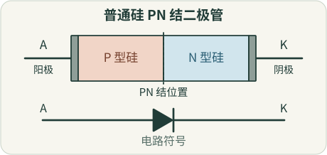
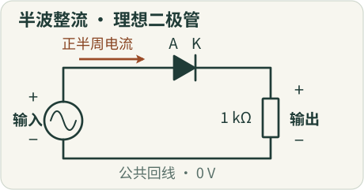
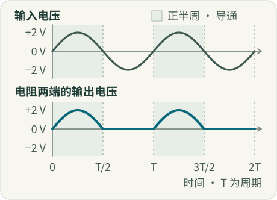
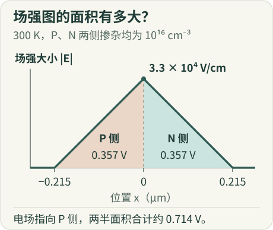

# 从电子到二极管：为什么 PN 结能整流？

**二极管**是一种两端半导体器件。普通 PN 结二极管正向加电压时较容易导通，反向加电压且未达到击穿条件时，电流通常很小。

家中的插座提供交流电，许多电器内部的电路却需要直流电。手机充电器、电脑电源等设备中通常都有**整流电路**，用来将交流电转换成直流电。整流后得到的电压仍可能随时间脉动，还可以通过滤波和稳压得到更平稳的直流电压。[加州大学伯克利分校的二极管与整流实验](https://instrumentationlab.berkeley.edu/node/9)

下面研究一种常见的硅二极管：它在一块硅中形成相邻的 P 型区和 N 型区，交界处称为 **PN 结**。P 端接阳极 A，N 端接阴极 K。这里的 P 和 N 表示两种不同的掺杂类型，并不意味着整块 P 区带正电、整块 N 区带负电。

**为什么原本都能导电的两种半导体形成 PN 结之后，就有了这种方向性？** 我们先观察一个简单的整流电路，再沿着电子从硅内运动到跨越 PN 结的路径寻找答案。

## 交流怎样变成单向脉动电流？ {#rectification}

把一只二极管和电阻串起来，接上正负交替的电压。示波器的一路看输入，另一路看电阻两端。输入有正、负两个半波，为什么电阻上主要只剩一个？先看最简单的半波整流。图中交流源上端接二极管的阳极 A（P 端），阴极 K（N 端）接 1 kΩ 电阻，再回到电源下端。两路测量都以下方回线为 0 V。一路量电源上端，另一路量电阻上端。

先把二极管看成理想器件，取峰值为 2 V 的正弦输入，负载只有电阻。沿一个周期看两次。

- **正半周。** 电源上端为正，二极管正向导通。常规电流从电源上端经 A、K 穿过电阻，回到电源下端。理想管的正向压降为零，因此负载电压跟随输入。输入到 +2 V 时，电流为 2 V / 1 kΩ = 2 mA。
- **负半周。** 电源上端为负，二极管反向截止。电流为零，电阻上的压降也为零。此刻负的输入电压落在二极管两端。即使输入到 −2 V，负载上仍是 0 V。

理想情况下，负载电压就是输入电压和零之中较大的那个。电阻中的电流每周期从零升起再落回零，始终沿同一方向流动。这叫**半波整流**。输出还在脉动。把正半波的面积除以整个周期，就得到它的直流分量。本例的平均负载电压是 2/π ≈ 0.64 V。[克莱姆森大学电子电路实验讲义，半波整流电路与波形](https://www.clemson.edu/cecas/departments/ece/academics/documents/undergrad/labmanuals/ece_311.pdf)

现在换回真实的硅管。仅仅交换电源正负极，就能使电流相差许多数量级。要解释这种差异，首先要知道**硅里有哪些电子能够持续搬运电荷，以及什么因素决定它们的运动**。接下来先观察硅本身，再看 P 区和 N 区之间发生了什么，最后回到这张整流波形。除另有说明外，器件取室温、暗处的普通硅 PN 同质结，P 在左、N 在右。[调节结电压，观察势垒和电流](interactive.html#forward)

## 一个电子在哪里，和它处于什么能量，是两个问题 {#states}

硅中有很多电子，但能否参与导电不仅取决于电子在哪里，还取决于它能取哪些能量。晶体中电子能够具有的能量分布在一段段范围内，这些范围称为**能带**。下文会看到两条重要的能带：能量较低的价带和能量较高的导带。

先看图中的两种变化：一个导带电子可以从一处移动到另一处，仍在导带；它也可以释放能量，填上一个价带中的空态。前者主要改变位置，后者改变电子所占据的状态。

怎样理解「状态」？电子的状态不只是一个能量数值。例如，两个自旋不同的电子可以具有相同能量，但占据不同状态。每个完整的单电子状态最多容纳一个电子。要理解导电，需要问两件事：材料允许哪些状态？哪些已经被电子占据，哪些还空着？

深化阅读：电子波包与两种能带图

电子在同一条能带里怎样移动？可以把它描述为一个波包，即由许多晶体态叠加而成、集中在有限区域内的一团波。包络中心向右移动，更可能找到电子的位置也随之右移。两个波包在某一刻可以形状相同，却向相反方向传播。 [交互：改变波包的位置和传播方向](interactive.html#state)

读能带图时也可以先看横轴。后文画 PN 结用的是 EC(x)、EV(x)。横轴 x 是从硅片左端量起的真实位置，纵轴给出各位置的导带底、价带顶。另有一种能带图 E(k)，横轴 k 是波矢，用来区分晶体中具有不同波动特征的态。普通硅中，同一条带上 k 和 −k 的态可以能量相同、速度相反。下一节就要用到这一点。

## 硅里有这么多电子，为什么只有一小部分参与导电？ {#bands}

既然每个状态最多容纳一个电子，硅中的电子是否能参与净电荷输运，就与它们占据了哪些状态有关。先数一数理想纯硅中的电子，再看填满能带为什么会限制导电。

### 1000 个硅原子的价电子，为什么恰好填满价带？ {#counting-states}

一个硅原子有四个价电子。在晶体里，四个近邻分布在它周围的四面体方向。想象先把原子分得很开，每个原子都有相同的外层轨道。随着原子靠近，邻近轨道相互作用，原先能量相同的态分裂开来。原子多到宏观尺度时，可取的能量极为密集，形成能带。在硅实际的晶格间距下，这些外层轨道形成一组较低能量的成键态，以及能量更高的态。先用成键图来算，低能这一组究竟能装多少电子。

1. 取 **1000 个硅原子**，用周期性边界忽略表面，让每个原子都有四个近邻。从每个原子出发数一遍，共数到 4000 个键端。同一条键分别从两端数了两次，所以实际有 **2000 条共价键**。
2. 在简化成键模型里，每条键对应一个低能成键轨道。每个轨道能容纳两个自旋不同的电子，2000 个轨道共能容纳 **4000 个电子**。
3. 回头数材料实际带来了多少电子。每个硅原子贡献四个价电子，1000 个原子恰好贡献 **4000 个价电子**。理想纯硅在 0 K 取最低能量的占据，价带因此恰好填满，导带为空。

这里把填满的低能带称为**价带**，其上方的空带称为**导带**。导带空着时，那里有允许态可以接收电子。两者之间是**禁带**，在理想晶体中没有允许的体态。刚才的计数解释了价带能装多少电子。要算出室温硅约 1.12 eV 的带隙，还得知道晶格和轨道相互作用怎样决定两组能量。 [伊利诺伊大学：硅的能带形成和态数](https://courses.physics.illinois.edu/phys525/sp2024/units/Semiconductors.pdf)

### 填满以后，电子的运动为什么加不出净电流？

图中左右两组各取三个态，逐对看，它们速度大小相同、方向相反。满带的各对电流相加为零。即使施加弱电场，只考虑带内响应，只要整条带的允许状态仍被占满，两个方向的贡献就依然相等。 [塔斯马尼亚大学：满带、电子与空穴](https://ssp.utasphys.cloud.edu.au/6-semiconductors/6-1-semiconductors/)

现在拿走图中一个右行电子。它原本带负电，对常规电流的贡献向左，拿走它以后，剩余电子合起来的常规电流就向右。换成成键图来追踪同一份缺失：右侧的价带电子向左填空位，新的空位便出现在右边。用一份随空位向右移动的正电荷来记账，这就是**空穴**。 [交互：依次观察满带、激发、带内重新分布与复合](interactive.html#bands)

升到室温，少量价带电子受热进入导带，每次都留下一份空穴。反过来，导带电子释放能量、填上一个当时空着的价带态，导带电子与空穴各少一个，这叫复合。热平衡时两种过程的平均速率相等。

弱电场可直接改变金属部分填充能带的占据。纯硅要先激发出载流子，室温下能参与导电的电子和空穴少得多。若带隙更大，同温下热激发更难，这也是许多材料表现为绝缘体的原因。 [胡正明教材第 1 章的金属、半导体与绝缘体能带图](https://www.chu.berkeley.edu/wp-content/uploads/2020/01/Chenming-Hu_ch1-3.pdf#page=12)

## 掺杂怎样改变电子数，又怎样保持电中性？ {#doping}

纯硅在室温下只有较少的可移动载流子。想让同一块硅的不同区域具有不同的导电特性，可以有意加入少量杂质原子，改变电子对能带状态的占据，这就是**掺杂**。看磷和硼怎样产生两种不同类型的半导体。

**磷多带来一个价电子。** 磷取代硅后，五个价电子中有四个参与成键，余下一个受束缚较弱。它所在的施主能级距导带底约 0.045 eV，室温轻掺杂时大部分施主已电离。逐个记账，每多一个导带电子，就留下一个固定正施主。

**硼少带来一个价电子。** 硼取代硅后，在价带顶附近引入受主能级。受主接收一个价带电子，自己带上一份固定负电荷，价带里少一个电子。这个空位可以随其他电子重新占据而移动。一正一负相加，P 型硅仍可保持电中性。 [MIT 6.012 的掺杂与载流子讲义](https://ocw.mit.edu/courses/6-012-microelectronic-devices-and-circuits-fall-2009/a37c73e7fcff4bcb5c5f1177e12d0891_MIT6_012F09_lec01.pdf) · [比较本征激发、施主电离与受主电离](interactive.html#doping)

掺入施主的 N 型硅以导带电子为多数载流子；掺入受主的 P 型硅以空穴为多数载流子。虽然两区都近似电中性，但它们能够提供的两类载流子数量可以差别很大。

### 同样两条能带，怎样知道哪条带里有多少载流子？ {#fermi}

**费米能级**是描述热平衡时电子怎样占据允许状态的一个能量参数。在温度相同、带边不变的情况下，费米能级离导带底越近，导带电子越多；离价带顶越近，空穴越多。N 型硅与 P 型硅的区别就可以用这种占据关系来描述。

深化阅读：从费米分布和态密度理解载流子浓度

先在导带中选一个允许态，问它有多大机会被电子占据。再在价带中选一个允许态，这次问它有多大机会空着。前者用来数导带电子，后者用来数空穴。能带结构给出每一小段能量里有多少可用的态，这叫**态密度**。要算载流子浓度，还得把每小段的态数乘上相应的概率，再加起来。

热平衡时，能量为 E 的允许态被电子占据的概率为 **f(E) = 1 / [1 + exp((E − EF)/kT)]**。这里 T 是绝对温度，k 是玻尔兹曼常数，EF 是电子的**费米能级**。如果某处有一个能量恰为 EF 的允许态，代进公式便得到一半的占据概率。如果 EF 落在理想硅的禁带里，那里没有允许的带态能让电子占据。这个能量仍有用，因为可以拿它和上下两个带边比较。

保持温度和带边不变，让 EF 靠近导带底。对某个给定的导带态，E − EF 变小，f(E) 变大，导带电子增多。价带态空着的概率 1 − f(E) 则变小。由此可以读出，单独处于平衡的 N 型硅，其费米能级更靠近导带底，P 型硅则更靠近价带顶。 [胡正明《现代半导体器件》第 1 章，态密度、占据概率与载流子浓度](https://www.chu.berkeley.edu/wp-content/uploads/2020/01/Chenming-Hu_ch1-3.pdf) · [调节费米能级，比较导带占据与价带空态](interactive.html#fermi)

算一遍差距有多大。取 300 K，硅的本征载流子浓度 nᵢ（未掺杂硅在热平衡下的电子或空穴浓度）约为 10¹⁰ cm⁻³。假设只掺入 10¹⁶ cm⁻³ 的施主，近似完全电离。在均匀、中性的 N 型体区，导带电子浓度 n 就约为 10¹⁶ cm⁻³。非简并热平衡下，电子和空穴浓度满足 np = nᵢ²，因此空穴浓度 p 约为 10²⁰ / 10¹⁶ = 10⁴ cm⁻³。换成相同浓度的受主，结果反过来，p 约为 10¹⁶ cm⁻³，n 约为 10⁴ cm⁻³。称空穴为 P 区的「多数」，比较的是空穴和导带电子的浓度。价带里的绝大多数状态仍然有电子占据。接上电源并向对侧注入载流子后，局部可能偏离热平衡，这时要重新求两种浓度。

### 金属导线送来一个电子，到了硅里会进哪条带？ {#contacts}

接上电源后，外部电路要通过金属与硅的接触补进或取走电荷。这里讨论接触压降很小、两个方向都容易传递电流的**欧姆接触**，以便把整流机制集中在 PN 结本身。

深化阅读：金属与半导体怎样形成欧姆接触

先把金属接到一块同温的掺杂硅上。若两边电子的电化学势不同，电子会净转移，界面电荷重排，硅的带边随之弯曲。热平衡时，两侧费米能级相同，来回交换的电子通量相抵。

接上电源后，才有了持续净交换的可能。一次具体的交换，出发处须有已占据态，另一侧须有能接纳电子的空态，电子还得能够越过或穿过界面势垒。实际器件常把紧邻金属的一小层硅做成重掺杂区，使势垒窄到足以隧穿。这样可以得到**欧姆接触**，工作范围内两个方向都能以很小的接触压降传递电流。如果金属与硅的接触本身明显整流，还得把这个称作肖特基接触的界面单独算进去。[华盛顿大学的金属–半导体接触讲义](https://dunham.ece.uw.edu/ee482/Notes/MS.pdf#page=10) · [胡正明《现代半导体器件》4.21 节，欧姆接触](https://www.chu.berkeley.edu/wp-content/uploads/2020/01/Chenming-Hu_ch4-1.pdf)

看低注入、接触附近由多数载流子导电的普通欧姆接触。沿每个箭头看一次电子交换，再看右侧的硅留下了什么。

沿 P 端追问一次：第一个送来的电子填上了空位，第二个填哪里？要维持稳态，硅内就得持续把空穴送到这个接触。反过来，金属持续取走价带电子，空穴就能从接触向硅内输运。图中画的是多数载流子主导的净交换。若少数载流子从器件内部扩散到电极，接触也可以收集它们。

## 同一批电子，为什么既会漂移，又会扩散？ {#transport}

现在我们知道硅里有哪些载流子，也知道外部电路怎样补充它们。但载流子数量多，并不意味着一定有净电流。还得弄清楚是什么让它们朝某个方向净输运。接下来分别观察电场和浓度差的作用。

在均匀 N 型硅中画一道截面。热平衡时，向左、向右穿过它的电子平均一样多。通电后，若每秒向左穿过的电子更多，常规电流就向右。再画一道截面，只要两道截面的电流相等，中间这一段保存的净电荷就不变，起初的近似电中性也能保持。

### 同样加 1 V，电子在每处受到的力一样大吗？

先取两根长度不同、掺杂相同的均匀硅棒，让右端的电势都比左端高 1 V。假设压降均匀，第一根长 1 μm，场强大小就是 1 V/μm。第二根长 10 μm，场强只有 0.1 V/μm。电场指向左，负电子受力向右，第一根里电子在每处受到的电场力是第二根的十倍。再跟着一份电子电荷从左走到右，两种情况下它的静电势能都降低 1 eV。**局部的力取决于电势在这里变得多快，走完全程的势能变化取决于两个端点的电势差。** 稍后在 PN 结里，电场沿途还会改变大小，同样可以这样逐段看。[用相同电压和不同间距比较电场](interactive.html#transport)

场中的电子会加速，也会受到晶格振动、杂质等的散射。随机运动上叠加了电场带来的微小方向偏好，电子群在普通低场下形成有限的平均漂移速度。一次弹性散射就可以改变运动方向，几乎不改变能量。持续通电时，电场输入的能量最终经与晶格交换等过程变成热。因此上一步算出的 1 eV 是电场对这份电荷做的总功；电子到右端时实际增加的动能，还取决于路上向周围交出了多少能量。

从截面的电子数算出硅棒电阻

现在调小电压，让两根硅棒都处于漂移速率与场强成正比的低场范围，再算电阻。先只看导带电子，设其浓度为 n，截面积为 A，平均漂移速率为 v。在一小段时间 Δt 内，定向输运等效于把厚度 vΔt、体积 AvΔt 的一层电子送过截面，净电荷量的大小就是 qnAvΔt，其中 q 是元电荷的正值。除以 Δt，得到电流大小 I = qnAv。低场时，v 与场强成正比，比例系数叫迁移率 μ。长度为 L 的均匀硅棒承受电压 V，场强大小为 V/L，因而 I = qnμAV/L。空穴也提供导电通路，把两种贡献相加就得到电导率 σ = q(nμn + pμp)，电阻 R = L/(σA)。同样的电压加在较长的硅棒上，电子漂移较慢；把截面积增大，则有更多电子可以同时通过。这里假设接触压降可忽略。

### 去掉电场，电子为什么还会向一边净传输？

设硅棒左段的导带电子较多，右段较少，起初让每个电子以相同的机会向左或向右运动。即使没有外场，从左边穿过交界的电子平均也更多。浓度梯度带来的这部分净输运叫**扩散**。普通非简并硅的导带在两侧都有大量可用空态。只说「右边有空态」解释不了为什么净传输向右；还得数一数两个方向各有多少电子出发。

接下来把扩散和漂移放在同一块硅里。每个电子都受当地电场作用，也都在做热运动。我们对经过某个截面的电子做统计，可以分别算出电场带来的电流贡献和浓度梯度带来的贡献。即使它们加起来正好是零，截面两边仍有电子来来往往。[MIT 6.012 的漂移、扩散与非均匀掺杂讲义](https://ocw.mit.edu/courses/6-012-microelectronic-devices-and-circuits-fall-2009/pages/lecture-notes/)

## 两侧原本都电中性，结里的电场从哪里来？ {#equilibrium}

回到开篇的二极管。P 区和 N 区的载流子浓度相差很大，接触之后会发生扩散。可是两边原本都近似电中性，并没有一个预先存在的结区电场。为什么扩散没有持续到两边载流子浓度相同？

把一块硅画成左 P、右 N，向右是位置轴的正方向。设想在某一刻才允许两侧交换载流子。这个思想实验把电场的来由单独拿出来看，真实器件可以直接在同一块晶体上形成相邻的掺杂区。先观察离交界很远的地方。N 区里，带负电的导带电子补偿带正电的施主离子。P 区里，缺少的价带电子留下空穴，空穴的正电荷补偿带负电的受主离子。两侧都近似电中性，导带里的电子浓度却可以相差许多个数量级。

只看最初一瞬。在交界两侧各取相同小体积，假设右侧有 100 个导带电子，左侧有 10 个，暂取相同的越界比例 ½。右侧 50 个向左，左侧 5 个向右，净结果是 **45 个电子向左**。这个人为的概率只用于看清浓度差；电场一旦建立，两边的越界机会就会改变。价带里，右侧电子填补左侧更多的空位，等效于空穴从 P 向 N 净扩散。 [改变两侧计数，观察双向扩散](interactive.html#junction)

现在只跟踪一个从 N 到 P 的导带电子。它刚过交界，右边就少了一份负电荷，左边多了一份。若它随后填上左边一个空穴，导带里少一个电子，价带里少一个空位，这两项对总电荷的改变量恰好抵消。**跨界改变了两侧各有多少净电荷，复合改变了这些电荷由哪些状态承载。** 交界附近因而逐步显出两层电荷。右边的施主正电荷失去电子的充分补偿，左边的受主负电荷失去空穴的充分补偿。图上的加减号留在原来的晶格位置。

再用空穴的记法检查一次。一个空穴从 P 到 N，左边少一份正电荷，右边多一份正电荷，与一个导带电子从 N 到 P 对两侧净电荷的影响同向。若已用空穴记录了这一次价带输运，把它改画成价带电子从右往左填补空位，电荷账上仍然只有这一次转移。

电场从右边的正电荷指向左边的负电荷，电子受力向右。先前净向左转移的电子越多，后来的电子要爬的坡就越高。若有电子净回流，固定离子的电荷得到部分补偿，坡又降低。结由此达到热平衡。

图中两支箭头数的是同一群电子。任取结区中的一个位置，漂移与扩散对电子净通量的贡献相抵，空穴也各自满足平衡。恒温、非简并时有 E = −(kT/q) d(ln n)/dx。电子浓度沿 x 增长得越快，维持平衡需要的向左电场就越强。 [MIT 6.012 的 PN 结热平衡](https://ocw.mit.edu/courses/6-012-microelectronic-devices-and-circuits-fall-2009/c053714447998e522f02db0776987091_MIT6_012F09_lec04.pdf#page=8)

## 电子能够进入，为什么耗尽区只占一小段？ {#field}

N 型体区里还有很多电子，为什么它们不往左补，把每个固定施主都重新补偿？暂时让器件与外部电路隔开。设一个稍远处的电子向左补上了邻近位置，原来那处就少了一份电子。这样只能把未补偿的正电荷挪个位置。要持续降低整个 N 侧的净正电荷，还需有负电荷从另一侧净回流。要判断这种回流是否能维持，得知道一个电子在沿途每一点受什么力。

### 结面处的场最强，电子到那里就爬完了坡吗？

在下面剖面图的横轴上，先把手指放在右端，再沿横轴向左移。手指在整个结区外时，左侧负电荷和右侧正电荷对测试电子的作用方向相反。在横向尺寸足够大的平面结模型里，可把电荷划成许多薄片，每片在两侧产生大小相同、方向相反的电场。移进 N 侧耗尽区，一部分正电荷片已落到手指右边，它们对电子的吸引力改为向右。移到结面，正电荷都在右、负电荷都在左，吸引和排斥都把电子推向右，此处场强最大。继续向左穿过负电荷层，合力逐渐减弱。两侧远处的电场都近于零。[移动测试电子，逐层叠加受力](interactive.html#depletion)

过了结面继续向左，电子受的力虽然减小，方向仍向右，势能因此继续升高。电场 E(x) 给出当地受力 −qE(x)。从 A 到 B 的电势差则取决于整段面积，即 φ(B) − φ(A) = −∫AB E(x) dx。

两层电荷按单位结面积计，绝对值相等。设 P 侧每单位体积有 NA 个电离受主，耗尽宽度为 WP，则单位面积对应 NAWP 个负离子。N 侧同理。均匀掺杂的突变结在耗尽近似下满足 **NAWP = NDWN**。若 P 侧掺杂浓度为 N 侧的十倍，P 侧只要展开十分之一的宽度即可给出相同的电荷量。这是同一个结里**两侧宽度的比值**。若另做一个只改变一侧掺杂的结，内建电势也会变，要重新计算总宽度。若只把均匀结的面积增大一倍，在边缘效应可忽略时，两边分离电荷的绝对量各增一倍，正负总和仍近于零。足够薄的轻掺杂层也可能整层耗尽。

这幅图的上下两栏共用横坐标。下栏的纵坐标现在是能量。电场向左，所以静电势 φ 从左向右升高。电子的静电势能为 −qφ，因而从右向左升高。在同一种硅里，局部导带底和价带顶都随 −qφ 移动，两条带边一同弯曲，带隙基本保持原宽度。热平衡时费米能级在整块硅中是一条水平线。它在右边更靠近导带底，在左边更远离导带底，因此两处导带中的电子浓度仍可相差很大。[切换接触前后的能带图](interactive.html#align)

图中取 300 K、两侧掺杂均为 1016 cm−3，假定杂质完全电离，取硅本征浓度 ni = 1010 cm−3。远离结区，N 侧导带电子约有 1016 cm−3，P 侧由 np = ni² 得到约 104 cm−3。在非简并热平衡下，导带底每升高一个 kT，电子浓度变为原来的 1/e。两侧相差一万亿倍，对应的电子势垒为 kT ln(1012) ≈ **0.714 eV**。对称结两侧的场强分布互为镜像，各贡献场强图下面积的一半。从 N 侧只走到结面，就已爬过约 0.357 eV，电子浓度约降为原来的百万分之一。右边的电子随时能走进来，但这里长期平均能找到的电子很少。若反过来从 P 型体区走向结面，平衡导带电子浓度反而上升，同时原先占多数的空穴显著减少。

为什么在图上画一条耗尽边界？「耗尽」得名于多数载流子的显著减少。用耗尽近似算电场时，还要检查当地的导带电子和空穴：当两者各自贡献的电荷密度大小都远小于未补偿的固定离子电荷密度大小时，就可以只用电离掺杂浓度估算空间电荷。到了外侧，移动电荷重新把大部分离子补偿了，局部近似电中性。真实硅里的浓度和电场在这两种区域之间连续过渡。耗尽区里，绝大多数价带态仍有电子占据，内层电子也留在原子中。

### 建立这个势垒，究竟要露出多宽的一层离子？ {#depletion-width}

耗尽区不需要扩展到整块硅：只要交界附近露出足以建立平衡势垒的固定离子，就能使漂移与扩散相抵。沿用刚才的对称突变结，在耗尽近似下，两侧的总耗尽宽度约为 **0.43 μm**，内建电势约为 0.714 V。下面可以从电场分布复算这两个数。

深化阅读：从固定电荷到耗尽宽度的计算

在均匀突变结里，每露出同样厚的一层 N 型硅，就多出同样多未被补偿的正施主，因此场强大小从耗尽边缘向结面线性增大。N 侧宽度 WN 对应单位面积电荷 qNDWN。用高斯定律，将它除以硅的介电常数 ε，便得到图中三角形的高度 **E峰 = qNDWN/ε**。

对称时，两侧都掺 N，WN = W/2。三角形的面积给出 **Vbi = E峰W/2 = qNW²/(4ε)**。

代入 ε ≈ 1.04 × 10⁻¹² F/cm、N = 10¹⁶ cm⁻³、q ≈ 1.60 × 10⁻¹⁹ C 和 Vbi ≈ 0.714 V，得 W = √(4εVbi/(qN)) ≈ 4.3 × 10⁻⁵ cm，即 **0.43 μm**，每边约 0.215 μm。再用两倍面积除以底宽，峰值场强约为 3.3 × 10⁴ V/cm。

若两侧掺杂不同，场强三角形的两边斜率不同。用前面的电荷平衡关系分配宽度，再算同一个三角形的面积，就得到 W = √[(2εVbi/q)(1/NA + 1/ND)]。这解释了为什么在足够厚的硅里，把远处的中性区再加长一截，结区不用随之加宽。达到平衡所需的电势差和单位体积能提供的净电荷都已经确定。[改变两侧掺杂，检查宽度和峰值场强](interactive.html#depletion)

若把电压表接到器件两端的金属电极，从一支表笔到另一支，途中还经过两个金属–硅接触。在等温、无光照的热平衡下，两金属端的电子电化学势相同。把接触处也算进测量回路，表读 **0 V**。下面给二极管接上电源时，改变的正是原来为零的端电压。[胡正明《现代半导体器件》4.1–4.2 节，内建电势、端口测量及耗尽宽度](https://www.chu.berkeley.edu/wp-content/uploads/2020/01/Chenming-Hu_ch4-1.pdf)

## 正接电源，为什么能一直有电流？ {#forward}

到这里，已经知道一个没有接电源的 PN 结为什么不会自行产生持续的净电流。接下来改变一个条件：在两端加上外部电压，看原来的平衡怎样被打破。

P 端接正，N 端接负，仍画成左 P、右 N。负极通过右边的欧姆接触给 N 区补充导带电子。正极通过左边的欧姆接触从 P 区取走价带电子，在靠近接触的地方留下空穴。如果只看两个接触，似乎一边不断多出电子，另一边不断少掉电子。要使电流持续，硅内部的哪一段会把这两件事接起来？

先在电源接通前观察结区。即使在零偏，有些 N 区导带电子也能越过势垒到达 P 区。偶尔来到结边的 P 区导带电子也会被电场扫向 N 区。热平衡时，两种方向的平均电子通量相等。接上电源后，结两侧的移动电荷重新分布，靠近原耗尽区边缘的一部分固定离子重新得到补偿。耗尽区变窄，结区原有的电势差下降。一旦已有持续注入，整块硅就离开了热平衡。在局部准平衡近似下，可以用电子、空穴各自的准费米能级描述占据情况。此时若硬把平衡关系 np = nᵢ² 用到每个位置，就无法描述结边积累的过剩电子。

### 势垒只降了一点，注入为什么多了那么多？

把 P 相对 N 的结电压记作 Vj。在低注入、接触及准中性区压降都很小的条件下，绝大部分端电压落在结上。N 区导带电子到达 P 区导带需要克服的势垒降到 q(Vbi − Vj)。沿用前面约 0.714 eV 的算例，加上 0.060 V 正向结电压，还要爬约 0.654 eV。耗尽区仍在，为什么注入已经明显增加？

单看势垒还剩多高，算不出注入能增加多少。还得知道坡顶上下分别有多少电子。在普通非简并硅中，高能尾部的电子占据近似按 exp(−能量/kT) 衰减。300 K 时 kT 约为 0.0259 eV。把坡顶降低 0.060 eV，等于移向热分布里电子更密的地方，移动的幅度有 2.32 个 kT。两处的统计权重相差 exp(2.32)，约 **10 倍**。

这个十倍具体发生在哪里？看耗尽区刚刚结束、进入 P 型准中性区的位置。设此处平衡时的导带电子浓度为 np0。在结区近似准平衡、忽略结内复合的理想模型中，结边电子浓度变为 **np0 exp(qVj/kT)**。若 np0 约为 10⁴ cm⁻³，加上 60 mV，边缘便约有 10⁵ cm⁻³。可远离结的长 P 区仍约为 10⁴ cm⁻³。相距一段距离的两处因此出现了约 9 × 10⁴ cm⁻³ 的浓度差。把同样两处放在零偏时比较，这项浓度差为零。[胡正明《现代半导体器件》4.6 节，结边的少数载流子浓度](https://www.chu.berkeley.edu/wp-content/uploads/2020/01/Chenming-Hu_ch4-1.pdf#page=17)

沿图中正偏曲线从右往左读。结边的过剩电子向 P 区深处扩散，途中逐渐复合；接触若离得近，也能直接收集电子。外部电源在结边持续补入电子，这一高一低的浓度分布就能保持，电流也能持续。图用对数纵轴同时显示正、反偏；计算扩散通量时要用实际浓度随距离的斜率。 [斯坦福 EE116：二极管中的少数载流子分布和电流](https://poplab.stanford.edu/files/ee116/L22toL25_PNcurrent.pdf)

**为什么结边浓度增加会带来更大的电流？** 外部电源维持结边较高的少数载流子浓度，硅内部的扩散、复合以及远端接触使这些载流子有持续的去路。浓度差增大，相同材料条件下净扩散通量也会增大。常用扩散长度 L = √(Dτ) 描述复合前载流子扩散的典型距离，D 是扩散系数，τ 是过剩载流子寿命。

在理想扩散模型下，把两类少数载流子的电流贡献相加，可得 **I = IS[exp(qVj/kT) − 1]**。其中 IS 是模型中的反向饱和电流；零偏时净电流为零。这说明正向管压降并不是固定的 0.7 V，而与电流、器件和温度有关。

深化阅读：由少数载流子的浓度分布推导二极管电流

为看清电流和结边浓度之间的关系，取一个均匀、足够长的 P 区，假设低注入下电子扩散系数 D 和过剩电子寿命 τ 均为常数。从 P 侧结边往 P 区内部量距离 s。扩散不断摊开电子分布，复合不断消耗过剩电子，稳态下得到的过剩浓度随距离按 exp(−s/L) 衰减，其中 L = √(Dτ) 是扩散长度。结边过剩浓度若为 Δn，每走一个扩散长度，过剩浓度就降到之前的 1/e。结边的浓度斜率大小为 Δn/L。按扩散定律，单位面积、单位时间净离开结边的电子数就是 DΔn/L。对于同一块材料，结边的过剩浓度翻倍，扩散通量也会翻倍。[胡正明教材 4.7–4.9 节的稳态少数载流子分布](https://www.chu.berkeley.edu/wp-content/uploads/2020/01/Chenming-Hu_ch4-1.pdf#page=19)

把上面算出的结边过剩浓度代进来，Δn = np0[exp(qVj/kT) − 1]。N 区结边也有从 P 区注入的空穴，按同样的电压因子增加。两项常规电流同向，加起来得到 **I = IS[exp(qVj/kT) − 1]**。式中的 1 来自扣掉平衡浓度这一步。零偏时净电流正好为零。IS 则随结面积、掺杂、扩散及复合等器件条件而变。只有在指数项远大于 1 的正向扩散区，60 mV 对边缘**总浓度**的十倍作用，才近似成为端子**净电流**的十倍。实际器件在很小电流下可能受耗尽区复合影响，在大电流下还要计入串联电阻和高注入。工程上说一只硅管「约 0.7 V 导通」，就需要附上测量的电流和温度。[MIT 6.012：PN 结的势垒、注入与电流](https://ocw.mit.edu/courses/6-012-microelectronic-devices-and-circuits-fall-2009/a342ce0afb84bfa8e5b7dc819ff3e9bc_MIT6_012F09_lec06.pdf) · [调节电压，对照势垒、耗尽宽度与电流](interactive.html#forward)

### 跨到 P 区的那个电子，会立刻掉进价带吗？

跟一颗成功越过势垒的 N 区导带电子走一段。刚过结，它占据的是 **P 区的导带态**。P 区价带里虽有很多空态，电子要填上其中一个，还得通过具体的复合过程把多余能量交给周围。两件事之间可以隔开一段时间、一段距离。上面介绍的扩散长度给出了一个可与 P 区长度比较的尺度。P 区远长于这个尺度时，多数注入电子在内部复合；P 区短于它时，有些电子在复合前便能抵达金属接触。

假定跟踪的电子在 P 区半路复合了。电流表为什么还一直有读数？从左端逆着这段过程看。正极从接触处取走价带电子，出现一个空位。硅里其他价带电子的输运使空位向结的方向传递，等效为有空穴持续从 P 端流向结。这样，导带电子从右边供应，空穴从左边供应，双方可以在 P 区内部相遇并复合。若沿 P 区从结走到金属，导带电子承担的电流逐渐减少，空穴承担的电流相应增加。在一维稳态下，任取相邻两个截面，总电流若长期不同，它们之间就会不断积累净电荷。因此沿程保持相同的是**两种载流子电流之和**。

再看结的另一边。P 区的空穴也会注入 N 区。用电子描述，这是 N 侧的价带电子填入 P 侧可用的价带态，N 侧留下可移动的空位。进入 N 侧的空穴可与负极补给的导带电子复合。这条路径同样使负电荷总体从 N 向 P 传递。于是在两根导线里，负极向 N 端送电子，P 端向正极送电子；而在硅里，结区两类载流子都能参与，约定电流从 P 指向 N。要让电荷在整个回路中连续传输，各段可以由不同的电子接续。

## 反接后，电场更强，为什么电流反而很小？ {#reverse}

正向偏置降低了多数载流子跨结的势垒。现在把电源反过来。电场会变强，但电流既取决于电场，也取决于可供输运的载流子数量。看看反接时，电路能否持续得到这些载流子。

从零偏平衡开始，把左侧 P 端接负、右侧 N 端接正。N 端抽走导带电子，P 端送来的电子填补价带空位。靠近耗尽边缘的多数载流子退开，更多固定离子失去补偿，耗尽区变宽、场增强。端子有充电电流，结内变化的场贡献位移电流。反压和耗尽宽度稳定后，这部分电流便消退。

稳态下，场对电子的力仍向右。图中先看一个已经到达结边的 P 区导带电子，它很容易被扫进 N 区。扫走之后，下一颗从哪里来？

**沿图中上面这条路走。** 暗处，P 型准中性区热产生一对电子和空穴。导带电子可能先复合，也可能抵达结边、被扫到 N 侧并由正极收集。P 端送来的负电荷经价带输运，填补热产生留下的空位。激发和跨结是同一电子先后走的两步，经过同一截面只计一次。N 区的多数导带电子若想反向进入 P 区，此刻要爬的势垒更高。

**如果从 P 端不断送进价带电子呢？** 要把负电荷沿价带一直向右传，右侧 N 区也得供给空位。N 侧的少数空穴到达结边后被扫向 P，等效于价带电子向右净传输。正极从 N 端的导带取走电子，并不会在它的价带里同时造出空位。所以两条反向路径分别受限于 P 区的导带电子和 N 区的空穴，常规电流都从 N 指向 P。 [沿电子路径比较正接与反接](interactive.html#reverse)

**再看图中下面这条路。** 反偏让带边沿空间倾斜得更陡，同一位置的价带顶与导带底仍隔着约 1.12 eV。要就地生出一对载流子，仍须获得能量。若热产生（可经缺陷能级）发生在耗尽区内部，电场就能直接把电子扫向 N、空穴扫向 P，省去扩散到结边的路程。完整收集一对时，每根外引线传递一份元电荷。

用刚才的结边浓度做个检验。仍取 300 K、P 型体区平衡导带电子浓度 10⁴ cm⁻³。加上 −10 mV，结边浓度是体区的 exp(−10/25.85) ≈ 0.679 倍。靠结处浓度低于深处，电子由深处向结边净扩散。改成 −100 mV，结边只剩约 0.021 倍。继续降低结边浓度，深处与边缘的浓度差最多也只能接近原来的 10⁴ cm⁻³。对给定材料和几何，这就是理想反向扩散电流渐趋饱和的由来。代入整管方程，这两个电压下的净电流分别为 **−0.321 IS** 和 **−0.979 IS**。只有当反压的绝对值比热电压大得多、且尚未击穿时，理想扩散电流才接近 −IS。实际暗电流还可能含有耗尽区产生电流和表面漏电，它们可以随反压而变。[在图上比较两种小反压](interactive.html#forward)

可以用另一个现象验证这种供应限制。保持反偏电压不变，用能在硅里产生电子–空穴对的光照射结区。耗尽区中新产生的载流子会被分离，附近准中性区产生的一部分也能扩散到结边并被收集。电流表的反向读数随供应增加而变大，这正是反偏光电二极管可以测光的原因。[胡正明《现代半导体器件》4.15 节，光电二极管](https://www.chu.berkeley.edu/wp-content/uploads/2020/01/Chenming-Hu_ch4-1.pdf#page=45)

*沿每一排先读金属导线的箭头，再读硅两侧的箭头。图中同时画了电子和空穴，用两种载流子记账时，它们在给定偏置下对常规电流的贡献同向。*

## 真实硅管会怎样改变整流波形？ {#real-rectification}

回到开头的[半波整流电路](#rectification)。真实管子和电阻串联，任何时刻都有 **输入电压 = 管压降 + 负载电压**。在足够慢的正半周，正偏使多数载流子持续注入。若输入到 +2 V 时管压降恰为 0.65 V，负载就有 1.35 V，1 kΩ 中流过 1.35 mA。这个压降只是该工作点的例子。

负半周，结区电场增强，却只有少量载流子可供持续收集。低频、未击穿时，电阻上的反向压降很小。于是正半周留下明显的脉冲，负半周的输出接近零。若输入变化足够快，换向波形还会受到[结电容和反向恢复](#storage)的影响；这些是接下来要讨论的拓展现象。

回到开篇，整流依靠的不是某个方向完全没有电子运动，而是两种电压方向下，能参与跨结输运的载流子供应相差很大。正偏时多数载流子容易持续注入，反偏时扫出载流子虽容易，却受少数载流子的供应限制。

到这里，已经可以解释普通硅 PN 结二极管在低频、未击穿条件下的半波整流。试着用刚刚理解的机制预测两个现象：不接电源、暗处且处于等温热平衡时，电压表能否在两个端子之间测到内建电势？维持反偏，把原来照射结区的光遮住，反向电流绝对值会怎样变？分别回到[内建电势与表笔](#depletion-width)和[反偏下的载流子供应](#reverse)检查。

如果只想了解整流的基本机制，可以先进入[下一篇 · MOS 管怎样隔着绝缘层控制电流？](../bands-to-channel/README.md)。下面再利用同一套载流子与电场的知识解释反向击穿、动态关断以及三极管怎样工作。

## 拓展：强场怎样改变载流子的供应？ {#breakdown}

在前面的主线中，反接电压始终没有达到击穿区。如果继续提高反偏电压，电流可能突然大幅增加。此时载流子的供应机制变了。

**雪崩倍增。** 跟着一个热产生的导带电子进入耗尽区。若它在两次散射间从强场获得足够动能，就可能在碰撞中把一个价带电子激发到导带。碰撞前有一个导带电子，碰撞后有两个，价带还多了一个空穴。新载流子也能加速，再次引发**碰撞电离**。这样，一次初始注入就能触发接连几轮倍增。[斯坦福 EE116 的反向击穿图](https://poplab.stanford.edu/files/ee116/L22toL25_PNcurrent.pdf#page=9)

**齐纳击穿。** 在重掺杂的窄结中，沿弯曲的能带找两处能量相近的态：P 侧有电子占据的价带态，以及 N 侧空着的导带态。电子的波函数在中间的经典禁阻区内衰减。两态距离足够短时，另一侧仍有非零振幅，电子便有机会进入空态，在原处留下空穴。这叫**带间隧穿**。弹性隧穿保持电子能量。硅的价带顶与导带底对应不同的晶体动量，声子也能参与跃迁，与电子交换动量和能量。[硅中的声子辅助隧穿](https://saraswatgroup.stanford.edu/Thesis/Donghyun%20Kim%20Thesis.pdf)

**总耗尽区变宽，隧穿距离为何还能变短？** 沿能带图的横轴量两次。两条耗尽边缘之间是总宽度 W。若从选定的价带态水平量到能量相近的导带态，量出的是隧穿距离 L。在场强 F 近似均匀的小段上，带边能量变化约 qFL，跨过一个带隙只需 L ≈ Eg/(qF)。增加反压使耗尽边缘向外移、W 增大，同时结面附近的场更强、L 缩短。两种击穿机制在实际器件中可以共存。[胡正明教材图 4–12](https://www.chu.berkeley.edu/wp-content/uploads/2020/01/Chenming-Hu_ch4-1.pdf#page=14) · [改变势垒宽度，观察隧穿概率](interactive.html#breakdown)

## 拓展：同样的反接，为什么刚才正向导通过的二极管会多出一股电流？ {#storage}

让两只相同的 PN 二极管通过相同的限流电路接受反向驱动，反压都远低于击穿电压。第一只原先处于零偏平衡，第二只原先有稳定的正向电流。

**两只管子都要给结电容充电。** 加上反压后，耗尽边缘向外移，两侧各有更多固定离子失去补偿。导线传输电荷，结内变化的电场贡献位移电流。偏置稳定后，这部分电流消退。结电容衡量电压再变一点时还需搬多少电荷。在平面、均匀突变结的耗尽近似下，Cj = εA/W。若耗尽宽度 W 加倍，两侧已分离的电荷更多，结电容却减半，同样的一小步反压只须再搬原来一半的电荷。[MIT 6.012 的结电容和扩散电容](https://ocw.mit.edu/courses/6-012-microelectronic-devices-and-circuits-fall-2005/4b2ed0f760def0cae0d70cc9fbf934df_lec16.pdf)

**第二只管子还储存着先前注入的载流子。** P 侧有来不及复合的导带电子，N 侧有过剩空穴。它们主要分布在耗尽区外，多数载流子的调整使当地仍近似电中性。正向电压再升高一点，注入增多，储存量也随之增加。这种小信号响应表现为**扩散电容**。关断时，这些载流子可以在硅内复合，也可以由外电路抽走。

沿图从左向右看。刚换接时，结边缘还有过剩载流子，结电压可能仍为正，外电路已经能抽出反向电流。远处的电子还得先扩散回结边。等边缘的过剩载流子消退，耗尽区展开承担反压，电流回到漏电水平。这段**反向恢复**电流与先前的正向注入有关，击穿电流则依靠此刻的强场产生或倍增载流子。[东芝的关断电流与电压波形](https://toshiba.semicon-storage.com/eu/semiconductor/knowledge/faq/diode/what-is-trr.html) · [逐步观察关断](interactive.html#transient)

| 从同一正向稳态切换 | 在端子上观察什么？ |
| --- | --- |
| 断开引线 | 端子电流为零。内部载流子继续扩散、复合，端电压回落，暗处充分弛豫后为零，结内仍有内建电势。 |
| 断开电源后将两端短接 | 端电压被拉到接近零。部分载流子回到结区被收集，短路线上仍有瞬态电流。 |
| 接入限流的反向电源 | 电源与串联阻抗共同限制反向电流。载流子被抽取或复合后，管子恢复反向阻断。 |

同一条电流曲线还可以读出两个数。**恢复时间** trr 是从电流过零到手册规定终点的时间。**恢复电荷** Qrr 是规定区间内反向电流绝对值的积分。把脉冲近似成底宽 20 ns、峰值 1 mA 的三角形，面积就是 ½ × 20 ns × 1 mA = 10 pC。底宽不变、峰值翻倍，恢复时间可以相同，搬运电荷却翻倍。比较手册数据时，还要对照先前的正向电流、换流速率与温度。[东芝对恢复时间与测试条件的说明](https://toshiba.semicon-storage.com/eu/semiconductor/knowledge/faq/diode/definitions-of-the-terms-in-the-electrical-characteristics-table.html)

试着做一个预测：让二极管通一段时间的正向电流，再经电阻反向驱动。换接瞬间，哪一批电子仍留在硅里？它们怎样影响外部电流？

## 延伸：旁边再放一个反偏结，它能收到刚注入的电子吗？ {#bjt}

把刚才的两种偏置放在一小段连续的硅里。下图是一只 **NPN 型双极型晶体管**（BJT，常称三极管）。从左往右是重掺杂的 N 型发射区、薄的 P 型基区和 N 型集电区。给三个端子举一组电压：发射极 E 为 0 V，基极 B 为 +0.70 V，集电极 C 为 +2.30 V。左边的 P 区比 N 区高 0.70 V，**发射结正偏**。右边的 P 区比 N 区低 1.60 V，**集电结反偏**。这组电压只代表一个工作点。

跟着图中的电子走。跨过左边的结，它在基区里是少数载流子，仍处于导带。靠近发射结处注入多，靠近集电结处电子不断被收走，两处的浓度差使电子在基区内净向右**扩散**。如果中间的准中性基区远薄于电子的扩散长度，多数注入电子在复合前就能到达右边的耗尽区。那里电场从 N 型集电区指向 P 型基区，带负电的电子受到向右的力，被扫入集电区。常规集电极电流的方向与这批电子相反，从外电路流入 C。[MIT 的 NPN 注入与收集示意，第 4–6 页](https://ocw.mit.edu/courses/6-012-microelectronic-devices-and-circuits-fall-2005/f6e04646e02de2f0ebabbc7e3e5adee9_lec17.pdf#page=4)

前面单独给二极管加反压时，电流小，是因为能被收集的少数载流子很少。这里若提高基极电压，发射结注入的电子增多，反偏的集电结就有更多电子可收。只有一小部分注入电子在基区与空穴复合，基极需要补充这些空穴。另有空穴从基区注入发射区，也贡献基极电流。于是用表分别量两个端子，集电极电流可以比基极电流大许多。若用导线把两只分立二极管的 P 端相连，载流子到达的是各自的金属接触。两个结之间没有这片可供少数载流子连续扩散的薄基区。[MIT 的薄基区条件与端子电流](https://ocw.mit.edu/courses/6-012-microelectronic-devices-and-circuits-fall-2005/fba725b75109fd1dec7c316fc3f74b47_lecture17annotat.pdf)

换成 **PNP**，发射区、基区、集电区依次为 P、N、P。把刚才的端电压一起反号，E 为 0 V、B 为 −0.70 V、C 为 −2.30 V。发射结仍正偏，集电结仍反偏。这次从发射区注入 N 型基区的是空穴，它们扩散到集电结后被扫入集电区。若仍跟踪电子，基区里一个价带电子填入旁边的空态，会在原处留下一个空态。连续发生这样的转移，空穴的净移动方向就与这些电子相反。空穴带正电，常规电流沿空穴的方向，从 E 进入、主要从 C 流出。接下来若给集电极串接电阻，这股电流会产生多大的输出变化？可以用[第五篇的负载算例](../transistor-amplifier/README.md#bjt-load)自己算一次。

## 下一只三端器件，怎样用绝缘栅控制电流？ {#next}

设想把一块金属栅极放在硅表面上方，中间隔着绝缘层。源、漏先接到同一电势，只提高栅压，电子会从哪里进入硅表面？等沟道形成，再给源漏加一点压差，电流会怎样变化？下一篇用同一只器件做这两个实验。[MOS 管怎样隔着绝缘层控制电流？](../bands-to-channel/README.md)
