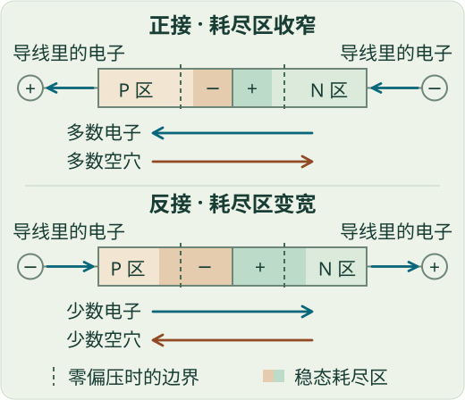

# 从电子到二极管：为什么 PN 结能整流？

把一只硅二极管和限流电阻串起来接到直流电源上。调换二极管的两个端子，电流表的读数可能相差许多个数量级。我最初能记住「正偏时势垒降低，反偏时势垒升高」，却答不上来一个问题：**反偏时，结里的电场更强。既然它能把电子拉过去，电流怎么反而这么小？**

要解开这个矛盾，得同时看两件事：某个地方有多少能够参与输运的电子，以及到达那里的电子在电场中怎样运动。我们从同一块硅讲起，沿途只改变一个条件：先掺杂，再让 P、N 两区相接，最后接通电源并调换极性。以下以普通硅 PN 同质结、室温、无光照为例。出现数字时再给出相应的近似。

如果想先看实验，可以[拖动结电压，同时观察势垒、耗尽宽度与电流](interactive.html#forward)。正文和图沿用同一方向约定：P 区在左，N 区在右。

## 一个电子在哪里，和它处于什么能量，是两个问题 {#states}

后面讲二极管时，会遇到两句话：「一个电子从 N 区进入 P 区」「一个电子从导带进入价带」。前一句说的是硅片上的两个地方。后一句说的是这个电子在晶体中占据的状态。一个导带电子可以跨过交界，仍在导带中。它也可以先留在同一片区域，随后释放能量，与空穴复合。两次变化都涉及同样一份负电荷。

怎样理解「状态」？先看一个孤立原子。束缚在原子里的电子只能取某些能量。即使知道能量，也未必能唯一指定它的状态。例如，同一个空间轨道上可以有两个能量相同、自旋不同的电子。把自旋也算进去，每个完整的单电子状态最多容纳一个电子。因此要分两次问：材料允许哪些态？在这些允许态中，哪些已经被电子占据？一次跃迁还需要有可接收这个电子的空态，并满足能量等条件。

电子怎样在同一个能带里移动？想象在一块均匀的硅里制备一个向右传播的电子波包。波包是许多晶体态叠加成的一团波，包络集中在哪里，就更可能在哪里找到这个电子。过一会儿，包络中心向右移动，电子的位置分布也在硅中向右移动。这个过程中它可以一直处在同一能带里。反过来，两个波包在某个时刻可以有相同的空间概率分布，却分别向左、向右传播。单看这团波当下画在哪里，还读不出它对电流的贡献。[交互：改变波包的位置和传播方向](interactive.html#state)

读能带图时也可以先看横轴。后文画 PN 结用的是 EC(x)、EV(x)。横轴 x 是从硅片左端量起的真实位置，纵轴给出各位置的导带底、价带顶。另有一种能带图 E(k)，横轴 k 是波矢，用来区分晶体中具有不同波动特征的态。普通硅中，同一条带上 k 和 −k 的态可以能量相同、速度相反。下一节就要用到这一点。

## 硅里有这么多电子，为什么只有一小部分参与导电？ {#bands}

### 1000 个硅原子的价电子，为什么恰好填满价带？ {#counting-states}

一个硅原子有四个价电子。在晶体里，四个近邻分布在它周围的四面体方向。想象先把原子分得很开，每个原子都有相同的外层轨道。随着原子靠近，邻近轨道相互作用，原先能量相同的态分裂开来。原子多到宏观尺度时，可取的能量极为密集，形成能带。在硅实际的晶格间距下，这些外层轨道形成一组较低能量的成键态，以及能量更高的态。先用成键图来算，低能这一组究竟能装多少电子。

1. 取 **1000 个硅原子**，用周期性边界忽略表面，让每个原子都有四个近邻。从每个原子出发数一遍，共数到 4000 个键端。同一条键分别从两端数了两次，所以实际有 **2000 条共价键**。
2. 在简化成键模型里，每条键对应一个低能成键轨道。每个轨道能容纳两个自旋不同的电子，2000 个轨道共能容纳 **4000 个电子**。
3. 回头数材料实际带来了多少电子。每个硅原子贡献四个价电子，1000 个原子恰好贡献 **4000 个价电子**。理想纯硅在 0 K 取最低能量的占据，价带因此恰好填满，导带为空。

再看图中两个看似都「空着」的地方。导带里有允许态，只是此时没有电子占据。价带顶到导带底之间的禁带里，理想晶体没有可供占据的体态。这个间隔画在**能量轴**上。即便只考察硅片中的同一小片区域，也要区分当地的价带、禁带及导带。上面的计数给出了价带的容量，要得到室温硅约 1.12 eV 的带隙，还得知道原子排列和轨道相互作用怎样决定两组态的能量。[伊利诺伊大学：硅的能带形成和态数](https://courses.physics.illinois.edu/phys525/sp2024/units/Semiconductors.pdf)

### 填满以后，电子的运动为什么加不出净电流？

在均匀硅中找一对能量相同的态。一个态的电子向右传播，另一个态的电子以同样大小的速度向左传播。它们带相同的负电，对电流的贡献大小相等、方向相反。价带完全填满时，可以对整条带的这些贡献逐对求和，总和是零。现在加一个弱电场，只考虑带内响应。场会推动电子的波矢发生变化，但整条带原本每个允许态就已占满，整体平移后的占据仍然填满整条带。电场不能在满带里建立「向右的态比向左的态多占一些」的分布。[塔斯马尼亚大学：满带、电子与空穴](https://ssp.utasphys.cloud.edu.au/6-semiconductors/6-1-semiconductors/)

现在从这一整带电子中拿走一个。假设少掉的是一个向右传播的电子，满带原来为零的常规电流，减去这个负电荷向右的贡献，剩下的电流就指向右。若改用成键图追踪同一份缺失，右侧的电子向左填上一个空位，新的空位便留在它刚离开的右侧。把许多价带电子的运动都加起来，结果可以用一份正电荷随缺失移动来记，这就是**空穴**。前一个例子数的是哪些速度态被占据，后一个例子追踪的是缺失在晶体里移到了哪里。[交互：依次观察满带、激发、带内重新分布与复合](interactive.html#bands)

把理想纯硅从 0 K 升到室温，热激发会把少量价带电子送到导带。每产生一个导带电子，价带就多出一个空态。在这一步里没有电子离开硅，两者的电荷贡献一负一正。导带电子也可能释放能量，重新填上某个当时空着的价带态，电子和空穴各少一个，这叫复合。热平衡时产生和复合的平均速率相等，硅里仍然可以有持续存在的少量载流子。施加电场后，导带电子与价带空穴都可以贡献电流。常见金属的部分填充能带里，最高占据能量附近就有空态，弱电场足以改变那里的占据分布。纯硅要先热激发出少量电子和空穴，室温下可用的载流子少得多。若满带到空带的能量间隔更大，同温下热激发出的载流子还会更少，这也是许多材料在室温下表现为绝缘体的原因。接下来只替换少量硅原子，看看可用载流子的数目能改变多少。[胡正明教材第 1 章的金属、半导体与绝缘体能带图](https://www.chu.berkeley.edu/wp-content/uploads/2020/01/Chenming-Hu_ch1-3.pdf#page=12)

## 掺杂怎样改变电子数，又怎样保持电中性？ {#doping}

让一个磷原子取代晶格中的一个硅原子。磷有五个价电子，其中四个参与周围的成键，多出的电子受到较弱的束缚。在能量图上，这对应一个靠近导带底的**施主能级**。硅中的磷施主只需约 0.045 eV 就能电离，远小于把纯硅的价带电子激发到导带所需的约 1.12 eV。在室温、通常的轻掺杂条件下，大部分施主已经电离。每电离一个，中性磷原子就变为留在晶格里的正施主，导带多一个可以移动的电子。把这两项相加，净电荷的变化为零。

把杂质换成只有三个价电子的硼，会发生另一种交换。硼取代硅后，四个成键方向合计少了一个价电子。硼在价带顶附近引入**受主能级**。当一个原来在价带中的电子占据受主态，硼受主就带上一份固定的负电荷，价带同时少一个电子。这个缺失叫空穴，随后其他价带电子改变占据时，空穴可以离开受主附近。于是每电离一个受主，又得到一对电荷，一负一正，其中只有空穴能在价带里传输。由此可知，P 型硅的「P」表示多数载流子带正电，整块材料仍然可以电中性。[MIT 6.012 的掺杂与载流子讲义](https://ocw.mit.edu/courses/6-012-microelectronic-devices-and-circuits-fall-2009/a37c73e7fcff4bcb5c5f1177e12d0891_MIT6_012F09_lec01.pdf) · [比较本征激发、施主电离与受主电离](interactive.html#doping)

### 同样两条能带，怎样知道哪条带里有多少载流子？ {#fermi}

先在导带中选一个允许态，问它有多大机会被电子占据。再在价带中选一个允许态，这次问它有多大机会空着。前者用来数导带电子，后者用来数空穴。能带结构给出每一小段能量里有多少可用的态，这叫**态密度**。要算载流子浓度，还得把每小段的态数乘上相应的概率，再加起来。

热平衡时，能量为 E 的允许态被电子占据的概率为 **f(E) = 1 / [1 + exp((E − EF)/kT)]**。这里 T 是绝对温度，k 是玻尔兹曼常数，EF 是电子的**费米能级**。如果某处有一个能量恰为 EF 的允许态，代进公式便得到一半的占据概率。如果 EF 落在理想硅的禁带里，那里没有允许的带态能让电子占据。这个能量仍有用，因为可以拿它和上下两个带边比较。

现在保持温度和两条带边不变，想象把 EF 向导带底靠近。在同一个导带态上，E − EF 变小，f(E) 变大，因此数到的导带电子更多。同时每个价带态空着的概率 1 − f(E) 变小，数到的空穴更少。这就能读懂一张掺杂硅的能量图。对两块各自处于热平衡的硅，N 型的费米能级靠近导带底，P 型的靠近价带顶。等两者接成一个结，再来检查各处的 EF 与**当地带边**相隔多远。[胡正明《现代半导体器件》第 1 章，态密度、占据概率与载流子浓度](https://www.chu.berkeley.edu/wp-content/uploads/2020/01/Chenming-Hu_ch1-3.pdf) · [调节费米能级，比较导带占据与价带空态](interactive.html#fermi)

算一遍差距有多大。取 300 K，硅的本征浓度 nᵢ 约为 10¹⁰ cm⁻³。假设只掺入 10¹⁶ cm⁻³ 的施主，近似完全电离。在均匀、中性的 N 型体区，导带电子浓度 n 就约为 10¹⁶ cm⁻³。非简并热平衡下，电子和空穴浓度满足 np = nᵢ²，因此空穴浓度 p 约为 10²⁰ / 10¹⁶ = 10⁴ cm⁻³。换成相同浓度的受主，结果反过来，p 约为 10¹⁶ cm⁻³，n 约为 10⁴ cm⁻³。称空穴为 P 区的「多数」，比较的是空穴和导带电子的浓度。价带里的绝大多数状态仍然有电子占据。接上电源并向对侧注入载流子后，局部可能偏离热平衡，这时要重新求两种浓度。

### 金属导线送来一个电子，到了硅里会进哪条带？ {#contacts}

先单看一个金属电极与一块均匀掺杂的硅。把它们放在同一温度下，接触后等待足够长的时间。刚接触时，若电子在两边的电化学势不同，电子会净转移，界面附近的电荷随之重排，硅里的带边也会弯曲。达到热平衡时，能交换电子的金属和硅具有相同的电子电化学势，也就是相同的费米能级。微观交换仍在发生，从金属进入硅和从硅进入金属的平均电荷通量相抵。

接上电源后，才有了持续净交换的可能。一次具体的交换，出发处须有已占据态，另一侧须有能接纳电子的空态，电子还得能够越过或穿过界面势垒。实际器件常把紧邻金属的一小层硅做成重掺杂区，使势垒窄到足以隧穿。这样可以得到**欧姆接触**，工作范围内两个方向都能以很小的接触压降传递电流。如果金属与硅的接触本身明显整流，还得把这个称作肖特基接触的界面单独算进去。[华盛顿大学的金属–半导体接触讲义](https://dunham.ece.uw.edu/ee482/Notes/MS.pdf#page=10) · [胡正明《现代半导体器件》4.21 节，欧姆接触](https://www.chu.berkeley.edu/wp-content/uploads/2020/01/Chenming-Hu_ch4-1.pdf)

现在只看低注入、接触附近以多数载流子导电的普通低阻欧姆接触。从硅侧数每次**净**送入或取出一份电子电荷，对应下面四种情形。

| 接触所在的一侧 | 金属净送入电子 | 金属净取走电子 |
| --- | --- | --- |
| N 型硅 | 补充一个导带电子 | 从导带取走一个电子 |
| P 型硅 | 填上一个价带空态，硅侧少一个空穴 | 从价带取走一个电子，硅侧多一个空穴 |

沿 P 端再想一步。假如金属连续送来电子，第一个填上近处的空态，第二个还要有新的空态可填。稳态时，硅内部必须能持续向这个接触送来空穴。反过来，如果金属连续从价带取走电子，就会在接触处不断留下空穴，空穴可以向硅内部输运。这就是导线里的电子电流怎样与 P 型硅里的空穴电流接续。表中列的是多数载流子主导时硅侧的净变化；若有少数载流子从器件内部扩散到电极，接触也可以收集它们。稍后给一个 PN 结的两端各装上这样的电极，接入电源，还要看电子从一侧进入另一侧后能再走多远。

## 同一批电子，为什么既会漂移，又会扩散？ {#transport}

在一根均匀的 N 型硅棒中想象一个固定横截面。即使没接电源，每秒也有电子从两个方向穿过它。在这根硅棒的热平衡状态下，两边平均通过的电子数相等。如果接上电源后，每秒向左穿过的电子更多，就有负电荷净向左传输，常规电流指向右。再在稍远处画一道截面。当两道截面流入和流出的电荷同样多，中间这一段保存的净电荷量就不变。如果它起初近似电中性，就能一直保持这种状态，同时让电流通过。

### 同样加 1 V，电子在每处受到的力一样大吗？

先取两根长度不同、掺杂相同的均匀硅棒，让右端的电势都比左端高 1 V。假设压降均匀，第一根长 1 μm，场强大小就是 1 V/μm。第二根长 10 μm，场强只有 0.1 V/μm。电场指向左，负电子受力向右，第一根里电子在每处受到的电场力是第二根的十倍。再跟着一份电子电荷从左走到右，两种情况下它的静电势能都降低 1 eV。**局部的力取决于电势在这里变得多快，走完全程的势能变化取决于两个端点的电势差。** 稍后在 PN 结里，电场沿途还会改变大小，同样可以这样逐段看。[用相同电压和不同间距比较电场](interactive.html#transport)

场中的电子会加速，也会受到晶格振动、杂质等的散射。随机运动上叠加了电场带来的微小方向偏好，电子群在普通低场下形成有限的平均漂移速度。一次弹性散射就可以改变运动方向，几乎不改变能量。持续通电时，电场输入的能量最终经与晶格交换等过程变成热。因此上一步算出的 1 eV 是电场对这份电荷做的总功；电子到右端时实际增加的动能，还取决于路上向周围交出了多少能量。

现在调小电压，让两根硅棒都处于漂移速率与场强成正比的低场范围，再算电阻。先只看导带电子，设其浓度为 n，截面积为 A，平均漂移速率为 v。在一小段时间 Δt 内，定向输运等效于把厚度 vΔt、体积 AvΔt 的一层电子送过截面，净电荷量的大小就是 qnAvΔt，其中 q 是元电荷的正值。除以 Δt，得到电流大小 I = qnAv。低场时，v 与场强成正比，比例系数叫迁移率 μ。长度为 L 的均匀硅棒承受电压 V，场强大小为 V/L，因而 I = qnμAV/L。空穴也提供导电通路，把两种贡献相加就得到电导率 σ = q(nμn + pμp)，电阻 R = L/(σA)。同样的电压加在较长的硅棒上，电子漂移较慢；把截面积增大，则有更多电子可以同时通过。这里假设接触压降可忽略。

### 去掉电场，电子为什么还会向一边净传输？

设硅棒左段的导带电子较多，右段较少，起初让每个电子以相同的机会向左或向右运动。即使没有外场，从左边穿过交界的电子平均也更多。浓度梯度带来的这部分净输运叫**扩散**。普通非简并硅的导带在两侧都有大量可用空态。只说「右边有空态」解释不了为什么净传输向右；还得数一数两个方向各有多少电子出发。

接下来把扩散和漂移放在同一块硅里。每个电子都受当地电场作用，也都在做热运动。我们对经过某个截面的电子做统计，可以分别算出电场带来的电流贡献和浓度梯度带来的贡献。即使它们加起来正好是零，截面两边仍有电子来来往往。[MIT 6.012 的漂移、扩散与非均匀掺杂讲义](https://ocw.mit.edu/courses/6-012-microelectronic-devices-and-circuits-fall-2009/pages/lecture-notes/)

## 两侧原本都电中性，结里的电场从哪里来？ {#equilibrium}

把一块硅画成左 P、右 N，向右是位置轴的正方向。设想在某一刻才允许两侧交换载流子。这个思想实验把电场的来由单独拿出来看，真实器件可以直接在同一块晶体上形成相邻的掺杂区。先观察离交界很远的地方。N 区里，带负电的导带电子补偿带正电的施主离子。P 区里，缺少的价带电子留下空穴，空穴的正电荷补偿带负电的受主离子。两侧都近似电中性，导带里的电子浓度却可以相差许多个数量级。

在交界两边各取一个相同的小体积。为看清最初一瞬的统计效果，人为设一个便于计数的例子。假设紧邻交界右侧有 100 个导带电子，左侧有 10 个，在同一观察时段各有一半越过交界。右边平均有 50 个向左，左边有 5 个向右，合起来便有 45 个电子净向左。每个电子都只需做无规则热运动，两群电子的人数差就足以给出净输运方向，这就是扩散。这里把两边的越界比例设为相同，只用来检验人数差的作用。结里逐渐长出电场以后，两边的越界机会也会改变。价带一侧也可以这样看。左边空位较多，右边的价带电子填上左边空位时，空位就出现在右边。许多这样的占据变化合在一起，等效为空穴从 P 向 N 净扩散。[改变两侧计数，观察双向扩散](interactive.html#junction)

现在只跟踪一个从 N 到 P 的导带电子。它刚过交界，右边就少了一份负电荷，左边多了一份。若它随后填上左边一个空穴，导带里少一个电子，价带里少一个空位，这两项对总电荷的改变量恰好抵消。**跨界改变了两侧各有多少净电荷，复合改变了这些电荷由哪些状态承载。** 交界附近因而逐步显出两层电荷。右边的施主正电荷失去电子的充分补偿，左边的受主负电荷失去空穴的充分补偿。图上的加减号留在原来的晶格位置。

再用空穴的记法检查一次。一个空穴从 P 到 N，左边少一份正电荷，右边多一份正电荷，与一个导带电子从 N 到 P 对两侧净电荷的影响同向。若已用空穴记录了这一次价带输运，把它改画成价带电子从右往左填补空位，电荷账上仍然只有这一次转移。

电场从右边的正电荷指向左边的负电荷。电子带负电，受力向右。一个新从右侧向左运动的导带电子，要逆着这个力爬坡。先前净转移的电荷越多，后续电子要爬的坡就越高。反过来，若少量电子净回流，这两层电荷得到部分补偿，坡变低，又有更多右侧电子能够向左越过。结在这种反馈下达到热平衡。跨结运动仍在继续。长时间平均，电子的漂移电流与电子的扩散电流在每个位置相抵，空穴也满足同样的条件。还可以检验一下方向。这里导带电子的浓度 n 从左到右升高，所以向左的电子扩散对应向右的常规电流。平衡时，向左的电场驱使负电子向右漂移，给出向左的常规电流。两项抵消时，在均匀温度、非简并近似下，电场满足 E = −(kT/q) d(ln n)/dx。这个式子表示浓度沿路的相对变化越快，平衡它所需的局部电场就越强。远离结区时浓度趋于平坦，所需的场也趋于零。[MIT 6.012 的 PN 结热平衡](https://ocw.mit.edu/courses/6-012-microelectronic-devices-and-circuits-fall-2009/c053714447998e522f02db0776987091_MIT6_012F09_lec04.pdf#page=8)

## 电子能够进入，为什么耗尽区只占一小段？ {#field}

N 型体区里还有很多电子，为什么它们不往左补，把每个固定施主都重新补偿？暂时让器件与外部电路隔开。设一个稍远处的电子向左补上了邻近位置，原来那处就少了一份电子。这样只能把未补偿的正电荷挪个位置。要持续降低整个 N 侧的净正电荷，还需有负电荷从另一侧净回流。要判断这种回流是否能维持，得知道一个电子在沿途每一点受什么力。

### 结面处的场最强，电子到那里就爬完了坡吗？

在下面剖面图的横轴上，先把手指放在右端，再沿横轴向左移。手指在整个结区外时，左侧负电荷和右侧正电荷对测试电子的作用方向相反。在横向尺寸足够大的平面结模型里，可把电荷划成许多薄片，每片在两侧产生大小相同、方向相反的电场。移进 N 侧耗尽区，一部分正电荷片已落到手指右边，它们对电子的吸引力改为向右。移到结面，正电荷都在右、负电荷都在左，吸引和排斥都把电子推向右，此处场强最大。继续向左穿过负电荷层，合力逐渐减弱。两侧远处的电场都近于零。[移动测试电子，逐层叠加受力](interactive.html#depletion)

从结面继续向左走，电子受的力开始减小，方向依然向右。它往左走仍然需要爬坡。电场 E(x) 决定这个位置的受力，对电荷为 −q 的电子，力是 −qE(x)。从位置 A 走到 B 的电势差满足 φ(B) − φ(A) = −∫AB E(x) dx。图上场强最高的那一点只能告诉我们哪一处的坡最陡。要知道整个坡有多高，得累加沿途各段的变化。

两层电荷按单位结面积计，绝对值相等。设 P 侧每单位体积有 NA 个电离受主，耗尽宽度为 WP，则单位面积对应 NAWP 个负离子。N 侧同理。均匀掺杂的突变结在耗尽近似下满足 **NAWP = NDWN**。若 P 侧掺杂浓度为 N 侧的十倍，P 侧只要展开十分之一的宽度即可给出相同的电荷量。这是同一个结里**两侧宽度的比值**。若另做一个只改变一侧掺杂的结，内建电势也会变，要重新计算总宽度。若只把均匀结的面积增大一倍，在边缘效应可忽略时，两边分离电荷的绝对量各增一倍，正负总和仍近于零。足够薄的轻掺杂层也可能整层耗尽。

这幅图的上下两栏共用横坐标。下栏的纵坐标现在是能量。电场向左，所以静电势 φ 从左向右升高。电子的静电势能为 −qφ，因而从右向左升高。在同一种硅里，局部导带底和价带顶都随 −qφ 移动，两条带边一同弯曲，带隙基本保持原宽度。热平衡时费米能级在整块硅中是一条水平线。它在右边更靠近导带底，在左边更远离导带底，因此两处导带中的电子浓度仍可相差很大。[切换接触前后的能带图](interactive.html#align)

图中取 300 K、两侧掺杂均为 1016 cm−3，假定杂质完全电离，取硅本征浓度 ni = 1010 cm−3。远离结区，N 侧导带电子约有 1016 cm−3，P 侧由 np = ni² 得到约 104 cm−3。在非简并热平衡下，导带底每升高一个 kT，电子浓度变为原来的 1/e。两侧相差一万亿倍，对应的电子势垒为 kT ln(1012) ≈ **0.714 eV**。对称结两侧的场强分布互为镜像，各贡献场强图下面积的一半。从 N 侧只走到结面，就已爬过约 0.357 eV，电子浓度约降为原来的百万分之一。右边的电子随时能走进来，但这里长期平均能找到的电子很少。若反过来从 P 型体区走向结面，平衡导带电子浓度反而上升，同时原先占多数的空穴显著减少。

为什么在图上画一条耗尽边界？「耗尽」得名于多数载流子的显著减少。用耗尽近似算电场时，还要检查当地的导带电子和空穴：当两者各自贡献的电荷密度大小都远小于未补偿的固定离子电荷密度大小时，就可以只用电离掺杂浓度估算空间电荷。到了外侧，移动电荷重新把大部分离子补偿了，局部近似电中性。真实硅里的浓度和电场在这两种区域之间连续过渡。耗尽区里，绝大多数价带态仍有电子占据，内层电子也留在原子中。

### 建立这个势垒，究竟要露出多宽的一层离子？ {#depletion-width}

还是用上面的均匀突变结。每露出同样厚的一片 N 型硅，就多出同样多没有被补偿的正施主。从 N 侧耗尽边缘一步步走向结面，场强的**大小**便从零线性增加。若 N 侧露出宽度 WN，每单位面积的净电荷为 qNDWN。根据高斯定律，场强从边缘到结面的改变量大小等于这个面电荷密度除以硅的介电常数 ε。于是峰值场强为 **E峰 = qNDWN/ε**。P 侧也可以从边缘向结面这样算，得到相同的峰值。

对这个对称结，把两侧相同的掺杂浓度记作 N，总宽记作 W，于是 WN = W/2。场强大小的图形是底为 W、高为 E峰 的三角形。面积就是内建电势差，所以 **Vbi = E峰W/2 = qNW²/(4ε)**。这就能倒过来求宽度了。取 ε ≈ 1.04 × 10⁻¹² F/cm、N = 10¹⁶ cm⁻³、q ≈ 1.60 × 10⁻¹⁹ C 和 Vbi ≈ 0.714 V，得到 W = √(4εVbi/(qN)) ≈ 4.3 × 10⁻⁵ cm，也就是 **0.43 μm**。两边各占约 0.215 μm。把 W 代回去，峰值场强约为 3.3 × 10⁴ V/cm。场很强，但它只作用在很短的一段上，两者合起来才得到 0.714 V。

若两侧掺杂不同，场强三角形的两边斜率不同。用前面的电荷平衡关系分配宽度，再算同一个三角形的面积，就得到 W = √[(2εVbi/q)(1/NA + 1/ND)]。这解释了为什么在足够厚的硅里，把远处的中性区再加长一截，结区不用随之加宽。达到平衡所需的电势差和单位体积能提供的净电荷都已经确定。[改变两侧掺杂，检查宽度和峰值场强](interactive.html#depletion)

若把电压表接到器件两端的金属电极，从一支表笔到另一支，途中还经过两个金属–硅接触。在等温、无光照的热平衡下，两金属端的电子电化学势相同。把接触处也算进测量回路，表读 **0 V**。下面给二极管接上电源时，改变的正是原来为零的端电压。[胡正明《现代半导体器件》4.1–4.2 节，内建电势、端口测量及耗尽宽度](https://www.chu.berkeley.edu/wp-content/uploads/2020/01/Chenming-Hu_ch4-1.pdf)

## 正接电源，为什么能一直有电流？ {#forward}

P 端接正，N 端接负，仍画成左 P、右 N。负极通过右边的欧姆接触给 N 区补充导带电子。正极通过左边的欧姆接触从 P 区取走价带电子，在靠近接触的地方留下空穴。如果只看两个接触，似乎一边不断多出电子，另一边不断少掉电子。要使电流持续，硅内部的哪一段会把这两件事接起来？

先在电源接通前观察结区。即使在零偏，有些 N 区导带电子也能越过势垒到达 P 区。偶尔来到结边的 P 区导带电子也会被电场扫向 N 区。热平衡时，两种方向的平均电子通量相等。接上电源后，结两侧的移动电荷重新分布，靠近原耗尽区边缘的一部分固定离子重新得到补偿。耗尽区变窄，结区原有的电势差下降。一旦已有持续注入，整块硅就离开了热平衡。在局部准平衡近似下，可以用电子、空穴各自的准费米能级描述占据情况。此时若硬把平衡关系 np = nᵢ² 用到每个位置，就无法描述结边积累的过剩电子。

### 势垒只降了一点，注入为什么多了那么多？

把 P 相对 N 的结电压记作 Vj。在低注入、接触及准中性区压降都很小的条件下，绝大部分端电压落在结上。N 区导带电子到达 P 区导带需要克服的势垒降到 q(Vbi − Vj)。沿用前面约 0.714 eV 的算例，加上 0.060 V 正向结电压，还要爬约 0.654 eV。耗尽区仍在，为什么注入已经明显增加？

单看势垒还剩多高，算不出注入能增加多少。还得知道坡顶上下分别有多少电子。在普通非简并硅中，高能尾部的电子占据近似按 exp(−能量/kT) 衰减。300 K 时 kT 约为 0.0259 eV。把坡顶降低 0.060 eV，等于移向热分布里电子更密的地方，移动的幅度有 2.32 个 kT。两处的统计权重相差 exp(2.32)，约 **10 倍**。

这个十倍具体发生在哪里？看耗尽区刚刚结束、进入 P 型准中性区的位置。设此处平衡时的导带电子浓度为 np0。在结区近似准平衡、忽略结内复合的理想模型中，结边电子浓度变为 **np0 exp(qVj/kT)**。若 np0 约为 10⁴ cm⁻³，加上 60 mV，边缘便约有 10⁵ cm⁻³。可远离结的长 P 区仍约为 10⁴ cm⁻³。相距一段距离的两处因此出现了约 9 × 10⁴ cm⁻³ 的浓度差。把同样两处放在零偏时比较，这项浓度差为零。[胡正明《现代半导体器件》4.6 节，结边的少数载流子浓度](https://www.chu.berkeley.edu/wp-content/uploads/2020/01/Chenming-Hu_ch4-1.pdf#page=17)

**为什么从一个浓度差就能走到稳态电流？** 结边和 P 区深处的电子都在热运动，靠结的那一侧电子更多，所以有电子净向左扩散。若没有任何地方收走它们，左边的浓度也会升高，梯度便会减小。实际的长 P 区里，过剩电子一边扩散，一边逐渐复合。复合越快，这一团过剩电子延伸的距离就越短。如果接触离结很近，接触也能收集过剩电子。电源持续维持结电压，就能在结边补进新的一批电子，维持同一个浓度分布。只要结边持续补进电子，注入的电子又能沿途复合或被电极收集，浓度梯度就能维持，相应的扩散电流也能维持。[斯坦福 EE116：二极管中的少数载流子分布和电流](https://poplab.stanford.edu/files/ee116/L22toL25_PNcurrent.pdf)

为看清电流和结边浓度之间的关系，取一个均匀、足够长的 P 区，假设低注入下电子扩散系数 D 和过剩电子寿命 τ 均为常数。从 P 侧结边往 P 区内部量距离 s。扩散不断摊开电子分布，复合不断消耗过剩电子，稳态下得到的过剩浓度随距离按 exp(−s/L) 衰减，其中 L = √(Dτ) 是扩散长度。结边过剩浓度若为 Δn，每走一个扩散长度，过剩浓度就降到之前的 1/e。结边的浓度斜率大小为 Δn/L。按扩散定律，单位面积、单位时间净离开结边的电子数就是 DΔn/L。对于同一块材料，结边的过剩浓度翻倍，扩散通量也会翻倍。[胡正明教材 4.7–4.9 节的稳态少数载流子分布](https://www.chu.berkeley.edu/wp-content/uploads/2020/01/Chenming-Hu_ch4-1.pdf#page=19)

把上面算出的结边过剩浓度代进来，Δn = np0[exp(qVj/kT) − 1]。N 区结边也有从 P 区注入的空穴，按同样的电压因子增加。两项常规电流同向，加起来得到 **I = IS[exp(qVj/kT) − 1]**。式中的 1 来自扣掉平衡浓度这一步。零偏时净电流正好为零。IS 则随结面积、掺杂、扩散及复合等器件条件而变。只有在指数项远大于 1 的正向扩散区，60 mV 对边缘**总浓度**的十倍作用，才近似成为端子**净电流**的十倍。实际器件在很小电流下可能受耗尽区复合影响，在大电流下还要计入串联电阻和高注入。工程上说一只硅管「约 0.7 V 导通」，就需要附上测量的电流和温度。[MIT 6.012：PN 结的势垒、注入与电流](https://ocw.mit.edu/courses/6-012-microelectronic-devices-and-circuits-fall-2009/a342ce0afb84bfa8e5b7dc819ff3e9bc_MIT6_012F09_lec06.pdf) · [调节电压，对照势垒、耗尽宽度与电流](interactive.html#forward)

### 跨到 P 区的那个电子，会立刻掉进价带吗？

跟一颗成功越过势垒的 N 区导带电子走一段。刚过结，它占据的是 **P 区的导带态**。P 区价带里虽有很多空态，电子要填上其中一个，还得通过具体的复合过程把多余能量交给周围。两件事之间可以隔开一段时间、一段距离。上面算出的扩散长度给出了一个可与 P 区长度比较的尺度。P 区远长于这个尺度时，多数注入电子在内部复合；P 区短于它时，有些电子在复合前便能抵达金属接触。

假定跟踪的电子在 P 区半路复合了。电流表为什么还一直有读数？从左端逆着这段过程看。正极从接触处取走价带电子，出现一个空位。硅里其他价带电子的输运使空位向结的方向传递，等效为有空穴持续从 P 端流向结。这样，导带电子从右边供应，空穴从左边供应，双方可以在 P 区内部相遇并复合。若沿 P 区从结走到金属，导带电子承担的电流逐渐减少，空穴承担的电流相应增加。在一维稳态下，任取相邻两个截面，总电流若长期不同，它们之间就会不断积累净电荷。因此沿程保持相同的是**两种载流子电流之和**。

再看结的另一边。P 区的空穴也会注入 N 区。用电子描述，这是 N 侧的价带电子填入 P 侧可用的价带态，N 侧留下可移动的空位。进入 N 侧的空穴可与负极补给的导带电子复合。这条路径同样使负电荷总体从 N 向 P 传递。于是在两根导线里，负极向 N 端送电子，P 端向正极送电子；而在硅里，结区两类载流子都能参与，约定电流从 P 指向 N。要让电荷在整个回路中连续传输，各段可以由不同的电子接续。

## 反接后，电场更强，为什么电流反而很小？ {#reverse}

先让同一只二极管处于零偏平衡，再交换电源端子。现在左侧 P 接负，右侧 N 接正。接通瞬间，正极从 N 端抽走导带电子，负极送来的电子则能填补 P 端的价带空态。靠近原先耗尽边缘的 N 区导带电子、P 区空穴都减少，更多固定掺杂离子失去补偿，耗尽区变宽，原有方向的电场增强。这个过程中端子会量到充电电流，结内随时间变化的电场贡献位移电流。端子上经过了多少电荷，并不能直接当作有同样多的电子完整穿越了耗尽区。等电压固定下来，场和耗尽宽度稳定，这部分充电电流便消退。

现在只看稳态。结里的电场仍从 N 指向 P，因而对电子的力从 P 指向 N，也就是向右。若把一个已在 P 区导带、已到结边的电子交给这个电场，它很容易被扫到 N 区。要算持续电流，就要问：扫走这个电子以后，下一颗从哪里来？

**P 区为什么只能送来少量导带电子？** P 端接的是负极，但普通 P 型欧姆接触送入的电子主要填补价带空态。导带里的电子仍然稀少。在暗态下，P 侧准中性区中热产生的少数电子可能先复合，也可能扩散抵达耗尽边缘。一旦被收集到 N 区，它就加入当地的导带电子，N 端金属向正极送出负电荷。若回头看 P 侧，那次热产生还在价带里留下了一个空位，P 端补入的负电荷可以通过价带输运填补它。这样就能在两根引线上形成反向电流。「激发到导带」和「跨结被收集」是同一条路径上的两步，在同一截面计算电流时只计一次。至于 N 区中原本很多的导带电子，它们想从右向左进入 P 区，此时遇到的势垒已经比零偏时更高。

**P 区价带本来就有许多电子，能不能沿着电场力直接向右传输负电荷？** 试着把右侧 N 区的价带画出来。里面几乎所有状态都已占据，能参与这种净输运的是少数空穴。如果一个 N 侧价带空位到达结边，电子填补空位的一连串运动确实可以把负电荷向右传，相当于这个空穴被扫向 P 区。若一个空位都没送到，仅仅继续从 N 端的**导带**取走电子，并不会同时在 N 区**价带**造出空位。所以用电子从头记账，会找到两种受供应限制的跨结路径，一种依赖 P 区的导带电子，一种依赖 N 区的价带空穴。两者贡献的反向常规电流都从 N 指向 P。[沿电子路径比较正接与反接](interactive.html#reverse)

那么，为什么 P 侧价带里的电子不干脆就地升入导带？正接时，导带电子与空穴复合可以释放能量。要在同一位置产生一个导带电子和一个价带空穴，则要从外界获得能量。普通反偏会使能带沿空间倾斜得更陡。把目光固定在任一点，室温硅的导带底和价带顶仍隔着约 1.12 eV，端子间的电势差并不会给每个价带电子各送上一份局部激发能。热激发仍会发生，材料中的缺陷也能通过位于禁带中的能级参与产生过程。如果电子–空穴对就产生在耗尽区内部，场能当场把电子扫去 N 侧、把空穴扫去 P 侧。这种收集省掉了从准中性区扩散到结边的那段路。完整收集一对时，看任意一根外部引线，转移的电荷量都是一个元电荷。

用刚才的结边浓度做个检验。仍取 300 K、P 型体区平衡导带电子浓度 10⁴ cm⁻³。加上 −10 mV，结边浓度是体区的 exp(−10/25.85) ≈ 0.679 倍。靠结处浓度低于深处，电子由深处向结边净扩散。改成 −100 mV，结边只剩约 0.021 倍。继续降低结边浓度，深处与边缘的浓度差最多也只能接近原来的 10⁴ cm⁻³。对给定材料和几何，这就是理想反向扩散电流渐趋饱和的由来。代入整管方程，这两个电压下的净电流分别为 **−0.321 IS** 和 **−0.979 IS**。只有当反压的绝对值比热电压大得多、且尚未击穿时，理想扩散电流才接近 −IS。实际暗电流还可能含有耗尽区产生电流和表面漏电，它们可以随反压而变。[在图上比较两种小反压](interactive.html#forward)

最后换一个实验条件。保持反偏电压不变，用能在硅里产生电子–空穴对的光照射结区。耗尽区中新产生的载流子会被分离，附近准中性区产生的一部分也能扩散到结边并被收集。电流表的反向读数随供应增加而变大，这正是反偏光电二极管可以测光的原因。[胡正明《现代半导体器件》4.15 节，光电二极管](https://www.chu.berkeley.edu/wp-content/uploads/2020/01/Chenming-Hu_ch4-1.pdf#page=45)

*沿每一排先读金属导线的箭头，再读硅两侧的箭头。图中同时画了电子和空穴，用两种载流子记账时，它们在给定偏置下对常规电流的贡献同向。*

### 强场怎样改变载流子的供应？ {#breakdown}

再把反压逐渐升高。先跟踪一个由热激发产生、进入耗尽区的导带电子。电场对它做功。如果它在两次散射之间获得了足够的动能，就有机会在一次碰撞中把一个价带电子激发到导带。碰撞前只有一个导带电子，碰撞后有两个导带电子，价带还多了一个空穴。新产生的载流子在电场中加速，又可能触发下一次**碰撞电离**。先前扫过结区的一个电子，如今可以引起许多个载流子通过，这就是雪崩倍增。[斯坦福 EE116 的反向击穿图](https://poplab.stanford.edu/files/ee116/L22toL25_PNcurrent.pdf#page=9)

**齐纳击穿**可以从另一处开始看。先选定 P 侧一个已有电子的价带态，再在 N 侧找一个能量相近、可以接收电子的空导带态。重掺杂结中，较短一段距离就能承担相当大的电势降，能带沿位置倾斜得很陡，这两个态因此可能相距很近。两处之间，在这个能量上有一段经典电子过不去的区域。电子的波函数在其中逐渐衰减，到了另一边仍可能有非零的振幅。于是电子有一定概率进入对面的空态，原处留下一个空穴。这叫**带间隧穿**。弹性隧穿前后电子能量相同；在硅中，价带顶和导带底还对应不同的晶体动量，晶格振动的量子（声子）可以参与，交换动量和能量。[硅中的声子辅助隧穿](https://saraswatgroup.stanford.edu/Thesis/Donghyun%20Kim%20Thesis.pdf)

反压越高，耗尽区越宽，为什么前后两个态反倒能更近？在能带图上量两次。第一次从 P 侧耗尽边缘量到 N 侧耗尽边缘，得到总宽度 W。第二次从选定的价带态出发，沿水平方向量到另一侧能量相近的导带态。在局部场强 F 近似不变时，带边沿距离 L 改变的能量约为 qFL。要改变一个带隙 Eg，只需走约 L = Eg/(qF)。反压加大时，两侧的耗尽边缘可以向外移动，结面附近更陡的带边却使 L 缩短。隧穿概率对这段短距离十分敏感。实际器件中，隧穿和雪崩可以共存。[胡正明教材图 4–12](https://www.chu.berkeley.edu/wp-content/uploads/2020/01/Chenming-Hu_ch4-1.pdf#page=14) · [用矩形势垒观察隧穿距离的影响](interactive.html#breakdown)

## 同样的反接，为什么刚才正向导通过的二极管会多出一股电流？ {#storage}

取两只相同的 PN 二极管。第一只处于零偏平衡，第二只刚刚通过稳定的正向电流。现在通过相同的限流电路施加反向驱动，反压都远低于击穿电压。第一只也有短暂的电流。偏置变化使耗尽边缘向外移动，两边又各有一层固定离子失去补偿。两侧分离电荷的绝对量都增加了。导线里有电子流动，结区里随时间变化的电场也贡献位移电流。反压固定、耗尽边缘稳定后，这部分电流便消退。

这能解释为什么 PN 结有**结电容**。电容问的是「再加一点电压，还要搬多少电荷」。在平面、均匀突变结的耗尽近似下，结电容 Cj = εA/W，其中 ε 是硅的介电常数，A 是结面积。比较同一只管子的两个反向工作点。若第二个工作点的 W 为第一个的两倍，其分离电荷更多，结电容却只有一半。此时再加同样一小步反压，端子搬运的电荷也只有原来的一半。[MIT 6.012 的结电容和扩散电容](https://ocw.mit.edu/courses/6-012-microelectronic-devices-and-circuits-fall-2005/4b2ed0f760def0cae0d70cc9fbf934df_lec16.pdf)

再看第二只。此前 N 区电子持续注入 P 区，即使每秒注入和消失的数量已相等，也总有一批导带电子还来不及复合。N 区同样留有从 P 区注入的过剩空穴。这些载流子主要存在于耗尽区外，所在区域因多数载流子的调整仍近似电中性。提高正向电压会增加注入量，继而增加存储量。存储量对正向电压微小变化的响应就是**扩散电容**。若突然改变电路，这批载流子要通过复合或从外电路抽取才能消退。此时怎样接线，就有了可观察的区别。

| 从同一个正向稳态怎样切换 | 外电路约束什么 | 切换后能看到什么 |
| --- | --- | --- |
| 断开引线 | 端子电流为零 | 内部载流子仍会扩散、复合。端子电压从正向值逐渐回落，暗处充分弛豫后为零，结内仍有内建电势。 |
| 断开电源后把两端短接 | 低阻通路把端电压拉到接近零 | 部分过剩载流子回到结区并被收集，短路线上能有瞬态电流。其余载流子可以在硅内复合。 |
| 接入限流的反向电源 | 电源和串联阻抗共同决定电流与端电压 | 端子可以先流过较大的反向电流，随着存储载流子减少，器件逐步恢复反向阻断。 |

最后一种接法解释了波形上一个容易看反的地方。刚刚注入 P 区的电子分布在准中性区，距离结边缘远的还得先扩散回来。结边缘的过剩浓度尚高时，结电压可能暂时仍为正，外电路却已开始抽取载流子，电流先变了方向。稍后结边缘的过剩载流子消退，耗尽区展开并承担反压，电流才落到很小的漏电水平。**反向恢复**这段电流所需的载流子，是刚才正向导通留下来的。若由击穿引起大电流，则此刻的强场仍在产生或倍增载流子。[东芝的 PN 结关断电流和电压波形](https://toshiba.semicon-storage.com/eu/semiconductor/knowledge/faq/diode/what-is-trr.html) · [逐步看正向导通到反向阻断](interactive.html#transient)

读数据手册时，可以在同一条电流波形上读两个量。**反向恢复时间** trr 量横向的时间，从电流过零量到手册定义的恢复终点。**反向恢复电荷** Qrr 量曲线的面积，在规定区间内对反向电流的绝对值积分。例如，把反向电流脉冲近似成底宽 20 ns、峰值 1 mA 的三角形，面积就是 ½ × 20 ns × 1 mA = 10 pC。如果峰值翻倍，底宽相同，时间没有变化，回路搬运的电荷却翻倍。实际恢复曲线还受先前的正向电流、换流速率和温度影响，比较器件时应连同测试条件一起读。[东芝对二极管恢复时间与测试条件的说明](https://toshiba.semicon-storage.com/eu/semiconductor/knowledge/faq/diode/definitions-of-the-terms-in-the-electrical-characteristics-table.html)

## 从一个 PN 结走向三个端子 {#next}

回到电流表前的那个疑问。反接时，即使结里的电场能很快扫走到达的少数载流子，过一小段时间还能有多少电荷通过，仍然取决于硅能补充多少载流子。正接则降低了占多数的载流子向对侧注入的势垒。改变端子方向，改变的既有电场，还有向结边缘供应电荷的条件。

读到这里，可以拿同一只二极管做三个预测。第一，在零偏、暗处、等温时把电压表接到金属端子，表会读出内建电势吗？看看测量路径上经过了几个接触。第二，维持普通反偏，把光照从结区遮住，反向电流的绝对值会怎样变？沿着载流子从产生到被收集的路径想一遍。第三，关灯后给管子通一段时间的正向电流，再通过电阻反向驱动。换接瞬间，哪一批电子仍留在硅里？这三个预测分别可以回到[内建电势与表笔](#depletion-width)、[反偏下的载流子供应](#reverse)和[反向恢复](#storage)检查。

这也引出了两种控制电流的方法。一个导带电子从 N 区进入 P 区后可以继续扩散。如果 P 区很薄，它还没复合就遇到第二个反偏结，会发生什么？沿[从硅到门电路的 BJT 路线](../silicon-to-logic/README.md#三极管怎样放大电流并作为开关)，可以跟着它走到集电极。还可以把控制电极与硅隔开，让它只通过电场改变表面的电子分布。先将源、漏接到同一电势，再提高栅压，就能把「形成沟道」和「出现源漏电流」分开观察。[从能带到沟道](../bands-to-channel/README.md)
