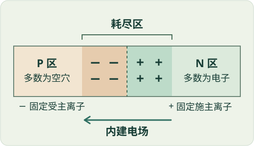
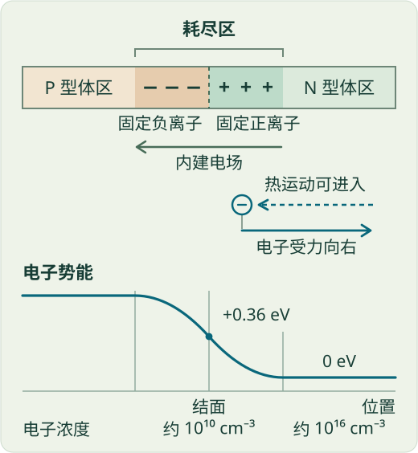

# 从电子到二极管：为什么 PN 结能整流？

把一只硅二极管和限流电阻串起来接到直流电源上。调换二极管的两个端子，电流表的读数可能相差许多个数量级。我最初能记住「正偏时势垒降低，反偏时势垒升高」，却答不上来一个问题：**反偏时，结里的电场更强。既然它能把电子拉过去，电流怎么反而这么小？**

要解开这个矛盾，得同时看两件事：某个地方有多少能够参与输运的电子，以及到达那里的电子在电场中怎样运动。我们从同一块硅讲起，沿途只改变一个条件：先掺杂，再让 P、N 两区相接，最后接通电源并调换极性。以下以普通硅 PN 同质结、室温、无光照为例。出现数字时再给出相应的近似。

如果想先看实验，可以[拖动结电压，同时观察势垒、耗尽宽度与电流](interactive.html#forward)。正文和图沿用同一方向约定：P 区在左，N 区在右。

## 一个电子在哪里，和它处于什么能量，是两个问题 {#states}

在硅片上从左往右画一条线，线上每个位置都是晶体里的真实位置。稍后我们还会在这条线上方画出一条倾斜的「导带底」。这种画法记作 EC(x)、EV(x)。**横轴 x 是硅中的真实位置，纵轴是带边能量。** 另有一种常见的能带图 E(k)，横轴 k 是波矢，用来区分晶体中不同的电子态。沿 k 轴移动视线，比较的是同一材料中不同态的能量；沿 x 轴移动视线，比较的却是结两侧不同位置的带边。 一个电子跨过 P、N 的交界面，可以始终是导带电子；一个电子在同一区域内也可能释放能量、与空穴复合。前一件事改变了它所在的区域，后一件事涉及能带之间的转换。把两者分开，后面就能回答「电子进了 P 区以后会怎样」。

那「状态」又是什么？拿一个孤立原子来说，束缚在原子里的电子只能取某些能量。要让电子吸收能量后转入另一个状态，所给的能量要合适，还得有尚未占据、允许跃迁到的终态。对晶体中的电子也要问这两个问题。这里用**允许状态**描述电子可以怎样存在于晶体中，用**占据**描述这些状态里实际上有没有电子。占据与传播是两件可以分别考察的事：在晶体里传播的电子可以用波包描述，它沿晶体移动时并不需要在每个原子处都做一次跨带跃迁。[交互：改变波包的位置和传播方向](interactive.html#state)

## 硅里有这么多电子，为什么只有一小部分参与导电？ {#bands}

一个硅原子有四个价电子。在晶体里，每个原子与四个近邻分别共享一对电子。成键图能说明电子如何把原子结合起来。现在换个问题：如果往晶体两端接上很小的电压，哪些电子的运动能够产生持续的净电流？这就要看许多原子组成晶体后，有哪些能量状态可以占据。

当大量原子的轨道相互作用时，允许能量变得十分密集，形成能带。对理想本征硅，绝对零度时，价带中的状态恰好填满，能量较高的导带为空。两者之间有一段没有允许体态的能量范围，叫禁带。数电子和可用状态能解释价带为什么恰好填满；要知道价带顶与导带底隔多远，还要知道晶体本身的能量结构。硅在室温下的带隙约为 1.12 eV。「禁带」画在图上有一定高度，却不对应硅里一层电子走不过去的材料。

为什么一个填满的带对微弱电场没有通常的带内导电响应？可以把整条带中贡献相反速度的状态配对。全部占满时，这些贡献相加为零。即使电场使状态的分布在波矢空间里整体平移，完整的一带仍然填满，求和后依然没有净电流。去掉一个电子，原先抵消的一项就空了出来。附近电子重新占据空态时，这个缺失的位置也会改变。我们可以追踪所有价带电子，也可以只记录缺失怎样移动；后者对应一个带正电的等效载流子，叫**空穴**。[塔斯马尼亚大学：满带、电子与空穴](https://ssp.utasphys.cloud.edu.au/6-semiconductors/6-1-semiconductors/) ·[交互：比较全满和留有空态的能带](interactive.html#bands)

温度升高时，热激发可以把少量电子从价带送入导带，每激发一个导带电子，价带里就留下一个空穴。反过来，导带电子也可能释放能量，重新占据价带空态，这叫复合。热平衡时，产生和复合都在进行，平均速率相等。因而室温下的纯硅已经有少量可输运的电子和空穴，整个样品仍然电中性。

## 掺杂怎样改变电子数，又怎样保持电中性？ {#doping}

让一个磷原子取代硅晶格中的一个硅原子。磷有五个价电子，其中四个参与周围的成键，多出的电子受到较弱的束缚。它所在的施主能级靠近导带，室温下的热激发便可将其送入导带。电子可以离开这处，而失去电子的磷施主固定在晶格中，带一份正电荷。把两者都记上，整块材料的净电荷没有改变。这样得到的 N 型硅有较多导带电子。

再把杂质换成只有三个价电子的硼。硼形成一个靠近价带的受主能级，能够接受原先在价带中的电子。接受电子的受主固定在晶格中，带一份负电荷；价带中留下的空穴可以移动。P 型硅里多的是这种可以运动的价带缺失。以后看到图上的负号，要先看它画在哪里：P 区的负受主留在晶格中，N 区的导带电子却能走出原来的区域。[MIT 6.012：硅、掺杂与平衡载流子](https://ocw.mit.edu/courses/6-012-microelectronic-devices-and-circuits-fall-2009/a37c73e7fcff4bcb5c5f1177e12d0891_MIT6_012F09_lec01.pdf)

这里引入**费米能级**就有了用途。能带给出有哪些允许态，费米能级和温度给出热平衡时这些态被电子占据的概率。同样是室温硅，费米能级越靠近导带底，导带里的电子就越多。在普通非简并、近似完全电离的掺杂条件下，取本征浓度约为 10¹⁰ cm⁻³，给硅掺入约 10¹⁶ cm⁻³ 的施主，导带电子浓度约为 10¹⁶ cm⁻³，由热平衡关系 np = nᵢ² 算出的空穴浓度仅约 10⁴ cm⁻³。这一步用的是热平衡的占据关系。单凭“电子多，空穴更容易遇到电子而复合”算不出空穴浓度，还要满足产生与复合的平衡。这些少数空穴平常很不显眼，但到解释反向电流时，每一侧的少数载流子都要算上。[交互：把费米能级从价带侧移到导带侧](interactive.html#fermi)

## 同一批电子，为什么既会漂移，又会扩散？ {#transport}

在均匀的 N 型硅中想象一个固定截面。即使导线没接电源，每秒也有大量电子从截面两边穿过。在热平衡的均匀区域里，两个方向的平均通量相等，电流表读到零。**电流数的是两个方向之差。**

现在给这块均匀的硅加一个向右的电场。电子带负电，受力向左。晶格振动和杂质会散射电子，因此在普通、近似稳态的小电场条件下，电子总体呈现一个向左的平均漂移速度；对应的常规电流向右。散射可以只改变电子运动方向，几乎不改变其能量；电源供给的能量最终通过与晶格交换等过程耗散，不能把每次方向改变都算成一次放热。如果换成没有外场、但左边电子比右边密集的初始分布，电子也会向两边移动。这时从左边出发的电子数更多，单位时间净穿过截面的方向就向右。这是扩散。同一处同时有电场和浓度梯度时，两项都要保留。对同一群导带电子统计，电场给出漂移贡献，浓度梯度给出扩散贡献。不能据此给某一颗电子分配一条「漂移路线」和另一条「扩散路线」。接下来的 PN 结正好给出一个例子：两种贡献都很明显，净电流却为零。[MIT 6.012：漂移、扩散与非均匀掺杂](https://ocw.mit.edu/courses/6-012-microelectronic-devices-and-circuits-fall-2009/pages/lecture-notes/) ·[交互：用相同电压和不同间距比较电场](interactive.html#transport)

## 两侧原本都电中性，结里的电场从哪里来？ {#equilibrium}

把一块硅画成左 P、右 N，向右是位置轴的正方向。设想在某一刻才允许两侧交换载流子。这个思想实验把电场的来由单独拿出来看，真实器件可以直接在同一块晶体上形成相邻的掺杂区。先观察离交界很远的地方。N 区里，带负电的导带电子补偿带正电的施主离子。P 区里，缺少的价带电子留下空穴，空穴的正电荷补偿带负电的受主离子。两侧都近似电中性，导带里的电子浓度却可以相差许多个数量级。

在交界两边各取一个相同的小体积。为看清最初一瞬的统计效果，假设右边有 100 个导带电子，左边只有 10 个，每个电子在极短的观察时间里都有一半机会越过交界。右边平均有 50 个向左，左边有 5 个向右，合起来便有 45 个电子净向左。每个电子都只需做无规则热运动，两群电子的人数差就足以给出净输运方向，这就是扩散。这个计数暂时忽略新形成的电场。价带一侧也可以这样看。左边空位较多，右边的价带电子填上左边空位时，空位就出现在右边。许多这样的占据变化合在一起，等效为空穴从 P 向 N 净扩散。[改变两侧计数，观察双向扩散](interactive.html#junction)

现在只跟踪一个从 N 到 P 的导带电子。它刚过交界，右边就少了一份负电荷，左边多了一份。若它随后填上左边一个空穴，导带里少一个电子，价带里少一个空位，这两项对总电荷的改变量恰好抵消。**跨界改变了两侧各有多少净电荷，复合改变了这些电荷由哪些状态承载。** 交界附近因而逐步显出两层电荷。右边的施主正电荷失去电子的充分补偿，左边的受主负电荷失去空穴的充分补偿。图上的加减号留在原来的晶格位置。

电场从右边的正电荷指向左边的负电荷。电子带负电，受力向右。一个新从右侧向左运动的导带电子，要逆着这个力爬坡。先前净转移的电荷越多，后续电子要爬的坡就越高。反过来，若少量电子净回流，这两层电荷得到部分补偿，坡变低，又有更多右侧电子能够向左越过。结在这种反馈下达到热平衡。跨结运动仍在继续。长时间平均，电子的漂移电流与电子的扩散电流在每个位置相抵，空穴也满足同样的条件。[MIT 6.012 的 PN 结热平衡](https://ocw.mit.edu/courses/6-012-microelectronic-devices-and-circuits-fall-2009/c053714447998e522f02db0776987091_MIT6_012F09_lec04.pdf#page=8)

## 电子能够进入，为什么耗尽区只占一小段？ {#field}

N 型体区里还有很多电子，为什么它们不往左补，把每个固定施主都重新补偿？设一个稍远处的电子向左补上了邻近位置，原来那处就少了一份电子。这样只能把未补偿的正电荷挪个位置。要持续降低整个 N 侧的净正电荷，还需有负电荷从另一侧净回流。要判断这种回流是否能维持，得知道一个电子在沿途每一点受什么力。

在下面剖面图的横轴上，先把手指放在右端，再沿横轴向左移。手指在整个结区外时，左侧负电荷和右侧正电荷对测试电子的作用方向相反。在横向尺寸足够大的平面结模型里，可把电荷划成许多薄片，每片在两侧产生大小相同、方向相反的电场。移进 N 侧耗尽区，一部分正电荷片已落到手指右边，它们对电子的吸引力改为向右。移到结面，正电荷都在右、负电荷都在左，吸引和排斥都把电子推向右，此处场强最大。继续向左穿过负电荷层，合力又减弱，直到 P 型体区。两侧远处的电场都近于零。[移动测试电子，逐层叠加受力](interactive.html#depletion)

因此还要分清局部电场与整段势垒。电场 E(x) 给出这个位置的受力；从位置 A 走到 B 的电势差满足 φ(B) − φ(A) = −∫AB E(x) dx。图上场强最高的那一点只能告诉我们哪一处的坡最陡。要知道整个坡有多高，得累加沿途各段的变化。

两层电荷按单位结面积计，绝对值相等。设 P 侧每单位体积有 NA 个电离受主，耗尽宽度为 WP，则单位面积对应 NAWP 个负离子。N 侧同理。均匀掺杂的突变结在耗尽近似下满足 **NAWP = NDWN**。若 P 侧掺杂浓度为 N 侧的十倍，P 侧只要展开十分之一的宽度即可给出相同的电荷量。这是同一个结里**两侧宽度的比值**。若另做一个只改变一侧掺杂的结，内建电势也会变，要重新计算总宽度。若只把均匀结的面积增大一倍，在边缘效应可忽略时，两边分离电荷的绝对量各增一倍，正负总和仍近于零。足够薄的轻掺杂层也可能整层耗尽。

这幅图的上下两栏共用横坐标。下栏的纵坐标现在是能量。电场向左，所以静电势 φ 从左向右升高。令 q 为元电荷的正值。电子电荷为 −q，其静电势能为 −qφ，因而从右向左升高。在同一种硅里，局部导带底和价带顶都随 −qφ 移动，两条带边一同弯曲，带隙基本保持原宽度。热平衡时费米能级在整块硅中是一条水平线。它在右边更靠近导带底，在左边更远离导带底，因此两处导带中的电子浓度仍可相差很大。[切换接触前后的能带图](interactive.html#align)

图中取 300 K、两侧掺杂均为 1016 cm−3，假定杂质完全电离，取硅本征浓度 ni = 1010 cm−3。远离结区，N 侧导带电子约有 1016 cm−3，P 侧由 np = ni² 得到约 104 cm−3。在非简并热平衡下，导带底每升高一个 kT，电子浓度变为原来的 1/e。两侧相差一万亿倍，对应的电子势垒为 kT ln(1012) ≈ **0.714 eV**。从 N 侧只走到对称结的结面，就已爬过约 0.357 eV，电子浓度约降为原来的百万分之一。右边的电子随时能走进来，但这里长期平均能找到的电子很少。若反过来从 P 型体区走向结面，平衡导带电子浓度反而上升，同时原先占多数的空穴显著减少。「耗尽」描述多数载流子对固定离子的补偿减弱；实际浓度随位置连续变化。仍然占满的大部分价带状态和原子内层电子都留在硅里。

同一算例取硅介电常数为 11.7ε₀，按突变结的耗尽宽度公式得总宽约 **0.43 μm**，两边各约 0.215 μm。这样一小段空间里积累的电荷，已足以建立平衡所需的静电势差 **φN − φP ≈ 0.714 V**。若把电压表接到器件两端的金属电极，从一支表笔到另一支，途中还经过两个金属–硅接触。在等温、无光照的热平衡下，两金属端的电子电化学势相同；把接触处也算进测量回路，表读 **0 V**。下面给二极管接上电源时，改变的正是原来为零的端电压。[胡正明《现代半导体器件》4.1–4.2 节，内建电势、端口测量及耗尽宽度](https://www.chu.berkeley.edu/wp-content/uploads/2020/01/Chenming-Hu_ch4-1.pdf)

## 正接电源，为什么能一直有电流？ {#forward}

让 P 端接正，N 端接负。先盯住 N 区导带靠近结的一群电子。没有电源时，它们当中就有一部分能到达 P 区。此时 P 区也有电子到达结区，受到电场作用进入 N 区，两个方向的平均电子通量恰好抵消。接上电源，结进入非平衡状态；上一幅图中贯穿全器件的水平费米能级只适用于热平衡。在通常的局部准平衡近似下，可以分别用电子、空穴的准费米能级描述各自的占据。先从电源怎样改变结边缘的电子数看起。

### 势垒只降了一点，注入为什么多了那么多？

正接后，耗尽区两边的移动电荷重新分布，靠近原来边缘的一部分固定离子再次得到补偿。结区变窄，原有电势差降低。在低注入、两侧中性区和接触压降都很小的近似下，把加在结上的正向电压记作 Vj，N 区电子进入 P 区需克服的势垒从 qVbi 降到 q(Vbi − Vj)。能带图上，电子从 N 到 P 仍然要上坡，只是坡顶低了。耗尽区还在，就已经能测出净电流。[MIT 6.012：PN 结的势垒、注入与电流](https://ocw.mit.edu/courses/6-012-microelectronic-devices-and-circuits-fall-2009/a342ce0afb84bfa8e5b7dc819ff3e9bc_MIT6_012F09_lec06.pdf)

有个直觉值得检查。假设原来势垒是 0.70 eV，降低 0.06 eV 后还足足有 0.64 eV，为什么会有明显差别？在普通、非简并掺杂的硅里，高能状态的占据随能量近似按指数下降。决定“低这么一点，能多出多少电子”的标尺是热能 kT。300 K 时 kT 约为 0.0259 eV。坡顶低 0.06 eV，相当于往电子分布更密的地方移了约 2.3 个 kT，统计权重约增为 exp(2.3) ≈ **10 倍**。

这个十倍可以在一个具体位置上验证。在理想模型中，P 区紧靠耗尽区边缘的导带电子浓度，是其平衡值的 exp(qVj/kT) 倍。这个边缘浓度升高时，远处 P 区的浓度仍可接近平衡值。于是过剩电子从结边缘向 P 区内部扩散。另一边也有对应的空穴注入。两者合起来，理想扩散电流为 **I = IS[exp(qVj/kT) − 1]**。减 1 正好使零偏时的净电流为零。在指数项远大于 1 的正向扩散区，结电压每增加约 60 mV，电流也约增十倍。实际器件还会受复合、串联电阻和高注入等影响。常说硅管“约 0.7 V 导通”，应当问一句：在什么温度、量到多大电流时？[调节电压，对照势垒、耗尽宽度与电流](interactive.html#forward)

### 跨到 P 区的那个电子，会立刻掉进价带吗？

一个 N 区导带电子可以穿过结区，到达 **P 区的导带**。跨过去改变了所在位置，也改变了它相对于当地多数载流子的身份。它仍占据导带态。若 P 区很长，它往往在到达接触前就复合；若 P 区比电子有效扩散长度短，注入的电子可以到达金属接触并被收集。常说 P 型欧姆接触主要由多数载流子承担导电，这个说法本身就有工作条件。发生复合时，一个本来空着的价带态得到电子，能量转移给周围，自由导带电子和空穴各少一个。从进入 P 区到发生复合，中间有一段可以输运、也可以暂时储存电荷的过程。[斯坦福 EE116：从少数载流子分布读出二极管电流](https://poplab.stanford.edu/files/ee116/L22toL25_PNcurrent.pdf)

如果进入 P 区的电子半路就复合了，电流还能到达正极吗？把视线移向 P 端的欧姆接触。正极持续从 P 端取走电子，相当于向 P 区补充空穴。价带的电子陆续填补邻近可用态，空穴的净运动方向指向结。于是，一侧送来的导带电子和另一侧送来的空穴可以在中途相遇。沿 P 区由结走向接触，电子电流与空穴电流所占的份额能够改变；在一维稳态下，两者的总和沿程相同。N 端也持续补充电子，同时 P 区的多数空穴还会注入 N 区。闭合电路能不断传递电荷，靠的是各段电流接续，并不要求同一颗电子走完两根引线之间的全程。

## 反接后，电场更强，为什么电流反而很小？ {#reverse}

先让二极管在零偏置下达到平衡，再将 P 端接负、N 端接正。刚换接时，两侧接触确实有电流。N 端抽走电子，P 端得到电子，结区附近的多数载流子退开，露出更多固定离子，耗尽区变宽。这个调整完成后，在固定的反向电压下，两端不会继续以同样的速率抽空或充满整块硅。要看稳态电流，得问：哪种电子仍有来源，又能到哪里去？

**先看 P 区的导带。** 一个导带电子扩散到耗尽区后，很容易被结区电场扫向 N 区。反偏时这个电场更强，到达边缘的电子本来就很容易被收集。可 P 区本来只有少量导带电子，普通 P 型欧姆接触主要同当地的多数载流子交换电荷。能否持续收集到下一只电子，取决于少数载流子怎样产生、怎样到达结边缘。另一方面，原本数量很多的 N 区导带电子要进入 P 区，遇到的势垒比零偏时更高。

**再看 P 区的价带。** 负极补进来的电子可以填补 P 端的价带空态。在稳态下，空穴不断从硅内部向这一接触输运，端子才能一直交换电荷。要仅靠价带输运持续把负电荷从 P 往 N 传，N 一侧也得不断有价带空态参与。这用空穴来记账尤其清楚：对应的正是 N 区的少数空穴到达结区，再被扫向 P 区。N 端抽走的主要是导带电子，在那里抽走一个导带电子，并不会同时在价带留下一个空位。因此两条反向输运路径各有一种稀少的供应：P 区的导带电子，N 区的价带空穴。[沿电子路径比较正接与反接](interactive.html#reverse)

那为什么 P 区不能就地把大量价带电子激发到导带？正接时的复合可以释放能量。把一个价带电子激发到同一位置的导带，则需要获得相应能量；室温硅的局部禁带宽度约为 1.12 eV。反向电压会改变带边随位置的倾斜程度，在普通反偏下，同一位置的价带顶和导带底之间仍然隔着禁带。载流子**在哪里产生**决定了还要走哪段路。在 P 侧准中性区热产生的一个导带电子，可能先复合，也可能扩散到耗尽边缘，再被场扫进 N 区。「从价带被激发」与「经导带跨结」可以是同一个电子先后经历的两步，计算通过截面的电流时只能数一次。若一对电子与空穴就在耗尽区内部通过缺陷辅助热产生，结区电场可以直接把它们向两侧分开。这是与中性区少数载流子扩散不同的供给来源。

现在用数字试一下「反向饱和」。取 300 K，热电压 kT/q 约 25.85 mV。将 −10 mV 代入上一节的理想扩散方程，得到 −0.321 IS；改为 −100 mV，得到 −0.979 IS。只有当反压的绝对值比热电压大得多、同时尚未击穿时，这个模型才给出接近 −IS 的值。实际曲线还叠加结区产生和表面漏电等成分。[在图上比较两种小反压](interactive.html#forward)

还有一个可以检验“供应有限”的实验。保持反偏不变，用能在硅中产生电子–空穴对的光照射结区，电流表的反向读数会增大。这里改变的是可收集载流子的供应。耗尽区中产生的载流子可以被电场分离，邻近中性区中产生的一部分也能扩散到边缘再被收集。反偏光电二极管正利用了这个效应。[胡正明《现代半导体器件》4.15 节：光电二极管](https://www.chu.berkeley.edu/wp-content/uploads/2020/01/Chenming-Hu_ch4-1.pdf#page=45)

*沿每一排先读金属导线的箭头，再读硅两侧的箭头。图中同时画了电子和空穴，用两种载流子记账时，它们在给定偏置下对常规电流的贡献同向。*

### 强场怎样改变载流子的供应？ {#breakdown}

反压足够高时，情况会改变。已有的载流子可以从强电场获得动能，通过**碰撞电离**产生新的电子和空穴，新载流子又可能引发下一次电离。这是雪崩倍增。另一条路常见于重掺杂的窄结：带边倾斜得足够陡时，P 侧已占据的价带态和 N 侧合适的空导带态之间的空间距离可以很短，电子有机会发生**带间隧穿**。这两个态处在不同位置。硅还是间接带隙材料，价带顶和导带底对应的晶体动量不同，声子可以参与带间隧穿，提供所需的动量差。整个耗尽区随反压增宽，和局部隧穿距离缩短可以同时发生。这两种强场机制都可能使反向电流急剧上升，并且可以共存。[斯坦福 EE116：反向击穿的能带图](https://poplab.stanford.edu/files/ee116/L22toL25_PNcurrent.pdf) · [用矩形势垒观察隧穿概率对宽度的敏感性](interactive.html#breakdown) · [硅中的声子辅助隧穿](https://saraswatgroup.stanford.edu/Thesis/Donghyun%20Kim%20Thesis.pdf)

## 同样的反接，为什么刚才正向导通过的二极管会多出一股电流？ {#storage}

比较两个起点。第一只二极管刚才处于零偏平衡。第二只刚才已有稳定的正向电流。给两者通过限流电路施加相同的反向驱动，第二只管子里还有一批已经注入对侧、尚未复合的少数载流子。此前的运行状态留在了硅里。

两只管子都有**结电容**。以均匀突变结的耗尽近似为例，偏置变化会移动耗尽边缘，改变两侧未被补偿的离子电荷量。端子的充电电流在导线里由电子传导，在结内还要计入电场随时间变化对应的位移电流；稳态电场建立后，这部分瞬态贡献消退。结电容衡量再改变一点结电压需要再搬多少电荷，其值为 εA/W，其中 A 是结面积，W 是耗尽宽度。反偏越大，耗尽区里两侧分离电荷的绝对量越大；此时 W 也更大，结电压再变同样一小步，需多搬的电荷反而更少。[MIT 6.012：结电容和扩散电容](https://ocw.mit.edu/courses/6-012-microelectronic-devices-and-circuits-fall-2005/4b2ed0f760def0cae0d70cc9fbf934df_lec16.pdf)

第二只管子还有另一类存储。正向注入的过剩载流子主要分布在耗尽区外的准中性区，当地多数载流子也会调整，使材料仍近似电中性。改变正向工作点时，这些过剩载流子的储存量随之改变，小信号下表现为**扩散电容**。突然反向驱动时，其中一部分经过扩散到达结区，被电场抽回，另一部分在材料内复合。切换初期，电流方向已经反转，结两端的电压却可能短暂保留正向值。在限流回路里，即使反向电压远低于击穿电压，仍可能先量到较大的反向电流，然后才衰减到很小的漏电流。这就是为什么刚导通过的管子需要**反向恢复**。若改为开路，外部没有这条抽取电流的通路，内部的过剩载流子仍能逐渐复合，两端电压也需要时间回落。[东芝：PN 二极管关断时的电流与电压波形](https://toshiba.semicon-storage.com/eu/semiconductor/knowledge/faq/diode/what-is-trr.html) · [逐步看正向导通到反向阻断](interactive.html#transient)

## 从一个 PN 结走向三个端子 {#next}

回到电流表前的那个疑问。反接时，即使结里的电场能很快扫走到达的少数载流子，过一小段时间还能有多少电荷通过，仍然取决于硅能补充多少载流子。正接则降低了占多数的载流子向对侧注入的势垒。改变端子方向，改变的既有电场，还有向结边缘供应电荷的条件。

这也引出了两种控制电流的方法。一个导带电子从 N 区进入 P 区后可以继续扩散。如果 P 区很薄，它还没复合就遇到第二个反偏结，会发生什么？沿[从硅到门电路的 BJT 路线](../silicon-to-logic/README.md#三极管怎样放大电流并作为开关)，可以跟着它走到集电极。还有一种做法：把控制电极与硅隔开，让它只通过电场改变表面的电子分布。先将源、漏接到同一电势，再提高栅压，就能把「形成沟道」和「出现源漏电流」分开观察。[从能带到沟道](../bands-to-channel/README.md)
