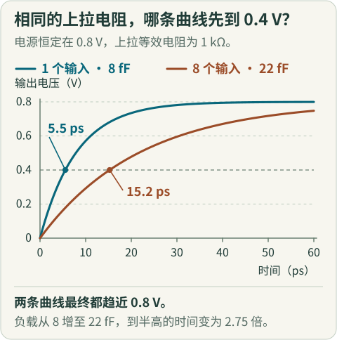
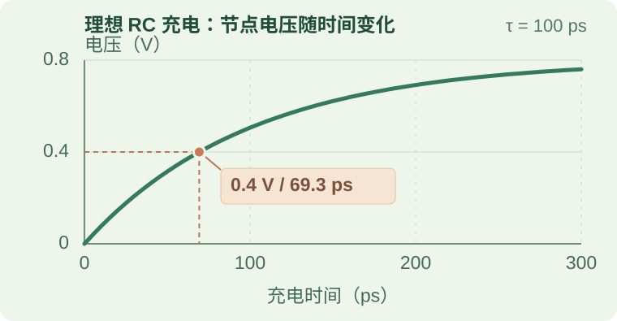
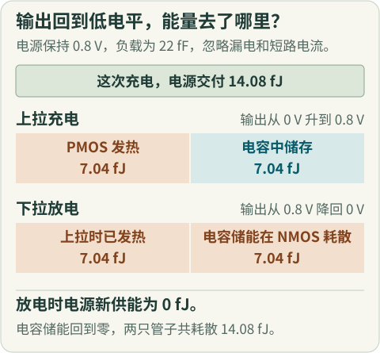

# 一个逻辑门翻转一次，要多久、耗多少能量？

[PLL 倍频篇](../integer-pll/README.md#lock) 已经产生了 50 MHz 的时钟，相邻两个上升沿相隔 20 ns。现在取时钟的一个**下降沿**，接到反相器的输入 A。按真值表，A 从 1 变成 0，输出 Y 应该从 0 变成 1。电源一直保持 0.8 V。

做两次实验。第一次，Y 只接一个后级输入。第二次，它接八个相同的输入。用同一支探头，在 A 下降后 **10 ps** 看 Y。在下面选定的电路里，第一次读到约 **0.57 V**，第二次只有 **0.29 V**。如果以 0.4 V 为这个边沿的到达门限，为什么同一只驱动门接一个输入时已经越过门限，接八个时还没到？如果再接一支电流探头，等 Y 升到高电平，电源在两次实验里各交付了多少能量？这两个问题可以沿同一条充电路径回答。

## 栅极隔着绝缘层，前一级的电流流向哪里？ {#charge}

从[第三篇的反相器](../cmos-logic-gates/README.md#inverter)找充电路径。A 原先为高，下拉 NMOS 将 Y 拉到接近 0 V。A 降低，上方 PMOS 导通，下方 NMOS 关断。常规电流从 0.8 V 电源经过 PMOS，到达输出金属线，再沿各分支到达后级的栅电极。若只数电子，Y 这一侧的导体少了一些电子，净正电荷增加。

看一个后级的 NMOS。栅电极和硅之间隔着栅介质。当前级改变栅电极上的电荷，介质中的电场随之改变，栅下硅表面的电荷也重新分布。形成电子沟道时，电子可由这个后级自己的源漏补入。忽略栅漏电，充电过程可以在电子不穿过栅介质的情况下完成。等 Y 稳在高电平，理想栅输入也就不再需要持续的充电电流。[回看 MOS 栅压怎样改变硅表面](../bands-to-channel/README.md#隔着绝缘层加电压)

**扇出**数的是这一个输出连接的后级输入个数。先忽略金属线的电阻，把整根线看成同一个电压节点。八个接收门的输入电压一起升高，每个输入都需要一份电荷。用同样的 2 fF 表示每个接收输入的等效电容，驱动门输出端和这段固定布线的寄生电容合计 6 fF。只改变接收端个数 N，输出要充的总电容就是 **C = 6 fF + N × 2 fF**。把 Y 从 0 V 充到 0.4 V，一路负载需要 8 fF × 0.4 V = **3.2 fC**，八路需要 22 fF × 0.4 V = **8.8 fC**。仅知道扇出是八，还要知道这些输入各有多大的电容，才能算出所需电荷。[MIT 6.012 的 CMOS 门延迟与负载](https://ocw.mit.edu/courses/6-012-microelectronic-devices-and-circuits-fall-2009/resources/mit6_012f09_lec16_scaling/)

## 同一个上拉管，给八个输入充电要多等多久？ {#load}

把 A 下降的时刻定为 0 ps。先用一个理想阶跃让上拉路径立即接通，以固定的 **R = 1 kΩ** 近似导通的 PMOS。Y 原本为零，电阻两端有 0.8 V 压差，充电电流为 **0.8 mA**。不管接一个还是八个输入，这个初始电流都一样。对一小段相同时间，电流送来的电荷也近似相同，但按 ΔV = ΔQ/C，电容较大的那组电压升得较少。

为什么图上的线越往后越平？当 Y 到 0.4 V，电阻上的压差只剩 0.4 V，电流已降为 0.4 mA。Y 到 0.72 V，电流只剩 0.08 mA。把 **I = (0.8 V − Y)/R** 和 **I = C dY/dt** 合在一起，每一刻的上升速率都由还剩多少压差决定。从 0 V 开始，解得 **Y(t) = 0.8 V × [1 − exp(−t/RC)]**。同一只电路每过 RC × ln(2)，就把剩余压差减半，先到 0.4 V，再到 0.6 V。[MIT 6.002 的电容与一阶电路讲义](https://ocw.mit.edu/courses/6-002-circuits-and-electronics-spring-2007/resources/6002_l12/)

把探头的游标放在三个位置。0.4 V 是终值的 50%，从接通算到这个点的时间为 **t₅₀ = RC × ln(2)**。量同一个输出从 0.08 V 到 0.72 V 的上升时间，要取 10% 与 90% 两次读数之差。这段时间内，剩余压差从 0.72 V 缩到 0.08 V，变成原来的九分之一，所以 **t₁₀₋₉₀ = RC × ln(9)**。这里 1 kΩ × 1 fF 恰好等于 1 ps。

| 后级输入个数 | 总负载 C | 经过 10 ps 时的 Y | 从接通到 0.4 V | 从 0.08 V 上升到 0.72 V |
| --- | ---: | ---: | ---: | ---: |
| 1 | 8 fF | 0.57 V | 5.5 ps | 17.6 ps |
| 8 | 22 fF | 0.29 V | 15.2 ps | 48.3 ps |

现在能回答开头的读数了。10 ps 介于两条曲线各自的半高时刻之间。相同的驱动电阻下，两种到达时间的比值是 **22/8 = 2.75**。固定的 6 fF 在两次接线中都要充电，因此输入从一个增加到八个，并不会使这两项时间都乘八。[改变扇出，观察同一时刻的电压](experiment.html#load)

### 时间常数是 100 ps，为什么第 69.3 ps 就过了半高？ {#rc-half}

换一组容易读图的数。让 **0.8 V** 的理想电源通过 **2 kΩ** 电阻给 **50 fF** 电容充电，电容起初为 0 V。时间常数 **τ = RC = 100 ps**。在图上从纵轴的 0.4 V 水平移到曲线，再向下读时间，交点却在 **69.3 ps**。因为到半高时，电阻两端的压差刚好从 0.8 V 减为 0.4 V，所需时间是 **τ × ln(2)**。若等足一个 τ，节点已升到约 **0.506 V**。

0.4 V 是探头的计时标记。电路在这一刻仍连接着同一个电源，电容会继续充电。想让输出在越过某个门限时主动翻转、再给电容放电，需要再接一条反馈通路。[看比较器怎样让电容反复充放电](../quartz-oscillator/README.md#rc)

## 同一根线上，为什么近端和远端看到的波形不同？ {#wire}

刚才，Y 和所有接收端共用一条波形。现在让探头 Y 留在驱动门的输出引脚，在导线另一端的接收引脚再放一支探头 F。两点之间加入 **0.5 kΩ** 的线电阻。只要有电流通过这段线，就有 **Y − F = I线 × 0.5 kΩ**。充电时，驱动端的电压可以已经升高，而远端还在它下面。

先保留一个能手算的对照。把全部 **22 fF 都放在 F**，近端不放电容。电源要经过 1 kΩ 的驱动电阻和 0.5 kΩ 的线电阻，才能给这 22 fF 充电。远端时间常数为 **1.5 kΩ × 22 fF = 33 ps**，到 0.4 V 约需 **22.9 ps**。刚接通时 F 仍为 0 V，两只电阻分压，使 Y 在这个理想模型里可以立即跳到约 **0.267 V**。这个跳变来自近端电容为零的假设。

现在量这段线本身的延迟。Y 在 9.5 ps 越过 0.4 V，F 在 22.9 ps 越过，两支探头相差 **13.4 ps**。如果拿 22.9 ps 和上一节短线的 15.2 ps 相比，回答的是换了接线后，远端比原来晚了多少。

再把 **6 fF 放回 Y，16 fF 留在 F**。两只电容的电压都从零连续上升。下图把探头留在原位，画出重新分配电容后的两条波形。

刚接通时 Y 与 F 没有压差，线中电流为零，电源电流先给近端充电。Y 稍一抬高，线中就出现电流，F 才逐渐跟上。此后，1 kΩ 驱动电阻既要供应本地电容，也要供应远端。0.5 kΩ 这段线只流过送往远端的那一部分。用这组参数求两条曲线，Y 约在 **12.0 ps** 越过 0.4 V，F 约在 **21.4 ps** 越过，两支探头相差 **9.4 ps**。总电容始终是 22 fF，只改变电容的位置，就已改变了波形。[移动电容，对照近端与远端的电压](experiment.html#wire)

实际布线会拐弯、分叉、经过过孔，沿途还有对邻线和衬底的电容。只要两个接收端共用一段导线，它们所需的充电电流就共同流过这段电阻。走过岔口后，各支路只承载自己下游的电流。布局布线完成后，工程师按实际几何结构提取各段的电阻与电容，才能分别估计每个接收引脚的到达时刻。[David Harris《Interconnect RC》中的分段导线模型，图 3](https://pages.hmc.edu/harris/class/hal/lect4.pdf#page=4) · [片内金属层和过孔怎样连接电路](../../chip-development/FAB/wiki/02-front-end-fabrication/interconnect-stack-beol.md)

## 三支探头，怎样分别量出门延迟、线延迟和转换时间？ {#timing}

再看一组便于读游标的教学波形。这次给 A 一个有斜率的下降沿。图中用直线段标定各次过门限的时刻，和上一节从电阻电容求出的两条曲线是两组独立例子。三支探头的读数放在同一条时间轴上。先在 A 的下降沿找 50%，再到 Y、F 的上升沿找 50%。

| 要量的时间 | 起点与终点 | 这一次的读数 |
| --- | --- | ---: |
| 驱动门的传播延迟 | 输入 A 下降到 50% → 输出 Y 上升到 50% | 22 − 10 = **12 ps** |
| 到这个接收端的线延迟 | 驱动输出 Y 上升到 50% → 接收输入 F 上升到 50% | 28 − 22 = **6 ps** |
| 接收端的上升转换时间（slew） | 同一支探头 F，从上升到 10% 量到上升到 90% | 36 − 20 = **16 ps** |

从 A 到 F，两个 50% 交越点相隔 **18 ps**。测这一段传播延迟，门的 12 ps 加上线的 6 ps 就够了。F 上的 16 ps 回答的是另一个读数问题，即这条边沿爬过指定电压区间用了多久。它与前两项在时间上有重叠。也因此，一份时序报告里同时列了延迟和转换时间，逐级累加到达时刻时只加沿路径发生的延迟。

这里的 50% 是方便各探头对时的测量基准。实际接收门的翻转点、能可靠认出高低电平的输入范围，还取决于该门的特性。库本身也会规定从哪里量转换时间。例如 SKY130 的一套标准单元库把输入、输出的延迟基准都定在 50%，转换时间则取 20% 到 80%。同一条波形按 10% 到 90% 量出的数，不能直接当成这套库的输入。[SKY130 标准单元库的门限及查表维度](https://foss-eda-tools.googlesource.com/skywater-pdk/libs/sky130_fd_sc_ms.git/+/refs/tags/v0.0.2/timing/sky130_fd_sc_ms__common.lib.json)

## 时序慢了，改门还是改线？ {#design}

先顺着路径读报告。假如慢在驱动门，查看它的输入转换时间和输出负载。在真实反相器里，A 缓慢下降时，上方 PMOS 的驱动能力逐渐增强，下方 NMOS 也要经过一段时间才逐渐关断。Y 的上升波形会跟着变化。标准单元库通常按具体输入、输出引脚和翻转方向给出时序表，用输入转换时间和输出负载查出门延迟与输出转换时间。下一轮计算还要用到送至后级的这条边沿。换用更强的驱动门可以加快大负载充电，同时也可能让前一级承担更大的输入电容。[从电荷追踪到一条完整的时序路径](../../microarchitecture/02-pipeline/electrical-timing-foundations.md)

如果慢的是长线的远端，可以缩短绕行，或者在合适的位置插入缓冲器。插入以后，前一级给前半段线和缓冲器输入充电，后半段线由缓冲器从自己的电源取电来驱动。较短的线段可能省下延迟，新增门也有自身延迟和翻转能量。加宽金属线能降低同长度导线的电阻，也会改变寄生电容和布线占用。改完要重新看接收端的到达时刻及转换时间。

## 输出翻转一次，电源提供的能量去了哪里？ {#energy}

回到[八个输入共用一个输出节点的实验](#load)。刚才在 Y 越过 0.4 V 时停表，读到 15.2 ps。这次让电流探头留在 0.8 V 电源一侧，让 Y 充到接近 0.8 V，再把这段电流对时间积分。按充满后的极限值算，电源交付的电荷是 **Q = CV = 22 fF × 0.8 V = 17.6 fC**。恒压电源每送出一份电荷 dQ，就做 0.8 V × dQ 的功。这次上升沿总共向负载充电路径交付了 **E供电 = VQ = CV² = 14.08 fJ**。只接一个输入时，同样算得 6.4 fC 和 5.12 fJ。把总负载从 8 fF 增到 22 fF，到达半高的时间和充满一次所取的能量都变成原来的 **2.75 倍**。

为什么电源交付了 14.08 fJ，电容却只存下 **7.04 fJ**？可以把充电分成许多份相等的小电荷。刚开始，电容端电压接近零，送来一份电荷，电容增加的能量也接近零。快充满时，送来同样多的电荷，电容按接近 0.8 V 的电压吸收能量。由于电容电压随累积电荷线性升高，这些小份电荷所经历的电容电压平均为 0.4 V。于是电容储能为 **½CV² = 0.4 V × 17.6 fC = 7.04 fJ**。其余 7.04 fJ 在充电路径的电阻上变成热。

试着把电压和能量放到同一个游标下。Y 刚到 0.4 V 时，电源已经送出 **7.04 fJ**，电容里却只有 **½ × 22 fF × (0.4 V)² = 1.76 fJ**。继续充电，两项读数都还会变。[移动游标，比较电源供能、电容储能与路径耗散](experiment.html#load-energy)

下一次 A 上升，PMOS 关断，NMOS 把 Y 接向地。电容放电时，先前存下的 7.04 fJ 也在放电路径上变成热。走完 **0→1→0**，电容回到原来的状态。在这个理想 CMOS 模型中，高、低电平充分建立，充放电路径分开，忽略短路和漏电。电源给外部负载的 **14.08 fJ 在上升时已经全部计入**。放电时还在发热，消耗的是先前存下的能量。把驱动电阻加大，充电会变慢，但只要还是把同一只电容充满，电源送出的总电荷和总能量都相同。[第三篇的反相器充放电路径](../cmos-logic-gates/README.md#energy) · [MIT 6.004 的 CMOS 充放电能量推导](https://ocw.mit.edu/courses/6-004-computation-structures-spring-2017/resources/power-dissipation-11-48-/)

## 如果探头量的是整个电源域，还会看到哪些电流？ {#other-power}

把电流探头移到真实单元的电源引脚。前面读时序报告时，A 下降需要一段时间。在其中一段电压范围内，PMOS 和 NMOS 可能同时导通，电流可以直接从电源经过两管流向地，形成**短路电流**。单元内部也可能有其他节点在充放电。用标准单元库估算时，要核对库中的内部功耗已经包含哪些贡献，避免重复计量。

即使时钟停止、输入输出都稳定，器件仍会有**漏电流**。假设静止的电源域只剩漏电，0.8 V 电源仍给它提供 2 mA 电流，那么静态功率是 **0.8 V × 2 mA = 1.6 mW**。如果想知道完成一次任务总共耗了多少能量，还要从任务开始量到结束。功率的单位 W 等于 J/s，任务能量是功率对运行时间的积分。例如平均 2 W，持续 3 ms，能量就是 **6 mJ**。平均功率较低的方案如果运行得更久，仍要重新计算整次任务的能量。[功耗、压降与电迁移分别检查什么](../../chip-development/process/03_backend_physical_design/06_power_analysis.md)

## 同样的 1 GHz，为什么两段程序的功耗不同？ {#activity}

设两段程序都运行 1 µs、时钟都是 1 GHz。每段程序恰好有 **1,000 个时钟周期**。从刚才的一只门扩大到一组数据通路，假设其中有 **1,000 个等效节点**，这次每个节点取 50 fF，电源仍为 0.8 V。一个节点每发生一次全摆幅上升，电源给它的负载提供 **50 fF × (0.8 V)² = 32 fJ**。现在只需在相同窗口里数上升沿。具体地，假设这些是传递使能脉冲的节点，每个有效周期内升高一次再回到零。程序 A 平均每四拍有一拍送出脉冲，程序 B 每四拍有三拍。

| 教学负载 | 每个节点每周期平均上升次数 | 窗口内总上升次数 | 负载切换能量 | 平均负载切换功率 |
| --- | ---: | ---: | ---: | ---: |
| 程序 A，部分周期在等数据 | 0.25 | 250,000 | 8 nJ | 8 mW |
| 程序 B，数据变化更频繁 | 0.75 | 750,000 | 24 nJ | 24 mW |

以程序 A 为例，1,000 个节点 × 1,000 个周期 × 0.25 得到 250,000 次上升。每次 32 fJ，相乘得到 8 nJ，再除以 1 µs，平均功率就是 8 mW。把**每个节点每周期平均发生的 0→1 次数**记作活动率 α，每秒就有 αf 次上升。单个节点的平均负载切换功率为 **αCV²f**，一组节点则把各自的贡献相加。若工具把上升和下降都计作一次翻转，要先核对活动率的定义。组合逻辑产生的毛刺也会引起额外充放电。[MIT 6.012 的 CMOS 延迟与功耗讲义](https://ocw.mit.edu/courses/6-012-microelectronic-devices-and-circuits-fall-2009/resources/mit6_012f09_lec16_scaling/)

这两段程序经历了同样多的时钟沿，B 的这组节点却多充了 500,000 次电，所以它们的平均负载切换功率是 A 的三倍。芯片上不同节点还须分别计数。等待数据时，寄存器的数据输入可能整段保持不变，送到这些寄存器的时钟分支却仍然每拍充放电。若设计允许暂停这组寄存器，时钟门控可以让停用分支也停止翻转。[低功耗设计与时钟门控](../../chip-development/process/02_frontend_design_and_verification/07_low_power_design.md)

还可以从另一个方向改变同一笔开销。把供电电压调低，单次充电的 CV² 会减小，上拉管的驱动能力也会变化。还能否在原来的时钟周期内把数据送到接收端？[下一篇 · 从电源到逻辑门：降压能省多少电，时钟还能跑多快？](../supply-voltage-and-frequency/README.md)
