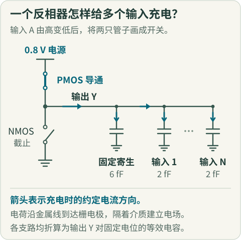
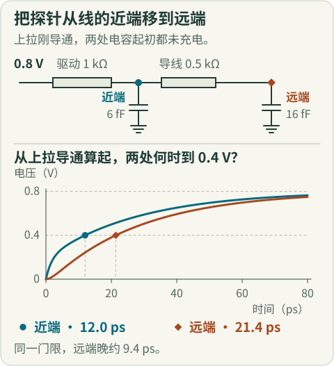

# 一个门驱动一个输入和八个输入，有什么区别？

[第七篇的 PLL](../integer-pll/README.md#lock) 已经产生了 50 MHz 的时钟，相邻两个上升沿相隔 20 ns。现在取时钟的一个**下降沿**，接到反相器的输入 A。按真值表，A 从 1 变成 0，输出 Y 应该从 0 变成 1。电源一直保持 0.8 V。

做两次实验。第一次，Y 只接一个后级输入。第二次，它接八个相同的输入。用同一支探头，在 A 下降后 **10 ps** 看 Y。在下面选定的电路里，第一次读到约 **0.57 V**，第二次只有 **0.29 V**。如果以 0.4 V 为这个边沿的到达门限，为什么同一只驱动门接一个输入时已经越过门限，接八个时还没到？

## 栅极隔着绝缘层，前一级的电流流向哪里？ {#charge}

从[第三篇的反相器](../cmos-logic-gates/README.md#inverter)找充电路径。A 原先为高，下拉 NMOS 将 Y 拉到接近 0 V。A 降低，上方 PMOS 导通，下方 NMOS 关断。常规电流从 0.8 V 电源经过 PMOS，到达输出金属线，再沿各分支到达后级的栅电极。若只数电子，Y 这一侧的导体少了一些电子，净正电荷增加。

看一个后级的 NMOS。栅电极和硅之间隔着栅介质。当前级改变栅电极上的电荷，介质中的电场随之改变，栅下硅表面的电荷也重新分布。形成电子沟道时，电子可由这个后级自己的源漏补入。忽略栅漏电，充电过程可以在电子不穿过栅介质的情况下完成。等 Y 稳在高电平，理想栅输入也就不再需要持续的充电电流。[回看 MOS 栅压怎样改变硅表面](../bands-to-channel/README.md#隔着绝缘层加电压)

**扇出**数的是这一个输出连接的后级输入个数。先忽略金属线的电阻，把整根线看成同一个电压节点。八个接收门的输入电压一起升高，每个输入都需要一份电荷。用同样的 2 fF 表示每个接收输入的等效电容，驱动门输出端和这段固定布线的寄生电容合计 6 fF。只改变接收端个数 N，输出要充的总电容就是 **C = 6 fF + N × 2 fF**。把 Y 从 0 V 充到 0.4 V，一路负载需要 8 fF × 0.4 V = **3.2 fC**，八路需要 22 fF × 0.4 V = **8.8 fC**。仅知道扇出是八，还要知道这些输入各有多大的电容，才能算出所需电荷。[MIT 6.012 的 CMOS 门延迟与负载](https://ocw.mit.edu/courses/6-012-microelectronic-devices-and-circuits-fall-2009/resources/mit6_012f09_lec16_scaling/)

## 同一个上拉管，给八个输入充电要多等多久？ {#load}

把 A 下降的时刻定为 0 ps。先用一个理想阶跃让上拉路径立即接通，以固定的 **R = 1 kΩ** 近似导通的 PMOS。Y 原本为零，电阻两端有 0.8 V 压差，充电电流为 **0.8 mA**。不管接一个还是八个输入，这个初始电流都一样。对一小段相同时间，电流送来的电荷也近似相同，但按 ΔV = ΔQ/C，电容较大的那组电压升得较少。

为什么图上的线越往后越平？当 Y 到 0.4 V，电阻上的压差只剩 0.4 V，电流已降为 0.4 mA。Y 到 0.72 V，电流只剩 0.08 mA。把 **I = (0.8 V − Y)/R** 和 **I = C dY/dt** 合在一起，每一刻的上升速率都由还剩多少压差决定。从 0 V 开始，解得 **Y(t) = 0.8 V × [1 − exp(−t/RC)]**。同一只电路每过 RC × ln(2)，就把剩余压差减半，先到 0.4 V，再到 0.6 V。[RC 充电公式和电压门限的推导](../voltage-to-clock/README.md#电压升到指定值要多久)

把探头的游标放在三个位置。0.4 V 是终值的 50%，从接通算到这个点的时间为 **t₅₀ = RC × ln(2)**。量同一个输出从 0.08 V 到 0.72 V 的上升时间，要取 10% 与 90% 两次读数之差。这段时间内，剩余压差从 0.72 V 缩到 0.08 V，变成原来的九分之一，所以 **t₁₀₋₉₀ = RC × ln(9)**。这里 1 kΩ × 1 fF 恰好等于 1 ps。

| 后级输入个数 | 总负载 C | 经过 10 ps 时的 Y | 从接通到 0.4 V | 从 0.08 V 上升到 0.72 V |
| --- | ---: | ---: | ---: | ---: |
| 1 | 8 fF | 0.57 V | 5.5 ps | 17.6 ps |
| 8 | 22 fF | 0.29 V | 15.2 ps | 48.3 ps |

现在能回答开头的读数了。10 ps 介于两条曲线各自的半高时刻之间。相同的驱动电阻下，两种到达时间的比值是 **22/8 = 2.75**。固定的 6 fF 在两次接线中都要充电，因此输入从一个增加到八个，并不会使这两项时间都乘八。[改变扇出，观察同一时刻的电压](experiment.html#load)

## 同一根线上，为什么近端和远端看到的波形不同？ {#wire}

刚才，Y 和所有接收端共用一条波形。现在让探头 Y 留在驱动门的输出引脚，在导线另一端的接收引脚再放一支探头 F。两点之间加入 **0.5 kΩ** 的线电阻。只要有电流通过这段线，就有 **Y − F = I线 × 0.5 kΩ**。充电时，驱动端的电压可以已经升高，而远端还在它下面。

先保留一个能手算的对照。把全部 **22 fF 都放在 F**，近端不放电容。电源要经过 1 kΩ 的驱动电阻和 0.5 kΩ 的线电阻，才能给这 22 fF 充电。远端时间常数为 **1.5 kΩ × 22 fF = 33 ps**，到 0.4 V 约需 **22.9 ps**。刚接通时 F 仍为 0 V，两只电阻分压，使 Y 在这个理想模型里可以立即跳到约 **0.267 V**。这个跳变来自近端电容为零的假设。

现在量这段线本身的延迟。Y 在 9.5 ps 越过 0.4 V，F 在 22.9 ps 越过，两支探头相差 **13.4 ps**。如果拿 22.9 ps 和上一节短线的 15.2 ps 相比，回答的是换了接线后，远端比原来晚了多少。

再把 **6 fF 放回 Y，16 fF 留在 F**。两只电容的电压都从零连续上升。下图把探头留在原位，画出重新分配电容后的两条波形。

刚接通时 Y 与 F 没有压差，线中电流为零，电源电流先给近端充电。Y 稍一抬高，线中就出现电流，F 才逐渐跟上。此后，1 kΩ 驱动电阻既要供应本地电容，也要供应远端。0.5 kΩ 这段线只流过送往远端的那一部分。用这组参数求两条曲线，Y 约在 **12.0 ps** 越过 0.4 V，F 约在 **21.4 ps** 越过，两支探头相差 **9.4 ps**。总电容始终是 22 fF，只改变电容的位置，就已改变了波形。[移动电容，对照近端与远端的电压](experiment.html#wire)

实际布线会拐弯、分叉、经过过孔，沿途还有对邻线和衬底的电容。只要两个接收端共用一段导线，它们所需的充电电流就共同流过这段电阻。走过岔口后，各支路只承载自己下游的电流。布局布线完成后，工程师按实际几何结构提取各段的电阻与电容，才能分别估计每个接收引脚的到达时刻。[David Harris《Interconnect RC》中的分段导线模型，图 3](https://pages.hmc.edu/harris/class/hal/lect4.pdf#page=4) · [片内金属层和过孔怎样连接电路](../../chip-development/FAB/wiki/02-front-end-fabrication/interconnect-stack-beol.md)

## 三支探头，怎样分别量出门延迟、线延迟和转换时间？ {#timing}

再看一组便于读游标的教学波形。这次给 A 一个有斜率的下降沿。图中用直线段标定各次过门限的时刻，和上一节从电阻电容求出的两条曲线是两组独立例子。三支探头的读数放在同一条时间轴上。先在 A 的下降沿找 50%，再到 Y、F 的上升沿找 50%。

| 要量的时间 | 起点与终点 | 这一次的读数 |
| --- | --- | ---: |
| 驱动门的传播延迟 | 输入 A 下降到 50% → 输出 Y 上升到 50% | 22 − 10 = **12 ps** |
| 到这个接收端的线延迟 | 驱动输出 Y 上升到 50% → 接收输入 F 上升到 50% | 28 − 22 = **6 ps** |
| 接收端的上升转换时间（slew） | 同一支探头 F，从上升到 10% 量到上升到 90% | 36 − 20 = **16 ps** |

从 A 到 F，两个 50% 交越点相隔 **18 ps**。测这一段传播延迟，门的 12 ps 加上线的 6 ps 就够了。F 上的 16 ps 回答的是另一个读数问题，即这条边沿爬过指定电压区间用了多久。它与前两项在时间上有重叠。也因此，一份时序报告里同时列了延迟和转换时间，逐级累加到达时刻时只加沿路径发生的延迟。

这里的 50% 是方便各探头对时的测量基准。实际接收门的翻转点、能可靠认出高低电平的输入范围，还取决于该门的特性。库本身也会规定从哪里量转换时间。例如 SKY130 的一套标准单元库把输入、输出的延迟基准都定在 50%，转换时间则取 20% 到 80%。同一条波形按 10% 到 90% 量出的数，不能直接当成这套库的输入。[SKY130 标准单元库的门限及查表维度](https://foss-eda-tools.googlesource.com/skywater-pdk/libs/sky130_fd_sc_ms.git/+/refs/tags/v0.0.2/timing/sky130_fd_sc_ms__common.lib.json)

## 时序慢了，改门还是改线？ {#design}

先顺着路径读报告。假如慢在驱动门，查看它的输入转换时间和输出负载。在真实反相器里，A 缓慢下降时，上方 PMOS 的驱动能力逐渐增强，下方 NMOS 也要经过一段时间才逐渐关断。Y 的上升波形会跟着变化。标准单元库通常按具体输入、输出引脚和翻转方向给出时序表，用输入转换时间和输出负载查出门延迟与输出转换时间。下一轮计算还要用到送至后级的这条边沿。换用更强的驱动门可以加快大负载充电，同时也可能让前一级承担更大的输入电容。[从电荷追踪到一条完整的时序路径](../../microarchitecture/02-pipeline/electrical-timing-foundations.md)

如果慢的是长线的远端，可以缩短绕行，或者在合适的位置插入缓冲器。插入以后，前一级给前半段线和缓冲器输入充电，后半段线由缓冲器从自己的电源取电来驱动。较短的线段可能省下延迟，新增门也有自身延迟和翻转能量。加宽金属线能降低同长度导线的电阻，也会改变寄生电容和布线占用。改完要重新看接收端的到达时刻及转换时间。

回到八个接收门。在短线模型中，若 Y 一直升到接近 0.8 V，电源交付的电荷会从 **8 fF × 0.8 V = 6.4 fC** 增至 **22 fF × 0.8 V = 17.6 fC**。下一篇保留这笔电荷账，再多问一步。每充一次，电源付出多少能量？同样的时钟频率下，一秒内发生的充电次数又由谁决定？[下一篇 · 同样的频率，为什么跑不同任务时芯片功耗不同](../switching-energy-and-power/README.md)
