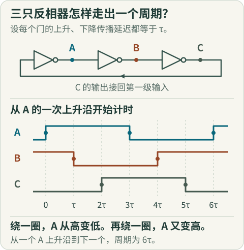
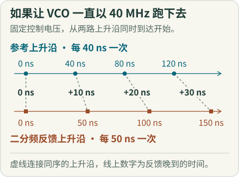
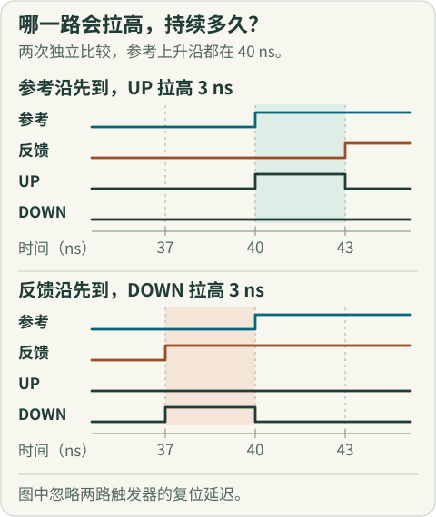
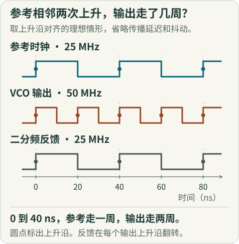

# PLL 怎样把 25 MHz 变成 50 MHz？

把示波器的一路探头接在[石英振荡器](../quartz-oscillator/README.md#clock)输出端，将一个上升沿记作 0 ns。下一个参考上升沿要到 40 ns 才来。再把另一路探头接到已经锁定的二倍频输出上。假设两路上升沿在 0 ns 对齐，那么 **20 ns 的时候，第二路已经又出现一个上升沿。此时谁让它翻转？**

芯片里有另一只通电后能自行振荡的电路。先把石英参考放在一旁，看看这只振荡器里的一个边沿怎样引起下一个边沿。随后把参考接回来，看**锁相环**（PLL）怎样调节两次上升沿之间的距离。

## 下一条上升沿怎样从三个反相器里走出来？ {#vco}

把三个反相器首尾相连，三个输出节点沿环依次叫 A、B、C。A 驱动 B，B 驱动 C，C 再驱动 A。设电路已经振荡，每一级从输入越过门限到输出越过门限约用同样的时间 τ。盯住 A 刚刚上升的一刻。A 的高电平使下一级的 NMOS 导通，B 的负载电容开始放电。约一个 τ 后 B 下降越过门限。再过一个 τ，C 被上拉越过门限。C 的高电平又让 A 放电，所以第三个 τ 到来时，A **向下**翻转。

接着盯住 A，直到它再次升高。A 下降引起 B 上升，B 上升引起 C 下降，C 下降引起 A 再次上升。**同一节点、同一方向的两次翻转，相隔六个单级延迟**。如果恰好要得到 20 ns 的周期，这个三级环的单级平均延迟约为 20/6 ≈ 3.33 ns。这个数是根据目标周期反推的教学值。用 M 个反相级构成同类奇数级环，一个完整周期内，边沿要经过 M 次上升传播延迟和 M 次下降传播延迟。把这两种延迟取平均，周期近似为 2Mτ。[MIT 6.776 讲义中的三级反相环与振荡周期，第 6 页](https://ocw.mit.edu/courses/6-776-high-speed-communication-circuits-spring-2005/09efd8ee8026e7e72a53d1fb5117a2d3_lec14.pdf#page=6)

怎样让它走快一些？给延迟单元加上由控制电压调节的充放电电流。给定同一负载电容和电压变化量，需要转移的电荷近似相同。电流越大，转移这份电荷用时越短，边沿就能更早到达下一级门限。这样得到一只**压控振荡器**（VCO）。本文选用控制电压升高、振荡频率随之升高的接法。实际芯片也可以用电感和电容谐振来实现 VCO。无论采用哪一种，输出持续振荡的能量都来自其电源。[MIT 6.776 对环形和 LC 振荡器的比较](https://ocw.mit.edu/courses/6-776-high-speed-communication-circuits-spring-2005/09efd8ee8026e7e72a53d1fb5117a2d3_lec14.pdf#page=4)

## 把时钟除以二送回来，怎样看出振荡器跑慢了？ {#feedback}

从 VCO 输出端分出两条线。一条作为高速时钟送给芯片，另一条接[二分频触发器](../latch-and-divider/README.md#divider)。触发器在每个 VCO 上升沿把自己的输出 Q 翻转一次。要让 Q 从低到高、回到低、再升高，相邻两个 Q 上升沿之间恰好要经过两个 VCO 周期。把 Q 叫作**反馈时钟**。现在有了一个可以和 25 MHz 参考逐沿比较的信号。

先做一个能在示波器上推演的对照实验。**暂时固定控制电压**，让 VCO 自由运行在 40 MHz，一个周期 25 ns。反馈因此为 20 MHz，周期 50 ns。把参考和反馈恰好同时上升的一刻选作 0 ns，给两路随后出现的上升沿分别编号。同为第一个沿，参考在 40 ns 到，反馈要等到 50 ns。到了第三个沿，两者已经错开 30 ns。

**一条反馈沿晚到，只能说明这一条晚了。** 假如两路都是 25 MHz，也完全可能在 40 ns 和 43 ns 才各自上升。下一对如果仍在 80 ns 和 83 ns 上升，两次都晚 3 ns，走的速度相同，只是周期中的位置错开。这个位置差就是**相位差**。40 ns 周期里的 3 ns 相当于一周的 3/40，即 27°。而图中反馈每过一周就多落后 10 ns，说明反馈的周期确实更长。图中只跟踪前几对沿。接通控制回路后，VCO 会边走边调整，后续时刻就会改变。[切换 VCO 频率，逐对比较参考沿和反馈沿](experiment.html#edges)

## 两只触发器怎样量出谁先到了几纳秒？ {#pfd}

回到环路图中左边的**鉴频鉴相器**（PFD）。用两只上升沿触发的 D 触发器就能做一个常见实现。两只 D 都接逻辑 1，第一只用参考作时钟，Q 输出叫 UP。第二只用反馈作时钟，Q 输出叫 DOWN。只要 UP 与 DOWN 同时为 1，复位电路就把两只触发器清零。[Analog Devices MT-086，鉴频鉴相器与电荷泵电路见图 2](https://www.analog.com/media/en/training-seminars/tutorials/MT-086.pdf#page=2)

假设这次比较开始前，两只 Q 都为 0。参考在 **40 ns** 先到，第一只触发器采到 1，UP 升高。参考沿早已经过去，UP 仍记着它来过，直到 **43 ns** 的反馈沿使 DOWN 也升高，两只触发器才一起复位。忽略复位传播延迟，UP 单独有效的时间就是 **3 ns**。再做一次独立比较，这次反馈在 **37 ns** 先到，参考仍在 **40 ns** 到来。先被置起并等待的变成了 DOWN，同样持续 3 ns。

这样，**哪一路先置起**给出了校正方向，**等了多久**给出了这次校正的脉宽。如果参考接连来了两次而反馈还没来，已经为 1 的 UP 会保持为 1，电路持续要求加速。它只需记住尚未等到另一边的沿。实际 PFD 常在复位路径上留一小段延迟，让两路短暂同时有效。图中画的是决定净校正的时间差。[Analog Devices MT-086，复位延迟与输出脉冲](https://www.analog.com/media/en/training-seminars/tutorials/MT-086.pdf#page=3)

## 电流只流了 3 ns，怎样影响后面的时钟？ {#pump}

UP 有效时，一只电流源接通，向环路滤波器送入电流。DOWN 有效时，另一支接通，向外抽取电流。这对受控电流源叫**电荷泵**。先单独看一次脉冲，把负载简化成 20 pF 电容，两支电流的大小都取 20 µA。3 ns 的 UP 脉冲送入的电荷为 **20 µA × 3 ns = 60 fC**。按 ΔV = ΔQ/C，电容电压上升 **60 fC / 20 pF = 3 mV**。若是相同宽度的 DOWN 脉冲，电压就下降 3 mV。把 UP 缩到 2 ns，便只上升 2 mV。[拖动反馈沿，查看脉宽、净电荷和电压变化](experiment.html#correction)

第二条沿到了，PFD 复位，电荷泵也关了。**刚才那 60 fC 去哪儿了？** 在这个忽略漏电的单电容实验里，它仍存于电容上，VCO 的控制电压因此可以维持在新值。真实环路滤波器还会用电阻和其他电容安排快、慢两种响应，决定这次校正有多快传到 VCO、先前的校正保留多久，以及接近目标时会不会来回摆动。单个电容的算例只给出一次脉冲的电压变化。要求实际锁定时间，还要知道电荷泵电流、滤波器参数、VCO 的调谐斜率和初始状态。[TI《Clock Conditioner Owner’s Manual》第 3 章的电荷泵和环路滤波器](https://www.ti.com/lit/ug/snaa103/snaa103.pdf)

现在把回路接通。回到 40 MHz 起步的例子，第一对后续沿到来时，参考先到，UP 向滤波器送入电荷。控制电压升高使 VCO 加快，后面的反馈周期随之缩短。假如它赶到 50 MHz 的那一刻，反馈仍然落后 3 ns，那么两边只要继续按同样速度走，这 3 ns 就会一直留着。PFD 仍能看到这个时间差，短暂再快一点才有机会把落后的距离追回来。如果追过了，反馈先到又会产生 DOWN，把方向调回来。真实的收敛过程可能有过冲，幅度和持续时间取决于环路。这个过程中随时可在 VCO 输出上量到边沿，PFD 的脉冲调节的是接下来那些边沿的到达时刻。

## 在相邻的参考沿之间，示波器上该数到几个输出沿？ {#lock}

先看理想锁定的一段，忽略内部传播延迟。令参考与反馈在 0、40、80 ns 上升，分频触发器在 0 ns 前为低。VCO 的 0 ns 上升沿让它升高。**20 ns** 时参考还没有新的上升沿，VCO 已经靠反相环走完一周期。这条新的 VCO 上升沿把分频触发器翻回低电平。**40 ns** 时 VCO 再上升，触发器才再次升高，PFD 收到可以与下一条参考上升沿比较的反馈沿。

从 0 ns 起数到 40 ns，**计入起点，终点留给下一段**，VCO 上升沿是 0 和 20 ns 两条。用周期量，也是 0 至 20 ns、20 至 40 ns 两个完整的周期。只改变同一反馈支路的整数分频比 N，锁定时 PFD 两端的平均频率相同，所以 **fout/N = fref**。在本文无参考预分频、无输出后分频的接法中，取 N = 2，VCO 输出就是 **2 × 25 MHz = 50 MHz**。[Analog Devices MT-086，带反馈分频器的整数倍频环](https://www.analog.com/media/en/training-seminars/tutorials/MT-086.pdf#page=1)

再看此时的电荷泵。两路上升沿已经对齐，理想电荷泵每次比较的净转移电荷为零。滤波电容仍保持让 VCO 跑在 50 MHz 的控制电压。即使这一拍无需校正，振荡器仍由电源供能，继续翻转。

如果换一只 VCO，最高只能到 **46 MHz**，会怎样？即使控制电压已经到上限，二分频反馈最高也只有 **23 MHz**。它仍在输出时钟，但无法锁到这个 25 MHz 参考。即使 50 MHz 在调谐范围内，校正过猛也可能使误差反复摆动。稳定锁定要求反馈相对参考的相位差保持在一个稳定值附近，长期没有持续漂移。实际稳态可能有小相位偏差，参考噪声、VCO 自身噪声和电源扰动还会使个别边沿比理想时刻略早或略晚，这种时间偏差叫**抖动**。[TI《Clock Conditioner Owner’s Manual》第 2、3 章](https://www.ti.com/lit/ug/snaa103/snaa103.pdf)

再回头看开篇的 20 ns。额外的边沿来自片内 VCO，石英提供的是用来校准它的时间间隔。50 MHz 给寄存器之间的一拍定下了 **20 ns 的标称周期**。如果把一个门的输出从驱动一个后级输入改为驱动八个，接收端要多等多久？电源为这次翻转又要多送出多少能量？[下一篇 · 一个逻辑门翻转一次，要多久、耗多少能量？](../fanout-and-wire-delay/README.md)

要把这个问题接到整条寄存器路径，可以继续看[工艺、电压和温度怎样改变路径延迟](../pvt-and-path-delay/README.md)。要看高速串行发送器怎样使用这些时钟，见 [SerDes 中的 PLL、分频与多相时钟](../../interconnect/SERDES/03-transmitter/clock-pll-and-multiphase.md)。
