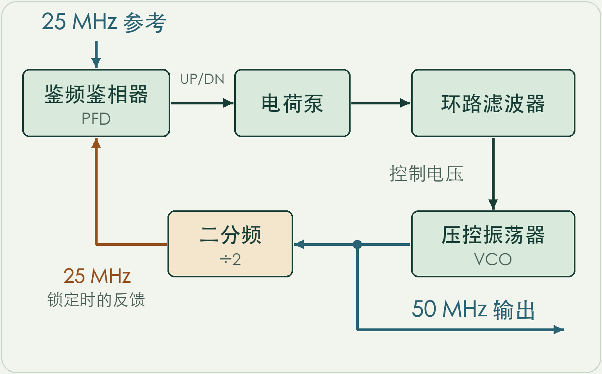

# PLL 怎样把 25 MHz 变成 50 MHz

[上一章的石英振荡电路](../quartz-oscillator/README.md#clock)经缓冲整形后，输出 25 MHz 的参考时钟，相邻上升沿相隔 40 ns。系统需要每隔 20 ns 一个上升沿。电路中真正产生这些边沿的是另一只可调振荡器。**锁相环**（PLL）观察它与参考的相对相位，调节它的速度，使它在两个参考沿之间走完两周。

## 先沿闭合回路走一圈

图中的**电荷泵 PLL** 采用整数分频比，参考输入与时钟输出都直接接出。取压控振荡器调谐斜率为正，即控制电压升高时频率升高。一次负反馈调节经过四步。[Analog Devices MT-086 锁相环原理](https://www.analog.com/media/en/training-seminars/tutorials/MT-086.pdf)

1. **鉴频鉴相器（PFD）比较边沿。** 它有两个输入，分别接参考时钟和分频反馈。参考沿先到时，典型 PFD 发出 UP 脉冲，直至反馈沿到来。反馈沿先到时则发出 DOWN 脉冲。两路频率不同时，边沿的相对位置会逐周期移动。
2. **电荷泵和环路滤波器形成控制电压。** 电荷泵按脉冲方向向滤波网络注入或抽走电荷，脉冲越宽，转移的电荷通常越多。滤波网络保存控制状态，并影响调节速度和稳定性。
3. **压控振荡器（VCO）持续产生时钟。** 一种片内实现把奇数级反相延迟单元首尾相连。一个边沿走过一圈后极性反转，再走一圈才恢复。各级延迟近似相等、环路已经振荡时，M 级的周期约为 2M 倍单级平均延迟。控制单元的充放电电流就能改变延迟。实际 VCO 也可采用 LC 谐振结构。[MIT 的环形振荡器与 VCO](https://ocw.mit.edu/courses/6-776-high-speed-communication-circuits-spring-2005/09efd8ee8026e7e72a53d1fb5117a2d3_lec14.pdf)
4. **分频器把边沿送回来。** 一个带反相反馈的 D 触发器每收到两个 VCO 周期，便完成一个反馈周期。高速时钟仍从 VCO 端引出。[逐沿看触发器二分频](../latch-and-divider/README.md)

可以把前两级落实到具体电路。一种常见 PFD 用两只 D 端接逻辑 1 的触发器，分别由参考沿和反馈沿触发。先到的沿置起对应输出，两路都置起后，复位逻辑清除两只触发器。因此两沿的时间差决定主要校正脉冲的宽度。假设有一个 2 ns 的 UP 脉冲，理想电荷泵以 20 µA 单独向 20 pF 电容充电，控制电压上升 **IΔt/C = 2 mV**。真实滤波器还会用电阻、电容一起设置动态响应。[Analog Devices 的 PFD 与电荷泵电路图](https://www.analog.com/media/en/training-seminars/tutorials/MT-086.pdf)

## 从 40 MHz 开始调

设 VCO 此刻输出 **40 MHz**，反馈支路除以 2。PFD 看到 25 MHz 参考和 **20 MHz** 反馈。反馈的周期为 50 ns，比参考的 40 ns 长。随着比较继续，电荷泵产生使 VCO 加速的净调节。具体哪一拍出现多宽的脉冲取决于初始相位，环路也可能有过冲。

稳定锁定后，反馈与参考具有相同的平均频率，相位差保持有界。此时反馈为 25 MHz，VCO 为 **2 × 25 MHz = 50 MHz**。参考和反馈各相邻两个上升沿之间，VCO 输出两个完整周期。把分频比改为 N，在相同连接方式下就有 **fout = N fref**。[Analog Devices 锁相与整数分频反馈](https://www.analog.com/media/en/training-seminars/tutorials/MT-086.pdf)

## 目标频率和可用频率有什么条件

假设 VCO 在允许的控制电压范围内最高只能到 46 MHz。即使调到上限，二分频反馈也只有 23 MHz，这个环路无法锁到 25 MHz 参考。即便调谐范围足够，环路参数仍需使系统稳定，并留出获取锁定的时间。锁定后的参考噪声、振荡器噪声和电源扰动都会使边沿出现抖动。

50 MHz 规定了 **20 ns 的标称周期**。一条数据路径能否在相邻采样沿之间送稳，还要检查时序。继续看[同一条路径为什么会有不同的延迟](../pvt-and-path-delay/README.md)，或者把分频倍频用于实际发送器，见 [SerDes 的 PLL、分频与多相时钟](../../interconnect/SERDES/03-transmitter/clock-pll-and-multiphase.md)。
