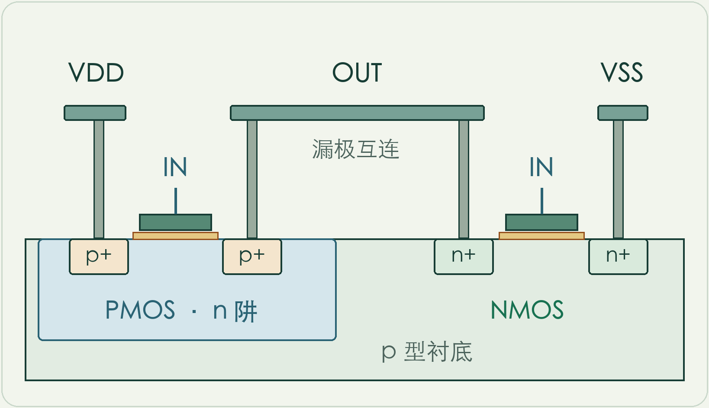
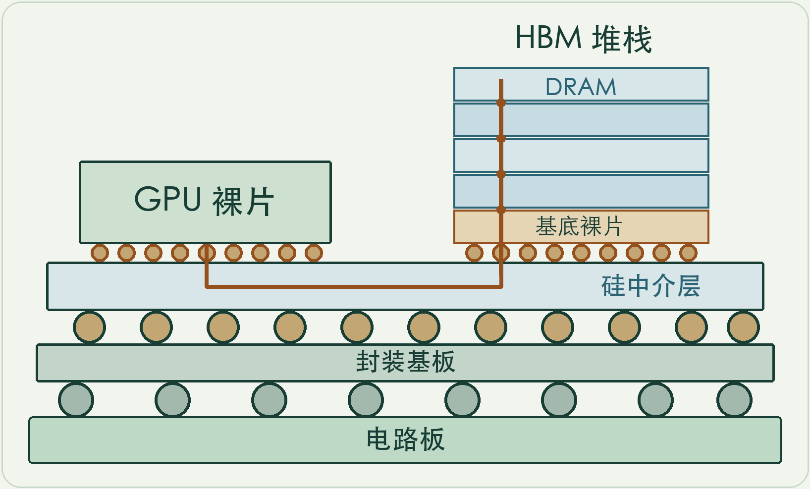

# 电路图上的反相器，在真实芯片里长什么样

电路图里，两只晶体管就能画出一个 CMOS 反相器。看一眼电路板，眼前却是一颗带焊点的封装件。把这两种视图接起来，要改变三次观察尺度。先放大到硅表面的器件，再退到一颗裸片和板卡，最后看同一封装内的多颗裸片怎样连接。

## 在硅片上找回电路图的四根线

图中选用平面 CMOS 作教学示例。p 型衬底中的 n 阱容纳 PMOS，旁边的 p 型区域容纳 NMOS。两只管各有源区、漏区和被薄绝缘层隔开的栅极。晶圆表面上的**接触**把器件端子引到上面的导线，不同金属层之间则用**过孔**连接。[康奈尔大学的 CMOS 器件与反相器讲义](https://web.csl.cornell.edu/courses/ece6745/handouts/ece6745-T01-basic-devices.pdf)

试着按网络名称读图。**IN** 接到两只栅极。**OUT** 是由金属连在一起的两个漏极。**VDD** 接 PMOS 源极，**VSS** 接 NMOS 源极。低输入时，上面的供电网经 PMOS 给输出节点充电。高输入时，输出经 NMOS 放电。图中同名 IN 标记表示这两点在其他位置接通。阱和衬底的偏置接触、完整金属层栈与保护结构均加以简化。实际 FinFET 和环绕栅器件的剖面也各有其形状。[第三篇的 CMOS 反相器原理图](../cmos-logic-gates/README.md#inverter) · [晶圆制造中的器件与金属层](../../chip-development/FAB/wiki/02-front-end-fabrication/process-flow-overview.md)

制造时，先在整片晶圆上形成隔离区、阱、栅和源漏等结构，再把端子引出，逐层形成金属线和过孔。每一层按需要重复材料生长或沉积、光刻、刻蚀和整平等工序。版图为不同层分别定义图形。只有当对应的层加工并接通，一条从漏极通往下一级输入的真实导线才形成。[晶圆制造的整体流程](../../chip-development/FAB/wiki/02-front-end-fabrication/process-flow-overview.md)

## 从一片晶圆追到板上的一颗芯片

以常见的单裸片倒装封装为例，沿途看手中对象发生了什么变化。

| 阶段 | 拿到什么 | 这一环节解决什么问题 |
| --- | --- | --- |
| 晶圆制造后 | 同一片晶圆上有许多裸片单元 | 每个单元内的器件和金属互连已形成 |
| 晶圆筛测与切割 | 各单元的测试记录，以及切下的裸片 | 在组装前筛选，并将可用裸片单独取出 |
| 封装组装 | 裸片通过凸点等结构连接到封装基板 | 把裸片上密集的端子引向板侧，同时提供机械支撑和散热路径 |
| 成品终测与板级连接 | 经测试的封装件，通过焊点接入板卡 | 按产品条件检查成品，并与供电、存储器和其他部件连接 |

还有一种常见连接方式是引线键合。金属细线把裸片表面的焊盘接到基板或引线框架。倒装则让裸片的连接面朝向载体，通过分布在表面的凸点连接。封装底部的一排排焊球描述的是板侧接口。要知道里面的裸片如何接到载体，还要看封装结构图。[封装结构与连接方式](../../chip-development/FAB/wiki/04-back-end-packaging/packaging-taxonomy.md)

从板上向反相器追一根电源线，会依次经过板上铜面、板侧焊点、封装基板、裸片凸点、片内金属电源网，最后到达晶体管。回流也有相应路径。这里的每一段都可能贡献电阻和电感。热量则通过裸片、封装材料以及散热结构等路径流出。具体工序顺序随封装方式变化，例如晶圆级工艺可以在切割前完成部分封装步骤。[从晶圆到成品的对象流](../../chip-development/FAB/wiki/01-overview/from-wafer-to-product.md) · [ST 的制造与封测流程](https://www.st.com/content/st_com/en/about/manufacturing-at-st/semiconductor-value-chain.html) · [沿供电和回流路径量出门两端的电压](../supply-voltage-and-frequency/README.md#supply-loop)

## 同一个 GPU 封装里，哪段横着走，哪段竖着走

图中取采用硅中介层的一种 **2.5D** 结构。GPU 裸片与已组装的高带宽存储器（HBM）堆栈并排安装，中介层上的密集走线连接两者。封装基板再把电源和外部信号引到板侧。转向堆栈内部看，多层 DRAM 裸片上下叠放，硅通孔（TSV）与层间连接形成垂直路径，属于 **3D 堆叠**。判断一种连接时，先指出哪两个对象互连，同一产品里就能同时辨认这两个层次。[GPU 与 HBM 的封装结构](../../chip-development/FAB/wiki/04-back-end-packaging/hbm-as-case-study/ai-gpu-hbm-package-architecture.md) · [台积电 CoWoS 技术说明](https://3dfabric.tsmc.com/english/dedicatedFoundry/technology/cowos.htm)

图中层数、厚度和走线均为示意。带宽、供电、散热、测试与良率会共同影响实际集成路线。想知道何时选硅中介层、局部硅桥或直接键合，可沿已有的[封装结构与工艺](../../chip-development/FAB/wiki/04-back-end-packaging/README.md)继续读。
