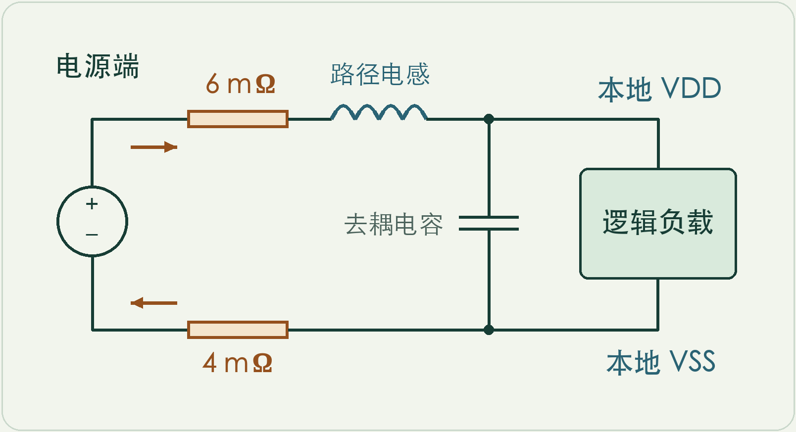

# 电源设定为 0.8 V，逻辑门两端实际有多少

稳压器在输出端维持 0.80 V。电流要沿板上铜线、封装连接和片内供电金属到达负载，再由地网返回。每一段导体都有电阻和电感。要知道逻辑门实际拿到的电压，两个探针应分别落在该处的 **VDD 和 VSS** 上。

图中把等效回路电感集中画在供电一侧。先沿上方导线从左向右追到负载，再沿下方导线向左返回稳压器。右侧去耦电容与负载构成更短的本地电流回路。

## 先把电流固定，算电阻上的 IR drop

用一串等效电阻代替某个逻辑模块的供电与回流路径。假设模块稳定取电 **2 A**，正向路径电阻 **6 mΩ**，回流路径电阻 **4 mΩ**，电源端为 0.80 V。选电源端的地为全图 0 V。下面沿同一个闭合回路计算。

| 量测位置 | 算法 | 结果 |
| --- | --- | --- |
| 负载的 VDD 相对电源端地 | 0.80 V − 2 A × 6 mΩ | 0.788 V |
| 负载的 VSS 相对电源端地 | 2 A × 4 mΩ | 0.008 V |
| 负载两端 VDD − VSS | 0.788 V − 0.008 V | **0.780 V** |

供电和回流合计损失 **20 mV**，这就是本例的电阻压降 **IR drop**。电阻上耗散的功率为 I²R = **40 mW**。电源输出 1.60 W，其中 1.56 W 到达负载。只量负载 VDD 对远端地，会漏掉地网上的 8 mV。真实芯片有很多并行供电支路和分布负载，静态压降分析要根据注入电流和电网电阻求各节点的电压。[OpenROAD 静态 IR drop 分析](https://openroad.readthedocs.io/en/latest/main/openroad/psm/README.html)

## 一批门同时翻转时，电流从哪里来

电流随时间变化时，电阻上仍有 I(t)R 压降。路径电感还会产生与 **L·di/dt** 相关的电压。负载突然需要更多电流时，远端路径的电流难以立即增加。靠近负载、接在本地 VDD 与 VSS 之间的**去耦电容**可以先放电，提供一部分瞬态电流。随后上游供电为它补回电荷。[ADI MT-101 去耦与路径电感](https://www.analog.com/media/en/training-seminars/tutorials/MT-101.pdf)

单独看一个储能算例。假设前 **1 ns** 内，本地电容承担恒定的 **0.10 A 增量电流**，其余电流由上游提供。取有效电容 10 nF，忽略电容的串联电阻、电感，放出的电荷为 0.10 nC，两端电压下降 **ΔV = ΔQ/C = 10 mV**。这个瞬态例子和前面的稳态例子各有一套假设。真实最低电压取决于电流波形、去耦位置与完整供电网络的阻抗。[封装供电完整性的手算示例](../../chip-development/FAB/wiki/06-cross-cutting-engineering/power-delivery-pi-pdn-decap.md)

## 为什么平均功耗够低，某一拍仍可能出问题

两组工作在同一时窗内翻转相同数量的节点，一组集中在同一拍启动，另一组分批启动。它们的平均切换功率可以相近，峰值电流和电流变化率却可能相差很大。某处电源跌落是否造成错误，还取决于跌落持续时间、当时正在传播的边沿，以及那条路径已有的余量。

三种改法针对不同原因。降低供电网电阻可以减小持续压降。缩短本地去耦回路可以改善快速负载变化时的响应。把启动分批可以改变电流波形，但会影响任务延迟。工程上把功耗、最低电压和时序分别验算，见[功耗、压降与电迁移分别检查什么](../../chip-development/process/03_backend_physical_design/06_power_analysis.md)。接着可看[同一条路径在不同工作条件下的延迟](../pvt-and-path-delay/README.md)。
