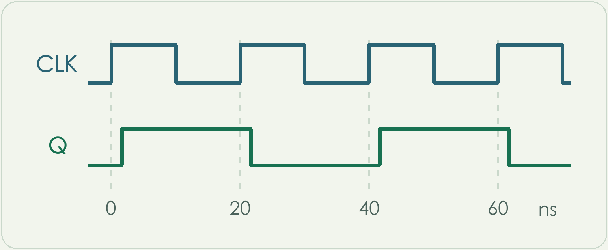

# 从锁存器到触发器，再到二分频

一只反相器产生与输入相反的输出。把两只反相器首尾相连，电路可以在通电时保持一个比特。再加上由时钟控制的开关，就能限定它在哪段时间接收新数据。二分频器正是利用了这个保存旧值的能力。

## 两只反相器怎样记住一个比特

把第一只的输出称为 A，第二只的输出称为 B。如果 A 接近电源电压，第二只便把 B 拉低。低电平 B 回到第一只输入，又支持 A 保持高电平。反过来，A 低、B 高也是稳定状态。一次足够小的扰动通常会被拉回原来的状态。若两个节点恰好落在转换区附近，电路也可能短时停在不稳定的平衡附近。这为后面理解亚稳态提供了物理图像。[MIT 6.004 的双稳态与锁存器](https://ocw.mit.edu/courses/6-004-computation-structures-spring-2017/pages/c5/c5s1/)

要写入新值，可以在反馈环上加一个开关，并在数据入口加另一个开关。CMOS **传输门**由并联的 NMOS 和 PMOS 组成，接受互补控制信号。这种锁存器在接收和保持之间切换。

| 锁存器状态 | 数据入口 | 反馈支路 | 输出 Q 如何变化 |
| --- | --- | --- | --- |
| 透明 | 接通 | 断开 | D 经过门延迟后到达 Q，在透明期间可以多次变化 |
| 保持 | 断开 | 接通 | 两只反相器构成闭合反馈，继续驱动刚保存的值 |

## 两级锁存器怎样选中一个边沿

在一种上升沿 D 触发器中，主锁存器在时钟为低时透明，从锁存器在时钟为高时透明。上升沿前，数据进入主级，从级保持旧输出。上升沿附近，主级关上，从级打开并读出主级刚保存的值。此后 D 即使改变，也要等下一次采样才会传到 Q。实际实现要控制两级的开关时序，避免输入一路穿透到输出。

D 必须在有效边沿前后分别满足**建立时间**和**保持时间**。Q 在边沿后还要经过时钟到输出延迟才稳定。违反采样窗口可能导致亚稳态，电路需要额外时间才能恢复为有效电平。恢复后的值取决于边沿附近的实际输入和器件状态。[MIT 6.004 的寄存器](https://ocw.mit.edu/courses/6-004-computation-structures-spring-2017/pages/c5/c5s1/) · [同步与亚稳态](https://ocw.mit.edu/courses/6-004-computation-structures-spring-2017/pages/c6/c6s1/)

## 把反相输出接回 D

令 **D = Q 的反相值**。假设复位已正常释放，初始 Q=0，触发器满足反馈路径的建立和保持要求。给它输入 50 MHz 时钟，相邻上升沿相距 20 ns。表中的“沿后”指 Q 已完成这次更新。

| 输入上升沿 | 沿前 Q | 被采到的 D | 沿后 Q |
| --- | --- | --- | --- |
| 0 ns | 0 | 1 | 1 |
| 20 ns | 1 | 0 | 0 |
| 40 ns | 0 | 1 | 1 |
| 60 ns | 1 | 0 | 0 |

虚线标出输入上升沿。Q 边沿稍向右移，表示时钟到输出的延迟，图中未给这个延迟指定数值。

Q 每个输入上升沿只翻转一次。输出的相邻两个上升沿相距 **40 ns**，所以频率为 **25 MHz**。初值会影响输出从哪一相位开始。只要可靠采样并持续翻转，二分频关系就成立。

这个电路有两个用途。需要较慢的时钟时，可以取 Q 作输出。需要把较快时钟和较慢参考进行比较时，可以把 Q 送入[PLL 的反馈支路](../integer-pll/README.md)。若想看同一对交叉耦合反相器怎样接到存储阵列，见 [6T SRAM 单元](../../storage/02-sram/foundations/6t-cell-bistable-storage.md)。
