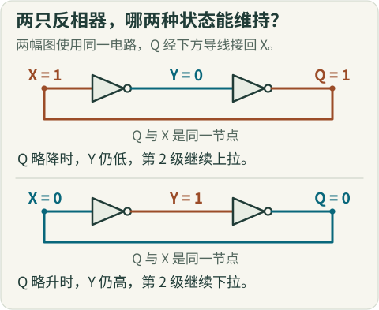
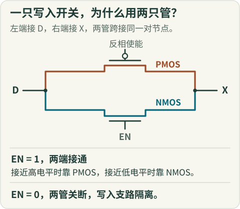
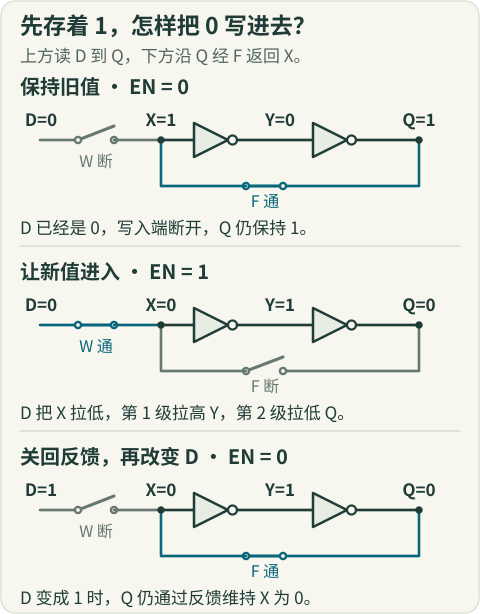
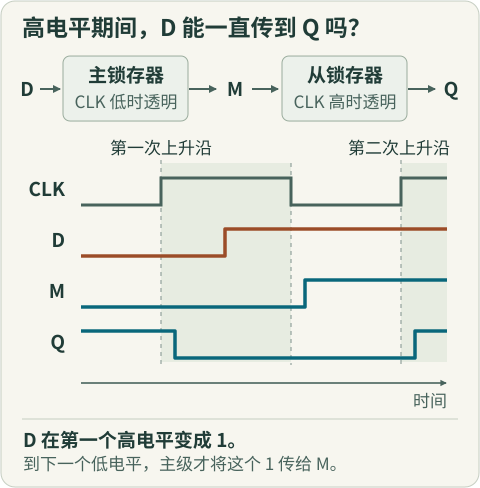
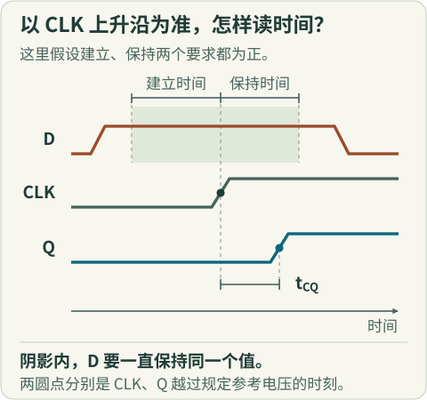

# 两只反相器怎样记住一个比特，时钟又怎样把新值写进去？

沿用[上一篇的 CMOS 反相器](../cmos-logic-gates/README.md#inverter)，再拿一只同样的，把两只首尾相连。假设输出原本是 1，你用一只较大的电阻把输出短暂接地，电压只降了一点。移开电阻，输出又回到原先的高电平。这个电路已经有了记忆。可是，如果现在**真的想把 1 改成 0**，写入电路怎样才能不被它拉回去？

下面一直用同一对反相器。先找出是谁在维持旧值，再看写入时该把哪根线断开。图中以接近地的电压表示 0，接近电源的电压表示 1。

## 输出被拉低一点，谁把它拉回来？ {#feedback}

给第一只反相器的输入命名为 **X**，输出为 **Y**。Y 接第二只反相器的输入，第二只的输出为 **Q**。现在用反馈线把 Q 接回 X。沿着线走一圈，依次经过 X、第一只反相器、Y、第二只反相器、Q，再回到 X。**保持时，X 与 Q 是接通的；稍后写入时，这根线可以断开。**

先看存 1 的状态。X 高，第一只反相器的 NMOS 导通，把 Y 接到地。Y 低，第二只的 PMOS 导通，把 Q 接到电源。假设一个短扰动从 Q 的电容上带走少量正电荷，Q 和 X 一起降了一点。只要 X 仍够高、Y 仍够低，移开扰动后，**电源会经过第二只的 PMOS 给 Q 补回电荷**，一直到 Q 再次接近电源电压。

交换高低也能走通一圈。X 低，第一只的 PMOS 把 Y 拉高，第二只的 NMOS 把 Q 接到地，低电平又被送回 X。两个状态都能在通电时维持，这叫**双稳态**。两次反相把原来的高或低送回自身，形成**正反馈**。仅凭电路的接法，上电时无法指定它一定存哪一位。要获得指定的初值，可以先写一次。[MIT 6.004：正反馈与可写的一位存储](https://ocw.mit.edu/courses/6-004-computation-structures-spring-2017/pages/c5/c5s1/)

## 要让 D 写入 X，为什么一个开关用两只管？ {#transmission-gate}

先在 Q 返回 X 的线上装一个**反馈开关 F**，再从外部数据端 **D** 到 X 装一个**写入开关 W**。假设旧 Q = 1，D = 0。若 F 还接通就合上 W，第二只反相器经 F 把 X 往高处拉，外部驱动器又经 W 把 X 往低处拉。两边会争着驱动同一个节点。这种锁存器的做法很直接：写入时断开 F，让 W 接通；保持时让 W 断开、F 接通。

把 W 放大看。NMOS 和 PMOS **并联在 D 与 X 之间**，数据从各自的沟道经过。使能信号 EN 只接控制端。EN 为 1 时，NMOS 的栅接高，PMOS 的栅接低。EN 为 0 时，两个栅压反过来，两条沟道都关断。这对管合起来叫 **CMOS 传输门**。

为什么不只用一只 NMOS？试着让 D 维持高电平，给起初为低的 X 充电。NMOS 的栅始终接电源，X 越升高，栅相对 X 的电压就越小。等这点压差接近阈值，NMOS 提供的充电电流会很弱。并联的 PMOS 栅接地，D 又保持高电平，它仍能把 X 充到接近电源。反过来写 0 时，D 接近地，栅接高的 NMOS 能把 X 拉到接近地。两只管各自在一种电平附近保有充足驱动。F 用同样的传输门，只需把使能极性与 W 对调。[新墨西哥大学 ECE321：传输门与静态锁存器](https://ece-research.unm.edu/payman/classes/ECE321/lectures/lecture25.pdf)

## 亲手写入一次 0，再把外面的 D 改成 1 {#write}

让整只电路原来存 1，外部已经准备好 D = 0。下面每一步都等传播完成再读数。注意观察 **X 的电荷通过哪条路改变**，以及 **Q 从哪个时刻起可以重新接回 X**。

| 你的动作 | W / F | 稳定后的 X、Y、Q |
| --- | --- | --- |
| EN = 0，D 已经是 0 | 断 / 通 | 1、0、1 |
| EN 升到 1，保持 D = 0 | 通 / 断 | 0、1、0 |
| 等 Q 降低以后，再把 EN 降到 0 | 断 / 通 | 0、1、0 |
| EN 仍为 0，单独把 D 改回 1 | 断 / 通 | 0、1、0 |

把第二行放慢。旧 Q 还高，但 F 已经断开。X 经 W 接到把 D 拉低的外部驱动器，X 上的电容开始放电。第一只反相器见到低输入，给 Y 充电。Y 升高又使第二只反相器的 NMOS 导通，把 Q 上的电荷放向地。**X 先降，Y 再升，Q 最后降。** 输入驱动器只须先改变 X，两级反相器各自负责改变下一个节点。

到了第三行，F 接回去时，Q 和 X 已经都是低电平。此后即使 D 改成 1，W 断开，X 依旧由 Q 驱动。反过来试一遍：让 EN 一直为 1，把 D 从 0 改为 1，稍等，再改回 0。Q 会跟着变两次。整个使能期间都可以通过数据，称为**透明**；关闭后保存最后写进的位，这就是**电平敏感的 D 锁存器**。图中分别画开关切换前后的状态，实际传输门的开关动作和节点充放电都需要时间。[操作写入开关，观察哪些节点会随 D 变化](experiment.html#write)

## 为什么串上第二只锁存器，就只在一个边沿采样？ {#edge}

取两只刚才的锁存器。第一只叫**主级**，输入是 D，输出改名为 **M**。第二只叫**从级**，输入接 M，输出叫 **Q**。让两个使能的极性相反：时钟 CLK 低时主级透明、从级保持；CLK 高时主级保持、从级透明。

假设原来 Q = 1。先把时钟停在低电平，让 D 变为 0，等到 **M = 0、Q = 1**。从这里一步一步走：

1. **CLK 从低升高。** 主级关上写口，保住 0。从级打开写口，读到 M = 0。等从级传播完成，Q 才从 1 降到 0。
2. **CLK 留在高电平。** 过了采样所需的时间，把 D 改成 1。从级虽透明，它看的是 M。主级的写口已经关了，M 和 Q 都保持 0。
3. **CLK 从高降低。** 从级关上，Q 继续保持 0。主级重新透明，M 随 D 变成 1。直到下一个上升沿，从级才会把这个 1 送到 Q。

现在看清了那个“边沿”：前半拍 D 能走到 M，却走不到 Q。后半拍 M 能走到 Q，新的 D 又进不了 M。外面观察到的结果，就是**上升沿前准备好的 D，在沿后出现在 Q**。这种组合称为上升沿触发的 **D 触发器**。这里假设两个使能相位配合得当；若两级同时透明得足够久，数据有可能从 D 一直穿到 Q。[MIT 6.004：沿时间轴观察两级锁存器](https://ocw.mit.edu/courses/6-004-computation-structures-spring-2017/pages/c5/c5s1/) · [分半拍推进时钟，比较 D、M、Q](experiment.html#edge)

## D 恰好在上升沿附近改变，会保存哪一位？ {#timing}

主级要在关写口前把数据传入内部节点。关写口的时钟信号也要经过内部器件，外部 CLK 越过参考电平的那一刻，各节点并不会一起完成切换。把探针分别接在 D、CLK 和 Q，可以量到三个不同的时间。

- **建立时间**（setup）。从采样沿往前看，D 至少要提前多久稳定，才能让这次写入满足器件规格？
- **保持时间**（hold）。从同一条沿向后看，旧的 D 至少还要保留多久，才可以安全地换下一份数据？
- **时钟到 Q 的延迟**（clock-to-Q）。前两项都满足且本次 Q 要翻转时，从 CLK 越过规定参考电平到 Q 越过输出参考电平，要等多久？

图中这一次采 1。D 提前升高，在整个阴影内保持为 1；Q 原来为 0，沿后才开始上升。两个圆点让我们能在同一条时间轴上量清时钟和输出各自的交越时刻。

举一个可以拿手册复核的例子。TI 的 **SN74LVC1G74** 在 3.3 V、−40 °C 至 85 °C 这一栏，D 的最小建立时间是 **1.3 ns**，最小保持时间是 **1.2 ns**。设采样沿在 10 ns，预置和清零都无效，其他工作条件满足手册要求。要保证这次采到目标值，D 应最迟在 **8.7 ns** 稳定，并维持到 **11.2 ns**。手册另列 CLK 到 Q 的传播延迟，需要按电压、温度和输出负载查。这些数字属于这款单门逻辑芯片。[TI SN74LVC1G74 手册，第 6.6、6.7 节及图 7-1](https://www.ti.com/lit/ds/symlink/sn74lvc1g74.pdf#page=7)

若 D 正好在窗口里翻转，单凭那一刻的 0/1 波形就不能保证结果。有时仍会及时得到旧值或新值。有时主级在转向新状态的途中就闭合了反馈，两侧节点电压恰好靠近不稳定的平衡点。回到主级内部看，这时两个反相器都在转换区。若第一级的输入稍偏高，它的输出就稍偏低，第二级又通过反馈把第一级的输入推得更高。反方向的小差异也能沿环路增长。内部节点短时停在这个不稳定平衡附近，称为**亚稳态**。起初的差异越小，走出这个区域所需的时间可能越长。最先会丢失的保证，可能是“在规定时间内已经可读”。[MIT 6.004：亚稳态下的正反馈与恢复时间](https://ocw.mit.edu/courses/6-004-computation-structures-spring-2017/pages/c6/c6s1/)

## 把 Q 取反接回 D，为什么频率恰好减半？ {#divider}

现在换掉外部数据源。把 Q 送过一只反相器，再接回 D。假设触发器已复位到 Q = 0，随后释放复位。输入时钟为 **50 MHz**，相邻两个上升沿间隔 **20 ns**，反馈路径满足建立、保持时间。先写“沿前 Q”，再取反得到这条沿采到的 D，最后才填“沿后 Q”。

| CLK 上升沿 | 沿前 Q | 采到的 D | 沿后 Q |
| --- | ---: | ---: | ---: |
| 0 ns | 0 | 1 | 1 |
| 20 ns | 1 | 0 | 0 |
| 40 ns | 0 | 1 | 1 |
| 60 ns | 1 | 0 | 0 |

第一次上升后 Q 变为 1，反馈很快就让 D 变回 0。**为什么 Q 不会紧接着再翻一次？** 此时主级已经保持，新的 D 要等下一段低电平才能进入 M，还要再等一个上升沿才能到 Q。数输出频率时也要认准同一种沿：Q 从 0 到 1 再回到 0，才完成一个周期。一个输出周期用了两个输入周期，即 40 ns，频率就是 **25 MHz**。图中 Q 相对时钟沿的小偏移表示传播延迟，未按实际器件的纳秒数绘制。[PLL 怎样在反馈支路中使用这个二分频器](../integer-pll/README.md)

## 这对反相器还会在哪里遇到？ {#next}

在常见的 **6T SRAM** 里，也能认出两只交叉耦合的反相器。差别恰好在本文开头的那个动作：这里的锁存器可以断开 F，让 D 单独驱动 X；6T 单元写入时，交叉反馈仍然接着。字线打开访问管，由位线驱动把一个原先为高的内部节点拉得足够低，另一侧才会在反馈作用下翻转。读存储篇时，可以先在电路图上找到这条会与写入相抗的上拉路径。[6T SRAM 如何保持和改写一个比特](../../storage/02-sram/foundations/6t-cell-bistable-storage.md)

回到时钟边沿附近的主级。我们刚看到，两只反相器能把节点间微小的电压差一步步放大。只看其中一级，栅压增加几毫伏，为什么输出可以下降几十毫伏？下一篇把这一级从环里拿出来，沿栅极、漏电流和负载电阻量一次。[栅压只升高 5 mV，漏极电压为什么能下降 25 mV？](../transistor-amplifier/README.md)
