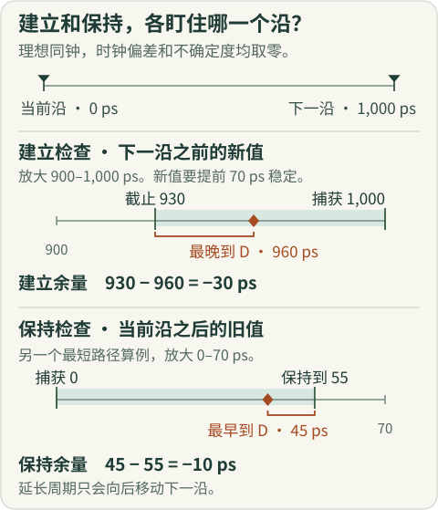

# 同一条逻辑路径，为什么既可能太慢，也可能太快？

假设芯片跑在 1 GHz，相邻两个上升沿相隔 1,000 ps。在发送寄存器和接收寄存器之间接上几级门。示波器记录到，新数据在第 960 ps 已经到达接收端，赶在下一个上升沿之前。可时序报告却说，这条路径**晚了 30 ps**。再看一条更短的支路，数据只用 45 ps 就到了，报告又说它**早了 10 ps**。这两个差数，分别是从哪一刻量的？

把时钟停在第 0 ps。两个寄存器都在这个上升沿采样。接收寄存器正在收下**上一拍**送来的旧值，发送寄存器则开始发出**这一拍**的新值。新值到达接收端的 D 引脚后，要等到第 1,000 ps 那个沿才轮到它被采样。一直盯住同一个 D，就能读懂两份报告。[第四篇 · 触发器在边沿附近怎样采样](../latch-and-divider/README.md#timing)

## 新值在第 960 ps 就到了，为什么还是晚了？ {#setup}

先看下一次采样。接收寄存器内部的节点需要时间响应 D 上的新电压。为了在时钟沿到来时可靠采样，D 要提前稳定一段时间，这段要求叫**建立时间**（setup time）。如果捕获沿在 1,000 ps，建立时间为 70 ps，D **最晚要在 930 ps 稳定**。数据在 960 ps 才稳定，即使比时钟沿早 40 ps，也已经侵入了采样所需的窗口。

数据怎样走到第 960 ps？发射沿来到发送寄存器后，它的输出 Q 要过一段时间才给出新值，这一段叫**时钟到 Q 的延迟**。随后边沿穿过门和布线，驱动接收端的 D。做建立检查时，要沿可能最慢的传播过程，算出 D 最晚何时稳定。两边时钟沿暂取同时到达，抖动和其他不确定度取零。对同一条单周期路径，在两组教学条件下分别算一次。

| 路径上的时间 | 工作点 A | 工作点 B |
| --- | ---: | ---: |
| 时钟到 Q 的最大延迟 + 门和布线的最大延迟 | 60 + 780 ps | 85 + 875 ps |
| D 最晚稳定时刻 | **840 ps** | **960 ps** |
| 接收寄存器要求的建立时间 | 60 ps | 70 ps |
| 下一捕获沿减去建立时间，得到 D 的截止时刻 | 1,000 − 60 = **940 ps** | 1,000 − 70 = **930 ps** |
| 建立裕量 = 截止时刻 − 最晚稳定时刻 | **+100 ps** | **−30 ps** |

在 A，整条路径连同建立时间共需 900 ps，约 0.90 ns。在 B，保留原来的门和布线，只把周期从 1,000 ps 延至 1,030 ps，D 的截止时刻随之从 930 ps 移到 960 ps。数据用时和原来一样，建立裕量刚好变成零。这只是本例的计算边界。选择实际工作点还要给时钟不确定性等影响留出余量。[第九篇 · 如何选择电压和时钟频率](../supply-voltage-and-frequency/README.md#dvfs)

## 数据在第 45 ps 就到了，为什么还需要多等一会儿？ {#hold}

回到第 0 ps 的上升沿。这一次要保护的是旧值。触发器内部完成采样需要一小段时间，库规定这一沿之后，D 还要维持旧值一段时间，这段要求叫**保持时间**（hold time）。如果发送端的新值走得特别快，D 可能在接收端收好旧值之前就开始变化。此时电路能否收对旧值，已超出这个工作点的时序保证。

换一条独立的短支路做保持检查。设从同一个发射沿起算，Q 最早可能改变的时间与数据通过短支路的最小延迟加起来是 **45 ps**。接收寄存器要求 D 在第 0 ps 之后再保持 **55 ps**。新数据最早到达时，旧值还应当保留 10 ps。于是**保持裕量 = 最早改变时刻 − 必须保持至的时刻 = 45 − 55 = −10 ps**。上段用最长路径找“最晚稳定”，这里用最短路径找“最早改变”。实际工具对每条受约束的路径都要做这两种检查。即使固定一条物理路径，不同工作条件下最早能多早动、最晚会多晚稳，也是两个独立的边界。

把下一拍从 1,000 ps 移到 1,030 ps，再看图底部的两个游标。它们仍然在 **45 ps 和 55 ps**，因为这项检查的发射沿和捕获沿都是第 0 ps 的同一沿。若能把这条短支路的最小数据延迟增加 20 ps，新数据最早在 65 ps 到达，保持裕量才会变为 **+10 ps**。实际在这条支路上加缓冲或绕线后，它的最大延迟也会变化，下一拍的建立检查须再做一次。[移动捕获沿，再给短支路加延迟](experiment.html#timing) · [芯片实现中的建立与保持检查](../../chip-development/process/03_backend_physical_design/05_static_timing_analysis.md)

到这里还假设两个寄存器在同一时刻收到时钟。若时钟树使接收端的每个沿都比发送端晚到 20 ps，而其余各项固定，下一拍的截止时刻往后移，建立裕量增加 20 ps。本拍旧值必须保持到的时刻也往后移，保持裕量就减少 20 ps。要读真实报告，先认清发射沿和捕获沿各自到达的时间。[时钟同步、采样边沿与时序约束](../../microarchitecture/02-pipeline/global-clock-synchronization.md) · [AMD UG906 的路径裕量定义](https://docs.amd.com/r/en-US/ug906-vivado-design-analysis/Timing-Path-Summary)

## 门和连线都没有换，为什么还要算多个工作角？ {#corners}

把探头移回路径中间的一个反相器，固定输入边沿和输出负载。输出要越过同一个相对电压门限，晶体管得给节点充放电。改变下面三个条件中的一个，这次充放电的速度就可能改变。工程上把它们合称 **PVT**，即工艺（Process）、电压（Voltage）和温度（Temperature）。

| 改变的条件 | 对同一只设计出来的门有什么影响 |
| --- | --- |
| 工艺 P | 同一版图在不同制造样品上的有效沟道尺寸、阈值电压或迁移率会有偏差。NMOS 和 PMOS 受影响的程度还可能不同，因此输出上升和下降要分别检查。 |
| 电压 V | 工作中的门用的是本地 VDD 与 VSS 之差。供电网有压降时，即使稳压器设定相同，两处单元的驱动电流也可能不同。[看门旁边的两支电压探头](../supply-voltage-and-frequency/README.md#supply-loop) |
| 温度 T | 升温通常会降低载流子迁移率，也会使阈值电压的绝对值下降。前者使载流子较难移动，后者在给定栅源电压下可能增强驱动。在一些低压范围，后一个效应占上风，低温反而可能使门更慢。[Dasdan 与 Hom 的温度反转研究](https://doi.org/10.1145/1142155.1142158) |

把一组器件工艺、电压和温度条件交给时序分析，就选定了一个**器件工作角**。看一次真实的读表。公开 SKY130 高密度库的 `tt_025C_1v80` 表示 NMOS 和 PMOS 都取典型工艺、25 °C、1.80 V。取同一只 `inv_1`，让 A 下降、Y 上升，输入转换时间为 10 ps，输出负载为 0.5 fF。典型角的输出上升传播延迟表给出约 **20.3 ps**。在 `ss_100C_1v60`，两类晶体管都取慢工艺、100 °C、1.60 V，同一格给出约 **30.9 ps**。两次查询同时换了三个条件，不能用这一对数字单独算出温度造成了多少差异。这两项库数据也与前面整条路径的 A、B 教学数值分开。[SKY130 典型角原表](https://github.com/google/skywater-pdk-libs-sky130_fd_sc_hd/blob/master/cells/inv/sky130_fd_sc_hd__inv_1__tt_025C_1v80.lib.json) · [SKY130 慢角原表](https://github.com/google/skywater-pdk-libs-sky130_fd_sc_hd/blob/master/cells/inv/sky130_fd_sc_hd__inv_1__ss_100C_1v60.lib.json)

门之间的金属线也有工艺偏差。导线的几何形状改变，提取出的寄生电阻和电容就会变。实际流程把单元库的工作角与互连的提取角按规定组合，在每组条件下计算时钟路径与数据路径。某些路径的大部分时间花在门里，另一些花在线上。换一组条件，决定最高频率的那条路径也可能换。一组角描述了要覆盖的分析条件，某颗芯片某一处当时的实际温度和电压，还得另行估计或测量。[OpenLane 的器件与互连时序角](https://openlane2.readthedocs.io/en/latest/usage/timing_corners.html)

再回到接收端 D。第一篇从硅里哪些电子能移动讲起，到这里，已经能沿着沟道、门和导线，解释 D 为什么在某一刻才改变。第四篇说明了触发器为什么需要采样窗口，第九篇给出了门在本地实际拿到多少电压。现在，面对一条标为 1 GHz 的路径，可以在每个需要覆盖的工作角上问两个问题。本拍的旧值能保留到什么时候？下一拍的新值最晚什么时候稳定？这两个时刻都落在各自允许的范围内，才算守住了这条路径的采样窗口。

把这两条界线用到一条真实的数据通路，就能继续讨论组合逻辑应当切成几级、寄存器应该插在哪里。[计算微架构 · 流水级之间如何插入寄存器](../../microarchitecture/02-pipeline/pipeline-register-insertion.md)
