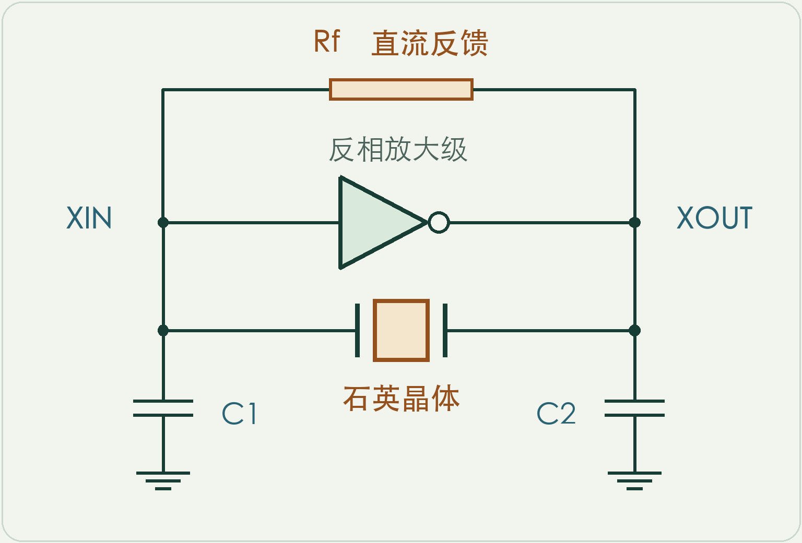

# 一块石英怎样产生稳定的时钟

给无源石英晶体一个短暂扰动，它会在特定频率附近振动，振幅随后因损耗而衰减。把同一块晶体接入合适的有源反馈电路，上电后便可能持续获得时钟。什么决定频率？谁提供能量？哪个电路把振动变成数字边沿？

## 晶体怎样选择频率

以常见的 MHz 级 AT 切厚度剪切模晶体为例。晶片两面的相对位移主要沿表面方向，位移的分布沿厚度方向变化。晶体的边界条件只允许某些振动模式。在理想基频近似下，厚度接近半个剪切波波长，频率约为剪切波速除以两倍厚度。因此在相同切型和模式下，较薄的晶片具有较高的基频。32.768 kHz 音叉晶体常用弯曲模，要按音叉的几何形状理解。[爱普生晶体振动模式与切型](https://www.epsondevice.com/crystal/en/techinfo/column/crystal-unit/)

在电极间施加交流电压，**逆压电效应**使晶体形变。晶体振动又通过**正压电效应**在电极上产生电荷。于是电路可以激励一个机械模式，也可以从电极读出它的响应。等效电路常用串联的运动电感、运动电容和运动电阻描述该模式，再并联一个静电电容。运动电阻代表机械振动的损耗。切型、机械尺寸和负载条件共同影响电路选中的工作频率。[ST AN2867 晶体模型](https://www.st.com/resource/en/application_note/cd00221665.pdf)

## Pierce 回路中每个元件做什么

在直流上，晶体支路几乎开路，输入端电流很小。大电阻 Rf 使输入与输出电压接近，偏置点落在反相器传输曲线与“输出等于输入”的交点附近，放大级便能响应微小扰动。[晶体管的小信号工作点](../transistor-amplifier/README.md)

在交流上，放大级、晶体以及两端对地的负载电容共同构成选频回路。电容的有效负载近似为 C₁C₂/(C₁+C₂) 加上等效杂散电容。例如两只 12 pF 电容配上 2 pF 等效杂散，晶体看到的负载约为 **8 pF**。器件手册给出的负载电容应与这个端口条件比较。[ST AN2867 的 Pierce 模型与负载电容](https://www.st.com/resource/en/application_note/cd00221665.pdf)

1. **起振。** 上电扰动和噪声含有多个频率成分。在目标模式附近，返回的信号若能同相增强原扰动，且小信号环路增益足以克服损耗，该成分会逐周期增长。晶体等效串联电阻过大或放大级驱动不足时，起振可能变慢或失败。
2. **稳幅。** 信号变大后，放大级的非线性或器件的幅度控制会限制增益。稳态下，电源通过有源电路每周期补入的能量与损耗达到平衡。设计还需满足晶体允许的驱动功率。
3. **整形。** 晶体端是模拟波形。后级时钟缓冲器检测过门限的时刻，输出全摆幅边沿。输出为 25 MHz 时，平均周期为 **40 ns**。实际边沿时刻还受噪声影响，负载、温度与晶体误差也会影响频率。

图中省略了芯片内部电源、保护和可能的限流电阻。具体器件的引脚连接见相应设计资料。若系统需要 50 MHz，可以继续使用 25 MHz 晶体作为参考。先看[触发器怎样分频](../latch-and-divider/README.md)，再看[反馈分频怎样实现 PLL 倍频](../integer-pll/README.md)。[ST 起振裕量与驱动功率](https://www.st.com/resource/en/application_note/cd00221665.pdf)
