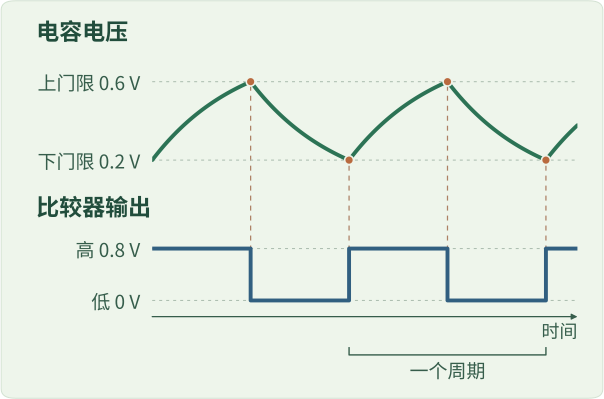
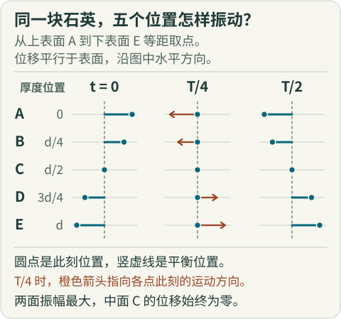
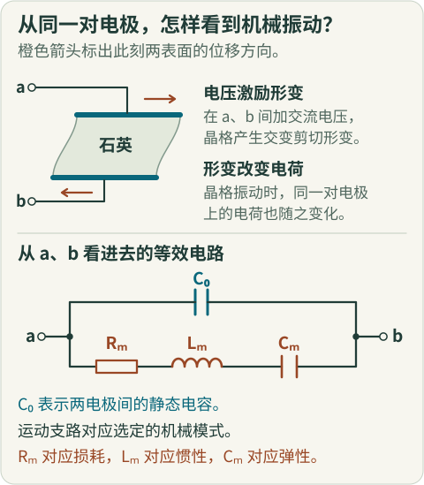
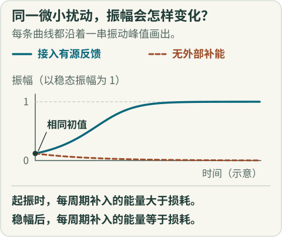
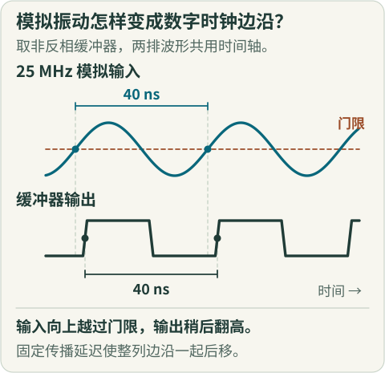

# 一块石英和一个放大器，怎样产生稳定的时钟？

假设示波器接在一个 25 MHz 时钟的输出端。屏幕上刚出现一次上升沿。外面没有谁再送入一条指令，大约 40 ns 后，下一次上升沿又来了。**谁让电路再翻一次，又是谁决定这一次要等 40 ns？**

[上一篇](../transistor-amplifier/README.md#pierce)把反相器偏置在能放大小信号的位置。这一级已经有电源，也有增益。现在要给它接一条反馈路径，使它能持续补回石英损失的能量。先用一个能手算的电路，看清“自己产生下一个边沿”需要什么。

## 一个电容充到门限以后，谁让它再走回来？ {#rc}

让比较器输出通过电阻 R 接到电容 C，比较器监测电容两端的电压。输出有高、低两个状态，分别为 0.8 V 和 0 V。先让输出为高，此时电容正在向 0.8 V 充电。把电容电压升到 **0.6 V** 作为切到低输出的条件，再把它降到 **0.2 V** 作为切回高输出的条件。这样，同一只电容在上升和下降时使用两个不同的门限，这叫**迟滞**。

用手指从一次输出上升沿沿图往右走。充电开始时，电容离目标 0.8 V 还差 0.6 V；到上门限时，压差只剩 0.2 V。理想 RC 的剩余压差按指数衰减，降到原来的三分之一需要 **RC × ln 3**。这时输出切低，电容改向 0 V 放电，从 0.6 V 降到 0.2 V，又用同样长的时间。两段合起来，一个周期约为 **2.20 RC**。图的横轴只表示先后。另取 R = 10 kΩ、C = 100 pF 作教学估算，RC = 1 µs，周期就约为 2.20 µs。这里忽略比较器的传播延迟。[TI：带迟滞比较器的 RC 振荡电路](https://www.ti.com/document-viewer/lit/html/SNOA998A/GUID-62521277-C7EF-42B9-96F6-ED6747F82F1D)

现在把 R 增大一倍，电容要慢一倍才走到相同的门限，周期也就变成两倍。石英振荡器要解决同样的周期问题，但它用来计时的是一片晶体的机械运动。先暂时移开电路，看看这片晶体上有什么会重复。

## 两列反向传播的波，为什么没有处处抵消？ {#mode}

取一片常用于 MHz 时钟的 **AT 切石英**。这里的“切”指晶片表面相对晶轴的取向。想象沿厚度均匀选出五层 A、B、C、D、E，A 和 E 在两侧表面，C 居中。把某一层沿着晶片表面轻轻推向右，相邻层会发生相对错动。晶体的弹性给两层施加相反的恢复力；每层都有惯性，经过平衡位置后还会继续走一段。这样的扰动沿厚度传递，层本身主要向左、右运动，叫**厚度剪切**。

当一列剪切波到达近似自由的表面，外侧没有另一层石英继续承受剪切力。表面必须满足切向应力近似为零的条件。理想自由面上，反射波和入射波的**位移同号**，它们造成的剪切应力却互相抵消，表面因而可以动得很明显。先只看一个频率，把去程和回程在**同一层、同一时刻的位移**相加。两个波传播方向相反，只说明波峰沿厚度走向相反方向。要让位移抵消，还得这一层此刻恰好一个向左偏、另一个向右偏，而且偏移一样大。不同深度的两列波相位差不同，某些层始终相消，另一些层却相互加强。[石英谐振器的自由表面边界与剪切位移分布](https://pmc.ncbi.nlm.nih.gov/articles/PMC8157064/)

只取最简单的厚度剪切振动，叫**基模**。以向右为正，在 A 向右偏到最远的一刻，按 A、B、C、D、E 次序，五层的位移约为 **+1、+0.71、0、−0.71、−1**，单位是表面最大位移。等半周期，这五个数全部反号。C 始终位于平衡位置，叫**位移节点**。两面摆幅最大，B 和 D 的摆幅稍小。于是，振幅最大和为零的位置一直留在原地，除节点 C 外，其余各层以同一个频率振动，这就是**驻波**。[美国国家标准局：厚度剪切基模与中心节点面，图 6](https://nvlpubs.nist.gov/nistpubs/Legacy/circ/nbscircular480.pdf)

有一个容易读错的时刻：从 A 最靠右起算，经过**四分之一周期**，五层恰好都回到零位移。A、B 正向左穿过平衡位置，D、E 正向右穿过，只有节点 C 在这个理想模式下一直静止。此刻看一张照片，晶片好像没有形变；再过一点时间，两侧就已经错向另一边。可以拖动相位，把这个时刻前后的两帧并排在脑中比较。[逐相位观察 A 至 E 的位移与运动方向](experiment.html#mode)

为什么这片晶体的厚度能定出约 25 MHz？

把厚度记作 d，取 A 为 z = 0，E 为 z = d。忽略电极质量、边缘和安装影响，把两面视作自由表面。一种满足边界条件的基模位移是 **u(z,t) = U cos(πz/d) cos(2πt/T)**。第一个余弦规定各层在哪里、以多大幅度振动；第二个规定它们怎样随时间摆动。把 B 的 z = d/4 代入，便得到上面的 0.71。在 t = T/4，位移为零而随时间变化最快，正好解释刚才那张照片。

一列波从 A 走到 E，再反射回 A，走过的距离为 2d。两次自由面反射都不翻转位移。要使一趟往返后的波与原来的波重合，这段路必须容纳整数个波长。最低的非零频率对应 2d ≈ λ，因此厚度恰好容纳**半个波长**。取剪切波速 v，就有 λ ≈ 2d，基频 f ≈ v/(2d)。京瓷资料给出 AT 切基模的近似换算 **d（mm）≈ 1.67 / f（MHz）**。取串联谐振频率约 25 MHz，晶片厚度约为 **0.0668 mm，即 67 µm**。这是对晶片厚度的估算；电极、负载和实际结构还会改变工作频率。32.768 kHz 手表晶体通常用音叉臂的弯曲模式，要按音叉的长度和截面分析。[京瓷晶体器件手册：切型、振动模式与厚度](https://ele.kyocera.com/assets/products/crystal-device/hand_e.pdf) · [爱普生：石英的振动模式与切型](https://www.epsondevice.com/crystal/en/techinfo/column/crystal-unit/)

## 一片绝缘的石英，电路怎样推得动又读得到？ {#piezo}

在晶片的两个表面各放一个电极。在两极间加电压，晶体内部出现电场。石英晶格中正负电荷的相对位置会随电场略微改变；在这种切型和电极布置下，电场可以驱动刚才的剪切形变。反转电压，驱动形变的方向也反转。**电压能使石英形变**，称为逆压电效应。

这个过程也可以反过来。让晶片发生剪切，晶体内部的电极化随之改变，表面的束缚电荷发生变化。接上外部回路时，金属电极上的自由电子会通过外部导线重新分布，电路因此能看到电流；用高阻输入读它，也可以观察到电压变化。**形变能产生电信号**，称为正压电效应。这两条路径使同一对电极既能激励振动，也能感受到振动的响应。[TI：石英的压电效应与电气等效模型，第 2.1 节](https://www.ti.com/lit/an/szza043/szza043.pdf)

设想只施加一个很短的电脉冲，随后撤去驱动。这个脉冲能激起一些机械模式。对准上述基模观察，一次推动结束后，晶片仍会左右摆动，能量在形变和运动之间转换。材料和安装结构每周期都有损耗，振幅会渐渐衰减。如果隔相同的时间再推一下，先前那次推动留下的振动还在。间隔接近固有周期时，两次激起的振动容易同相相加；间隔错开，它们会部分抵消。也可以用强度不变的正弦电压逐点扫频，每换一个频率都等瞬态消退。此时晶片按外加频率振动，但测出的稳态振幅和相位会随频率改变，基模附近的机械响应尤其明显。

电路图上的一个晶体符号，怎样表示机械运动和损耗？

在一个谐振模式附近，可以用电感 Lₘ、电容 Cₘ 和电阻 Rₘ 串联来描述机械运动。Lₘ 对应惯性，Cₘ 对应弹性顺从程度，Rₘ 代表机械能的耗散。两块电极隔着绝缘介质，本身还会存电荷，这一部分用并联的静态电容 C₀ 表示。即使把频率调离机械谐振，外部仍可能测到经 C₀ 的交流电流。模型中的运动电感和运动电容，是把这个机械模式折算到电端口后的参数。[ST AN2867：等效电路、串联谐振与负载谐振频率](https://www.st.com/resource/en/application_note/cd00221665-oscillator-design-guide-for-stm8af-al-s-stm32-mcus-and-mpus-stmicroelectronics.pdf)

## 沿 Pierce 回路走一圈，放大器怎样给振动补能？ {#loop}

把石英接回电路。图中反相器的输入叫 **XIN**，输出叫 **XOUT**。反相器向前驱动 XOUT；后面有两条路能从 XOUT 回到 XIN，一条经过大电阻 Rf，另一条经过石英，两端还各有一只电容接地。图中省略电源、保护结构和某些实现中的串联限流电阻。

先停在**直流工作点**。电容充稳，石英的端口在直流下近似开路。反相器输入漏电很小，Rf 上的压降也很小，因此 XIN 和 XOUT 的直流电压接近。它们落在反相器传输曲线与“输入等于输出”直线的交点附近。这个位置让未缓冲反相级可以放大微小变化。[回看反相器为什么停在传输曲线的陡坡](../transistor-amplifier/README.md#pierce)

再看叠在直流电压上的**一个微小交流分量**。从 XIN 开始，反相级使 XOUT 电压向相反方向摆动。XOUT 改变晶体与负载网络上的电压，石英受到驱动。晶体的运动和两只负载电容的充放电共同决定有多少信号回到 XIN、又在一个周期的哪个时刻返回。拿候选频率逐个比较。若返回分量的波峰与原来 XIN 上的波峰对齐，走完整个环路就是同相增强；若小信号环路增益的幅值还大于 1，这个分量便能从微小扰动中长起来。从机械侧看同一件事，电场产生的等效剪切力与该模式的运动速度同向时，对振动做正功；反向时，从振动取走能量。一周期内把这些功加起来，就能判断电路净补了多少。放大器输出虽然反相，返回 XIN 的相位还要算上石英和电容的作用。补回损耗的能量由反相放大器从电源取得。[TI：Pierce 回路的增益与相位条件，第 2.2 节](https://www.ti.com/lit/an/szza043/szza043.pdf)

回到这张图的并联负载接法。晶体选在基模、损耗较小时，实际工作频率通常介于晶体的串联谐振频率和它在没有外加负载电容时的反谐振频率之间。在这段窄频带里，从电极看进去晶体呈感性，与两端的负载电容共同决定返回信号的相位。[ST AN2867：晶体阻抗的感性区与负载频率，图 2](https://www.st.com/resource/en/application_note/cd00221665-oscillator-design-guide-for-stm8af-al-s-stm32-mcus-and-mpus-stmicroelectronics.pdf#page=7)

若两端的电容 C₁、C₂ 都取 12 pF，从晶体两端经公共地绕过去相当于两者串联，再计入等效杂散电容 2 pF，晶体看到的**负载电容**约为 **12 × 12 / (12 + 12) + 2 = 8 pF**。这个值应与晶体手册标称频率对应的负载条件比较。换负载会改变网络相位，满足整环条件的频率也会在晶体谐振附近移动。于是同一块标称 25 MHz 的晶体，焊到两块不同的板上，频率可能略有差异。[ST AN2867：Pierce 回路与负载电容](https://www.st.com/resource/en/application_note/cd00221665-oscillator-design-guide-for-stm8af-al-s-stm32-mcus-and-mpus-stmicroelectronics.pdf)

## 上电时振幅几乎为零，为什么后来能长大又停住？ {#startup}

观察 XIN 附近的交流幅度。上电瞬态和电路噪声含有许多频率成分。假设其中一个在目标模式附近，并且电路有足够的起振裕量。开始时振幅很小，放大器工作在第五篇讲的局部斜率上。每周期补入的能量多于损耗，下一周期的摆幅就更大。其他不能同相增强或增益不足的分量逐渐落在它后面。常用**品质因数 Q** 来描述储存的振动能量相对每周期损耗有多大。高 Q 的石英能保存许多周期的振动，使谐振响应集中在较窄的频率范围。振幅从噪声水平长到可用，也需要时间。

把 XOUT 的摆幅想得更大一些。波形开始扫到反相器传输曲线较平的两端，输出还受电源轨限制。同样再添一点输入，基波得到的放大往往已比小信号时弱。有些芯片还会主动控制振幅。**稳幅时，每周期从电源补入该振动的能量恰好够支付损耗。** 当等效串联电阻 ESR 太大、放大级驱动能力不足时，振动可能建立得很慢，甚至无法起振。驱动过大则可能超过晶体规定的驱动功率，检查时要结合实际晶体电流和损耗。[ST AN2867：起振裕量、驱动功率及启动时间](https://www.st.com/resource/en/application_note/cd00221665-oscillator-design-guide-for-stm8af-al-s-stm32-mcus-and-mpus-stmicroelectronics.pdf)

做个对照。让同一个模式从相同的小振幅出发，分别选择撤去补能、补能小于损耗、补能充足三种情况。每推进一个振动周期，就对照这个周期补入和损失的能量，再读下一次的振幅。实验用归一化数值放大这种趋势；具体电路的起振时间还要按晶体、放大器、负载和初始扰动求得。[逐步观察补能和损耗怎样改变振幅](experiment.html#startup)

## 从一段模拟振动，到时钟线上相邻的两个上升沿 {#clock}

把最后一支探针放到时钟缓冲器的输出。石英回路已经稳定工作时，缓冲器输入上有周期性的模拟电压。取一个同相缓冲器作例子：输入上行并越过切换门限后，缓冲器把输出端拉高；输入下行并越过相应门限后，输出被拉低。下一级的负载电容由缓冲级充放电，晶体一侧的小幅波形便能驱动数字电路所需的边沿。[TI：石英振荡器的输出整形与缓冲，图 24](https://www.ti.com/lit/an/szza043/szza043.pdf#page=17)

**从一次上穿门限数到下一次上穿。** 如果负载条件下实际振荡频率正好为 25 MHz，一个完整周期是 **1 / (25 × 10⁶ Hz) = 40 ns**。缓冲器的传播延迟会把两个输出上升沿一起向后移；若两次延迟相同，它们仍相隔 40 ns。温度、负载和晶体频差会改变平均周期，叠在波形上的噪声还可能让某一次越过门限的时刻提早或推迟。说一只晶体提供稳定参考，既要看一段时间内平均走得准不准，也要看每一条边沿偏了多少。

现在再看开头的示波器。每个数字上升沿之前，都有一次模拟电压跨过门限；再往前，石英中的同一振动模式已经重复了一个周期，放大器为它补回了这一周期的损耗。[第四篇的触发器](../latch-and-divider/README.md#divider)能把 50 MHz 二分频成 25 MHz。如果系统手里只有这条 25 MHz 的参考，却需要每 20 ns 一个上升沿，电路中的额外边沿来自哪里？[下一篇 · PLL 怎样把 25 MHz 变成 50 MHz](../integer-pll/README.md)
