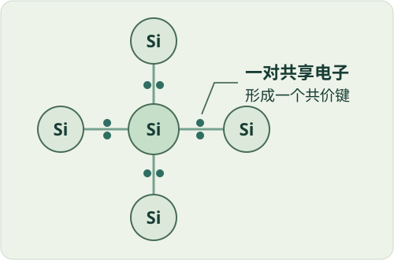
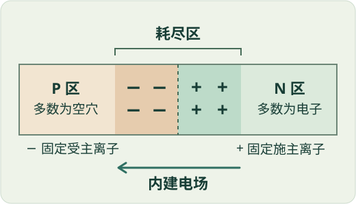
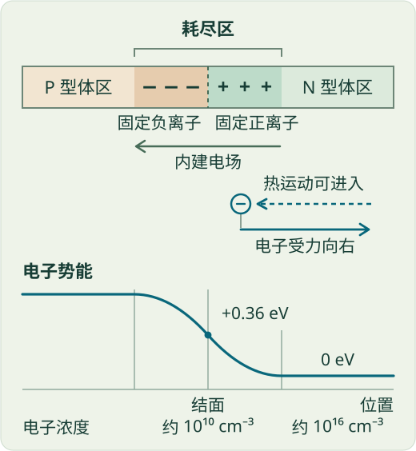
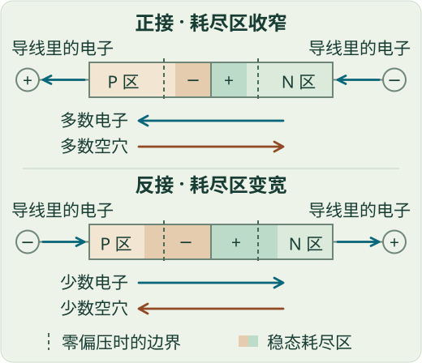
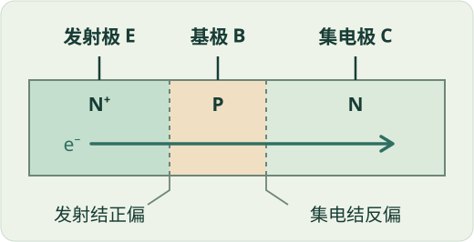
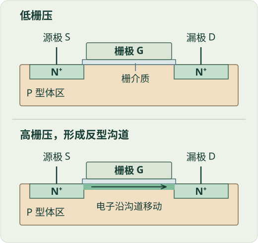
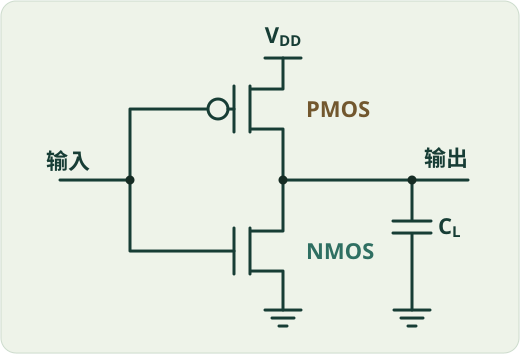

# 从硅到门电路

上级：[半导体基础](../README.md)

## 硅晶体 {#从硅的四个价电子理解-p-型和-n-型掺杂}

在单晶硅中，硅原子在三维空间中按周期性结构排列。这种排列称为**晶格**。

### 硅原子如何成键

硅原子的最外层有四个价电子。每个硅原子与四个近邻各形成一个**共价键**。下面用局部成键模型看这个结构。每个键由两个原子各贡献一个价电子，组成一对共享电子。见 [MIT 6.012 的硅晶格与成键模型](https://ocw.mit.edu/courses/6-012-microelectronic-devices-and-circuits-spring-2009/resources/mit6_012s09_lec02/)。

*以中心硅原子为参照，四个近邻位于四面体的四个顶点。图中把这个结构画在平面上，并省略四个近邻的其他键。*

## 掺杂 {#p-型与-n-型掺杂}

在硅晶格中引入少量其他元素的原子，可以改变硅的导电特性。这称为**掺杂**。沿用上面的晶格图，四个键一共需要八个共享电子，四个近邻各提供一个。下面只替换图中的中心原子，分别看换成磷和硼会发生什么。

### 磷提供电子，硼提供空穴

**换成磷。** 磷有五个价电子，其中四个参与成键。第五个电子受到的束缚较弱，在室温下容易受热激发，成为能在晶体中移动的电子。失去这个电子后，磷留在原来的晶格位置，成为正离子。

**换成硼。** 硼有三个价电子。加上四个近邻提供的电子，四个键还缺一个电子。硼可以从邻近的键接受一个电子，成为固定的负离子。提供电子的键留下一个空位。

周围的电子可以依次填入空位。每次有电子填入，空位就移到该电子原来的位置。这个能移动的空位叫**空穴**。它的运动相当于正电荷的运动。

能参与导电的电子和空穴统称为**载流子**。电子占多数的硅称为 **N 型硅**，空穴占多数的硅称为 **P 型硅**。提供电子的磷称为**施主**，接受电子的硼称为**受主**。见 [MIT 6.012 的施主与受主图解](https://ocw.mit.edu/courses/6-012-microelectronic-devices-and-circuits-spring-2009/6583f0018f5bb90464ea68b550f73c95_MIT6_012S09_lec02.pdf#page=10)。

在远离界面的均匀掺杂区，载流子的净电荷与电离杂质的净电荷近似相抵。

### 两类载流子怎样共存 {#电子和空穴从哪里来}

纯硅中的成键电子获得足够的热能或光能后，也可以参与导电，并留下一个空穴。掺杂后的硅同样可以产生电子和空穴对。因此，N 型硅中也有空穴，P 型硅中也有电子。浓度较低的一类称为**少数载流子**。

在能带模型中，产生一对电子和空穴对应电子从价带跃迁到导带。导带底和价带顶之间的能量差叫禁带宽度。电子与空穴复合时，这一对载流子消失并释放能量。

纯硅在热平衡下的电子浓度 n 与空穴浓度 p 相等，均为本征载流子浓度 ni。ni 受温度影响。

以热平衡、非简并且杂质近似完全电离的 N 型硅为例。若有效施主浓度远大于 ni，则 n 近似等于有效施主浓度。此时 n·p = ni2。若 n 是 ni 的 106 倍，p 就是 ni 的 10−6 倍。这是相同温度下的浓度比例。若施主和受主并存，要考虑补偿。若器件正在注入载流子，则要按偏置条件求 n 和 p。见 [MIT 6.012 的本征、掺杂与补偿模型](https://ocw.mit.edu/courses/6-012-microelectronic-devices-and-circuits-spring-2009/resources/mit6_012s09_lec02/)。

### 载流子怎样形成电流

载流子通过材料截面时会输运电荷。单位时间通过该截面的净电荷量就是**电流**。常规电流按正电荷的运动方向计。

**漂移**由电场驱动。空穴沿电场方向漂移，带负电的电子反向漂移。两者贡献的常规漂移电流都沿电场方向。低电场下，均匀材料的电导率 σ = q(nμn + pμp)。其中 q 是元电荷的大小，μn 和 μp 是两类载流子的迁移率。一段长度为 L、截面积为 A 的均匀硅条，在上述条件下有 R = L/(σA)。计算时，掺杂水平也会影响迁移率。

**扩散**由浓度梯度产生。同类载流子从高浓度区向低浓度区发生净移动。将 P 型和 N 型区域做在同一块晶体中，结附近的漂移和扩散会共同决定电流。见 [MIT 6.012 的载流子输运](https://ocw.mit.edu/courses/6-012-microelectronic-devices-and-circuits-spring-2009/resources/mit6_012s09_lec03/)。

## PN 结与二极管 {#pn-结如何形成势垒二极管如何整流}

先把两块温度相同的硅分开看。在 P 型硅里，空穴的正电荷抵消固定受主离子的负电荷。在 N 型硅里，电子的负电荷抵消固定施主离子的正电荷。两块硅内部各自近似电中性，载流子一直在做热运动。

现在想象两区在一块连续的硅晶体里相接。左边是 P 区，右边是 N 区，载流子可以跨过交界。P 型区与 N 型区相接形成的结构叫 **PN 结**。掺杂从 P 型转为 N 型的位置叫**结面**。这里假设两区都足够厚，外加电压为零。

### 耗尽区怎样形成

刚接通时，两侧的电子都在做无规则的热运动。靠近结面的电子碰巧朝对侧运动时，就有机会穿过结面。两个方向都会有电子跨结。

在结面两侧各取一小块体积相同的区域。假设 N 侧有 100 个可移动电子，P 侧有 20 个。这个简化例子先忽略正在建立的内建电场，设两侧每个电子在接下来的一小段时间内跨结的概率都是 1/10。平均下来，从 N 到 P 的有 10 个，从 P 到 N 的有 2 个。净效果是 **8 个电子从 N 侧移到 P 侧**。

跨结机会相同时，浓度高的一侧平均会有更多电子跨过去。将两个方向通过的数量相减，净移动指向浓度低的一侧，这就是**扩散**。空穴在 P 侧的浓度较高，所以空穴从 P 向 N 净扩散。

跟踪其中一个从 N 侧跨到 P 侧的电子。它一过结面，**N 侧就少了一份负电荷，P 侧就多了一份负电荷**。如果它接着在 P 侧与一个空穴复合，P 侧就少了一个空穴。复合成对移走等量异号的电荷，刚才跨结造成的两侧净电荷仍然存在。一个空穴从 P 跨到 N，也会让 P 侧多一份净负电荷，让 N 侧多一份净正电荷。

随着载流子净跨结，最先受影响的是结面附近。N 侧电子变少，固定施主离子的正电荷失去补偿。P 侧空穴变少，固定受主离子的负电荷失去补偿。**耗尽区**就是结面两侧这段多数载流子明显减少、净电荷主要来自固定离子的区域。这里仍有少量载流子。

### 耗尽区为什么只扩展一段 {#平衡时扩散和漂移怎样抵消}

两侧一出现净电荷，就开始建立从 N 侧指向 P 侧的**内建电场**。场对电子的力指向 N 侧，对空穴的力指向 P 侧。由此产生的漂移与各自的扩散方向相反。随着两侧积累更多净电荷，后来的电子从 N 侧到 P 侧需要增加更多势能。这道能量门槛叫**势垒**。

N 区深处的电子仍可以向左补位。这会把一份电子缺额从结面附近挪到深处。要让近处和深处同时留下更多未补偿的离子电荷，还需要有更多电荷净跨过结面。

势垒升高后，N 侧只有部分电子能靠热运动越过它。P 侧的少数电子到达结区后，可以顺着电场力移向 N 侧。达到热平衡时，两个方向跨结的电子数在长期平均上相等。空穴也有各自的平衡。此时每种载流子的漂移电流和扩散电流各自抵消，两侧的净电荷量和耗尽区的平均宽度稳定下来。

离结较远的体区近似电中性。平衡时，结内有内建电势差，通过外部欧姆接触测得的端口电压为零。见 [MIT 6.012 的 PN 结电荷分布与热平衡](https://ocw.mit.edu/courses/6-012-microelectronic-devices-and-circuits-fall-2009/c053714447998e522f02db0776987091_MIT6_012F09_lec04.pdf#page=8)。

*图按对称掺杂画出耗尽区。对突变结，掺杂较轻的一侧通常分到更宽的耗尽区。*

### 电子能进去，耗尽区为什么还能保持

从图中的 N 型体区向左看。一个电子可以靠热运动进入耗尽区。下方的曲线与上方的结构图使用同一位置轴。电子一进入耗尽区，势能就开始升高，同时受到向右的电场力。越靠近结面，电子需要爬的势能坡越高。

*图采用突变结的耗尽近似。取 300 K、两侧掺杂浓度均为 1016 cm−3、本征载流子浓度约为 1010 cm−3。势能以 N 型体区为零。点击图可放大。*

在热平衡下，势能越高的位置，平均能找到的电子越少。图中结面比 N 型体区高约 0.36 eV，约为热能尺度 kBT 的 14 倍。按非简并硅的平衡浓度关系，结面的电子浓度约为 N 型体区的百万分之一。P 侧空穴向结面移动时，也要逆着把它推回 P 侧的电场力。**载流子能进入，结面附近仍然只有很低的平均浓度。** [MIT 6.012 的势能与热平衡浓度关系](https://ocw.mit.edu/courses/6-012-microelectronic-devices-and-circuits-fall-2005/9654bdfa6767064b440d91e610933bf3_lecture4annotat.pdf#page=13)

再想象一小批电子短暂地由 P 侧净回到 N 侧。若两侧体区的温度和浓度基本保持原值，两侧分开的正、负电荷会因这次回流而减少，势垒也随之降低。这样 N 侧电子更容易向 P 侧越过势垒，净转移会趋向于重新积累刚才减少的电荷。回到热平衡后，电子和空穴仍在进出结区，各自的净流量为零。耗尽区就能维持低载流子浓度和稳定的平均宽度。

### 外加电压怎样改变结电流

左边的 P 端是阳极，右边的 N 端是阴极。二极管端电压 VD = VP − VN，常规正向电流从 P 端流向 N 端。下面两种接法都从零外加偏压开始，用一个直流电源串联电阻后接通二极管。

*图按对称掺杂示意。圆圈标出电源极性，图中省略了串联电阻。虚线标出接通前耗尽区的边界，深色区域是稳态的耗尽区。箭头表示相应载流子的净运动方向。点击图可放大。*

#### 正接时，多数载流子持续跨结

1. **刚接通。** P 端接正极，N 端接负极。看图上半部分，左边导线的电子从 P 端流向电源正极，右边导线的电子从负极流向 N 端。P 端抽走电子，相当于给 P 区补充空穴。
2. **耗尽区收窄。** 在原耗尽区的边缘，N 侧一部分固定施主的正电荷重新得到电子补偿，P 侧一部分固定受主的负电荷重新得到空穴补偿。两侧分开的净电荷减少，势垒降低。更多 N 侧电子可以靠热运动越过势垒进入 P 区，更多 P 侧空穴也能进入 N 区。 [MIT 6.012 的正向偏置与势垒](https://ocw.mit.edu/courses/6-012-microelectronic-devices-and-circuits-fall-2009/c053714447998e522f02db0776987091_MIT6_012F09_lec04.pdf#page=18)
3. **达到稳态。** 耗尽区的电荷量稳定下来，用于改变这部分电荷的瞬态电流消退，多数载流子还在跨结。跟踪一个从 N 跨到 P 并与空穴复合的电子。电源负极补回 N 区失去的电子，正极从 P 端抽走电子，补回复合消耗的空穴。这样，**N 侧一边从电源得到电子，一边有电子持续跨结离开**。电子和空穴的净运动方向相反，贡献的常规电流都从 P 到 N。

#### 反接时，充稳后只剩少量漏电

1. **刚接通。** P 端接负极，N 端接正极。看图下半部分，左边导线的电子从电源负极流入 P 端，右边导线的电子从 N 端流向正极。在 P 端接点，送入的电子可以填上到达这里的空穴，让 P 侧多一份净负电荷。N 侧被抽走电子后，净正电荷增加。
2. **耗尽区变宽。** 载流子重新分布，结面两侧更多固定离子失去补偿。分开的净电荷量增大，势垒升高，多数载流子更难跨结。这个过程相当于给结电容充电。反向端电压逐渐建立，落在串联电阻上的电压随之变小，充电电流也降下来。
3. **达到稳态。** P 侧的少数导带电子可以扩散到耗尽区边缘，再被电场扫到 N 侧。N 侧少数空穴到达边缘后会被扫到 P 侧。耗尽区内热产生的电子和空穴也会被扫向两边。**电场可以很快带走到达结区的载流子，可持续补到这里的载流子很少。** 击穿前，电源只需持续补回漏电带走的净电荷，常规反向电流从 N 到 P。 [MIT 6.012 的反偏少数载流子输运](https://ocw.mit.edu/courses/6-012-microelectronic-devices-and-circuits-spring-2009/5075c569d72924227b6a36d40ca37898_MIT6_012S09_lec15.pdf#page=11)

理想扩散模型在固定温度、低注入、忽略器件内部串联电阻和结区产生复合电流、且避开击穿时，给出 **ID = IS[exp(VD/UT) − 1]**。IS 是反向饱和电流的大小，UT = kBT/q 是热电压，300 K 时约为 25.9 mV。

当正向电流远大于 IS 时，电压每升高 UT·ln(10)，理想电流约增大十倍。300 K 时，这个电压增量约为 **60 mV**。常说的「硅二极管压降约 0.7 V」是选定工作电流下的粗略估计。实际 I–V 曲线还受温度、复合、串联电阻和高注入影响。较强反偏可能引发击穿，电流会快速增大。具体范围取决于器件和限流条件。见 [MIT 6.012 的 PN 结 I–V 模型及其适用条件](https://ocw.mit.edu/courses/6-012-microelectronic-devices-and-circuits-fall-2009/resources/mit6_012f09_lec06/)。

### PN 结也会储存电荷

改变反偏会改变耗尽区边界和端口电荷，表现为随偏置变化的**耗尽电容**。正向偏置时，注入到两侧的过剩少数载流子还会形成储存电荷，对应**扩散电容**。从正偏切换到反偏时，需要先清除一部分储存电荷，二极管电流才会恢复到反偏稳态值。这个过程与开关速度有关。见 [MIT 6.012 的二极管等效电路与储存电荷](https://ocw.mit.edu/courses/6-012-microelectronic-devices-and-circuits-fall-2005/pages/lecture-notes/)。

## 双极型晶体管（BJT） {#三极管怎样放大电流并作为开关}

双极型晶体管（BJT）有两个 PN 结，共用一个很薄的**基区**。在正向放大区，发射结向基区注入载流子，集电结收集穿过基区的载流子。如果基区厚度远小于注入载流子的扩散长度，**大部分注入基区的载流子能到达集电极**。这是 BJT 能提供电流增益的原因之一。电路中常说的「三极管」在这里指 BJT。

### 三个端子决定两个结的偏置

以 NPN 管为例。发射极 E 接在重掺杂 N 型发射区，基极 B 接在薄的 P 型基区，集电极 C 接在 N 型集电区。定义 VBE = VB − VE，VBC = VB − VC。PNP 管交换 P 型和 N 型区域，偏置和常规电流方向也相应反转。

*图中箭头表示电子运动方向。区域宽度仅作示意。*

在正向放大区，发射结正偏，集电结反偏。发射区把电子注入基区。大部分电子扩散到集电结，再被该处的电场扫入集电区。部分电子在基区与空穴复合，基极电流负责补充空穴。空穴从基区注入发射区的过程也贡献基极电流。见 [MIT 6.012 的 BJT 注入与收集模型](https://ocw.mit.edu/courses/6-012-microelectronic-devices-and-circuits-fall-2009/resources/mit6_012f09_lec07/)。

### 从端口看工作区

下表假设器件避开击穿。电流取 NPN 正向使用时的大小。

| 工作区 | 发射结和集电结的偏置 | 可用的近似 |
| --- | --- | --- |
| 截止 | 发射结反偏或正偏很弱，集电结反偏或零偏。 | 集电极电流接近漏电量级。 |
| 正向放大 | 发射结正偏，集电结反偏。 | 固定温度、低注入时，IC 对 VBE 近似呈指数关系。给定工作点附近，也可用 IC ≈ βIB。 |
| 饱和 | 两个结均正偏。 | VCE 通常较小，集电极电流需与外部负载一起求解。 |
| 反向放大 | 发射结反偏，集电结正偏。 | 集电区承担注入。常规器件的发射区和集电区结构不同，反向增益通常较低。 |

β 随器件、温度和偏置而变。工程上可以用基极电流估算集电极电流，内部注入同时取决于 VBE。硅 BJT 的 VBE 应随电流和温度一起给出。用作饱和开关时，关断还要移除基区的储存电荷。

### 用负载检查一次开关状态

设发射极接地，集电极经 1 kΩ 电阻接 3.3 V 电源。基极驱动由外部电路提供。流过这个线性电阻的电流等于两端的压差除以阻值。因此 IC = (3.3 V − VCE) / 1 kΩ。

1. 若假设 β = 100、IB = 10 µA，正向放大模型给出 IC ≈ 1 mA，VCE ≈ 2.3 V。取教学工作点 VBE ≈ 0.7 V，集电极高于基极，满足集电结反偏的条件。
2. 若 IB 增至 0.4 mA，沿用 β = 100 会得到 40 mA。即使 VCE 降为零，电阻也只能提供 3.3 mA。应检查饱和工作点。若本例取 VCE(sat) ≈ 0.2 V，则 IC ≈ **3.1 mA**。

这里的参数是供手算使用的假设。实际开关要根据负载电流与基极驱动查规格。例如 onsemi 的 2N3904 在 IC = 10 mA、IB = 1 mA、环境温度 25 °C 的脉冲测试中，给出 VCE(sat) 最大值 0.2 V。另一个电流测试点有不同上限。见 [onsemi 2N3904/D，Rev. 3，第 2 页](https://www.onsemi.com/pdf/datasheet/2n3904-d.pdf#page=2)。

## MOSFET 与沟道电流 {#mosfet-如何用栅极电压控制沟道电流}

在常见的硅 MOSFET 中，掺杂形成源区和漏区。MOSFET 的全称是金属–氧化物–半导体场效应晶体管。栅极隔着介质建立电场，改变硅表面的载流子浓度。当源区与漏区之间形成导电沟道时，源、漏两端的压差可以驱动电流。

### 用平面 NMOS 观察沟道怎样形成

以增强型平面 NMOS 为例。器件有栅极 G、源极 S、漏极 D 和体端 B。两个重掺杂 N 型区形成源区和漏区，位于 P 型体区中。栅极和硅之间由薄的介质隔开。对本例，令体端与源极同电位，漏极电位略高于源极。

逐步提高栅极电压时，栅极电场先从硅表面排开部分空穴，形成耗尽区。电场进一步增强时，电子在表面聚集。表面从以空穴为主变为以电子为主，称为**反型**。在强反型且漏源电压较小时，电子沟道将源区和漏区连起来。

*截面为教学示意。两幅图均以源极为参考，省略体端接触和边缘电场。下图假设漏源电压较小，强反型沟道延伸至漏区。*

定义 VGS = VG − VS，VDS = VD − VS。在上述 NMOS 方向下，电子从源极移向漏极，常规漏极电流 ID 从漏极流向源极。PMOS 使用空穴沟道，常用正值 VSG = VS − VG 表示栅驱动。提高 VSG 会增强 PMOS 的沟道导电能力。见 [MIT 6.004 的 MOSFET 结构与端口特性](https://ocw.mit.edu/courses/6-004-computation-structures-spring-2017/pages/c3/c3s1/)。

### 漏极电流随端电压怎样变化

用一个长沟道 NMOS 的一阶模型。设体端与源极相连，VDS ≥ 0，温度固定。模型沿沟道采用恒定的迁移率和阈值，忽略亚阈值电流、沟道长度调制和串联电阻。以 VTN 表示 NMOS 阈值，Vov = VGS − VTN 表示过驱动电压。系数 k = μnCoxW/L，Cox 是单位面积栅介质电容，W 和 L 是沟道宽度和长度。

| 模型工作区 | 条件 | 漏极电流 ID |
| --- | --- | --- |
| 截止 | Vov ≤ 0 | 近似为零。 |
| 线性区 | Vov > 0 且 0 ≤ VDS < Vov | k(VovVDS − VDS2/2)。 |
| 饱和区 | Vov > 0 且 VDS ≥ Vov | kVov2/2。 |

在线性区靠近 VDS = 0 的范围，沟道近似一个电阻，约为 1/(kVov)。这个区间适合用来分析低压降开关的稳态导通。

当 VDS 增至 Vov，漏端的强反型沟道开始**夹断**。源端仍向沟道供应电子，电子穿过漏端的高电场区被收集。理想模型中的 ID 由栅源电压决定。实际饱和区的 ID 也可随 VDS 增加。见 [MIT 6.012 的长沟道 MOSFET 大信号模型](https://ocw.mit.edu/courses/6-012-microelectronic-devices-and-circuits-fall-2009/resources/mit6_012f09_lec11/)。

例如，取 VTN = 0.3 V、VGS = 0.8 V、k = 200 µA/V²，得到 Vov = 0.5 V。在 VDS = 0.1 V 时，模型得到 ID = **9 µA**。在 VDS = 0.5 V 或 0.8 V 时，理想饱和电流均为 **25 µA**。这些数值来自指定模型和假设。

### 看规格时，先看测量条件

- **转移特性**固定 VDS 等条件，扫描 VGS，观察 ID。某个工作点的跨导 gm 是固定其他端电压时 ID 对 VGS 的局部斜率，单位为西门子（S）。
- **输出特性**对多个固定的 VGS，分别扫描 VDS，得到一组 ID 曲线。用作低损耗开关时，关注规定栅驱动和温度下的导通电阻 RDS(on)。
- **输入电容与栅电荷**描述驱动电路在切换时需要转移的电荷。绝缘栅极的稳态漏电通常很小。每次改变栅极电压，驱动电路仍需提供瞬态电流。

例如，Nexperia 2N7002 在结温 25 °C、VDS = VGS、ID = 0.25 mA 时，测得的栅源阈值规格范围为 1.0–2.5 V。同为 25 °C，导通电阻最大值 5.3 Ω 对应 VGS = 4.5 V 和 ID = 75 mA。前一个测试定义小电流门限，后一个测试才给出指定负载和栅驱动下的导通电阻。见 [Nexperia 2N7002，Rev. 7，表 7 与图 5–7](https://assets.nexperia.com/documents/data-sheet/2N7002.pdf#page=5)。

实际器件还要考虑亚阈值电流、体偏置改变阈值、源漏与体区之间的 PN 结、寄生电容及短沟道效应。上面的一阶式适合解释趋势。预测特定工艺中的电流和延迟，要使用对应的器件模型与工作条件。器件结构演化见 [FAB 的 Planar、FinFET 与 GAAFET](../../chip-development/FAB/wiki/02-front-end-fabrication/transistor-evolution-planar-finfet-gaa.md)。

## CMOS 反相器与逻辑门 {#cmos-门怎样用充放电实现逻辑运算}

把 PMOS 和 NMOS 接到同一个输出节点，可以控制这个节点的充放电。静态 CMOS 门用 PMOS 建成**上拉网络**，用 NMOS 建成**下拉网络**。分析门的输出时，先判断哪条路径会接通，再判断节点电压会怎样变化。

### 用两只管构成反相器

反相器的 PMOS 源极接 VDD，NMOS 源极接 GND。两个栅极接输入，两个漏极接输出。在常见体硅 CMOS 中，这两个器件的体端分别接 VDD 和 GND。以下过程假设供电和输入满足器件的正常工作条件，输出接等效电容负载 CL。

*黑点表示电气连接。图中的 CL 代表下一级输入和连线等效到输出节点的电容，体端连接见正文。*

| 输入 | 管子状态 | 稳态输出 |
| --- | --- | --- |
| 0 | PMOS 导通，NMOS 截止。 | 1 |
| 1 | PMOS 截止，NMOS 导通。 | 0 |

稳定后，逻辑 1 的电压接近 VDD，逻辑 0 的电压接近 GND。

输入设置两只管子的栅极电压。输入从高变低时，电荷从 VDD 经 PMOS 流入输出节点。输入从低变高时，输出节点通过 NMOS 向 GND 放电。

对图中接地的线性负载电容，输出节点一侧的电荷 **Q = CL·Vout**。忽略其他电流路径，按基尔霍夫电流定律（KCL），流入电容的净电流为上拉电流 IP 减去下拉电流 IN。净电流为正时，输出节点一侧的电荷增加，电压升高。净电流为负时，电荷减少，电压降低。电压变化所需的时间见[电路与时序基础](../../microarchitecture/02-pipeline/electrical-timing-foundations.md)。

### 用串联和并联推导 NAND 与 NOR

对于两输入静态 CMOS 门，A 和 B 各控制一只 PMOS 和一只 NMOS。串联支路要求每个开关都导通，并联支路只需有一个支路导通。

| 门 | 上拉和下拉的接法 | 输出何时为 0 |
| --- | --- | --- |
| NAND（与非） | PMOS 并联，NMOS 串联。 | A 和 B 都为 1。 |
| NOR（或非） | PMOS 串联，NMOS 并联。 | A 和 B 至少有一个为 1。 |

以 A = 1、B = 0 为例。NAND 的 B 控制管关断了串联下拉，B 同时使一个并联上拉支路导通，输出为 1。对同样输入，NOR 的 A 控制管打开一个并联下拉支路，同时断开串联上拉，输出为 0。

| 输入 (A, B) | NAND | NOR |
| --- | --- | --- |
| (0, 0) | 1 | 1 |
| (0, 1) | 1 | 0 |
| (1, 0) | 1 | 0 |
| (1, 1) | 0 | 0 |

在 NAND 或 NOR 后再接一级反相器，就分别得到 AND 或 OR。分析这条路径时，要计入两级的负载与传播延迟。见 [MIT 6.004 的互补网络和组合门](https://ocw.mit.edu/courses/6-004-computation-structures-spring-2017/pages/c3/c3s1/)。

### 电压落在哪个范围，逻辑值才有效

缓慢扫描输入电压并等待输出稳定，可以得到反相器的电压传输曲线。输入接近两个电源轨时，输出分别接近相反的电源轨。中间过渡区可能出现两只管同时导通，输出由两边的电流平衡决定。

| 电平参数 | 在规定的供电、温度和负载条件下 |
| --- | --- |
| VIL、VIH | 接收端保证识别为低电平的最高输入电压，以及保证识别为高电平的最低输入电压。两者之间的逻辑结果无保证。 |
| VOL、VOH | 驱动端输出低电平时的最高保证电压，以及输出高电平时的最低保证电压。 |

一对兼容的驱动端和接收端应有正的直流噪声容限。低电平容限为 VIL − VOL，高电平容限为 VOH − VIH。例如，若本例的低电平输出上限为 0.10 V，接收低电平上限为 0.25 V，低电平容限为 **0.15 V**。该值只描述所选端口条件下的静态余量。

器件的 VTN 用于描述单个 NMOS 的导电。门电路的直流翻转点可用传输曲线上 Vin = Vout 的点定义。传播延迟则按约定的输入和输出参考门限计量。分析时应分别取相应的器件参数、接口电平和时序库门限。见 [MIT 6.004 的数字抽象与电平规范](https://ocw.mit.edu/courses/6-004-computation-structures-spring-2017/pages/c2/c2s1/)。

### 翻转消耗的能量来自哪里

在理想全摆幅的充放电模型中，输出每次从 0 V 升至 VDD，电源向 CL 送入 CLVDD 的电荷，提供能量 CLVDD2。其中一半暂存在电容里，一半在上拉路径耗散。随后放电时，存下的能量在下拉路径耗散。

设 f 是每秒的周期数，α 是每周期平均发生的 **0 → 1** 次数，则该节点平均负载切换功率为 Psw = αfCLVDD2。例如，反相器负载为 50 fF，供电为 0.8 V。电源每次全摆幅充电提供 **32 fJ**。若 f = 1 GHz，平均每四周期发生一次上升，则 Psw = **8 µW**。实际门还会消耗两管同时导通时的短路能量、内部节点翻转能量和漏电功率。见 [MIT 6.012 的 CMOS 延迟与功耗](https://ocw.mit.edu/courses/6-012-microelectronic-devices-and-circuits-fall-2009/resources/mit6_012f09_lec16_scaling/)。

## 用到哪里

下一篇[从电容充电到时钟边沿](../voltage-to-clock/README.md)从输出节点的充放电讲起，看电压越过门限需要多久。

- **时序。** 从输出节点充放电继续算到寄存器的采样边沿。见[电路与时序基础](../../microarchitecture/02-pipeline/electrical-timing-foundations.md)。
- **运算。** 从基本逻辑门进入部分积和累加电路。见[从部分积到 MAC](../../microarchitecture/01-datapath/multiply-accumulate-from-gates.md)。
- **存储。** 从两个反相器维持状态，读到访问管怎样连接存储节点与位线。见 [6T SRAM cell](../../storage/02-sram/foundations/6t-cell-bistable-storage.md)和 [1T1C DRAM](../../storage/03-dram/foundations/1t1c-cell-destructive-read.md)。
- **前道工艺。** 从材料特性进入掺杂、注入和栅极结构。见[掺杂与离子注入](../../chip-development/FAB/wiki/02-front-end-fabrication/doping-and-ion-implantation.md)和[器件演化](../../chip-development/FAB/wiki/02-front-end-fabrication/transistor-evolution-planar-finfet-gaa.md)。
