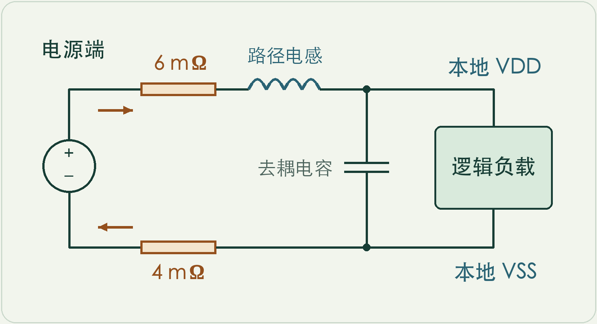
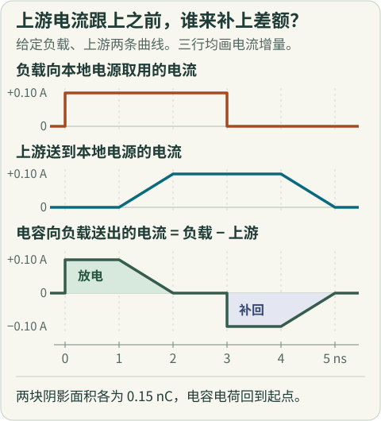

# 从电源到逻辑门：降压能省多少电，时钟还能跑多快？

稳压器的输出是 **0.80 V**。把电压表移到芯片里正在工作的模块，红表笔接门旁的 VDD，黑表笔接门旁的 VSS，读到的却是 **0.78 V**。稳压器没有换档，少掉的 20 mV 在哪里？

[上一篇](../fanout-and-wire-delay/README.md#activity)的 1 GHz 数据通路里，每个节点都有要充放电的电容。先沿供电和回流路径找出一只门实际拿到的电压，再把这个电压带回 50 fF 节点，算一趟充电要花多少能量、数据能不能赶上下一拍。

## 从电路板量到裸片，中间经过哪些连接？ {#board-to-die}

先把板上那颗芯片翻过来看。以一颗单裸片的倒装球栅阵列封装为例，底面一排排焊球把**封装基板接到电路板**。再往封装里看，裸片带电路的一面朝向基板，另一组更细密的凸点把**裸片接到基板**。采用引线键合的封装则用细金属线把裸片焊盘引到基板或引线框架。只看封装底面的焊球，还分辨不出裸片采用了哪种连接。[Amkor 的倒装 BGA 剖面](https://amkor.com/wp-content/uploads/2018/02/FCBGA_DS831.pdf)

按这颗倒装芯片的制造顺序看，晶圆筛测先记录各裸片单元的结果，切割后取出合格裸片，接到封装基板上。封装成品经过终测，才会拿到板上焊接。这样回到电路板，便能把板上的焊点和封装内的凸点分清。[从晶圆筛测、切割到封装与终测](../../chip-development/FAB/wiki/01-overview/from-wafer-to-product.md)

回到这颗倒装芯片，先让模块稳定取电。稳压器送出的电流沿板上的电源铜面、供电焊球、基板布线和裸片凸点进入片内金属网，最后到达门旁的 **VDD**。从门旁 **VSS** 流出的电流经过地网、接地凸点和焊球，回到板上稳压器的地端。实际模块有许多条并联通路。把红表笔放在门旁 VDD，黑表笔放在本地 VSS，才能量到这只门实际使用的供电电压。有些 GPU 与 HBM 合封的芯片还多一层硅中介层，信号可以在里面横向走到另一颗裸片。[沿 GPU 与 HBM 的剖面辨认横向和垂直互连](../../chip-development/FAB/wiki/04-back-end-packaging/hbm-as-case-study/ai-gpu-hbm-package-architecture.md#hbm-section)

## 只移动黑表笔，为什么 0.788 V 变成了 0.780 V？ {#supply-loop}

把刚才经过的焊点、走线和接触一起收进下面这张电路图。选稳压器的地端作为 0 V，分别量去程的压降和回程的压降。

图中把整个供电回路的等效电感集中画在上方。先让**整个模块**稳定取电 2 A，电流不变，电感上的电压为零。把正向路径等效为 6 mΩ，回流路径等效为 4 mΩ。稳态下这两段都流过 2 A，在电阻上形成 **I × R** 的电压降，也叫 **IR drop**。保持红、黑表笔的读数定义为“红端电位减黑端电位”，分三次量。

| 红表笔 | 黑表笔 | 电压表的读数 |
| --- | --- | --- |
| 稳压器正端 | 稳压器地端 | **0.800 V** |
| 门旁 VDD | 稳压器地端 | 0.800 V − 2 A × 6 mΩ = **0.788 V** |
| 门旁 VDD | 门旁 VSS | 0.788 V − 2 A × 4 mΩ = **0.780 V** |

为什么最后要再减 8 mV？沿回流电流方向，电位从本地 VSS **降到**稳压器地端。所以稳压器地端取 0 V 时，本地 VSS 在 **+0.008 V**。只测门旁 VDD 对远端地，就漏掉了这段回路。功率也能对上：电源输出 0.80 V × 2 A = 1.60 W，负载得到 0.78 V × 2 A = 1.56 W，差的 **40 mW** 正好等于两段导线中的 I²R 损耗。真实供电网有很多并联支路，可以把各处的负载电流加到提取的电阻网络上，逐点计算稳态压降。[OpenROAD 的静态 IR drop 分析](https://openroad.readthedocs.io/en/latest/main/openroad/psm/README.html)

## 一批门刚开始翻转，额外的电流从哪里来？ {#decoupling}

把时间退到这批门切换之前。去耦电容的两个电极分别接本地 VDD 和 VSS。上电时，上游电源已经给它充过电。若负载保持稳定，理想电容的平均电流为零，两极板间的电场仍储存着能量。

现在许多门同时开始给输出电容充电，负载需要的电流迅速增加。上游路径除了电阻还有电感，回路上的电感电压满足 **V = L × dI/dt**。有限的电压只能让电感电流以有限速度变化。于是刚开始，原有的上游电流仍在流，新增需求有一部分来不及从远端送到。去耦电容的正极板经本地 VDD 给正在翻转的负载供电，回流从本地 VSS 回到负极板。这条短回路每送走一些电荷，去耦电容两端的电压就随之下降。[ADI MT-101 对去耦电流路径的说明](https://www.analog.com/media/en/training-seminars/tutorials/MT-101.pdf#page=2)

把**电容向负载放电**记作正方向。在本地 VDD 节点，**电容电流 = 负载电流 − 上游电流**。两条曲线之间的差给出当时由电容承担的电流，把这段差对时间累加，就得到电容送出的电荷。等负载需求回落，或者上游继续送来的电流超过负载需求，差变成负值，同一只电容开始充电。判断电压恢复了多少，要看之后补回多少电荷。

沿图读到 **1 ns**。图中画的是相对翻转前的增量，负载已多取 **0.10 A**，上游暂时维持原电流。这 1 ns 内电容交付 **ΔQ = 0.10 A × 1 ns = 0.10 nC**。取有效电容 **10 nF**，忽略它的串联电阻和电感，电容电压就降低 **ΔQ/C = 10 mV**。从 1 到 2 ns，上游多送的电流逐步追上负载，电容又送出 0.05 nC，累计下降 15 mV。3 ns 后负载回到原来的水平，上游仍多送一阵，到 5 ns 恰好补回 0.15 nC。这个例子给定了电流的形状，用来练习读电荷和电压。要预测某个模块的实际最低电压，还要知道切换前的电压、实际电流波形以及整条供电网的阻抗。[封装供电与去耦的手算示例](../../chip-development/FAB/wiki/06-cross-cutting-engineering/power-delivery-pi-pdn-decap.md)

再让同样一批节点各翻转一次。集中到一拍时，它们同时取电；分批启动时，同样的充电需求摊到了几个时段。在供电近似相同、节点都完成全摆幅翻转的条件下，总切换能量可以很接近。若观察窗口也相同，平均切换功率就接近。但瞬间需要的电流和它上升的快慢可以差很多。要降低持续压降，可以减小供电网的电阻；要为快边沿就近补电，应缩短去耦回路并降低其阻抗；调度上错开启动也会改变电流波形，同时可能增加完成任务的时间。[分别检查功耗、最低电压与时序](../../chip-development/process/03_backend_physical_design/06_power_analysis.md)

## 降了 0.1 V，电路上哪两个点之间的电压变了？ {#levels}

已经知道本地电压怎样量，现在另选两个稳定的工作点，**直接给定门旁 VDD − VSS 分别为 0.8 V 和 0.7 V**。前面 0.780 V 的稳态算例和 10 mV 的瞬态算例各自独立。驱动门、接收门在同一供电域，接下来都以本地 VSS 为 0 V。反相器输入 A 从高变低，输出 Y 从零上升，最终分别接近 0.8 V 和 0.7 V。例如把示波器固定在 0.75 V 处触发，第一档的上升沿会越过它，第二档即使充满也到不了。

先分清前三种电压各在哪里量。

| 量 | 怎么量 | 它告诉我们什么 |
| --- | --- | --- |
| 本地供电电压 | 探头两端分别接门旁的 VDD 和 VSS | 这一处实际能用的电压摆幅 |
| 晶体管阈值电压 | 对单只 MOS 管，按规定的体偏置、温度和电流等条件确定栅源电压 | 描述沟道开始明显导电的器件特性。接近阈值时仍有电流，驱动能力还会随栅压变化 |
| 逻辑输入门限 | 在接收门的输入引脚，以它的本地 VSS 为参考 | 输入电压低到什么范围可保证识别为 0，高到什么范围可保证识别为 1 |

我们给示波器另定一个**计时标记**，两次都在 Y 达到本次供电的 50% 时停表。因此游标从 0.40 V 改为 0.35 V。这样能在相同的相对位置比较边沿。要判断后一级能否可靠识别高低电平，还要看该接收门在对应供电下的规格。[MOS 栅极怎样改变沟道](../bands-to-channel/README.md) · [怎样读出接收门的输入范围](../cmos-logic-gates/README.md#levels)

## 同一只电容充满一次，电源少做了多少功？ {#energy}

让 Y 在两次实验中都从零充到本次电源电压。先取电容 C 恒定，考虑恒压电源通过上拉管给这个负载充电。充满后，Y 增加的电荷为 **Q = CV**。电源每送出一单位电荷，做的功等于供电电压乘以这份电荷，所以这次充电从电源取走 **E = VQ = CV²**。

| 本地供电 | 充满所需电荷 | 一次充电从电源取走的能量 |
| --- | --- | --- |
| 0.8 V | 50 fF × 0.8 V = **40 fC** | 0.8 V × 40 fC = **32 fJ** |
| 0.7 V | 50 fF × 0.7 V = **35 fC** | 0.7 V × 35 fC = **24.5 fJ** |

少了 0.1 V，差别有两份。要送的电荷变成原来的 7/8，每份电荷从电源取得的能量也变成原来的 7/8。两者相乘，一次上升节省 **1 − (7/8)² ≈ 23.4%**。若每秒上升次数不变，这组负载的平均切换功率也降低 23.4%。想看供电能量怎样分到电容和充电路径，可以回到上一篇的游标实验。[观察充电过程中的能量](../fanout-and-wire-delay/experiment.html#load-energy) · [MIT 的 CMOS 延迟与功耗讲义](https://ocw.mit.edu/courses/6-012-microelectronic-devices-and-circuits-fall-2009/resources/mit6_012f09_lec16_scaling/)

## 要搬的电荷少了，为什么爬到半高反而更慢？ {#drive}

先做一个对照。沿用上一篇的固定电阻模型，从零开始给电容充电。只要 R 和 C 都固定，到达本次电源一半的时间始终是 **RC × ln(2)**。把供电和计时门限一起降低，波形在纵轴上缩小，到达半高的时刻却不动。换回真实的反相器，还得看上拉管在新供电下能送出多大的电流。

输入 A 已降到 0 V 时，上拉 PMOS 的栅极接近地，源极接本地 VDD。供电从 0.8 V 降到 0.7 V，源与栅之间的压差也从 0.8 V 降到 0.7 V。在同一器件、相同体偏置与温度下，建立空穴沟道的驱动减弱。在负载充电的过程中，PMOS 源漏之间可用的压差也随 Y 改变。于是电荷每一刻送来的速率都要重新算。尤其接近器件阈值时，再降一点栅源压差，驱动电流就可能显著下降。[回看 PMOS 的源、栅与沟道](../bands-to-channel/README.md#pmos) · [Gonzalez 等人的 CMOS 供电、阈值与延迟分析](https://web.stanford.edu/class/archive/ee/ee371/ee371.1066/handouts/gonzalez_97.pdf)

只看从零到半高的这段时间。把这段实际送到负载的电荷除以用时，就得到**这段的平均净充电电流**。反过来，已知它，就有 **到半高的时间 = 到半高需要的电荷 ÷ 平均净电流**。下面给定两档教学用电流，比较所需电荷和充电电流各自的降幅。

在 0.8 V 下，充到 0.40 V 要 **20 fC**。取平均电流 **0.40 mA**，用时是 **50 ps**。在 0.7 V 下，充到 0.35 V 只需 **17.5 fC**，取平均电流 **0.28 mA**，用时却变成 **62.5 ps**。电荷少了 12.5%，送电荷的速率少了 30%，于是到半高反而多用 25% 的时间。可以试着把低压档的平均电流调到 **0.35 mA**。它刚好也在 50 ps 到达半高，因为电荷和电流都只比高压档少 12.5%。这三组电流是为了显出机制而给定的值。实际电路要在相应电压、温度、输入转换时间和负载下，使用晶体管模型或标准单元时序库求延迟。[调节平均充电电流，比较两档到达半高的时间](experiment.html#edge)

## 一个门多等了片刻，为什么可能要调整整条时钟？ {#timing}

把第一个寄存器发出数据的时钟上升沿定为 0 ns。它的 Q 经过一段时间才给出新值。这个值穿过几级门和连线，要在下一个上升沿之前送稳到第二个寄存器的 D，并给它留下建立时间。为时钟不确定性等因素保留的时间，也要计入这一拍的预算。[第四篇的建立时间与保持时间](../latch-and-divider/README.md#timing)

取一条单周期路径，以该供电下的寄存器和组合逻辑时序数据核算。假设发射寄存器时钟到 Q、沿途数据延迟、接收寄存器建立时间与预留量合计，在 0.8 V 下需要 **0.86 ns**，在 0.7 V 下需要 **1.08 ns**。这是独立的路径算例。上节 50 ps 和 62.5 ps 只描述单个简化节点充到半高，整条路径还包含不同的门、连线和寄存器。

- **0.8 V，1 GHz。** 相邻上升沿相隔 1.00 ns。拿 1.00 减去 0.86，还剩 **0.14 ns** 建立余量。
- **0.7 V，仍为 1 GHz。** 下一沿照旧在 1.00 ns 到来，路径却需要 1.08 ns，余量为 **−0.08 ns**。当输入变化走过这条慢路径时，接收寄存器可能来不及可靠采到新值。
- **0.7 V，改为 900 MHz。** 下一沿改在约 1.111 ns 到来，给同一条路径留下约 **0.031 ns** 的余量。降频做的是把截止时间向后移，低压下的路径仍需 1.08 ns。

只考虑这条路径的建立约束，频率上限是 **1 / 1.08 ns ≈ 925.93 MHz**，通常粗写成约 926 MHz。实际选择频点要留在满足预算的一边，还须核对其他路径。反过来，如果所有相关路径在低压下依然赶得上 1.00 ns，且其他工作条件也满足，就可以保留原来的 1 GHz。保持时间关注的是发射沿之后数据会不会**过早**改变，须按最短路径另查。片上存储器也有自身的读、写和保持条件。[移动下一个时钟沿，查看路径余量](experiment.html#clock) · [为什么还要检查最短路径](../pvt-and-path-delay/README.md#数据到得过早同样有风险)

## 选好电压和频率，这段程序最后省了什么？ {#dvfs}

芯片会在规定的工艺、温度与供电条件下验证可用的频率和电压组合。**动态电压频率调整（DVFS）**让系统随负载选择这些工作点。Linux 把设备支持的这类组合称为工作点（OPP）。对同一段计算，调电压改变每次翻转的能量，调频率还会改变完成计算的时间。[Linux 内核的 OPP 说明](https://docs.kernel.org/power/opp.html) · [芯片开发中的低功耗设计](../../chip-development/process/02_frontend_design_and_verification/07_low_power_design.md)

两档之间怎么切换？在这个单供电域例子里，从 0.8 V、1 GHz 降到低档时，可以先把时钟降到 900 MHz，再把电压降到 0.7 V。反过来，先把电压升回并稳定在 0.8 V，再升到 1 GHz。这样中途也能避开刚才算出的 0.7 V、1 GHz 负余量组合。[Linux 通用 OPP 实现中的调压与调频顺序](https://kernel.googlesource.com/pub/scm/linux/kernel/git/stable/linux-stable/+/4a6808f347a3f969e56e8e4274e70849ecdc33de/drivers/base/power/opp/core.c)

沿用上一篇的程序 A，固定要做的工作为 **1,000 拍**。假设调频后所需拍数不变，1,000 个 50 fF 节点仍各自平均每拍上升 0.25 次。两种工作点都恰好产生 **250,000 次**全摆幅上升。

| 供电与时钟 | 做完 1,000 拍 | 这组负载的切换能量 | 执行期间的平均负载切换功率 |
| --- | --- | --- | --- |
| 0.8 V，1 GHz | 1 µs | 250,000 × 32 fJ = **8 nJ** | **8 mW** |
| 0.7 V，900 MHz | 约 1.111 µs | 250,000 × 24.5 fJ = **6.125 nJ** | **5.5125 mW** |

对这项固定工作，节省的负载切换能量仍是 **23.4%**。较低频率把这笔能量摊在更长的时间里，所以平均负载切换功率从 8 mW 降到 5.5125 mW，减少约 **31.1%**。若只降频、保持电压和总翻转次数，每次翻转的能量仍一样，这笔负载能量也一样。要算整片完成任务的能量，还要把运行期间的漏电、内部功耗、存储与其他电源域的开销加回来。

回到开头。一次电压跌落会不会妨碍计算，得看它何时发生、经过这片供电网的哪段逻辑当时正在翻转，以及那条路径还剩多少余量。现在把两只寄存器和中间的连线都固定下来，连时钟周期也不变。为什么换一批硅片或改变温度，数据既可能赶不上下一拍，也可能过早改变？[终章 · 同一条逻辑路径，为什么既可能太慢，也可能太快？](../pvt-and-path-delay/README.md)
