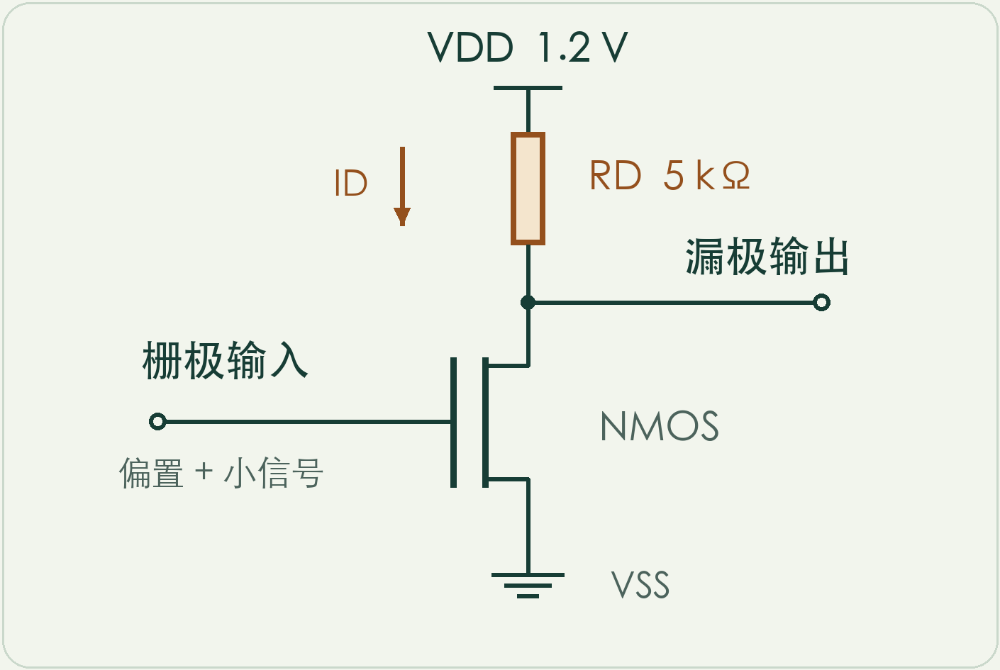

# 晶体管为什么能放大微弱信号

数字反相器的输入靠近电源轨时，输出通常很接近另一条电源轨。如果把输入放在传输曲线陡峭的一段，同样是输入增加几毫伏，输出却可能下降几十毫伏。要看清这件事，先把 CMOS 反相器的上拉管换成一只电阻。

## 把漏电流的变化变成电压变化

源极接地，栅极接输入，漏极接输出。电源 VDD 经电阻 RD 向漏极供电，电流再经 NMOS 回到地。输入、输出都以源极为参考，因此称为**共源级**。忽略输出端额外的直流负载时，输出电压为 **Vout = VDD − IDRD**。

先给栅极一个直流电压，让 NMOS 在饱和区工作并留出输出摆幅。这个静态条件称为**偏置**。在该工作点、保持漏源电压近似不变时，漏电流对栅源电压的局部斜率称为**跨导** gm，单位是安培每伏（西门子）。输入略微上升，沟道电流增加，电阻上的压降增大，漏极电压下降。这三个变化解释了放大器为什么反相。[MIT 6.012 单管放大级](https://ocw.mit.edu/courses/6-012-microelectronic-devices-and-circuits-fall-2009/resources/mit6_012f09_lec18/)

## 手算一次 5 mV 的扰动

取一组教学参数。VDD 为 1.2 V，RD 为 5 kΩ，静态漏电流为 100 µA。输出静态电压为 **0.70 V**。假设偏置使 NMOS 保持在饱和区，工作点跨导为 1 mS，晶体管输出电阻远大于 5 kΩ，信号频率也足够低。

1. 在栅极偏置上叠加 +5 mV，漏电流约增加 1 mS × 5 mV = **5 µA**。
2. 电阻压降约增加 5 µA × 5 kΩ = **25 mV**。
3. 输出由 0.70 V 变到约 **0.675 V**。小信号电压增益约为 −5。

栅极信号控制电流，直流电源向电路供能。若输入变化太大，管子会离开原工作区，输出也受电源轨限制。若输出并接较大的电容，频率升高后，要让输出在半个周期内摆到同样的幅度就更困难。这个增益只适用于所选工作点和频段。[MIT 单管放大级讲义](https://ocw.mit.edu/courses/6-012-microelectronic-devices-and-circuits-fall-2009/resources/mit6_012f09_lec18/)

## CMOS 反相器也能作放大级

把上拉电阻换回 PMOS。在两管同时导通的转换区，输入升高会增强 NMOS 下拉，同时减弱 PMOS 上拉，输出的变化可以大于输入的变化。把输入固定在稳定的高或低电平附近，局部斜率一般很小。两种用途对应同一条传输曲线上的不同工作点。[CMOS 反相器的传输曲线与电平](../silicon-to-logic/README.md)

在一种典型的 Pierce 振荡器里，大电阻把**未缓冲反相放大级**的输出接回输入，建立靠近转换区的直流工作点。晶体和电容则影响交流信号怎样返回输入。理解偏置后，就可以沿着完整的反馈回路看[石英振荡器怎样起振](../quartz-oscillator/README.md)。[ST AN2867 振荡器设计指南](https://www.st.com/resource/en/application_note/cd00221665.pdf)
