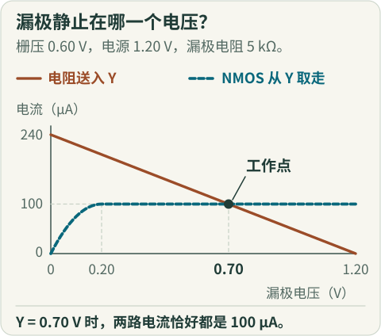
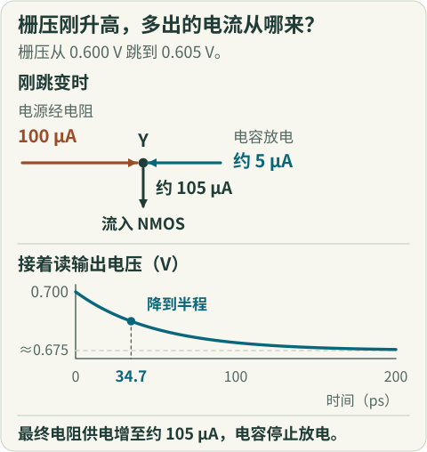
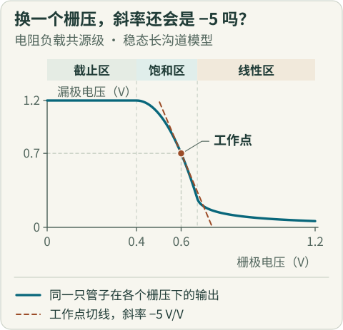
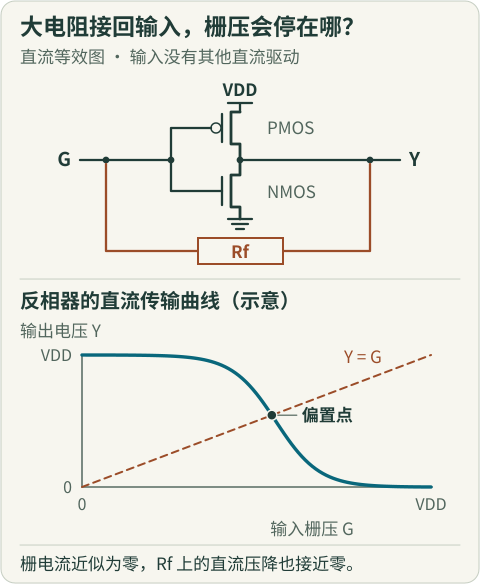

# 栅压只升高 5 mV，漏极电压为什么能下降 25 mV？

把两支电压探针同时接到一只 NMOS 上，一支量栅极，一支量漏极。调好电路，第一支读 0.600 V，第二支读 0.700 V。现在只把栅压往上推一点，推到 0.605 V。等读数稳定，漏极却降到了约 0.675 V。**栅极隔着绝缘层，这里多出来的 25 mV 压降究竟落在哪里？**

[上一篇的锁存器](../latch-and-divider/README.md#timing)用了两只首尾相连的反相器。我们把环拆开，只看一级，再把上拉的 PMOS 暂时换成一只电阻。用电压表量电阻两端的压降，再除以阻值，就能知道电源往漏极送了多少电流。

## 栅压还没动时，漏极为什么停在 0.700 V？ {#bias}

图中源极与体端接地，输入加在栅极。电源 VDD 为 1.2 V，经过一只 5 kΩ 的电阻 RD 接到漏极。把电阻和漏极的交点叫作 **Y**，它也是输出。输入、输出都以源极为电压参考，这种接法叫**共源级**。

先把栅极固定在 **0.600 V**，让电路稳定。假设这只教学器件的阈值是 0.400 V。栅源电压高出阈值的部分叫**过驱动电压**，此时是 0.200 V。沿用[沟道篇的理想长沟道模型](../bands-to-channel/README.md#pinch-off)，给本篇的管子取 k = 5 mA/V²。在饱和区，漏电流 ID = k(VGS − VT)²/2，代入得到 **100 µA**。

输出只接高阻探针。稳态时，电阻送进 Y 的电流与管子从 Y 取走的电流相等。100 µA 流过 5 kΩ，电阻上端比下端高 **0.500 V**。上端由电源固定在 1.200 V，下端 Y 就是 **0.700 V**。再回头检查刚才的假设：此时漏源电压 0.700 V 高于过驱动 0.200 V，满足模型的饱和条件。把信号加进来之前先建立的这组电压、电流，叫**直流工作点**。给栅极加上那 0.600 V 的过程，就是在设定**偏置**。

也可以从两个相反的方向找这个点。假设栅压不变，先把 Y 临时拉到 0.800 V 再松手。电阻当下只能送来 80 µA，NMOS 仍取走约 100 µA，Y 会下降。若从 0.600 V 松手，电阻能送来 120 µA，Y 会上升。上下两股电流相抵时，Y 才停下来。这也是稍后用来解释放大的同一个机制。[MIT 6.012：共源放大级和工作点](https://ocw.mit.edu/courses/6-012-microelectronic-devices-and-circuits-fall-2009/resources/mit6_012f09_lec18/)

## 栅极多了 5 mV，为什么 Y 向下走了约 25 mV？ {#gain}

保持源、体接地。把栅极从 0.600 V 提到 0.605 V，栅下电场随之改变，源端附近能维持的反型电子更多。在相同的漏源电压下，沟道可以输运更多电子。电子从源端进入沟道、净流向漏端，按常规电流记号，就是管子从 Y 向地取走的电流增大。调节栅压会给输入电容充电；理想栅介质隔开了栅极与沟道。[回看栅极怎样调节沟道中的电荷](../bands-to-channel/README.md#channel-voltage)

多取多少？想象先用另一台电源把漏压固定，测栅压在 0.600 V 附近改变一点时漏电流改变多少。电流变化除以栅压变化的局部斜率，叫**跨导** gm。把上面的平方公式在这个工作点取斜率，得到 gm = k(VGS − VT) = **1 mS**。这个单位读作毫西门子，在这里等于栅压每升 1 mV，漏电流约增 1 µA。[胡正明《现代半导体器件》第 6 章，式 6.6.8](https://www.chu.berkeley.edu/wp-content/uploads/2020/01/Chenming-Hu_ch6-1.pdf#page=19)

回到电阻负载。漏端可以自行改变电压，管子在这次小变化前后仍处于饱和区。先忽略饱和区电流对漏压的微弱依赖，用工作点的斜率手算：

1. **栅端**增加 5 mV，漏电流约增加 1 mS × 5 mV = **5 µA**。
2. **电阻**要持续多送 5 µA，压降就要再增加 5 µA × 5 kΩ = **25 mV**。
3. **输出 Y** 在电阻下端。上端的电压固定，压降增加意味着 Y 从 0.700 V **降到约 0.675 V**。

对输入和输出都只取相对原工作点的变化，得到**小信号电压增益** ΔVY/ΔVG ≈ −gmRD = **−5**。负号说明两支探针的读数向相反方向变化。若输入摆动得足够慢，上半个波峰会在输出变成向下的波谷。从绝对电压 0.600 V 到 0.700 V，描述的则是偏置，两者的比值算不出这个增益。

| 栅压 | 用同一平方模型算出的漏电流 | 用电阻压降算出的 Y |
| --- | ---: | ---: |
| 0.595 V | 95.0625 µA | 0.7246875 V |
| 0.600 V | 100 µA | 0.7000000 V |
| 0.605 V | 105.0625 µA | 0.6746875 V |

在工作点作一条贴着平方曲线的直线，沿这条切线读数，就是刚才用跨导做的小信号近似。表中保留更多小数，方便比较。栅压向上、向下各变 5 mV，Y 实际按这个模型分别下降 **25.3125 mV**、上升 **24.6875 mV**。两次都接近 25 mV，又略有不同，因为平方曲线越往右越陡。可以自己[调节栅压，比较两次读数与局部增益](experiment.html#gain)。

## 漏极电压还没来得及变，多出的电流从哪里来？ {#step}

给 Y 与地之间接入 **10 fF** 负载电容，再把栅压从 0.600 V 快速抬到 0.605 V。这一次把时间放慢。只保留该负载电容，假设栅端由理想阶跃驱动，忽略栅漏耦合、沟道建立时间和其他寄生效应。设流入 Y 的电阻电流为 IR，离开 Y 的漏电流为 ID，则 **C dVY/dt = IR − ID**。[回看一个输出节点的充放电](../cmos-logic-gates/README.md#edge)

- **刚抬高栅压。** Y 的电压还在 0.700 V，电阻两端仍差 0.500 V，它只能送来 100 µA。管子已经要取约 105 µA。相差的约 5 µA 起初由输出电容放电提供。按电子方向看，接地的源端经沟道向 Y 补入电子，Y 一侧极板原先的净正电荷减少，电压开始下降。
- **下降的途中。** Y 越低，电阻两端的压差越大，电阻送来的电流越多。两股电流的差越来越小，波形也越来越平。以这个模型的终值来算，约 **34.7 ps** 后已经走完总降幅的一半，Y 约为 **0.6873 V**。这是 RDC = 50 ps 再乘以 ln 2 的结果。
- **到达新平衡。** 电阻和 NMOS 都传输约 105 µA，电容的净电流回到零。若栅压随后降回 0.600 V，管子先少取电流，电阻送来的余量会重新给 Y 充电。把负载换得更大，两端的稳态读数相同，到达它们需要更久；输入变化得太快时，Y 还没来得及走完这段路，下一次变化就到了。[逐时刻比较两股电流和输出电压](experiment.html#step)

如果只数电子，可以把两次稳态做一次核对。Y 下降 25.3125 mV，电容 Y 侧极板的净电荷就减少 10 fF × 25.3125 mV ≈ **0.253 fC**，相当于这侧净多了约 **1,580 个电子**。这个数来自流入与流出两股电流之差。Y 稳定以后，两股电流仍在持续，极板上的电子便不再净增加。

**持续供能的是哪一端？** 在原工作点，即使输入静止，1.2 V 电源也在向这条支路供给 100 µA，对应 **120 µW**。其中电阻耗散 50 µW，管子耗散 70 µW。栅端的微小变化调节了这股供电电流。上面得到的“五倍”只比较两个电压的变化，计算输出能向外部负载交付多少功率，还要知道负载及其电流。

## 同样加 5 mV，换个起点还会放大五倍吗？ {#range}

把栅压从 0.300 V 提到 0.305 V，两次都低于本例的阈值。在这套忽略亚阈值电流的模型里，NMOS 截止，电阻几乎没有压降，Y 贴着 1.2 V。这个位置的局部斜率接近零。原来先把输入放在 0.600 V，正是要让信号的正、负两半都能沿曲线改变输出。

再把栅压推到 0.800 V。若继续硬套饱和区平方公式，会算出 400 µA；可就算把 Y 直接接到地，1.2 V 经 5 kΩ 电阻最多也只能提供 **240 µA**。电路实际会在低漏压处重新平衡，此时 VDS 小于过驱动，管子进入**线性区**，电流同时受栅压和漏压控制。这里“线性区”是 MOS 管的工作区名。放大器在原来的饱和区偏置点附近，同样能对小信号作线性近似。把过大的输入正弦波跨过几个区域，输出上下两半的形状就会变，发生失真。[胡正明，第 6 章的漏极电流工作区](https://www.chu.berkeley.edu/wp-content/uploads/2020/01/Chenming-Hu_ch6-1.pdf#page=18)

接上实际的输出负载，为什么增益也会变？

真实器件在饱和区时，固定栅压再改变漏压，电流通常仍会稍有变化。工作点附近，这种作用可以用管子的**小信号输出电阻** ro 表示。对于交流小变化，理想直流电源是电压不动的端点，RD 和 ro 都成为 Y 通往固定电位的支路。在相同偏置点，若再接一只只对交流起作用的负载电阻 RL，低频增益约为 −gm(RD ∥ ro ∥ RL)。并联后的等效电阻越小，同样的电流增量能换来的输出电压变化越小。若负载也取直流电流，应先重新求静态工作点。[MIT 6.012：共源级的小信号模型](https://ocw.mit.edu/courses/6-012-microelectronic-devices-and-circuits-fall-2009/resources/mit6_012f09_lec18/)

## 换回 PMOS，同一只反相器怎样放大微弱信号？ {#inverter}

把电阻换回 PMOS，上管源极接电源，下管源极接地，两栅共用输入，两漏仍接 Y。先看下图的下半幅，暂将上半幅的大电阻断开，由外部电压源缓慢扫输入，在每一点等 Y 稳定下来，就能得到[门电路篇的直流传输曲线](../cmos-logic-gates/README.md#levels)。靠近两端，Y 接近一条电源轨，输入再挪一点，Y 变化很小。把输入移到中间的陡坡，上下两只管都在导电，静态时上管送入与下管取走的电流相等。

假设输入再升高一点，而 Y 暂时来不及变。下管的栅相对地更高，**下拉电流增加**。上管的栅更接近它的源极，**上拉电流减少**。这两项一起使流入 Y 的净电流变负，Y 开始放电，直到上下管在较低的输出电压上再次平衡。若工作点处曲线斜率的绝对值大于 1，输出的电压变化就比输入大。具体大多少，由这两只管子及负载决定；前面的 −5 来自那只 **5 kΩ 电阻负载共源级**。[TI：用未缓冲 CMOS 反相器作放大器](https://www.ti.com/lit/an/szza043/szza043.pdf)

## 怎样让它停在陡坡上，等石英送回微小信号？ {#pierce}

现在看图的上半幅。取一只适合作模拟放大的**未缓冲反相器**，移开原来固定栅压的电压源，用一只大电阻从 Y 接回输入。先只看直流，假设输入漏电很小。稳定时，反馈电阻上几乎没有压降，因而 **输入电压约等于输出电压**。在图上画出这条等值线，它与反相器传输曲线的交点就是新的工作点。它常在转换区附近，具体电压取决于器件。

可以试着把输入往高处拨一点。反相器会把 Y 拉低，反馈电阻便使输入端的电荷朝降低输入电压的方向变化。沿这条直流反馈路走一圈只经过**一次反相**，偏离工作点的小变化受到纠正。第四篇的存储环走一圈经过**两次反相**，会在转换区把微小差异进一步放大，最终落在两个稳定状态之一。[回看两次反相怎样保持一位](../latch-and-divider/README.md#feedback)

接入石英和负载电容后，变化着的信号还有一条与频率有关的返回路径。大电阻先给放大级定下工作点；上电扰动中的哪一种频率能绕一圈回来继续增强，要沿这条交流路径去看。下一篇就从这里跟踪一次振动，看看电源怎样经放大器补回石英每周期的损耗。[石英振荡器怎样起振与稳幅](../quartz-oscillator/README.md) · [ST AN2867：Pierce 振荡器的偏置与反馈](https://www.st.com/resource/en/application_note/cd00221665-oscillator-design-guide-for-stm8af-al-s-stm32-mcus-and-mpus-stmicroelectronics.pdf)
