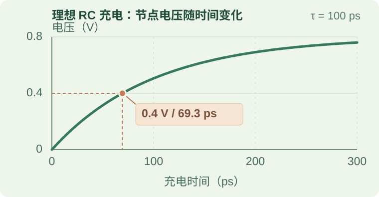

# 从电容充电到时钟边沿

上级：[半导体与电路基础](../README.md)

这篇导读保留原来的充电算例。从 RC 电路怎样反复翻转，到石英怎样定频、时钟怎样触发采样，各节都可直接接到对应的系列正文。

## 电压升到指定值要多久

图中，0.8 V 的电源通过 2 kΩ 电阻给 50 fF 电容充电。电容一端接到 0 V，图中画的是另一端相对它的电压。沿着 0.4 V 的虚线找到圆点，再向下读时间轴，就能看到电压达到 0.4 V 用了约 **69.3 ps（皮秒）**。

为什么曲线先陡后缓？刚接通时，电容电压为 0 V，电阻两端相差 0.8 V。随着电容电压上升，这个压差变小。同一个电阻上，压差越小，电流越小。连接电阻的极板积累电荷的速度也随之变慢，电压升得更慢。

电容越大，把电压提高同样的幅度就需要越多电荷。这个理想电路的时间常数是 **τ = R·C**，也就是电阻值乘以电容值。图中的 τ 为 100 ps，用来描述电压变化的快慢。见[电路与时序基础的 RC 算例](../../microarchitecture/02-pipeline/electrical-timing-foundations.md#2-用-rc-模型观察电压怎样上升)及 [MIT 6.002 的一阶电路讲义](https://ocw.mit.edu/courses/6-002-circuits-and-electronics-spring-2007/resources/6002_l12/)。

图中的 0.4 V 是用来读时间的参考值。现在让电路在电压到达指定值时切换输出。输出由低变高是**上升沿**，由高变低是**下降沿**。怎样让电路自己产生下一个边沿？

## 比较器怎样让翻转重复

把输出通过电阻接回电容，给比较器设置 0.6 V 和 0.2 V 两个切换门限。电容电压升到上门限，输出从高转低，电容随即开始放电。降到下门限，输出又把电容接回充电方向。这两段充放电合起来，产生下一个周期。完整的双波形和周期推导见[第六篇的 RC 振荡实验](../quartz-oscillator/README.md#rc)。

## 石英晶振怎样定频

石英的几何尺寸、切型和边界条件决定允许的机械振动模式。电极把机械振动与电信号联系起来，放大器经反馈补回损耗，缓冲器把模拟波形整形成逻辑边沿。可以在[第六篇的五点位移图](../quartz-oscillator/README.md#mode)中观察哪些位置在移动，再沿 [Pierce 电路](../quartz-oscillator/README.md#loop)找到供能和选频的路径。

## 时钟边沿怎样触发采样

25 MHz 参考时钟的相邻上升沿相隔 40 ns。沿到来之前，D 要满足建立时间；沿后，D 还要满足保持时间，Q 则经过传播延迟才给出新值。对照[第四篇的主从锁存器波形](../latch-and-divider/README.md#edge)和[器件手册的采样窗口](../latch-and-divider/README.md#timing)，可以看清每一段时间从哪个节点量起。

要继续算两个寄存器之间的组合逻辑能否赶上下一拍，见[寄存器路径算例](../../microarchitecture/02-pipeline/electrical-timing-foundations.md#4-算一条路径需要多长的时钟周期)。若系统要从 25 MHz 得到 50 MHz，可以先[逐沿追踪二分频](../latch-and-divider/README.md#divider)，再看 [PLL 的反馈回路](../integer-pll/README.md)。
