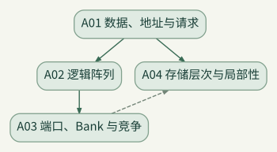

# 存储系统共同基础

一次读请求至少要指出待访问的位置以及需要取得的数据。如果同时收到多笔请求，存储资源还要判断哪些访问能够并行，哪些必须等待。这些问题在 SRAM、DRAM、Cache 和其他存储系统中都存在。

本专题先建立可以描述这些行为的共同模型，再研究负责存储的真实电路和系统机制。

## 贯穿算例与阅读边界

先定义一块可按字节寻址的教学存储器，从一次 4 B 读取跟踪地址、请求及返回的数据。再将逻辑存储划分为多个 Bank，比较相邻访问和具有固定步长的访问为什么产生不同的竞争。

A04 继续比较顺序读取相邻数据和反复读取同一数据的需求，说明为何需要存储层次和复用。它可以在 A01 后独立阅读。所有数值和并行能力都需要明确作为教学假设；不将任一器件的接口或时序推广为普遍规律。

在这里，存储单元可以先视为能够保存和返回数据的抽象资源。不提前推导 SRAM、DRAM 或 NAND 的物理电路，也不提前假定虚拟地址、缓存填充或特定内存协议。

## 知识关系

<figure class="micro-v2-map" markdown="1">

<figcaption>实线表示主要前置，虚线表示按需参考。A04 不需要先理解实际 SRAM 电路。点击可查看大图。</figcaption>

</figure>

## 阅读顺序 {#计划阅读顺序}

本专题规划四篇常规文章，尚未发布正文。

| 编号 | 文章 | 读完应理解什么 | 主要前置知识 | 状态 |
| --- | --- | --- | --- | --- |
| A01 | 一次访存请求，究竟要求存储器做什么？ | 数据、地址、读写请求、访问粒度、接纳与完成 | 无 | 未发布 |
| A02 | 大量存储单元怎样组成一块可寻址的存储器？ | 逻辑阵列、深度、位宽、译码、行列选择 | A01 | 未发布 |
| A03 | 四笔存储请求，为什么有时可以同时处理，有时只能排队？ | 端口、Bank、地址映射、资源竞争、访问并发 | A01、A02 | 未发布 |
| A04 | 为什么计算机不使用一块又大又快的存储器？ | 局部性、工作集、存储层次、数据放置、复用 | A01 | 未发布 |

## 从哪里来，接下来往哪读

想从真实电路出发，可结合[半导体与电路基础](../../semiconductor-foundations/README.md)。A02 的逻辑阵列只是抽象，电路路线在 [SRAM](../02-sram/README.md)、[DRAM](../06-dram/README.md)和[非易失性存储介质](../08-nonvolatile-media/README.md)中补齐。

理解数据地址和访问契约后，可以独立进入[片上存储组织](../03-on-chip-storage/README.md)、[Cache](../04-cache/README.md)和[地址翻译](../05-address-translation/README.md)。性能和数据完整性问题可按需进入[性能分析](../12-performance/README.md)及[可靠性](../11-reliability/README.md)。

更多阅读路线见[存储系统新版入口](../README.md)。原有[存储系统资料](../../storage/README.md)仍可阅读。
