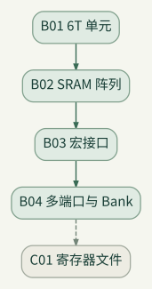

# SRAM 单元与存储宏

SRAM（Static Random-Access Memory，静态随机存取存储器）常用于芯片内的存储。它不仅要保住数据，还要在接口上接纳读写请求，并用有限的面积和能量提供足够的访问并发。

## 贯穿算例与阅读边界

假设芯片中有一块容量为 256 B 的 SRAM，共 64 个 32 bit 的 Word（字）。假设字地址 5 中保存了数值 1，现在计算单元要读取它，数据搬运引擎同时想写入字地址 6。

先跟着字地址 5 所对应 Word 的最低位的读写，理解一个 6T 单元怎样保存或改写状态（B01），再看 32 个 bit 怎样从阵列送到接口（B02）。假设四个 Word 共享一根字线，读出时怎样只选出目标字？

接着观察接口采样、读数据稳定及写入掩码（B03）。如果两个请求到达同一个只有一个读写端口的 Macro（存储宏），它们怎样等待？若增加端口，或将奇偶字地址交给不同的 Bank，有哪些操作可以并发，哪些仍会争用共同通路（B04）？

以上是教学配置，不代表具体存储 IP 的组织或时序。宏的接口规则、读写并发与同址行为须由目标实例规定。本专题关注存储单元、阵列与宏的实现；寄存器文件、片上缓冲和 Cache 如何管理数据，交给 C、D 专题。

## 知识关系

<figure class="micro-v2-map" markdown="1">

<figcaption>实线表示主要前置知识，虚线表示按需参考；跨专题的主要前置知识见下表。点击可查看大图。</figcaption>

</figure>

## 阅读顺序 {#计划阅读顺序}

本专题规划 4 篇正文。B01、B02 从一个存储单元走到一块阵列；B03 建立宏的访问契约，B04 解释增加并发需要哪些电路与资源。若只想了解寄存器文件、Scratchpad 或 Cache 的管理方式，可先从 A 专题进入相关系统角色，不必先掌握全部电路细节。

| 编号 | 文章 | 读完应理解什么 | 主要前置知识 | 状态 |
| --- | --- | --- | --- | --- |
| B01 | 六个 MOS 管怎样保存、读取和修改一个 bit？ | 6T SRAM、双稳态、读扰动、写入及保持 | 半导体与电路基础；A01 的 bit 概念 | 未发布 |
| B02 | SRAM 打开一整行单元，为什么只返回一个 Word？ | 字线、位线、预充、感测、行列译码、局部阵列 | B01、A02 | 未发布 |
| B03 | SRAM 在哪一拍接纳请求，数据又在哪一拍可用？ | Macro 接口、时序、读写掩码、同址读写 | B02 | 未发布 |
| B04 | 怎样让一块 SRAM 同时支持更多读写请求？ | 多端口、Banking、复制、时分复用及物理代价 | B03、A03 | 未发布 |

## 从哪里来，接下来往哪读

- [存储系统共同基础](../01-foundations/README.md)：先掌握位、字、寻址、端口及 Bank 等共同概念。
- [半导体与电路基础](../../semiconductor-foundations/README.md)：补充 MOS 管、反相器、反馈存储、电容充放电与时钟采样。
- [片上存储组织与显式管理](../03-on-chip-storage/README.md)和[Cache 与多级缓存](../04-cache/README.md)：将存储宏提供的能力用于寄存器文件、显式放置的片上缓冲和缓存等系统角色。
- [数据完整性与存储可靠性](../11-reliability/README.md)与[性能分析、建模与设计权衡](../12-performance/README.md)：进一步讨论错误检测、测试修复及系统级面积、能耗和吞吐权衡。

新版正文正在分篇建设，已有原理推导和实现细节可按需查阅[原 SRAM 资料](../../storage/02-sram/foundations/README.md)。

[返回新版存储系统总览](../README.md)
