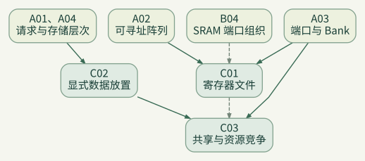

# 片上存储组织与显式管理

计算单元不仅需要保存操作数和中间结果，还需要在恰当的时刻取得它们。寄存器文件（Register File）、暂存存储器（Scratchpad）和紧耦合存储器（TCM）等组织，分别针对不同访问需求提供片上存储空间。

## 贯穿算例与阅读边界

沿用计算微架构中的小矩阵乘法：输入矩阵 X 为 2×4，权重矩阵 W 为 4×2。先关注运算所需的两个源操作数，再观察一份权重如何进入片上缓冲区，以及下一份权重能够在什么时候覆盖另一块区域。

假设某个片上存储体每拍只能接纳一次读或写。当前计算在读第一块缓冲区，搬运引擎准备写第二块缓冲区。即使两个区域的地址互不重叠，它们也可能落在同一个存储体（Bank）上，需要竞争访问机会。

从这个问题再回看 TCM 等紧耦合存储组织。已知数据的位置可以帮助分析访问时间，但还需要知道哪些请求者共享端口，以及等待是否有界。

本专题关注存储组织、可达性、端口、Bank 和容量怎样约束访问。计算时序、DMA 内部机制属于计算微架构；如何选择分块、布局、搬运及缓冲区分配属于编译器与运行时系统。理解显式管理不需要先掌握 Cache 或 DRAM。

## 知识关系

<figure class="micro-v2-map" markdown="1">

<figcaption>实线表示主要前置知识，虚线表示按需参考。C01 与 C02 是两条可分别进入的路线。 点击可查看大图。</figcaption>
</figure>

## 阅读顺序 {#计划阅读顺序}

本专题规划 3 篇常规文章。C01 关注寄存器文件如何供数；C02 建立显式数据放置的访问模型；C03 讨论多个请求竞争同一片上存储资源的情况。

| 编号 | 文章 | 读完应理解什么 | 主要前置知识 | 状态 |
| --- | --- | --- | --- | --- |
| C01 | 一条指令需要多个操作数，Register File 怎样同时提供它们？ | 寄存器文件、读写端口、标量与向量组织 | A02、A03；按需 B04 | 未发布 |
| C02 | 计算单元怎样找到并使用显式放在片上存储中的数据？ | Scratchpad、TCM、Local Memory、显式数据放置 | A01、A04 | 未发布 |
| C03 | 两块缓冲区的地址互不重叠，为什么搬运和计算仍可能争用？ | Shared Memory、Bank Conflict、权重与激活缓冲、多缓冲的资源约束 | C02、A03 | 未发布 |

## 从哪里来，接下来往哪读

- [存储系统共同基础](../01-foundations/README.md)：理解可寻址阵列、访问请求、存储层次、端口与 Bank。
- [SRAM 单元与存储宏](../02-sram/README.md)：进一步理解阵列的物理实现和多端口、Banking 等组织方式，按研究问题选择。
- [Cache 与多级缓存](../04-cache/README.md)：比较硬件管理的缓存副本与显式安排的数据放置；两条路线可以分别学习。
- [系统级存储组织与集成](../10-system-integration/README.md)：将本地缓冲扩展到多个计算单元、片上共享存储和外存。
- [计算微架构](../../microarchitecture-v2/README.md)和[编译器与运行时系统](../../compiler-runtime/README.md)：分别了解计算和搬运的执行机制、软件的布局与缓冲规划。

[返回存储系统新版导读](../README.md)
