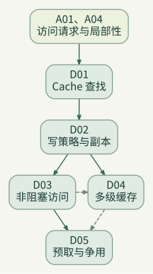

# Cache 与多级缓存

Cache 在计算单元附近保留其他存储位置中的数据副本。硬件负责查找、填充、更新和替换这些副本。命中本地副本可以减少向下级存储发出的请求，但管理副本也会占用容量、端口和带宽。

## 贯穿算例与阅读边界

延续旧版存储系列的两个整数：A[0] 位于物理地址 0x1000，A[1] 位于 0x1004，每个整数占 4 B。假设一级 Cache 以 64 B 为一行，初始没有目标行，也没有其他请求或预取影响这次访问。

先让第一次读取完整填充，观察第二次读取如何得到本地的 4 B。然后依次改变条件：修改 A[0]、让第二次请求提前到达、增加下一级 Cache、提前读取后续缓存行。跟踪这些变化如何影响缓存状态和向下游发出的请求。

本专题先假设请求已经获得正确的物理地址及访问权限，下级存储可以提供数据。学习 Cache 的基本机制不需要先掌握 MMU、DRAM 或存储控制器的内部实现。

本专题会解释缓存副本的有效性、写权限、脏数据和维护操作。多个节点如何通过消息取得权限和维护一致性，属于芯片与系统互连系列。

## 知识关系

<figure class="micro-v2-map" markdown="1">

<figcaption>实线表示主要前置知识，虚线表示按需参考。由已画出的路径涵盖的前置关系不重复画出，完整前置知识见下表。 点击可查看大图。</figcaption>
</figure>

## 阅读顺序 {#计划阅读顺序}

本专题规划 5 篇常规文章。D01、D02 建立读取与写入的副本管理机制；D03 讨论在途访问，D04 讨论多级组织，两者可分别进入。随后在 D05 比较预取带来的收益及额外开销。

| 编号 | 文章 | 读完应理解什么 | 主要前置知识 | 状态 |
| --- | --- | --- | --- | --- |
| D01 | 读取两个相邻整数，Cache 怎样知道第二个数据已经在这里？ | Cache Line、Tag、Set、Way、命中、填充、相联度、替换 | A01、A04 | 未发布 |
| D02 | 只修改 4 个字节，为什么 Cache 有时还需要取回整条缓存行？ | 写分配、写回、直写、脏数据、写权限与缓存维护 | D01 | 未发布 |
| D03 | 一次 Cache Miss 还没有完成，为什么后续读取可以继续执行？ | MSHR、请求合并、非阻塞 Cache、填充与写回缓冲 | D01、D02 | 未发布 |
| D04 | L1 Cache 没有找到数据，为什么不一定需要访问 DRAM？ | 多级缓存、副本关系、私有与共享缓存、跨层流量 | D01、D02 | 未发布 |
| D05 | 提前读取下一条缓存行，为什么有时反而让程序变慢？ | 预取、覆盖率、提前量、缓存污染与带宽竞争 | D01–D03 | 未发布 |

## 从哪里来，接下来往哪读

- [存储系统共同基础](../01-foundations/README.md)：先建立地址、粒度、存储层次与局部性的认知。
- [SRAM 单元与存储宏](../02-sram/README.md)：按需深入 Cache 的 Tag 与 Data 阵列的物理实现，不是基本查找机制的必修前置。
- [地址空间、翻译与保护](../05-address-translation/README.md)：理解虚拟地址和页表后，可在 E03 将地址翻译与本专题的 Cache 查找机制连接起来。
- [内存控制器与请求调度](../07-memory-controller/README.md)：当各级缓存及其他可用副本均不能提供数据时，继续分析主存的请求映射与服务过程。
- [一致性与内存互连](../../interconnect/COHERENCE/README.md)：深入副本权限、内存顺序、目录和协议事务。

[返回存储系统新版导读](../README.md)
