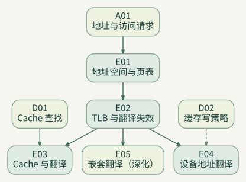

# 地址空间、翻译与保护

程序和设备使用的地址不一定直接对应存储器中的位置。地址翻译将请求中的地址转换到目标地址空间，并根据相应规则检查访问权限。本专题解释翻译所需的状态、访问路径，以及翻译与数据读取之间的关系。

## 贯穿算例与阅读边界

延续 Cache 专题的两个整数。假设某个程序中的 A[0] 位于虚拟地址 0x00403000，A[1] 位于其后 4 B。页大小为 4 KiB，A[0] 恰好在页首。假设页表允许读取，并将此页映射到物理地址 0x1000 开始的一页。

如果另一个程序的同一虚拟页映射到了 0x2000 开始的物理页，两者访问相同的虚拟地址将得到不同的内存位置。再让原程序连续访问 A[0]、A[1]，观察何时需要查页表，以及翻译结果怎样被保存和更新。

E01、E02 只追踪地址翻译和权限，以普通存储读取表示查找页表的过程。E03 才将地址翻译和一级 Cache 查找放在同一条访问路径中；E04 进一步比较 CPU 与设备的地址模型。

本专题主讲硬件翻译和保护机制。软件如何为设备分配并映射缓冲区，由编译器与运行时系统讲解；操作系统的一般内存管理不在此展开。PCIe、CXL 等接口如何承载请求，归芯片与系统互连系列。

## 知识关系

<figure class="micro-v2-map" markdown="1">

<figcaption>实线表示主要前置知识，虚线表示按需参考。由已画出的路径涵盖的前置关系不重复画出。E03 是 Cache 与地址翻译的汇合点，E05 为深化文章。 点击可查看大图。</figcaption>
</figure>

## 阅读顺序 {#计划阅读顺序}

本专题规划 4 篇常规文章和 1 篇深化文章。E01、E02 是共同基础；E03、E04 分别衔接处理器的缓存访问和设备的地址翻译；E05 讨论虚拟化场景，不是继续阅读其他文章的必要条件。前两篇不要求先学完 Cache 专题。

| 编号 | 文章 | 读完应理解什么 | 主要前置知识 | 状态 |
| --- | --- | --- | --- | --- |
| E01 | 两个程序访问相同的地址，为什么可以得到不同的数据？ | 地址空间、页、页表、多级翻译、权限、Page Fault | A01 | 未发布 |
| E02 | 每次读取之前，都需要重新遍历页表吗？ | TLB、Page Walker、ASID、翻译失效、大页 | E01 | 未发布 |
| E03 | 地址翻译还没有结束，为什么 L1 Cache 已经可以开始查找？ | PIPT、VIPT、VIVT、地址别名、翻译与查找并行 | E01、E02、D01 | 未发布 |
| E04 | 为什么不能总是将 CPU 使用的地址直接交给计算设备？ | 设备地址空间、IOMMU、设备 MMU、地址保护 | E01、E02 | 未发布 |
| E05 | 虚拟机中的一次访存，为什么有时需要两级地址翻译？ | 嵌套页表、Guest PA、Host PA、VMID | E01、E02 | 未发布（深化） |

## 从哪里来，接下来往哪读

- [存储系统共同基础](../01-foundations/README.md)：理解地址和访问请求的基本语义。
- [Cache 与多级缓存](../04-cache/README.md)：E03 需要 D01 的地址分解和命中判断，设备与 CPU 共享缓存的场景可按需参考 D02。
- [内存控制器与请求调度](../07-memory-controller/README.md)：区分虚拟地址到物理地址的翻译，与物理地址到具体存储资源的映射。
- [系统级存储组织与集成](../10-system-integration/README.md)：进一步理解多节点内存、异构内存、数据放置和统一地址之间的关系。
- [编译器与运行时系统：设备驱动与底层资源管理](../../compiler-runtime/05-device-driver/README.md)：理解软件如何建立设备可用的映射。[芯片与系统互连](../../interconnect/README.md)负责设备地址翻译的接口接入与一致性协议等机制。

[返回存储系统新版导读](../README.md)
