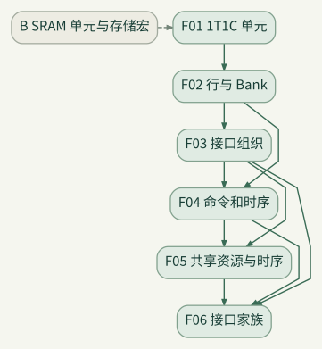

# DRAM 单元、阵列与接口

DRAM（Dynamic Random-Access Memory，动态随机存取存储器）利用电荷保存数据，适合构成较大容量的存储资源。一笔读取从存储单元走到数据引脚，要经历感测、恢复、行列选择与接口传输。

## 贯穿算例与阅读边界

假设一条普通 DDR4 通道有一个由八颗 x8 器件组成的 Rank（不含额外校验位），已完成初始化及训练，处于允许访问的状态。每次外部数据传输共 64 bit，若一次 Burst 有八次传输，就可送出 64 B。

跟着其中一颗器件里一个保存 1 的电容，观察读时电荷怎样变化，为什么需要恢复、为什么即使不读也要刷新（F01）。再把视角扩大到整行与 Bank，追问一次列读取为何只送出所需的一部分数据（F02）。F03 将这部分数据连接到八颗芯片共用的接口。

先假设同一个 Bank 里有三笔读取：A 和 B 位于同一行的不同列，C 位于另一行。Bank 起初未开行；依次处理它们时，要发出哪些命令，又有哪些等待（F04）？若将 C 改到另一个 Bank，哪些动作可以重叠，哪些仍受共享通路、读写切换和刷新约束（F05）？

最后改变接口组织，比较 DDR、LPDDR、GDDR 和 HBM 怎样面向不同系统目标（F06）。具体通道划分、命令及参数以器件和工作模式为准。本专题解释器件行为与接口契约；控制器怎样从合法候选中选择命令，交给 G 专题。

## 知识关系

<figure class="micro-v2-map" markdown="1">

<figcaption>实线表示主要前置知识，虚线表示按需参考；跨专题的主要前置知识见下表。点击可查看大图。</figcaption>

</figure>

## 阅读顺序 {#计划阅读顺序}

本专题规划 6 篇正文。从电荷保存到行列访问，再从器件组织到命令和时序，最后比较接口家族。想研究控制器的调度，需要掌握 F01、F03–F05 的相关约束；不要求先掌握所有接口家族或特定器件参数。

| 编号 | 文章 | 读完应理解什么 | 主要前置知识 | 状态 |
| --- | --- | --- | --- | --- |
| F01 | 一颗电容怎样保存一个 bit，为什么读取后还需要恢复数据？ | 1T1C、电荷共享、感测恢复、泄漏与刷新 | 半导体与电路基础；A01 的 bit 概念 | 未发布 |
| F02 | 只读取几个字节，DRAM 为什么要先打开一整行？ | 行缓冲、列选择、开关行、Bank、内部并行资源 | F01、A02 | 未发布 |
| F03 | 一次 64 B 读取，为什么可能由八颗 DRAM 一起送出？ | Channel、Rank、Chip、位宽、DDR、Prefetch、Burst | F02 | 未发布 |
| F04 | 同一个 Bank 连续读取三次，为什么等待时间可能不同？ | ACT、RD、WR、PRE、行状态、基本命令时序 | F02、F03 | 未发布 |
| F05 | 两笔请求位于不同的 Bank，为什么仍可能互相等待？ | Bank Group、共享资源、跨 Bank 时序、读写切换、刷新约束 | F03、F04 | 未发布 |
| F06 | 同样是 DRAM，为什么 DDR、LPDDR、GDDR 和 HBM 的组织不同？ | 各类接口的设计动机、位宽、速率、功耗及通道组织 | F03–F05 | 未发布 |

## 从哪里来，接下来往哪读

- [存储系统共同基础](../01-foundations/README.md)与[半导体与电路基础](../../semiconductor-foundations/README.md)：补充逻辑阵列、电荷充放电及电路采样知识。
- 按需对照 [SRAM 单元与存储宏](../02-sram/README.md)，比较数据保持、读写结构和资源组织。理解 DRAM 不要求先学完 SRAM。
- [内存控制器与请求调度](../07-memory-controller/README.md)：跟踪上游请求怎样转为合法命令，并分析资源竞争与调度。
- [系统级存储组织与集成](../10-system-integration/README.md)：比较及组织不同通道、容量、封装和集成方式。
- [数据完整性与存储可靠性](../11-reliability/README.md)：理解保持错误、扰动和多层数据保护。

新版正文正在分篇建设。详细原理和参数资料可参阅旧版 [DRAM 单元与阵列](../../storage/03-dram/foundations/README.md)、[DRAM 命令与接口](../../storage/03-dram/protocols/README.md)。

想了解设备如何达到可访问状态，可按需查阅 [PHY 初始化与训练](../../storage/03-dram/protocols/dram-interface-init-training.md)，不必将其作为理解稳态请求路径的前置。

[返回新版存储系统总览](../README.md)
