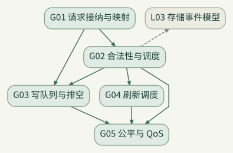

# 内存控制器与请求调度

内存控制器（Memory Controller）连接上游访存请求与 DRAM 接口。它要找到目标存储位置、按器件约束安排命令，并正确返回数据或完成响应。即使使用相同器件，请求的组织方式不同，也可能得到不同的等待时间和吞吐。

## 贯穿算例与阅读边界

沿用 F 专题中一次 Burst 传输 64 B 的教学通道。假定连续地址区间 [0, 64) 和 [64, 128) 位于同一个 Bank 的同一行。若上游请求读取从字节地址 48 开始的 32 B，控制器怎样分配内部请求，并将两处返回的数据拼成一次响应（G01）？

再让多个请求同时排队：保留同行读取 A、B 与异行读取 C，其中 C 比 B 更早到达。控制器要先判断每条候选命令是否满足时序、当前行状态与共享资源约束，再决定先服务哪个请求（G02）。

加入写请求后，什么时候转换数据总线方向，怎样保证相关读取看到正确的值（G03）？即使请求不断到来，控制器又怎样满足刷新期限（G04）？最后区分 CPU 发出的一些短读取和 DMA 持续发出的搬运请求，比较总吞吐、各自等待时间和长期服务机会（G05）。

本专题沿着请求、内部事务、命令与响应之间的关系解释控制器的职责。实际地址映射、命令时序、响应顺序和刷新模式依具体系统而定。F 专题负责 DRAM 器件契约；软件地址翻译、互连协议及系统级建模分别由相关专题展开。

## 知识关系

<figure class="micro-v2-map" markdown="1">

<figcaption>实线表示主要前置知识，虚线表示按需参考；跨专题的主要前置知识见下表。点击可查看大图。</figcaption>

</figure>

## 阅读顺序 {#计划阅读顺序}

本专题规划 5 篇正文。G01 建立请求到响应的路径，G02 先判断命令能否发出，再讨论选择策略。G03 与 G04 分别引入读写切换和刷新义务，可以根据分析目标选读。分析多来源混合负载时，再结合这两篇进入 G05。

| 编号 | 文章 | 读完应理解什么 | 主要前置知识 | 状态 |
| --- | --- | --- | --- | --- |
| G01 | 控制器收到一笔读写请求，怎样找到目标 Bank 并形成内部事务？ | 地址映射、请求拆分、队列、在途状态、响应跟踪 | A01、F03 | 未发布 |
| G02 | 为什么 DRAM 控制器有时优先服务较晚到达的读取请求？ | 命令合法性、资源预约、FCFS、FR-FCFS、行策略 | G01、F04、F05 | 未发布 |
| G03 | 写请求不断积压时，控制器应该什么时候暂停读取？ | Write Buffer、Write Drain、读写切换、顺序与转发 | G01、G02 | 未发布 |
| G04 | 控制器怎样在满足刷新期限的同时，尽量减少对普通访问的影响？ | 刷新调度、提前与推迟、资源竞争 | F01、F05、G02 | 未发布 |
| G05 | 多个请求者共享内存，怎样避免其中一个长期得不到服务？ | 多主设备仲裁、公平性、优先级、QoS、可预测性 | G02–G04 | 未发布 |

## 从哪里来，接下来往哪读

- [存储系统共同基础](../01-foundations/README.md)：理解访问请求、共享资源及接纳与完成。
- [DRAM 单元、阵列与接口](../06-dram/README.md)：了解器件组织、行状态、命令及时序约束。这些知识是控制器命令调度的主要先修内容。
- [地址空间、翻译与保护](../05-address-translation/README.md)：当研究虚拟地址如何到达控制器时，按需回看地址翻译。控制器一侧的资源地址映射，不等同于虚拟页翻译。
- [系统级存储组织与集成](../10-system-integration/README.md)和[性能分析、建模与设计权衡](../12-performance/README.md)：分析多控制器、多通道、性能及仿真模型。
- [芯片与系统互连](../../interconnect/README.md)：了解控制器上游事务的接口及传输机制。

新版正文正在分篇建设，原有算例、调度细节和命令级建模资料可查阅[旧版 DRAM 控制器](../../storage/04-dram-controller/README.md)。

[返回新版存储系统总览](../README.md)
