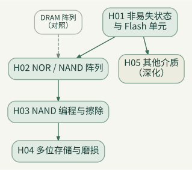

# 非易失性存储介质

设备完全断电后，下次启动仍然需要找到原来的程序和配置。如果还要保存大量模型权重，就需要更大的非易失存储容量。不同介质保存数据的方式不同，读出和修改数据时的限制也不同。

本专题从一个存储单元出发，解释数据怎样保持，怎样通过阵列取出和修改。读写操作的物理约束是后续理解 SSD（固态硬盘）与 HBF（高带宽闪存）的基础。

## 贯穿算例与阅读边界

先观察用于保存启动程序的存储单元，再比较使用 Flash 单元的 NOR 与 NAND 阵列。H01 建立存储状态的认知；H02 从阵列选址解释读出粒度；H03 再改变 NAND 中已经写入的数据。

想象一个 NAND Block（擦除块）中有两个已写入的 Page（页），分别保存 A 和 B。现在只想更新 A。H03 将解释为什么在这个物理位置完成某些修改需要擦除整个 Block。怎样安排新版 A 的存放位置、保证 B 仍可读取，留给下一专题。

H04 深入不同阈值状态及存储密度、保持和磨损的关系。它有助于理解长期维护成本，但理解 NAND 的基本读写和异地更新不要求先掌握多位编码。H05 是独立的深化路线。

这里讨论单元、阵列和介质操作，不展开 SSD 控制器、FTL（闪存转换层）映射与掉电恢复，也不把非易失性直接等同于存储系统的持久化保证。

## 知识关系

<figure class="micro-v2-map" markdown="1">

<figcaption>实线表示主要前置关系，虚线表示按场景参考。前面的知识可沿上游路径取得；未画出的跨专题前置见下表。点击可查看大图。</figcaption>
</figure>

## 阅读顺序 {#计划阅读顺序}

本专题正在重构。理解 Flash 介质的读写约束可以先读 H01–H03，再按需要了解多位存储的代价和其他非易失介质。

| 编号 | 文章 | 读完应理解什么 | 主要前置知识 | 状态 |
| --- | --- | --- | --- | --- |
| H01 | 断开电源以后，芯片怎样仍然记住一份启动程序？ | ROM、OTP、Flash 单元、浮栅、电荷俘获 | 半导体与电路基础；A01 | 未发布 |
| H02 | 为什么 NOR 通常适合直接取指，而 NAND 要先感测一个 Page？ | NOR、NAND 阵列、XIP、Page、Block、Plane | H01、A02 | 未发布 |
| H03 | 为什么 NAND 无法像 SRAM 一样随意覆盖已有的数据？ | NAND 编程、验证、擦除、物理操作约束 | H02 | 未发布 |
| H04 | 一个存储单元保存更多 bit，为什么会更难正确读取数据？ | SLC、MLC、TLC、QLC、保持与磨损 | H01–H03 | 未发布 |
| H05 | 除了电荷，还能利用哪些物理状态保存数据？ | MRAM、ReRAM、PCM、铁电存储等 | A01、H01 | 未发布（深化） |

## 从哪里来，接下来往哪读

主要衔接：[存储系统共同基础](../01-foundations/README.md)、[半导体与电路基础](../../semiconductor-foundations/README.md)。

按需对照：[SRAM 单元与存储宏](../02-sram/README.md)、[DRAM 单元、阵列与接口](../06-dram/README.md)。它们有各自的访问与保持机制，无需先了解其完整控制器实现才能研究 Flash。

理解 NAND 的物理约束后，进入[非易失性存储系统](../09-nonvolatile-storage/README.md)研究 SSD 与 HBF 的设备行为。错误检测与纠正的通用机制见[数据完整性与存储可靠性](../11-reliability/README.md)。

重构期间仍可查阅旧版[SSD 怎样更新 NAND 中的一页](../../storage/05-hbf/02-nand-foundations.md)。更多阅读路线见[存储系统系列首页](../README.md)。
