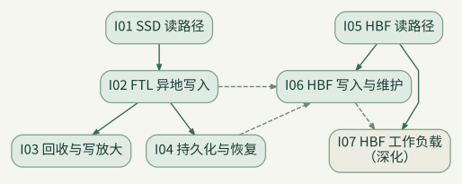

# 非易失性存储系统

要保存和读取大量数据，主机无需知道每个存储单元的位置。以常见的 NAND SSD（固态硬盘）为例，设备通过控制器，将主机请求转换成介质操作，并在多次读取、编程和回收中维护数据的位置。

另一个需求是，让计算芯片能够持续取得大量模型权重。HBF（高带宽闪存）通过不同的接口、并行资源与管理职责，使 NAND 成为靠近计算的数据来源。本专题分别解释 SSD 与 HBF 的请求路径。

## 贯穿算例与阅读边界

SSD 路线延续 H03 的 A、B 两页。I01 先追踪一笔读取，I02 只更新 A 并观察逻辑地址所对应的物理位置，I03 再让设备回收原来的 Block。最后 I04 加入写缓存和突然断电的条件，判断哪些版本能够恢复。

HBF 路线追踪独立的权重读取。假设有 16 个主机 Channel，按 4 KiB 条带分配全局地址。I05 追踪从 `0x5000` 开始的 4 KiB 读取，观察请求如何到达 Channel 5，并继续进入内部存储资源。这是沿用旧版材料的教学映射，不是产品地址布局。

I06 回到 A、B 两页，比较在不同的管理职责下怎样保证有效数据不丢失。I07 再分析多个权重读取实际得到的带宽。HBF 的具体接口和地址约束需结合所用规范版本及产品条件理解。

SSD 和 HBF 是并列的阅读路线。HBF 的读取不要求先读完 SSD；比较写入与维护责任时，可参考 SSD 路线。这里不展开 PCIe 等链路协议及文件系统事务的内部实现。

## 知识关系

<figure class="micro-v2-map" markdown="1">

<figcaption>普通 SSD 和 HBF 各有一条从读取开始的路线。实线表示主要前置关系，虚线表示按场景参考；未画出的跨专题前置见下表。点击可查看大图。</figcaption>
</figure>

## 阅读顺序 {#计划阅读顺序}

本专题正在重构。关注 SSD，可以先读 I01–I04；关注 HBF，可以在建立 NAND 介质认知后从 I05 开始，并按问题选择 I06、I07。

| 编号 | 文章 | 读完应理解什么 | 主要前置知识 | 状态 |
| --- | --- | --- | --- | --- |
| I01 | 向 SSD 请求一段数据，设备怎样找到并返回它？ | SSD 结构、LBA、FTL 查找、内部并行、读取路径 | H02 | 未发布 |
| I02 | SSD 更新 A 页，为什么同一个 Block 中的 B 页不会丢失？ | 异地写入、有效页、无效页、FTL 映射更新 | I01、H03 | 未发布 |
| I03 | 主机只写入了 4 KiB，为什么 SSD 实际写入的数据可能更多？ | GC、Wear Leveling、预留空间、TRIM、写放大 | I02；按需 H04 | 未发布 |
| I04 | SSD 已经报告写入完成，突然断电后一定能读到新数据吗？ | 持久化语义、写缓存、元数据、掉电恢复 | I01、I02 | 未发布 |
| I05 | NAND 的单次读取较慢，HBF 怎样向计算芯片提供高带宽？ | HBF 结构、地址映射、读取路径与并行资源 | H02、A03 | 未发布 |
| I06 | HBF 更新一个 NAND Block 时，谁负责保护仍然有效的数据？ | HBF 写入、擦除、管理责任、维护及可靠性 | I05、H03、H04 | 未发布 |
| I07 | 将大模型权重放在 HBF 中，什么时候才能真正用上它的聚合带宽？ | HBF 工作负载、地址分布、读取放大、并发和预测 | I05、L01；按需 I06 | 未发布（深化） |

## 从哪里来，接下来往哪读

主要衔接：[非易失性存储介质](../08-nonvolatile-media/README.md)、[存储系统共同基础](../01-foundations/README.md)。比较 HBF 与 HBM 时，可补充[DRAM 单元、阵列与接口](../06-dram/README.md)。

相关机制见[芯片与系统互连](../../interconnect/README.md)。主机地址翻译、设备地址空间与 FTL 不是同一层映射；了解相关地址机制可读[地址空间、翻译与保护](../05-address-translation/README.md)，但 SSD 和 HBF 基本访问不以完整地址翻译专题为前置。

继续研究数据放置、错误恢复和性能设计，可读[系统级存储组织与集成](../10-system-integration/README.md)、[数据完整性与存储可靠性](../11-reliability/README.md)、[性能分析、建模与设计权衡](../12-performance/README.md)。

重构期间可从旧版[HBF 高带宽闪存](../../storage/05-hbf/README.md)查阅器件结构、一次读取、写入限制及规范资料。更多阅读路线见[存储系统系列首页](../README.md)。
