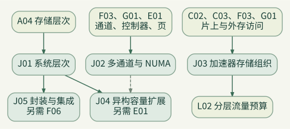

# 系统级存储组织与集成

同一个计算结果可以由不同的存储层次提供数据。怎样组织这些存储资源，要看访问者、工作集、数据复用、响应时限和物理连接，而不能只看存储器的峰值带宽。

## 贯穿算例与阅读边界

J01 先比较 MCU、CPU、GPU 和 NPU 的典型存储层次，观察指令、操作数和中间结果分别由谁保存、谁管理。J02 从主存地址出发，观察增加通道和节点之后请求怎样分布。

J03 沿用[编译器与运行时系统 C02 的矩阵乘法](../../compiler-runtime/03-mapping-and-planning/c02-layout-and-dataflow-planning.md)：2×4 的输入 X 乘以 4×2 的权重 W，得到 2×2 的结果 Y。两个计算单元分别负责一行输出，每个输入元素占用一个字节的存储槽。

假设两个单元都需要 W[0,0]＝3，并支持从共享 SRAM 广播该元素。可以追踪这份权重从外存到共享 SRAM，再到两个单元的路径，同时观察激活和部分和是否留在局部存储。L02 将继续使用这个算例统计各边界的流量与供数需求。

J04 再改变容量和访问位置，讨论统一地址、异构存储与跨设备容量扩展。J05 关注 DIMM、PoP 和 HBM 等物理集成形态对存储系统约束的影响。

本专题主讲存储资源的组织与系统访问路径，不重复器件内部机制、计算单元的执行机制、软件数据放置策略或互连协议。各种处理器的组织是典型例子，不是处理器类别的固定定义。J02 和 J03 可以各自按场景直接进入，不必先掌握所有存储技术。

## 知识关系

<figure class="micro-v2-map" markdown="1">

<figcaption>图中实线表示主要认知前置或后续衔接，虚线表示按场景补充；关联的存储机制按下表选择，不要求完整学习对应专题。点击可查看大图。</figcaption>
</figure>

## 阅读顺序 {#计划阅读顺序}

本专题规划 5 篇正文。下表标题为计划，正文尚未发布。

| 编号 | 文章 | 读完应理解什么 | 主要前置知识 | 状态 |
| --- | --- | --- | --- | --- |
| J01 | 为什么 MCU、CPU、GPU 和 NPU 需要不同的存储层次？ | 四类系统的典型组织及不同需求 | A04；按系统选择相关机制 | 未发布 |
| J02 | 增加内存通道或者处理器后，为什么一个地址不能使用全部带宽？ | 多控制器、多通道、NUMA、本地与远端访问 | F03、G01、E01 | 未发布 |
| J03 | 一份权重在计算芯片的多层存储中，应该放在哪里？ | 私有与共享存储、权重、激活、部分和驻留 | C02、C03、F03、G01 | 未发布 |
| J04 | 内存容量不足时，为什么不能直接把新增容量当成同一种内存？ | 异构内存、统一地址、分层存储、CXL 扩展与池化 | J01、E01；按场景补充 | 未发布 |
| J05 | 为什么采用 HBM、DIMM 或 PoP，会改变整颗芯片的设计约束？ | 封装与集成、互连密度、容量、带宽、散热及成本 | F06、J01 | 未发布 |

## 从哪里来，接下来往哪读

J01 按系统选择相关存储机制。J04 若涉及远端访问，可参考 J02；其 CXL 接口语义由[一致性与内存互连](../../interconnect/COHERENCE/README.md)提供。J05 涉及封装制造时，进一步参考[芯片开发与实现](../../chip-development/process/README.md)。

加速器存储组织与[计算阵列与数据流](../../microarchitecture-v2/04-compute-arrays/README.md)、[资源映射与执行规划](../../compiler-runtime/03-mapping-and-planning/README.md)衔接：这里解释存储资源与访问路径，前者解释硬件怎样消费数据，后者解释软件怎样安排数据放置与任务。

基础机制可查阅[片上显式管理存储](../03-on-chip-storage/README.md)、[地址空间与地址翻译](../05-address-translation/README.md)、[DRAM](../06-dram/README.md)和[内存控制器](../07-memory-controller/README.md)。继续研究各层流量、性能和配置选择，进入[性能分析、建模与设计权衡](../12-performance/README.md)；需要分析错误或可靠性约束时，参考[数据完整性与存储可靠性](../11-reliability/README.md)。

[返回存储系统新版系列总览](../README.md)。
