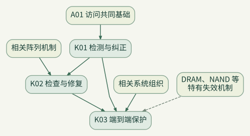

# 数据完整性与存储可靠性

存储器不仅要返回数据，还要帮助系统判断这些数据是否正确。单元故障、保持能力不足、读写维护和传输错误可能影响不同位置的数据。可靠性机制必须说明受保护的对象、保证范围和失败后的处理方式。

## 贯穿算例与阅读边界

先考虑一个 bit 已经改变的受保护数据字。读取时，硬件怎样根据收到的数据和校验信息发现错误？如果编码对这次错误具有纠正能力，读出的值可以恢复正确，但存储阵列中的错误位未必已经被改写。

K01 用这个例子建立检测、纠正及保护粒度的认识。K02 将例子放回真实的存储访问过程，观察部分写入、初始化、后台检查以及测试修复怎样改变数据状态和服务资源。

K03 进一步把一次读取路径拆为器件内部、接口和系统控制器的保护边界。如果有一层报告了不可纠正的错误，就需要明确哪些数据失效、错误如何传播，以及是否存在可供恢复的副本。

本专题横跨各条存储路线。K01 可在共同基础后直接进入；K02、K03 按目标存储资源补齐必要机制，不要求先掌握所有介质。各介质的物理失效原因由其对应专题解释；这里关心检测、纠正、保护边界和恢复。共享副本的协议过程由互连系列负责，完整的制造测试流程也不在这里展开。

## 知识关系

<figure class="micro-v2-map" markdown="1">

<figcaption>图中实线表示主要认知前置或后续衔接，虚线表示按场景补充；关联的存储机制按下表选择，不要求完整学习对应专题。点击可查看大图。</figcaption>
</figure>

## 阅读顺序 {#计划阅读顺序}

本专题规划 3 篇正文。下表标题为计划，正文尚未发布。

| 编号 | 文章 | 读完应理解什么 | 主要前置知识 | 状态 |
| --- | --- | --- | --- | --- |
| K01 | 一个 bit 发生了变化，硬件怎样发现并恢复原来的数据？ | 错误类型、Parity、ECC、SECDED | A01 | 未发布 |
| K02 | ECC 已经纠正了读出的数据，为什么还需要检查和修复存储器？ | ECC 读改写、Scrubbing、初始化、MBIST、冗余修复 | K01、相关阵列机制 | 未发布 |
| K03 | 存储系统报告了错误，怎样确定哪些数据仍然可以使用？ | 多层保护、故障域、错误上报、隔离与恢复 | K01、K02、相关系统组织 | 未发布 |

## 从哪里来，接下来往哪读

理解 K02 时，可根据目标查看[SRAM 单元与存储宏](../02-sram/README.md)的读写机制、[DRAM](../06-dram/README.md)的刷新机制和[非易失性存储介质](../08-nonvolatile-media/README.md)的保持与磨损机制。

K03 根据错误出现的位置补充[系统级存储组织与集成](../10-system-integration/README.md)或[非易失性存储系统](../09-nonvolatile-storage/README.md)中的持久化语义。涉及链路错误、共享数据副本和设备容量退出时，参考[一致性与内存互连](../../interconnect/COHERENCE/README.md)。

测试和修复的实现约束可联系[芯片开发与实现](../../chip-development/process/README.md)。若要分析维护操作、冗余容量和故障处理对性能的影响，可进入[性能分析、建模与设计权衡](../12-performance/README.md)。无故障条件下的普通性能分析不要求先读完本专题。

[返回存储系统新版系列总览](../README.md)。
