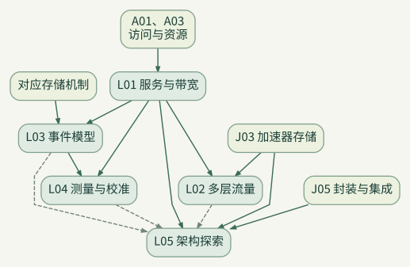

# 性能分析、建模与设计权衡

存储容量足够、峰值带宽很高，仍不能保证计算单元按时获得数据。要理解真正的限制，需要追踪请求何时到达、占用哪个资源、何时完成，并比较各层实际搬运的数据量。

## 贯穿算例与阅读边界

L01 和 L03 沿用一个小型教学存储器。假设它有两个 Bank，每个 Bank 每拍能接纳一笔读取，下一拍返回结果；两个 Bank 能独立工作，返回路径没有额外冲突。

同一时刻到达四笔读请求，若它们全部访问 Bank 0，就要在该 Bank 依次服务；如果平均分布在两个 Bank，则可以并行使用两个资源。在 L03 中将记录 Bank 的服务状态、等待请求和完成事件，再按问题增加约束。

L02 延续 J03 的小矩阵算例：2×4 的 X 乘以 4×2 的 W，两个计算单元分别负责一行输出。比较在局部缓冲中保留激活、在共享 SRAM 中保存权重、在累加器中保存部分和等安排，分别统计外存到 SRAM、SRAM 到计算单元的实际传输量。具体分配和映射条件与 J03 一致。

L04 用测量和地址轨迹检验模型。L05 结合 J03 的加速器存储组织与 J05 的集成约束，比较容量、带宽、能耗和成本不同的配置，形成架构探索所需的输入、约束和可验证结果。

本专题是横切阅读路线。L01 在共同基础后即可进入，L03、L04 按被分析的存储机制补充知识。L05 只汇合本次方案需要的分析方法与模型，不以掌握所有介质为前提。条件估算、教学模拟和真实硬件测量均需明确边界。

计算微架构 H 专题解释计算任务的时间及设计权衡；编译与运行时系统 K 专题解释软件执行和推理服务的测量与验证。这里主讲存储资源的服务能力、约束、实际流量、模型状态与校准，不重复其他系列的分析对象或工具实现。

## 知识关系

<figure class="micro-v2-map" markdown="1">

<figcaption>图中实线表示主要认知前置或后续衔接，虚线表示按场景补充；关联的存储机制按下表选择，不要求完整学习对应专题。点击可查看大图。</figcaption>
</figure>

## 阅读顺序 {#计划阅读顺序}

本专题规划 5 篇正文。下表标题为计划，正文尚未发布。

| 编号 | 文章 | 读完应理解什么 | 主要前置知识 | 状态 |
| --- | --- | --- | --- | --- |
| L01 | 两块存储器的峰值带宽相同，为什么处理同一批请求的时间不同？ | 延迟、带宽、并发、排队、有效带宽、尾延迟 | A01、A03 | 未发布 |
| L02 | 计算单元使用了多少字节，各层存储就需要搬运多少字节吗？ | 数据复用、传输粒度、多层实际流量、供数预算 | L01、J03 | 未发布 |
| L03 | 怎样把一笔存储访问变成可预测其完成时间的模型？ | 资源状态、事件、队列、时序约束、建模精度 | L01、对应存储机制 | 未发布 |
| L04 | 模型预测与真实硬件存在差距，应该怎样定位和校准？ | Microbenchmark、Trace、性能计数器、模型验证 | L01、L03 | 未发布 |
| L05 | 扩大 SRAM、增加内存通道，还是换用 HBM，怎样选择更好的方案？ | 容量与带宽预算、能耗、成本、架构探索、Pareto | J03、J05、L01–L04 必要知识 | 未发布 |

## 从哪里来，接下来往哪读

L02 衔接[系统级存储组织与集成](../10-system-integration/README.md)中的加速器案例。L03、L04 可选择任意一个相关资源：例如[SRAM 单元与存储宏](../02-sram/README.md)的 Bank、[Cache](../04-cache/README.md)的填充与在途请求，或[内存控制器](../07-memory-controller/README.md)的命令与资源约束。若分析维护流量或故障情况下的行为，再参考[数据完整性与存储可靠性](../11-reliability/README.md)。

L05 从实际候选方案出发，记录资源能力、连接拓扑、请求及状态变化、约束和观测边界。这些信息既能用于手算，也可转成 archax 等架构探索框架的模型输入；模型预测仍需核对器件参数和测量结果。

[计算微架构的性能分析与设计权衡](../../microarchitecture-v2/08-performance/README.md)与[编译器及运行时的性能分析、建模与验证](../../compiler-runtime/11-performance/README.md)解释其他观察层次的性能方法。旧版[存储系统架构建模模板](../../storage/reading-and-reference/02-reference/memory-modeling-template.md)仍可作为参考。

[返回存储系统新版系列总览](../README.md)。
