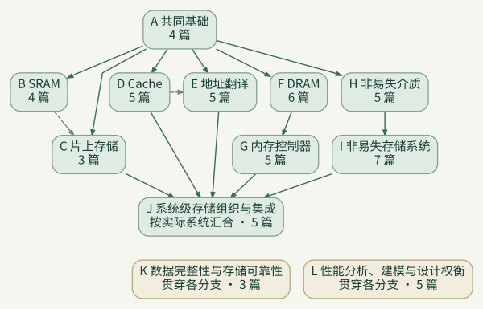

# 存储系统（新版）

存储系统为计算单元保存数据，并在需要时提供正确的数据。一次读取需要找出目标位置，取得数据，再将它交给请求者。不同介质、资源组织、访问方式和数据管理机制，会改变这一过程所需的时间、带宽和成本。

假设处理器要读数组中两个相邻的整数。为什么第一次可能需要从外存取回一整块数据，第二次却能从附近的缓存得到结果？如果改用显式管理的片上存储，数据又该怎样提前到达？

## 从共同基础进入不同存储机制

先建立数据、地址、访问请求、资源和存储层次的共同认知。再按问题选择阅读 SRAM、Cache、DRAM、地址翻译或非易失性存储等分支。器件路线可以从[半导体与电路基础](../semiconductor-foundations/README.md)中补充 MOS 管、电容、反馈与采样知识。

系统级组织将相关机制组合起来，解释 MCU、CPU、GPU 和 NPU 的不同需求。可靠性与性能分析贯穿这些路线，不要求在开始之前读完所有存储机制。

## 十二个专题的知识关系

<figure class="micro-v2-map micro-v2-map-wide" markdown="1">

<figcaption>实线表示主要认知衔接，虚线表示按问题补充。系统级组织按场景选择前置；不需要完整掌握所有分支。K、L 为贯穿各路线的分析专题。点击可查看大图。</figcaption>

</figure>

初版规划 **57 篇正文**，其中 54 篇常规、3 篇深化阅读。现在开放的是系列和专题导读；未发布的条目是阅读计划，不是已完成文章。实际编写时可随知识密度调整篇数。

| 专题 | 核心问题 | 建议先了解 | 规划篇数 |
| --- | --- | --- | ---: |
| A · [存储系统共同基础](01-foundations/README.md) | 怎样描述存储状态、寻址、请求和共享资源？ | 基本数字表示 | 4 |
| B · [SRAM 单元与存储宏](02-sram/README.md) | SRAM 怎样保持、读写数据并向系统提供访问能力？ | MOS 管、反馈、A 中的逻辑阵列 | 4 |
| C · [片上存储组织与显式管理](03-on-chip-storage/README.md) | 寄存器文件、Scratchpad 和 TCM 怎样提供本地存储访问？ | A；物理实现按需 B | 3 |
| D · [Cache 与多级缓存](04-cache/README.md) | 怎样自动查找、填充和管理数据副本？ | A 的地址、局部性与访问契约 | 5 |
| E · [地址空间、翻译与保护](05-address-translation/README.md) | 怎样找到实际地址并限制非法访问？ | A 的地址；Cache 协作按需 D | 5 |
| F · [DRAM 单元、阵列与接口](06-dram/README.md) | 为什么 DRAM 的访问需要开行、列选择、命令和时序？ | 电容、感测与 A 的阵列知识 | 6 |
| G · [内存控制器与请求调度](07-memory-controller/README.md) | 控制器怎样将读写请求转换为合法命令并安排资源？ | A 的请求、F 的接口与时序 | 5 |
| H · [非易失性存储介质](08-nonvolatile-media/README.md) | 如何断电保持数据，以及读、编程、擦除有何限制？ | MOS 管、阈值与 A 的阵列知识 | 5 |
| I · [非易失性存储系统](09-nonvolatile-storage/README.md) | SSD 与 HBF 怎样在介质约束下提供访问和管理数据？ | H 中的 NAND 机制、A | 7 |
| J · [系统级存储组织与集成](10-system-integration/README.md) | 怎样组合不同资源，形成满足计算需求的完整系统？ | 按目标系统选择相关分支 | 5 |
| K · [数据完整性与存储可靠性](11-reliability/README.md) | 怎样发现、纠正、隔离并处理存储错误？ | A；按错误场景补充具体资源 | 3 |
| L · [性能分析、建模与设计权衡](12-performance/README.md) | 怎样预测、测量及比较存储资源与系统的性能？ | A；按被测对象选择机制 | 5 |

## 按学习目标选择

- **理解 SRAM 与片上存储**：A → B、C 中所需的路径。
- **理解 CPU 存储系统**：A → D、E 两条分支 → F、G → J 中的 CPU/NUMA 场景；共享访问按需了解一致性。
- **理解 GPU 或 NPU 存储系统**：A → B、C → 相关外存接口与控制器 → J03、L。GPU 的缓存与地址翻译按需补充；显式管理的 NPU 不要求先学完整的 Cache 和 MMU。
- **理解 SSD 与 HBF**：A → H → I 的 SSD 或 HBF 分支；跨介质选型时补充 F、J、L。
- **架构设计与建模**：从已理解的存储资源出发，随时进入 K、L，再依据目标系统分析供数、容量与成本。

## 与相邻系列的分工

[计算微架构](../microarchitecture-v2/README.md)负责指令执行、数据搬运与计算资源协作；[芯片与系统互连](../interconnect/README.md)负责事务传输、路由、流控及详细一致性协议；[编译器与运行时系统](../compiler-runtime/README.md)负责数据放置、缓冲分配与软件执行计划。本系列负责存储介质、资源组织和硬件访问服务本身。

[芯片开发与实现](../chip-development/process/README.md)讲工艺、封装和测试流程，本系列只解释这些技术条件怎样影响存储行为与系统取舍。

## 版本说明

新版独立建设，原版[存储系统资料](../storage/README.md)仍可正常阅读，旧版源码、公开路径与锚点保持不变。重构期间不删除旧资料，待新版稳定后再讨论归档和兼容方案。

完整知识域、文章基线、旧内容迁移清单及协作约定见[重构计划书（仓库）](https://github.com/microarch-flow/wiki/blob/main/docs/storage-v2-plan.md)。
