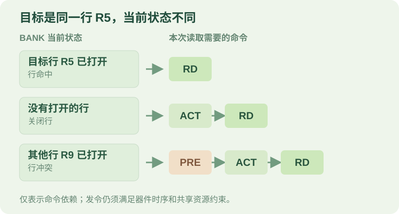
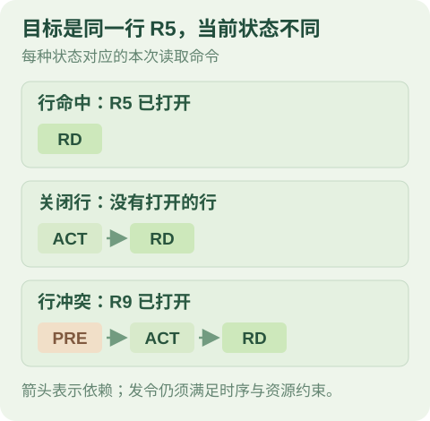

# 为什么存储系统难设计？从一次读取看跨层约束

上级：[系统视角](./README.md)

相关：[速度、容量、成本、功耗四角矛盾的根源](./memory-hierarchy-tension.md) · [把 register、cache、scratchpad、DRAM、HBM 看作一个系统](memory-hierarchy-as-system.md)

一次读取看起来只是“给地址、取数据”。在实际系统中，它可能要经过 cache 查找、互连、控制器排队、DRAM 访问和数据返回。每一层都有自己的状态与共享资源，工作负载又决定了这些资源何时发生竞争。

存储系统的难点，是让**容量、延迟、带宽、功耗和成本**在具体工作负载下同时满足目标。本文用一笔读取解释这些约束怎样连接，再说明如何判断瓶颈，以及模型需要保留什么。

“难设计”不意味着所有程序都受存储限制，也不意味着存储系统一定比计算电路更难。瓶颈要结合工作负载、观察边界和测量结果判断。

## 1. 从一次 cache miss 开始

沿用[RAM 概览](../README.md)中的单请求例子：地址翻译已经完成；只有一个 cache 层参与查找，且该层未命中；目标数据位于 DRAM。本例没有其他请求争用，也不涉及脏块写回或一致性处理；完整数据块回填 cache 后，才向处理器响应。单层 cache 未命中的基本路径，也可以参考 [MIT 的存储层次课程](https://ocw.mit.edu/courses/6-004-computation-structures-spring-2017/pages/c14/c14s1/)。

<ol class="ram-event-sequence" aria-label="本例中一次读取的主要阶段">
  <li>cache 未命中</li>
  <li>控制器接收</li>
  <li>DRAM 服务</li>
  <li>数据返回并回填</li>
  <li>处理器收到响应</li>
</ol>

这是一条简化路径，不代表所有系统都只有一级 cache，也不要求所有真实实现都等待完整回填才返回所需数据。一次 miss 也不必然产生一笔独立的 DRAM 请求：其他 cache 可能满足请求，多个 miss 也可能被合并。

现在把处理器发出读取请求到收到响应的时间作为**端到端延迟**。哪怕请求地址相同，延迟也可能不同，因为请求经过的层、当时的资源状态和其他请求都可能不同。

| 观察位置 | 要看什么 | 可能影响什么 |
| --- | --- | --- |
| Cache 与上游请求 | 是否命中、是否有未完成请求、是否需要合并 | 有多少请求继续向下游传递，以及上游能提供多少并发。 |
| 互连与控制器 | 请求何时被接收、队列是否拥挤、地址映射到哪里 | 排队时间，以及哪些请求会竞争同一资源。 |
| DRAM bank | 目标行是否已打开、命令何时合法 | 本次读取需要哪些命令和等待。 |
| 数据通路 | 数据传输是否与其他读写竞争 | 数据何时返回，以及接口的有效带宽。 |
| 工作负载 | 数据是否复用、请求是否相互依赖 | 系统有多少搬运需求，以及能否用并发隐藏一部分等待。 |

这几行不是互不相关的参数表。例如，工作负载产生地址流；地址映射决定这些地址落到哪些 bank 和 row；控制器再根据当前状态与命令约束调度它们。最终观察到的等待，是这些条件共同作用的结果。

## 2. 同一个地址，为什么可能走不同的 DRAM 路径？

假设请求已经到达控制器，映射到同一个 bank 的目标行 R5。先忽略其他请求和 refresh，只比较请求到来时的 bank 行状态。

{.ram-diagram-wide}
{.ram-diagram-mobile}

*图 1：同一 bank 的命令依赖示意。箭头不是时间轴；点击图可查看大图。*

- **行命中（row hit）**：R5 已打开。该请求不需要再次为 R5 发 ACT；待相关条件满足后，可以发 RD。
- **关闭行**：没有打开的行。满足开行条件后，控制器先发 ACT 打开 R5，再在允许时发 RD。
- **行冲突（row conflict）**：其他行 R9 已打开。控制器要先让 R9 满足关行条件并发 PRE，再等到允许开行时打开 R5，最后发 RD。

ACT 表示开行，RD 发起列读取，PRE 关闭当前行并进行预充。图中省略了等待和数据返回：即使是行命中，RD 也要满足相关时序、模式和共享资源约束；发出 RD 后仍要等待数据传输。具体条件以目标协议和器件为准，可继续读 [ACT、RD、WR、PRE](../../03-dram/protocols/commands-act-rd-wr-pre.md)。

这些命令关系可对照 [TI DDR3 控制器手册的第 2.4.3–2.4.5 节](https://www.ti.com/lit/ug/spruhn7c/spruhn7c.pdf)。该手册描述的是具体实现；其中的时序参数不能直接套用到其他器件。

行命中通常省去了**本次请求**的开行或切行操作，但不能只凭“命中”断言整笔请求一定更快。它可能仍在队列中等待，也可能受数据通道、之前的命令或其他请求影响。

## 3. 峰值带宽高，为什么程序仍可能等待？

先区分两个问题：**延迟**是指定起点到终点的一笔请求花了多久；**带宽**是在指定接口和时间窗口内，传输的数据量除以时间长度，例如 B/cycle。两者相关，但不能互相替代。

如果程序必须先拿到某次读取的结果，才能生成下一次读取的地址，那么这是一条依赖链。即使数据通道很宽，在只有少量请求可并行的条件下，程序仍可能主要等待单次访问；此时通道空闲也不一定意味着它需要更高的峰值带宽。

反过来，如果有足够多可并行的请求，多个 bank 可能在满足约束时交错工作。但它们仍可能共享命令或数据通道。增加 bank 数量不自动保证总吞吐随之增加：当共享数据通道已饱和，或请求没有提供足够并发时，收益可能受限。

### 一个带宽上界的例子

假设一个任务由多个相同的数据块（tile）组成。每个 tile 从 DRAM 读取 1,024 B，并完成 4,096 次按同一口径计数的算术操作。假设输出在观察期间保留在片上；观察区间包含这些读取和计算，不计其他流量。DRAM 读取接口峰值为 16 B/cycle，计算单元峰值为 128 op/cycle。

  算术强度 = 4,096 op / 1,024 B = <strong>4 op/B</strong>
  带宽对应的吞吐上界 = 16 B/cycle × 4 op/B = <strong>64 op/cycle</strong>
  计算与带宽两个上界中较小者 = min(128, 64) = <strong>64 op/cycle</strong>

即使读取和计算可以完全重叠，这两个假设上界也不允许平均吞吐超过 64 op/cycle。实际吞吐可能更低，例如请求并发不足、bank 冲突或其他资源受限。这个结果是教学示例的**上界**，不是对任何芯片的实测性能。

这里的算术强度按 **DRAM 读取接口**统计。若在 cache、片上 SRAM 或其他接口统计，经过该边界的数据量可能不同，算术强度也可能不同。比较时需要对齐工作量、操作计数、字节统计、时间窗口和接口方向。[Roofline 原始论文](https://www2.eecs.berkeley.edu/Pubs/TechRpts/2008/Archive/EECS-2008-134.pdf)以缓存后的 DRAM 流量和实测可持续带宽为例；本文则使用接口峰值，得到一个更理想化的上界。

反例：如果保持上述数据需求和带宽上界不变，把计算峰值改为 32 op/cycle，那么在这两个理想上界中，计算侧的 32 更紧。仍需要检查其他约束，才能判断实际系统的瓶颈。

## 4. 为什么不能只改一个参数？

设计时，每个选择都可能改变另一处的需求或代价：

- **增大 cache**：在某些工作负载下可能减少下游流量；它也可能增加面积、能耗或访问路径的设计代价。收益取决于容量、工作集、组织方式和访问模式。
- **增加 bank 或端口**：可能提供更多并行服务机会；若请求集中在少数 bank，或共享通道已经饱和，新增资源未必能充分利用。端口和布线也有实现代价。
- **选择更高带宽的外存**：可能放宽外存接口的吞吐上界，但不自动消除片上互连、控制器、单请求延迟或供数不足等其他限制。容量、功耗与封装成本也要一起比较。
- **选择 cache 或 scratchpad**：cache 通常由硬件管理数据放置；scratchpad 通常由软件、编译器或其他明确机制管理。前者的命中行为、后者的搬运与同步责任不同；scratchpad 也可能受 bank 或端口争用影响。

因此，先明确比较目标和约束，再判断某个改变是否有效。比如，要降低一次依赖读取的响应时间，和要提高大量独立请求的持续吞吐，可能需要观察和优化不同的资源。

## 5. 怎样找到真正的限制？

下面是一种排查顺序。每一步都应先固定工作负载和测量边界：

1. **确认症状**：看端到端响应时间、平均或尾延迟，还是指定接口的有效带宽。窗口内只计需要的有效数据。
2. **检查请求供给**：是否有依赖链、可用并发不足，或 cache 已过滤掉大部分访问。总线空闲可能是下游等待，也可能只是上游没有请求。
3. **检查共享资源**：观察控制器队列、bank 分布、行状态和数据通道利用率；需要时再检查 refresh、读写切换等条件。
4. **改变一个条件并对照**：例如在相同工作量下改变地址映射或并发度，比较延迟和有效带宽，再确认其他资源是否成为新限制。

观测值需要结合定义解释。例如，row-hit 比例变高，不自动证明端到端延迟下降；请求可能在等待调度，数据通道也可能已饱和。不同实现中的计数时点可能不同，比较前要确认指标口径。

## 建模启示

模型应服务于问题，而不是默认把所有电路细节都展开。

如果只做某个固定工作条件下的粗略估算，可以使用校准过的延迟和带宽参数，并说明适用范围。这个模型不能单独解释地址映射、行状态或调度策略改变后的结果。

如果要研究这些变化，至少要考虑下列信息是否影响所问的问题：

| 模型部分 | 输入与状态 | 作用 |
| --- | --- | --- |
| 请求流 | 地址、读写类型、大小、到达时间及必要的依赖关系 | 决定系统收到什么请求，以及何时可以发出下一笔。 |
| 控制器与队列 | 接收规则、容量、地址映射和调度规则 | 决定请求是否等待，以及下一步选择什么操作。 |
| DRAM 与数据通道 | bank 行状态、必要的命令时序和通道占用 | 约束哪些操作何时可发，数据何时可以传输。 |
| 响应与观测 | 请求接收、数据返回和响应可见的时间 | 计算所定义边界内的延迟、带宽及等待分布。 |

一次请求不一定都要发 ACT：它取决于 bank 当时的状态。模型也不能只在入队时判断一次 row hit；如果等待期间状态可能改变，应在相应的调度时点重新判断。需要模拟到什么细节，取决于目标问题；参数应来自目标规格或测量，并注明假设与工作条件。

## 一句话理解

存储系统的表现由**请求需求、路径上的资源能力，以及请求到达时的状态**共同决定。要解释一次等待或一次吞吐下降，先确定观察边界，再沿数据路径查找限制。

## 接下来怎么读？

- [速度·容量·成本·功耗](./memory-hierarchy-tension.md)：继续看存储方案的取舍。
- [局部性与数据搬运](./locality-working-set-data-movement.md)：看访问序列和复用如何影响跨层流量。
- [带宽与延迟](../03-performance/bandwidth-vs-latency-fundamental.md)：进一步区分单次响应与持续吞吐。
- [地址映射](../../04-dram-controller/address-mapping-channel-rank-bank-row-col.md)：看地址怎样影响行局部性和并行机会。
- [命令调度与 FR-FCFS](../../04-dram-controller/command-scheduling-fr-fcfs.md)：看控制器如何在合法候选中选择命令。
