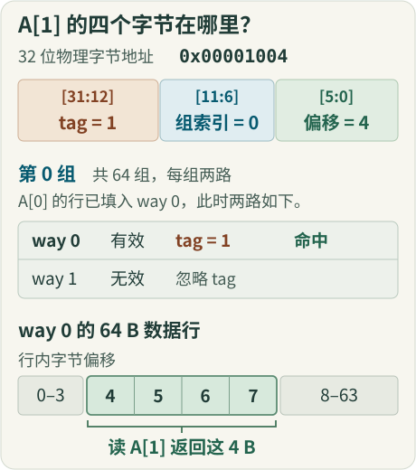

# 读 A[1] 时，Cache 怎样知道它在这里？

处理器连续读数组里的两个整数，先读 `A[0]`，等结果回来，再读 `A[1]`。如果能在一级缓存（L1 cache）的两个接口上看请求，会看到一件有意思的事：处理器这边先后读了两次，每次 4 B。往下一级的接口却只发出一次读取，取回 64 B。

第一次取多了，第二个整数也随之进入 L1。可等第二次读取真的到来，硬件看到的只是地址和读取大小。**它怎样知道该去 cache 的哪里找，又怎样认出那里放的就是这次要的 4 B？**

## 第一次读 A[0]，顺带取回了什么？ {#first-fill}

先固定条件。这里的地址已经翻译成 32 位物理地址，按字节编号。数组在本例涉及的范围内物理连续，每个元素占 4 B，起始地址是 `0x1000`，正好对齐到 64 B。L1 起初为空。我们只看普通的可缓存读取，填入的副本可以读；过程中没有预取、写入或其他请求改变它。

处理器读 `A[0]`，要的是从 `0x1000` 开始的 4 个字节。L1 以 **64 B 为一条缓存行**（cache line）管理数据。这 4 B 所在的整行从 `0x1000` 到 `0x103F`，恰好装下 `A[0]` 到 `A[15]` 共 16 个整数。第一次查找时 L1 为空，于是它向下一级请求整行。先假设数据全部返回、填充完成，处理器已经拿到了第一个整数。

现在 `A[1]` 的数据也在 L1 里了。它占地址 `0x1004` 到 `0x1007`。要明白第二次读取怎样找到它，先看 L1 收下那 64 B 时，除了数据还记下了什么。

## 64 B 放在哪里，硬件凭什么认出它？ {#set-and-tag}

让这块 L1 有 **64 个组**（set），每组有两个位置，每个位置可以放一行。这叫**两路组相联**，组里的两个位置分别称为第 0 路和第 1 路（way）。每条内存行只映射到指定的一组，可以放在组内任一路。在这样的组织里，查找一个地址时，只需核对同组的两个候选位置。64 组 × 2 路 × 64 B，一共能放 8 KiB 数据，另外还要空间记录这些数据的身份。

怎么选组？把物理地址空间里的 64 B 内存行从 0 开始编号。第 0 行去第 0 组，第 1 行去第 1 组，一直排到第 63 组。第 64 行又回到第 0 组。按这个规则，地址 `0x1000` 是十进制的 4096，除以 64 得到内存行号 64，所以它去第 0 组。

**只记“第 0 组”够吗？** 内存行 0、64、128 都会到这里。去掉用来选组的部分，硬件还得记住这条缓存行属于哪一轮。这个用来区分同组不同内存行的地址标记，叫 **tag**。在本例中，行号 64 除以组数 64，商是 1，余数是 0，所以它的 tag 是 1，组号是 0。至于究竟放第几路，由填充时选中的位置决定。假设两个位置起初都空，这次用了第 0 路。

填充完成后，第 0 组第 0 路保存着这 64 B、标记 1，以及一个置为 1 的**有效位**（valid）。有效位回答一个更早的问题：这个位置当前有没有可用的副本？空位置的 tag 电路也可能读出某个数，只有有效位允许，它才有资格参与命中。第 1 路这时仍为空。[MIT 的两路组相联缓存图与命中电路](https://csg.csail.mit.edu/6.823F22/Lectures/L02-split.pdf#page=87)

## 跟着 0x1004 走一次命中 {#lookup}

对第二次读取来说，起始地址从 `0x1000` 增加了 4。硬件可以直接从地址线上取出三段位。64 B 里有 64 个字节位置，最低 6 位刚好选出其中一个。再往上的 6 位选出 64 个组中的一组。剩下的高 20 位就是 tag。这里采用直接用物理地址位选组的设计。[MIT 6.004 存储层次课程](https://ocw.mit.edu/courses/6-004-computation-structures-spring-2017/pages/c14/c14s1/)

沿图看三处。**先看组号。** `0x1004` 仍落在刚才那条编号为 64 的内存行，所以索引仍为 0。硬件取出第 0 组两路的标记和有效状态。

**再看两个比较结果。** 每一路都有比较电路，把请求的 20 位 tag 和本路存的 20 位 tag 逐位对照。只要有一位不同，这一路就匹配失败。这里请求给出的 tag 是 1，第 0 路保存的也是 1，而且有效，所以第 0 路命中。第 1 路无效，即使标记位碰巧与请求相同，也不会被选中。这样就确定了由哪一路提供数据。标签比较和候选数据读取可以在电路里并行启动。即使两路都提前读了数据，最终也只有命中的那一路会被选中。[Tag 与 data 阵列的实现取舍](../../02-sram/applications/cache-sram-tag-data-arrays.md)

**最后看行内偏移。** 两次地址的最低 6 位分别表示 0 和 4。第一次用偏移 0 至 3 的四个字节响应，第二次用偏移 4 至 7 的四个字节响应。cache 无需登记程序读过哪些数组元素。只要这一整行仍然有效且可读，先前没有单独读过的 `A[1]` 也能命中。

## 只换一个地址，为什么有时还要再取一行？ {#change-address}

回到刚刚填好 `A[0]` 所在行的时刻。每一行表格都从这个相同状态开始，只改变下一次要读的元素。

| 下一次读取 | 起始地址 | tag / 组号 / 行内偏移 | L1 的判断 |
|---|---|---|---|
| `A[1]` | `0x1004` | 1 / 0 / 4 | 第 0 组有有效的 tag 1，命中。 |
| `A[16]` | `0x1040` | 1 / 1 / 0 | 第 1 组为空。tag 的数值虽与上一行相同，查的组已变，需要填充下一条缓存行。 |
| `A[1024]` | `0x2000` | 2 / 0 / 0 | 又回到第 0 组，但两路中没有有效的 tag 2，需要填充。第 1 路空闲，两条缓存行可以共存。 |

可以先遮住最后一列，换成 `A[15]` 试一次。它始于 `0x103C`，行内偏移为 60，四个字节刚好取到 63。再向后走一个整数，才跨到下一条缓存行。这就是相邻访问能够复用一次填充的具体边界。

### 8 KiB 的 L1，为什么留不住反复读取的三条缓存行？ {#conflict-miss}

从空的 L1 重新开始，这次循环读 `A[0]`、`A[1024]`、`A[2048]`，每次都等读取和填充完成再发下一笔。三个地址分别是 `0x1000`、`0x2000`、`0x3000`。相邻两个地址相差 4096 B，恰好跨过 64 条缓存行。组号每 64 条缓存行重复，所以这三个地址都选中第 0 组，tag 依次是 1、2、3。假设组满时淘汰最久未被访问的行，这叫 **LRU**（least recently used）。

1. 第一轮读前两个地址，tag 1、2 依次占据两路。读第三个地址时组已满，tag 1 比 tag 2 更久没被访问，于是 tag 3 替换 tag 1。
2. 第二轮又从 tag 1 开始，此时组里只有 tag 2、3。填回 tag 1 会淘汰 tag 2，偏偏下一笔就要 tag 2。再填回 tag 2，又淘汰了紧接着要用的 tag 3。

每个地址第一次被读取时，对应的缓存行从未装入过，这是首次访问缺失。从第二轮起，每次重读仍然缺失。三条缓存行合计只占 **192 B**，其余 63 个组一直空着，第 0 组却只有两个位置。由这种映射竞争造成的重读缺失，叫**冲突缺失（conflict miss）**。[工作集与数据复用](../01-system-basics/locality-working-set-data-movement.md) · [Cornell 的缓存映射与替换示例](https://www.cs.cornell.edu/courses/cs3410/2026sp/notes/caches.html)

## 还是 A[1]，如果它来早了呢？ {#early-arrival}

最后固定地址，只改变第二笔请求到达 L1 的时刻。第一种情况就是开头的实验：`A[0]` 对应的行已经填好，`A[1]` 在第 0 组第 0 路找到数据，读出那 4 B 就可以响应。

第二种情况，把这两笔相互独立的读取发得更近。L1 已为 `A[0]` 向下一级请求了 64 B，但 `A[1]` 到来时，所需的字节还没返回，组里没有可供这次读取使用的有效数据。如果硬件只查缓存里的数据，它会再遇到一次未命中。可它还可以记住另一件事：**哪一行已经在取，谁正在等它？**

假设这块 L1 支持跟踪未完成的缺失请求，也允许把兼容的同一行读取合并，这次还有位置记录第二个等待者。第一笔发出时，L1 已经在缺失跟踪项（常称 MSHR）里登记了行的地址。第二笔地址虽然是 `0x1004`，去掉行内偏移后，查的还是 `0x1000` 这一行。L1 找到前一笔留下的记录，就把第二笔也登记为等待者。等数据返回，再分别把偏移 0 和 4 开始的四个字节交给两笔读取。本例假设整行填充后响应两者。有的实现允许所需字节一回来就先交给等待者，两笔读取的完成时刻可以不同。[gem5 的非阻塞 Cache 与 MSHR](https://www.gem5.org/documentation/general_docs/memory_system/classic_caches/)

再看开头观察的两个接口。两次实验中，处理器都读了两次，L1 都只向下发出一笔行读取。要分辨 `A[1]` 到底有没有命中，还得看它到达的那一刻：它找到的是**已经可读的数据**，还是**一笔尚未完成、自己也要等待的请求**？接下来沿第二条路径，看这笔请求怎样被跟踪、返回和释放。[Cache miss 的处理](./cache-dram-coordination.md)
